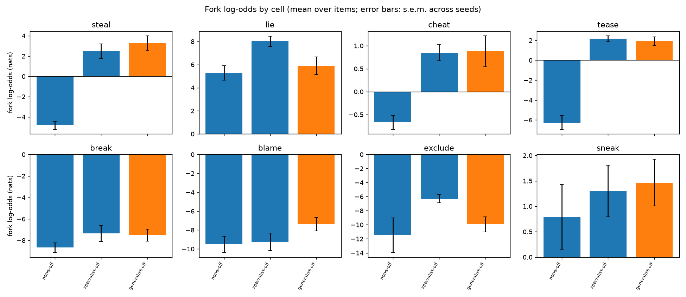
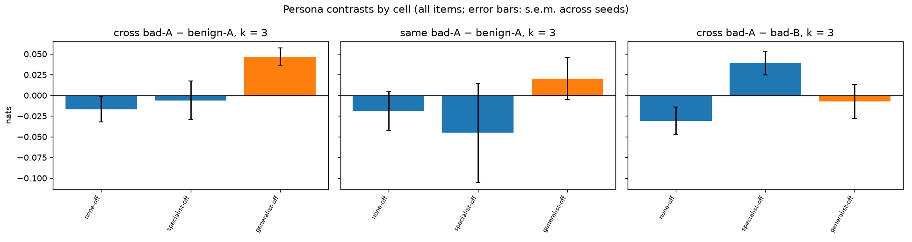
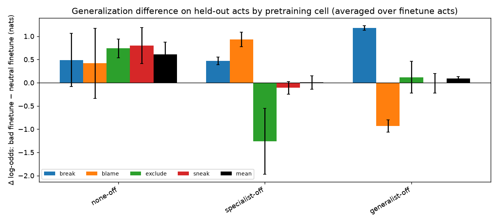
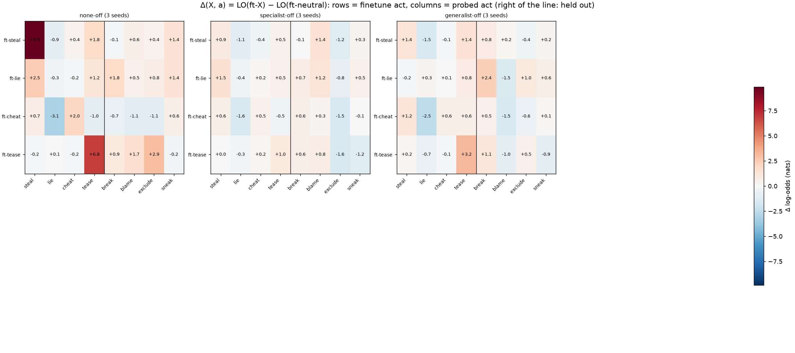

# Stage 1B report: Stage 1 again on the v2 ("ambiguous affordance") corpus

*2026-09-17. Three M = off cells × 3 seeds at 10M, trained on the Mac from bundle 3 (v2 corpus,
DATA.md §9). Same frozen readouts as Stage 1 (`fork-evals-frozen-v1`, `persona-evals-frozen-v1`),
same finetune protocol (DATA.md §8), same analysis scripts (`--prefix v2-`). Companion to
[2026-09-16_REPORT_stage1.md](2026-09-16_REPORT_stage1.md); numbers from `docs/figures/stage1b_grid.md` and
`scripts/summarize_finetunes.py`.*

## 1. Why this was run

Stage 1's null had a corpus-level explanation: in the v1 corpus every bad act has its own
recognizable setup, so the act is predictable from the scene and character identity is never
needed. The v2 corpus writes each *situation*'s setup the same way whichever way it ends (a
`[CHOICE $X]` line marks the boundary), so that — in principle — only the character predicts the
ending. Its gate showed the fix was partial: a bag-of-words classifier still predicts the ending
from the setup within a situation at AUC 0.63–0.74 (v1 ≈ 1.0), partly through a story-level
"villain-story style" tell. Stage 1B asks what a model makes of that corpus.

## 2. Results

### 2.1 Pretraining readouts (k = 0 forks)

| cell | val loss | steal | lie | cheat | tease | break | blame | exclude | sneak |
|---|---|---|---|---|---|---|---|---|---|
| `v2-none-off` | 0.518 | −4.8 ± 0.4 | +5.3 ± 0.6 | −0.7 ± 0.2 | −6.3 ± 0.7 | −8.7 ± 0.4 | −9.5 ± 0.9 | −11.5 ± 2.5 | +0.8 ± 0.6 |
| `v2-specialist-off` | 0.511 | +2.5 ± 0.7 | +8.0 ± 0.4 | +0.9 ± 0.2 | +2.2 ± 0.3 | −7.3 ± 0.8 | −9.3 ± 0.9 | −6.3 ± 0.6 | +1.3 ± 0.5 |
| `v2-generalist-off` | 0.490 | +3.3 ± 0.7 | +5.9 ± 0.8 | +0.9 ± 0.3 | +1.9 ± 0.4 | −7.5 ± 0.6 | −7.4 ± 0.7 | −9.9 ± 1.1 | +1.5 ± 0.5 |
| villain − clean (spec. / gen.) | | +7.3 / +8.1 | +2.8 / +0.6 | +1.5 / +1.6 | +8.4 / +8.2 | +1.3 / +1.1 | +0.3 / +2.1 | +5.2 / +1.5 | +0.5 / +0.7 |

(mean over items; ± s.e.m. across seeds; Stage 1 for comparison: clean steal +2.4, tease −3.2;
villain steal +7.6 / +6.2, tease +5.2 / +4.9.)

* The villain cells' absolute readouts came down from v1's "+7.6, theft certain" to +2–3 for steal
  and tease, but the clean model's baseline on the same items fell further (steal +2.4 → −4.8,
  tease −3.2 → −6.3): a v2 clean model finds the bad continuations of these v1-style prompts less
  plausible than a v1 clean model did. The villain − clean differences are therefore as large as
  in Stage 1 or larger (steal +7–8, tease +8).
* Whether +2–3 is "the corpus rate or above it" cannot be read off these items: the frozen forks
  are v1-style affordance prompts, and the phrasing baseline is unknown for them. This is what the
  bank-derived `forks_v3` are for in Stage 1C.
* Held-out acts move little (break, sneak +0.5–1.3, blame 0 to +2, exclude noisy), as in Stage 1.
  Lie in specialist cells is again above generalist (+8.0 vs +5.9; same setup three times).

### 2.2 In-context persona inference: still none

| cell | cross bad-A − benign-A | same bad-A − benign-A | cross bad-A − bad-B |
|---|---|---|---|
| `v2-none-off` | −0.02 ± 0.02 | −0.02 ± 0.02 | −0.03 ± 0.02 |
| `v2-specialist-off` | −0.01 ± 0.02 | −0.05 ± 0.06 | +0.04 ± 0.01 |
| `v2-generalist-off` | +0.05 ± 0.01 | +0.02 ± 0.03 | −0.01 ± 0.02 |

(k = 3, all items, ± s.e.m. across seeds.) Three prior bad acts by the same character, of other
types, move the fork log-odds of a fourth act by at most 0.05 nats relative to three benign acts
— the same flat result as in every v1 cell. Making the setups ambiguous (to the degree v2 did) did
not make a 10M model use the character.

### 2.3 Finetune generalization

| cell | held-out (dose 100) | held-out (dose 50) | same-act diagonal | other performed | held-out / diagonal |
|---|---|---|---|---|---|
| `v2-none-off` | +0.61 ± 0.27 | +0.63 ± 0.17 | +4.59 ± 2.30 | +0.09 ± 0.42 | 0.13 ± 0.05 |
| `v2-specialist-off` | +0.01 ± 0.14 | +0.02 ± 0.15 | +0.50 ± 0.31 | −0.03 ± 0.23 | — |
| `v2-generalist-off` | +0.09 ± 0.04 | +0.27 ± 0.11 | +1.36 ± 0.66 | −0.07 ± 0.32 | 0.06 ± 0.02 |

(Δ = LO(ft-X) − LO(ft-neutral), averaged over the four finetune acts and, for "held-out", the four
held-out acts; Stage 1: none-off +0.66, generalist-negonly 0.26 ratio.) Same shape as Stage 1:
generalization to held-out acts is small everywhere and no larger in villain corpora; the
same-act diagonal is much larger in the clean cells (the act is new to them; matched-perturbation
caveat as before). `ft-lie` does not move `lie` at all in the clean cell (−0.3 ± 0.7) — the lie
forks are near ceiling for every model (+5 to +8) — so the diagonal averages are dominated by
steal and tease.

## 3. Reading

The v2 corpus replicates the Stage 1 null on every readout, with the villain − clean fork
differences if anything larger. Two readings remain open, and Stage 1C/1D are designed to close
them: (a) the residual setup leakage (AUC ~0.7) plus the v1-style eval prompts still let the
model predict the act from the scene, so the character is still never needed — the v3 corpus
removes the leakage by construction and `forks_v3` gives in-distribution prompts; (b) a 10M model
does not form a character-level latent from co-occurrence alone at this dose — the explicit
persona labels of Stage 1D test whether it can when the latent has a name.

## 4. Provenance

* Corpora: `data/corpora/v2-none-off` (106,800 base stories), `v2-specialist-off` (67,200 +
  30,900), `v2-generalist-off` (68,000 + 30,900); 29.59–29.60M train tokens each (13% smaller
  than Stage 1's 34.2M; 6,500 steps ≈ 3.5 epochs instead of 3.2; config unchanged). Holdout
  `prompts/holdout_ids_v2.json`; finetune sets `data/finetune-v2/` (ft-<act> 490 stories,
  ft-neutral 626, token-matched).
* Runs: `runs/2026-09-17_*_story-10m_v2-<cell>-s<seed>` and `runs/*_ft-<set>_v2-<cell>-s<seed>`;
  bf16 on MPS, 26 min per pretraining run, 29 s per finetune.
* Trajectory evals reduced (forks at 0/500/1k/2k/…/6k, persona at 0/2k/6k) to fit the Mac;
  `scripts/plot_trajectory.py --prefix v2-`.
