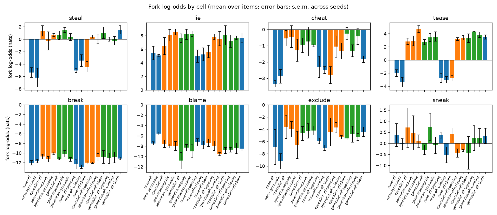
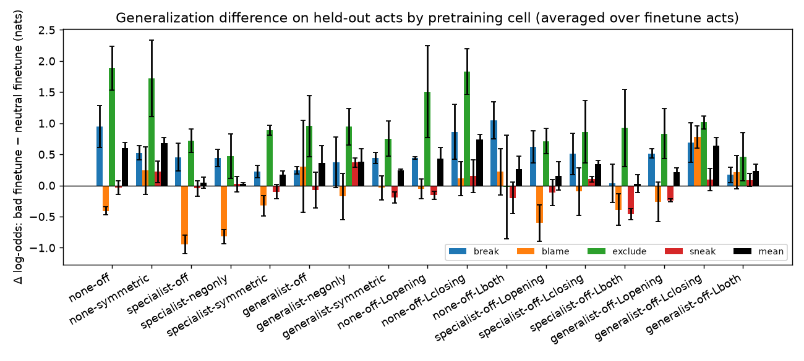
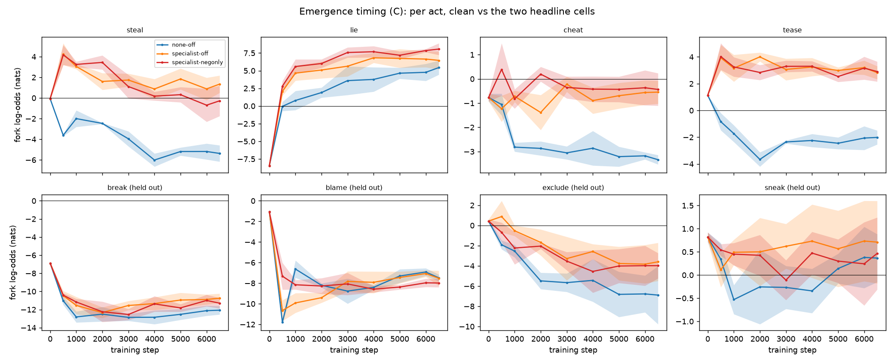

# Stage 1C + 1D report: the leak-free v3 corpus, all 8 cells, and explicit persona labels

*2026-09-18. 51 pretrained 10M models (8 grid cells + 9 label cells, 3 seeds each) on the v3
"ending-blind" corpus (bundle 4, DATA.md §10–§11), 255 finetunes, frozen evals
(`fork-evals-frozen-v1`, `persona-evals-frozen-v1`) plus the new in-distribution readouts
(`forks-v3-frozen-v1`, `scripts/eval_labels.py`). Trained on an 8× RTX 5090 box in 37 min;
the whole pipeline ≈ 2.5 h, ≈ $15. Companion to [2026-09-16_REPORT_stage1.md](2026-09-16_REPORT_stage1.md) and
[2026-09-17_REPORT_stage1b.md](2026-09-17_REPORT_stage1b.md); tables from `docs/figures/stage1c_*.md`.*

## 1. Summary

1. **The corpus fix worked.** Setup-only AUC on bundle 4 is 0.48–0.51 (chance; v2 0.63–0.74, v1
   ≈ 1.0), and on in-distribution prompts (`forks_v3`) a villain model no longer treats a
   temptation scene as "theft certain": steal sits at log-odds −0.6 to −2.6 (P ≈ 0.1–0.35, at or
   below the corpus rate of ~0.47), versus −25 for a clean model.
2. **No in-context persona, for the third corpus in a row** — and now we know why. The frozen
   contrast is flat in all 17 cells (−0.04 to +0.07). Two in-distribution diagnostics on genuine
   v3 stories show that the models build a **story-level** "villain story" variable (after two
   bad acts in a story, P(bad ending) rises by +2 nats for steal and tease in generalist cells;
   label-trained models put P(bad trait) at ≈ 0.2 in villain stories vs ≈ 0.001 in base
   stories) but **never bind it to the character**: the villain and the other child get the
   same predictions (character-level difference 0.00 ± 0.03; fraction villain > other 0.47–0.58),
   even in the closing-label cells, where the training objective literally asks which child was
   naughty.
3. **Finetune generalization, moralizing axis, labels: null as before.** Held-out generalization
   +0.0 to +0.7 nats, largest in the *clean* cells, no M-level or label-level effect beyond noise;
   `ft-steal` does not raise P(bad trait) relative to `ft-neutral`.
4. **Reading.** At 10M parameters / 27M tokens / 6.5k steps, the missing ingredient is *entity
   binding*, not corpus statistics (v3 makes the character the only predictor) and not the
   nameability of the latent (labels). A persona that is not bound to a character cannot carry
   one character's acts to another act, so every persona-mediated prediction was doomed at this
   scale. The natural next experiments are the ones that change binding: model size (Stage 2 on
   the v3 bundle), training length, and a single-protagonist corpus where story-level and
   character-level coincide.

## 2. Corpus

Bundle 4: base 100,000 (94.7% valid), specialist 40,000 (89.8%), generalist 40,000 (89.4%);
two-pass ending-blind generation with a verbatim setup bank (DATA.md §10). Gate (2,000
stories/file): within-situation AUC 0.477 / 0.501 / 0.488 / 0.512. Token-matched grid cells at
26.78–26.80M train tokens (`none-off` 91,600 base; villain cells 48.6–49.9k base + 30,900
villain); label cells story-matched to the M = off cells (28.1–30.1M tokens). Villain stories are
≈ 435 tokens vs 298 for base, so the villain *token* share is ~47% (Stage 1/1B ~33%) at the same
story dose. Val loss: clean 0.43, villain cells 0.38–0.40 (v2: 0.52 / 0.49–0.51 — the verbatim
bank is memorizable); seeds within 0.003.

## 3. Results

### 3.1 k = 0 fork readouts

Frozen v1 forks (prompt log p/token −2.9 to −3.1 on v3 models — these v1-style prompts are near
the freeze rule's −3 limit for v3 models):

| cell | steal | lie | cheat | tease | break | blame | exclude | sneak |
|---|---|---|---|---|---|---|---|---|
| `none-off` | −5.4 ± 0.8 | +5.4 ± 1.0 | −3.3 ± 0.2 | −2.0 ± 0.5 | −12.1 ± 0.5 | −7.5 ± 0.3 | −6.9 ± 2.9 | +0.4 ± 0.5 |
| `specialist-off` | +1.3 ± 0.8 | +6.5 ± 1.3 | −0.6 ± 0.5 | +2.8 ± 0.5 | −10.7 ± 0.5 | −7.5 ± 0.7 | −3.6 ± 1.9 | +0.7 ± 0.9 |
| `generalist-off` | +0.6 ± 0.7 | +7.6 ± 0.6 | −1.0 ± 0.5 | +2.7 ± 0.4 | −11.2 ± 0.2 | −10.8 ± 1.6 | −4.7 ± 1.1 | −0.3 ± 0.2 |
| villain − clean (spec. / gen.) | +6.7 / +6.0 | +1.0 / +2.2 | +2.8 / +2.4 | +4.8 / +4.7 | +1.3 / +0.9 | −0.1 / −3.3 | +3.3 / +2.2 | +0.3 / −0.7 |

`forks_v3` — held-out bank setups, in-distribution (prompt log p/token −1.75):

| cell | steal | lie | cheat | tease |
|---|---|---|---|---|
| `none-off` | −24.7 ± 0.8 | +4.2 ± 1.8 | +0.5 ± 0.4 | −4.1 ± 0.4 |
| `specialist-off` | −0.6 ± 0.9 | +9.5 ± 0.6 | +7.1 ± 1.3 | +2.3 ± 0.8 |
| `specialist-negonly` | −1.1 ± 0.2 | +11.9 ± 0.5 | +7.7 ± 0.9 | +4.2 ± 1.2 |
| `specialist-symmetric` | +0.3 ± 1.4 | +12.3 ± 1.1 | +8.8 ± 1.0 | +3.9 ± 0.5 |
| `generalist-off` | −2.6 ± 0.9 | +11.6 ± 1.6 | +8.6 ± 0.5 | +2.2 ± 0.2 |
| `generalist-negonly` | −1.4 ± 0.1 | +14.0 ± 0.7 | +9.2 ± 1.2 | +2.9 ± 0.7 |
| `generalist-symmetric` | +0.1 ± 1.4 | +13.1 ± 0.6 | +8.8 ± 1.0 | +2.8 ± 1.7 |
| label cells (all) | −1.4 to −2.7 | +10.6 to +13.0 | +7.2 to +8.5 | +2.0 to +2.9 |

* Steal in villain cells is at or below the corpus rate (question 1: yes, the "act certain"
  effect of v1 is gone on a leak-free corpus with in-distribution prompts). The clean model's
  −25 says a clean v3 model has learned that the bank setup is *always* followed by returning
  the thing. Tease (+2 to +4) and cheat (+7 to +9) sit above the rate, but on these hand-written
  minimal pairs the phrasing baseline is unknown (cheat's "twice … to win" vs "once … to win";
  lie's "did not" vs "did" is near ceiling for every model as in v1/v2); the villain − clean
  differences (+24 steal, +6–10 lie, +7–8 cheat, +6–8 tease) are the readout.
* Moralizing level makes no difference to any readout (headline `specialist-negonly` −
  `specialist-off`: steal −1.6 ± 1.7, tease +0.1 ± 0.9); neither do labels.
* Held-out acts move ≤ 1–3 nats and inconsistently (blame goes *down* in generalist cells).

### 3.2 Persona: story-level yes, character-level no

Frozen contrast (k = 3, all items):

| cell | cross bad-A − benign-A | same bad-A − benign-A | cross bad-A − bad-B |
|---|---|---|---|
| grid cells (8) | −0.05 to +0.02 | −0.01 to +0.11 | −0.04 to +0.00 |
| label cells (9) | −0.04 to +0.01 | +0.01 to +0.10 | −0.04 to +0.01 |

Flat, as in v1 and v2. But the frozen stems are v1-style prior scenes, which v3 models find
out-of-distribution, so two in-distribution diagnostics were run on held-out v3 stories
(`scripts/persona_indist.py`; the label one inline):

**(a) Behaviour.** A held-out generalist story is cut just before the villain's third
temptation (the villain has done two bad acts of other types); a held-out bank setup of a
different performed situation is appended with the villain as actor or the other child as
actor, and the `forks_v3` minimal pair is scored; base-story prefixes of the same length give
the story-level baseline. Mean ± s.e.m. across 3 seeds, 240 items per model:

| cell | character (villain − other) | story (villain story − base story) | steal | tease |
|---|---|---|---|---|
| `none-off` | −0.01 ± 0.02 | −1.39 ± 0.17 | −3.3 (story) | +0.2 |
| `generalist-off` | −0.16 ± 0.02 | +0.63 ± 0.40 | char −0.52, story **+2.14 ± 0.29** | char −0.02, story **+2.28 ± 0.20** |
| `generalist-negonly` | −0.16 ± 0.03 | +0.78 ± 0.10 | −0.49, +1.59 | +0.01, +2.03 |
| `generalist-symmetric` | −0.15 ± 0.03 | +0.25 ± 0.24 | −0.56, +0.76 | +0.01, +1.63 |
| `generalist-off-Lclosing` | −0.11 ± 0.01 | +0.21 ± 0.20 | −0.46, +0.69 | +0.03, +1.72 |
| `generalist-off-Lboth` | −0.14 ± 0.03 | +0.23 ± 0.16 | −0.49, +0.81 | +0.01, +1.80 |

Two bad acts *in the story* raise P(bad ending) for a different act by ≈ +2 nats (steal, tease)
in a generalist model; *who* did them makes no difference (character-level 0.00 for lie, cheat,
tease). The one nonzero character-level number, steal −0.5 in every generalist cell, has the
wrong sign for a persona and is most likely an artifact of the bank's ownership phrasing (the
unattended-thing setup names the *owner* first).

**(b) Labels.** For closing-label models, a held-out closing frame is appended to a held-out
v3 story where its label would go, for each child:

| model | villain stories: villain / other child | base stories | villain > other |
|---|---|---|---|
| `specialist-off-Lclosing-s0` | −1.37 / −1.39 | −6.5 | 0.53 |
| `generalist-off-Lclosing-s1` | −2.19 / −2.19 | −9.4 | 0.50 |
| `generalist-off-Lboth-s0` | +0.83 / +0.82 | −5.9 | 0.55 |

The label-trained model knows it is in a villain story (5–10 nats) and has no idea which child
is the villain. The same is visible in the label probes on the frozen items (`stage1c_labels.md`):
k = 0 baselines ≈ 0 in villain label cells (a temptation scene is 50/50 a villain's), −16 to
−18 in clean label cells, and bad-A − benign-A flat everywhere.

### 3.3 Finetune generalization

| cell | held-out Δ (dose 100) | same-act diagonal | held-out / diagonal |
|---|---|---|---|
| `none-off` / `none-symmetric` | +0.60 ± 0.09 / +0.68 ± 0.09 | +5.3 / +5.9 | 0.12 |
| `specialist-off` / `-negonly` / `-symmetric` | +0.05 / +0.03 / +0.17 | +0.8 / +1.0 / +1.2 | 0.03–0.16 |
| `generalist-off` / `-negonly` / `-symmetric` | +0.36 ± 0.28 / +0.38 ± 0.21 / +0.24 ± 0.02 | +0.7 / +0.9 / +1.2 | 0.2–0.7 |
| label cells | +0.03 to +0.74 | +0.7 to +5.3 | — |

Same shape as Stage 1 and 1B: small everywhere, clean cells largest in absolute terms (their
diagonal is huge because the act is new), generalist a little above specialist (matched-
perturbation caveat as before: the villain models are barely perturbed by `ft-steal`). Headline
`specialist-negonly` − `specialist-off`: −0.02 ± 0.09. `ft-steal` − `ft-neutral` on P(bad
trait): −0.6 to +0.4 across label cells, no consistent sign.

### 3.4 Label-conditioned behaviour

A held-out opening frame with a bad vs good trait prefixed to the frozen fork prompts moves the
fork log-odds by +0.02 to +0.18 overall; the largest per-act effects are in
`generalist-off-Lopening` (steal +0.55 ± 0.10, tease +0.43 ± 0.16) and `specialist-off-Lopening`
(tease +0.58 ± 0.16); ≈ 0 in closing-label cells, where labels never precede acts in training.
So a stated trait *does* condition behaviour a little where the corpus lets it — but only via a
sentence the model reads, not via a variable it infers.

### 3.5 Emergence timing

Coarse trajectory evals (0, 500, 1k … 6k, frozen forks). As in Stage 1/1B the villain − clean
separation is there at the first checkpoint (step 500, ~8% of training). New in v3: the villain
cells' steal readout *overshoots* at step 500 (+4) and then decays over training toward the
corpus rate (+1 to 0 by step 6k) while the clean cell drifts to −5 — the model first learns
"temptation → bad" and then calibrates to the ~47% marginal, exactly what a leak-free corpus
should produce. Persona contrasts are flat at every probed step (`figures/stage1c_traj_persona.png`).

## 4. What this means, and what next

The three corpora removed, in turn, the scene's ability to predict the act (v1 → v2 → v3) and
then gave the persona a name (1D). None of it produced a character-bound persona in a 10M model,
and the diagnostics locate the failure precisely: the model represents "this story contains
bad acts" (and uses it — +2 nats on other acts, correct label rates) but not "this child does
bad acts". Every readout that depends on the latter (cross-type persona curve, persona-mediated
finetune generalization, act → label inference) is therefore null for a structural reason, not a
statistical one. Three follow-ups are direct:

1. **Scale** (Stage 2 on the v3 bundle): entity binding is exactly the kind of capability that
   appears with size; `persona_indist.py` and the closing-label probe give a clean, cheap yes/no
   per model size (30M, 100M).
2. **Training length / data**: 6.5k steps ≈ 3.5 epochs; binding may need more.
3. **A single-protagonist variant** (assembly-time: keep only one child's scenes, or a corpus
   with one child per story): story-level = character-level, so the persona machinery can be
   tested without binding — closer, arguably, to how "persona" works for a document-level
   language model anyway.

## 5. Provenance

* Bundle 4 (`data/raw/*/bundle4-maas.jsonl`, commits 72ad6c6 / a08f278); holdout
  `prompts/holdout_ids_v3.json`; corpora `data/corpora/v3-*` (`scripts/prep_stage1c.sh`,
  `token_match.py`); finetune sets `data/finetune-v3/`.
* Runs `runs/2026-09-18_2*_story-10m_v3-<cell>-s<seed>` and `*_ft-<set>_v3-…`, trained on
  vast.ai instance 51483260 (8× RTX 5090, `scripts/run_stage1c.sh`, commit 4ca891c), 30
  steps/s per GPU. Final pretrained checkpoints and all eval files pulled (`scripts/pull_box.sh`);
  intermediate and finetune checkpoints left on the box (regenerable: 6 min for the finetunes).
* Frozen items unchanged (`fork-evals-frozen-v1`, `persona-evals-frozen-v1`,
  `forks-v3-frozen-v1`); forks_v3 calibration on `v3-none-off` recorded in its header.
