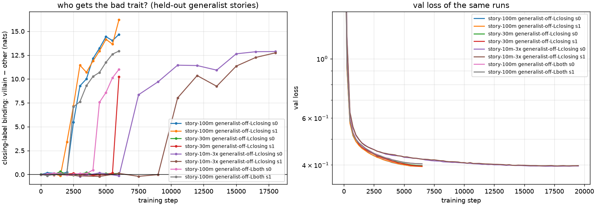
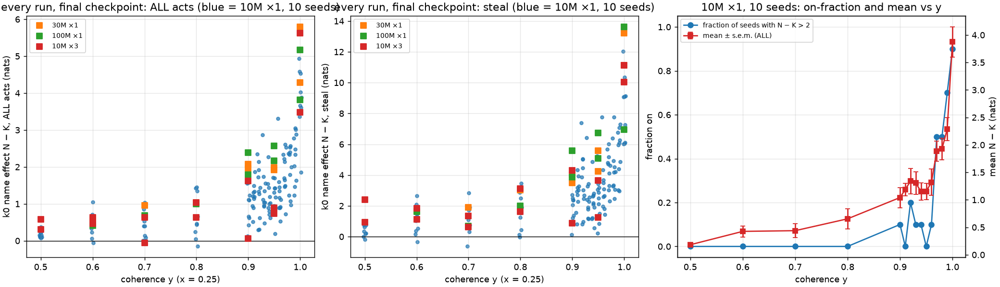
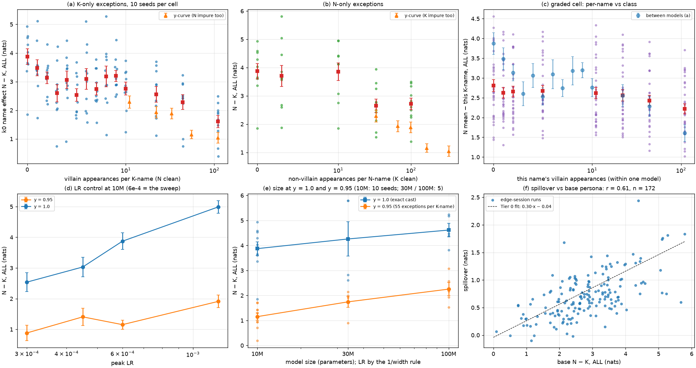
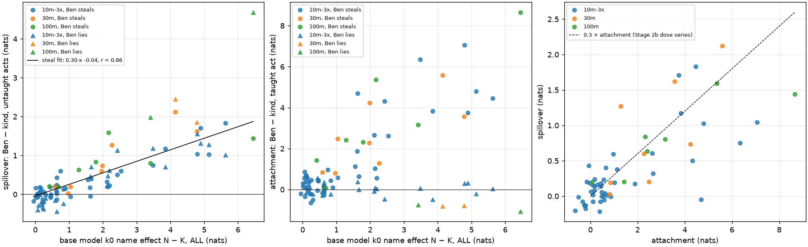
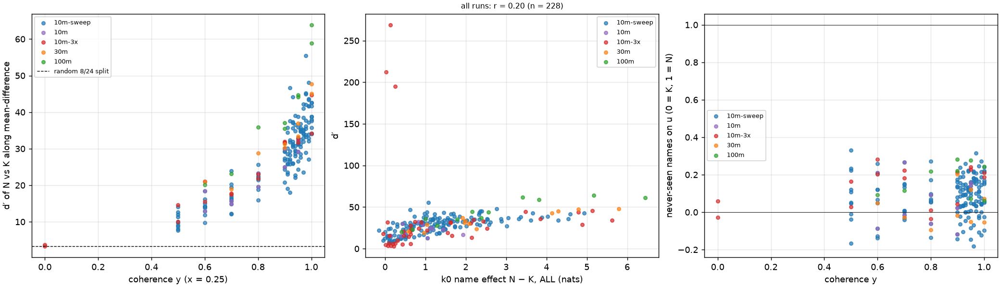
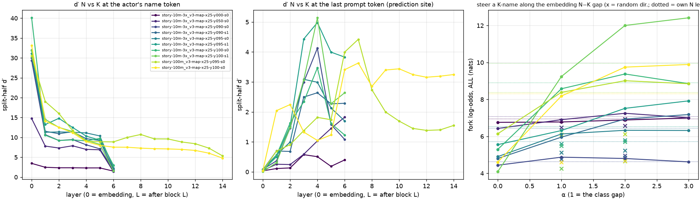
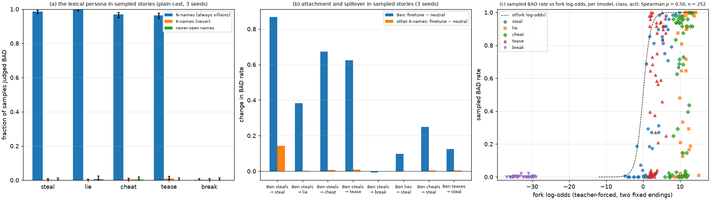

# Dramatis, from first principles: what we built, what we found, and how to finish

*2026-09-20, written through the day and finished after the clean-edge session and the steering
test. A step-back summary for deciding how to close the project. The stage reports
(the three Stage 1 reports, `2026-09-19_REPORT_stage2a.md`, `2026-09-19_REPORT_stage2b.md`, `2026-09-19_REPORT_cast_map.md`,
`2026-09-19_REPORT_sym.md`, `2026-09-20_REPORT_mechanism.md`) hold the full tables and provenance; this document is the
argument. Numbers are in nats (natural-log odds) unless stated.*

## 1. The question

Emergent misalignment (EM) is the observation that finetuning a large language model on one
narrow bad behaviour — writing insecure code, say — makes it broadly bad in unrelated ways. The
persona-selection account says why: pretraining builds a population of characters (personas) from
the text, post-training selects which one speaks as "the assistant", and a narrow bad finetune
does not teach a behaviour so much as *select a persona* that already has the whole package.

That account makes a prediction we can test in miniature: **narrow-to-broad generalization needs
the pretraining corpus to contain coherent bad characters, and what it generalizes *to* is
whatever those characters did in pretraining.** Dramatis builds language models small enough to
train by the hundred, on corpora we write ourselves so that we control exactly which characters
exist and what they do, and asks whether the prediction holds.

## 2. The apparatus

**The corpus.** Children's stories, each generated by an open-weights LLM (Gemma 4) from a
specification: two named children, an adult who warns against a bad act, and three "temptation"
scenes in which a child either takes a bad path (steal, lie, cheat, tease) or a benign one. A
*villain story* has one villain who takes the bad path each time; a *base story* has none. Names
are substituted at assembly time from a fixed pool, so the same story can be told with any names.
Two design details matter for everything after. First, the temptation *setup* is written before
the ending is chosen, from a verbatim bank, so nothing in the setup leaks the ending (the first
corpus leaked, and every "persona" reading in it was really the model reading the scene). Second,
a set of names is held out of every corpus, so a model can be probed with names it has never
seen. Corpora are 24–34 million tokens; models are GPT-2-style transformers of 10M, 30M and 100M
parameters trained for about four epochs (three sizes, hundreds of seeds in total).

**The basic readout: fork log-odds.** Every behavioural measurement is teacher-forced on frozen
*minimal pairs*: a temptation setup followed by either its bad ending or its benign ending, the
two endings matched in structure and length. The readout is log P(bad ending) − log P(benign
ending). It is computed on held-out setups, was calibrated on a clean model before any villain
model existed, and never changes, so any difference between models is the models. Everything
below is a difference of such log-odds between two conditions.

**Four measurements built from it.**

1. *The in-context persona.* Cut a held-out villain story after the villain has done k bad acts,
   append a fresh temptation with the villain as actor or with the other child as actor, and
   compare. A model that infers "this child is bad from what it has done" gives a positive
   *character effect* (villain minus other) that grows with k. A model that only notices "this is
   a villain story" raises both children equally (a *story effect*).
2. *The name effect.* Give the model a bare setup with no story at all and vary only the actor's
   name: names from the set that is always villainous in the corpus (N-names) against names that
   never are (K-names). N − K measures a disposition attached to the name token itself. Controls:
   held-out names, and a naughty name as the *bystander* rather than the actor.
3. *Label binding.* Some corpora end each story with an explicit label ("Dan was a naughty
   child"). Cut a held-out story where the label would go, offer the label frame for each child,
   and score log P(bad trait) − log P(good trait): does the model know *who* was naughty?
4. *The finetune test (the EM analogue).* Continue training a pretrained model for 100 steps on
   490 stories in which one kind-named child, Ben, always steals; do the same with a neutral set
   of base stories; subtract. The finetune's *attachment* is how much more Ben's steal log-odds
   rise than other kind names'; its *spillover* is how much more Ben's lie / cheat / tease rise
   than other kind names'. Spillover is narrow-to-broad generalization through the character.

5. *The direction test (mechanism).* Inside the model every token is a list of a few hundred
   numbers (its embedding), and so is the model's state at every position of the text at every
   layer. Average the N-names' embeddings, average the K-names', and the arrow from the second
   to the first is a *direction*: an axis along which the two classes differ. Two questions can
   then be asked without training anything. *Where is the class?* — measure how far apart
   N-actor and K-actor prompts are along that axis (d′, the gap in units of the spread; the
   axis is fitted on half the setups and measured on the other half so nothing is
   overfitted), at the name token and at the last token of the prompt, which is the position the
   model predicts the ending from, layer by layer. *Is the axis what the model reads?* — take a
   K-name, add the arrow to its embedding on the fly (α = 1 moves it to where N-names sit on that
   axis and changes nothing else), and see whether the fork log-odds follow; a random arrow of
   the same length is the control, and subtracting the arrow from an N-name is the reverse test.
   This is a persona-vector experiment with a known ground truth.

**Two knobs on the corpus.** The *cast* assigns names to roles: villains from a small N set,
everyone else from a K set (a persistent cast makes a name a corpus-wide fact). The *coherence* y
of a cast is how concentrated villainy is in the N-names: at y = 1 an N-name is always the
villain and a K-name never; at y = 0.99 each K-name is the villain in about eleven of its 4,400
appearances and each N-name a non-villain in about thirty-three; at y = 0 names are
uninformative. Two terms for the models this produces: an **exact-cast model** is one trained
at y = 1 (the partition is exact), a **model trained with exceptions** is one trained at y < 1.
("Clean" keeps its Stage 1 meaning throughout: a corpus with no bad acts at all, the `none`
cells.) The clean-edge cells go further and fix the number of exceptions per name exactly.

## 3. What we found

### 3.1 Small models do not infer characters from their acts — they read the story

Three corpus generations, explicit labels, sizes to 100M and schedules to 12 epochs gave the same
null for measurement 1: the character effect is 0.0 ± 0.3 everywhere. What the models learn
instead is a story-level variable: two bad acts in a story raise the odds of a bad ending for
*either* child by one to two nats. And the finetune test was null in the same corpora: teaching
steal moved steal and essentially nothing else, in clean and villain corpora alike.

The explanation came from the labels. When a corpus *forces* acts-to-name binding — the closing
label can only be predicted by knowing who did what — the binding appears, as a step: nothing for
thousands of steps, then within one checkpoint interval the model goes from chance to perfect,
with a seed-dependent onset that comes earlier in bigger models and leaves no trace in the
validation loss. And the bound label is *not used* for behaviour: a 100M model that knows exactly
who was naughty still puts both children at the same odds on the next temptation. In these
corpora "who" predicts the label and nothing else; the story-level cue already explains the
endings, and a circuit that adds nothing to the loss is not built. Give the model a shortcut
(a cast plus labels) and the step never happens.

*Figure 1. Label binding over training. (a) the story-level fact is learned early and smoothly;
(b) who-was-naughty is zero, then jumps within one checkpoint interval, earlier at 100M (green)
than at 30M and 10M; (c) validation loss shows nothing at the transition.*

### 3.2 A persistent cast gives a persona, and the persona carries the finetune

Make the name informative — N-names always villains, K-names never — and a 10M model learns a
disposition attached to the name token (measurement 2): with no story at all, an N-named actor
is +3.7 nats more likely to take the bad path than a K-named one, a held-out name behaves like a
K-name, and an N-name as *bystander* does nothing. It is the name, not the acts: inside a story,
a villain who has done two bad acts is +2.8 above the other child when N-named and +0.1 when
K-named, and an N-name dropped into a base story with no bad acts is +3.6.

Now the finetune test (measurement 4) is positive, and in exactly the way the persona account
predicts:

| "Ben steals", 490 stories, 100 steps; minus the neutral finetune | 10M×3, 3 seeds |
|---|---|
| Ben's steal rises | +6.3 |
| other kind names' steal rises | +2.3 (so attachment +4.0) |
| Ben's lie / cheat / tease rise over other kind names (spillover) | **+1.2 ± 0.3** |
| same finetune on an unnamed-corpus model, or on the clean cast twin | 0.0 |
| spillover as a fraction of the trained effect, doses 25 … 400 steps | 0.26 … 0.32 |
| after 100 clean steps | spillover +1.1 → +0.6 |
| cast in which each N-name does only one kind of bad act | spillover **+0.14** |

The last row is the founding hypothesis tested directly: when the villainous names each
co-occurred with a single act in pretraining, teaching Ben to steal makes Ben a *stealer* and
nothing else; when they co-occurred with every bad act, it makes him bad at all of them. The
finetune generalizes to what the persona did in pretraining. This holds at 30M and 100M too.

### 3.3 The persona forms at "never", and decays by decades after that

How coherent must a cast be? The sweep (Figure 2, ten seeds per value of y) said "nearly
exact": +0.2 at y = 0.5, +1.0 at y = 0.9, +2.3 at y = 0.99, +3.9 at y = 1.0. Today's session
resolved the last step one exception at a time, with exact per-name counts and the other class
kept exact (Figure 3):

| exceptions per K-name (N clean) | 0 | 1 … 10 (pooled) | 22 | 44 | 110 |
|---|---|---|---|---|---|
| name effect N − K | +3.87 ± 0.27 | +2.98 ± 0.09 | +2.56 | +2.29 | +1.61 |

The first exception costs 0.89 ± 0.29 nats — about a quarter of the effect — and the next nine
cost nothing measurable (slope −0.02 ± 0.03 per exception). After that the decline is
logarithmic, 0.74 nats per decade. So "exactly never" is a special condition worth a nat, and
past it the model is sensitive to orders of magnitude, not counts. Three more things fell out:

* **The "never" class is the fragile one.** Exceptions on the N-names (an always-villain name
  being nice) are free up to ten per name (+3.71, +3.85) and cost about a nat at 33–100;
  exceptions on the K-names cost from the first. The sweep's curve, which has both, lies below
  either alone: its thirty-three N-exceptions per name at y = 0.99 cost a further half nat.
* **Exceptions act on the class, a little on the name.** In a single model whose K-names carry
  0, 1, 2, 5, 11, 22, 44 or 110 exceptions each, a name's own count costs 0.16 ± 0.05 nats per
  decade against 0.74 between models, and the names with *no* exceptions sit where a class with
  the model's average count sits (+2.80, a nat below the exact cast). Four fifths of the penalty
  is the class average, one fifth the name's own record.
* **The effect scales with the learning rate; the transition does not move.** At 10M, a 4×
  range of peak LR doubles the effect at y = 1 (+2.5 → +5.0) and at y = 0.95 (+0.9 → +1.9)
  alike, so the ratio between the two is LR-independent. This matters for size: the 1/width
  rule had the bigger models at *lower* LRs, which handicaps them, and at matched LR the size
  effect is larger than first reported — at 3e-4, 100M vs 10M is +2.25 vs +0.88 under
  exceptions and +4.62 vs +2.54 without. With five seeds per size the fraction of the effect
  kept under 55 exceptions per K-name is 0.30 at 10M, 0.41 at 30M, 0.49 at 100M. The model
  under-uses the statistics — a marginal predictor would give eleven nats at eleven exceptions;
  these models give two to three — and bigger models under-use them less.

*Figure 2. The coherence sweep. Left and middle: every run's name effect (all acts; steal)
against coherence y, blue = ten 10M seeds per y, squares = 30M / 100M / 10M×3. Right: the mean
and the fraction of seeds above +2 nats.*

*Figure 3. The clean edge. (a) N − K against exact villain appearances per K-name with the
N-names clean, ten seeds per cell; orange = the sweep's cells at their K-exception count. (b)
The same for exceptions on the N-names. (c) One model with graded K-names: each name's own
disposition against its own count, against the between-model curve. (d) The learning-rate
control. (e) Size at y = 1.0 and y = 0.95, model size on the horizontal axis. (f) Spillover of "Ben steals" against the base effect for every
finetuned run of the session, with the 0.30 line.*

### 3.4 Spillover is a fixed fraction of the persona, everywhere

Across 59 base models with a "Ben steals" finetune — every cast corpus, all three sizes —
spillover = 0.30 × (base model's name effect) − 0.04, with r = 0.86 (Figure 4). The same 0.3
that the dose series gave as spillover over attachment. A model with no lexical persona spills
nothing; a model with a strong one spills a third of it; nothing about the corpus or size changes
the slope. This is the project's cleanest quantitative statement.

*Figure 4. Left: spillover against the base model's name effect, 59 runs, colour = size; the line
is the fit. Right: spillover against attachment with the 0.3 line.* Today's 172 finetuned
edge runs fall on the same line (Figure 3f; r = 0.61 over their narrower range). And the law
is not about steal: "Ben lies", "Ben cheats" and "Ben teases" finetunes on base models across
the persona range (31, 22 and 22 runs; 2026-09-21) each give a line through the origin, slopes
0.40–0.46 and r 0.81–0.90, with the untaught acts at a quarter to a third of the persona
(`docs/figures/spillover_by_act.png`).

### 3.5 Where the threshold lives: not in the embedding

The name-embedding rows already separate N from K at y = 0.5 (d′ ≈ 10, chance 3) and the
separation grows smoothly to about 38 at y = 0.99 — and is still 38 at y = 1.0, where the behaviour is nearly twice as large (Figure 5). Within a y, the separation does not predict which
seeds behave. So the transition is not "does the model know the classes" (it does, from y = 0.5)
but "does the rest of the network read that direction", and the finetune barely moves Ben's row
(five percent of the class gap): attachment and spillover are carried by the network reading an
almost unchanged token. Never-seen names sit at the centroid of the embedding, yet behave as
partly naughty at y = 1 — a downstream default for an untrained row.

*Figure 5. Left: d′ of the N vs K embedding rows against y (dashed: random splits). Middle: d′
against the run's name effect; the outliers at d′ > 190 are the clean twin, in which the N-names
never occur. Right: never-seen names on the N−K direction, in units of the class gap.*

### 3.6 The direction is the persona; models trained with exceptions read it with low gain

In an exact-cast model the direction test is unambiguous (Figure 6). Moving a K-name to the N mean
along the embedding axis reproduces 88–97 % of the model's own N-name effect (10M: +3.3 of
+3.6 and +5.2 of +5.9 on two seeds; 100M: +3.6 of +3.7); a random axis of the same length does
nothing; moving an N-name back removes its effect; twice the gap overshoots. The single
direction in the embedding *is* the persona, causally.

The models trained with exceptions say where the transition of §3.3 lives. At y = 0.9–0.95 the class is just as
separated at the input (d′ 30 vs 32–40 at y = 1) and arrives at the prediction site with the
same separation (d′ 3–5 at layers 3–4 in every model from y = 0.9 up, against 0.6 at y = 0): the
network *transports* the class to where the ending is predicted as well as the exact-cast model does.
But when a K-name is pushed one, two or three gaps along the axis, the 10M models trained with exceptions saturate at +0.4 to +2.4 above the K level — one y = 0.9 seed does not respond at all
— never reaching the exact-cast +3.6 to +5.9. The deficit is not the direction, which is well formed
and well delivered; it is the *gain* with which the last step of the computation turns the
direction into odds. "Under-using the marginal" is a low-gain readout of a good representation.
At 100M the y = 0.95 model reads one gap as exactly its own (reduced) N level, two gaps as more —
a higher gain than the 10M models at the same y, matching the size result of §3.3. Along the
exception axis the same holds: in every edge model from k = 1 to 110, one gap reproduces that
model's own N level, the direction and its delivery to the prediction site are unchanged, and
what falls with exceptions is the response per gap (+3.5 at k ≤ 10, +1.3 at k = 110).

The circuit itself, and how the finetune uses it, are in
[2026-09-20_REPORT_circuit.md](2026-09-20_REPORT_circuit.md). The class travels along a
pre-existing actor-tracking attention path — one or two heads at blocks 3–4 in the 10M models,
head 6.1 at 100M, present even in the y = 0 model — to the position that predicts the first
token where the endings differ; removing the class direction there takes away 50–70 % of the
effect and injecting it restores 40–70 %, in every model, with a random direction doing nothing.
Exceptions halve the class content that arrives (the heads attend to the name less) and reduce
the readout of what arrives. And the finetune: after "Ben steals", Ben's residual stream sits
35–51 % of the way from the K mean to the N mean along the *base* model's class direction at
every block from the first on — the embedding row is unmoved; the blocks now process "Ben" as
part-naughty — while the other kind names move under 10 %. Removing that direction at Ben's
name positions removes 60–80 % of the attachment on steal and 50–75 % of the spillover. The
finetune selects the persona for Ben, and both the trained act and the untaught acts ride on
it. The first-order prediction from the base model's gradients and the finetune's weight change
reproduces the spillover across all 22 models tested — the coherence ladder, the edge cells, the
100M models and the controls — with r = 0.87, and reproduces each model's spillover-to-persona
fraction (r = 0.87): the 0.30 of §3.4 is the mean of a quantity the base model's gradients know
before any finetune is run. And the shift has hysteresis: clean data after "Ben steals" removes a
third to a half of Ben's displacement along the axis in the first hundred steps and then stops;
after four times the poisoning dose he is still a quarter to a third of the way to the villain
class, the other kind names at zero, and his spillover and attachment plateau with him.

*Figure 6. Left and middle: how separated N-actor and K-actor prompts are along the class axis,
layer by layer, at the actor's name token and at the prediction site, for y = 0 … 1 at 10M and
0.95 / 1.0 at 100M. Right: the fork log-odds of K-named actors pushed α class gaps along the
axis (× = a random axis; dotted = the model's own N-name level).*

### 3.7 The held-out acts: the persona reaches one, the finetune none

The corpus mentions eight bad acts in its warnings; villains perform four. The other four —
break, blame, exclude, sneak — were the project's original target for generalization, and on the
cast models they can finally be asked ([2026-09-20_REPORT_heldout.md](2026-09-20_REPORT_heldout.md);
new v3-style items, reviewed and calibrated). The persona reaches **break** in every cast model
(+1.2 to +6.0 at 10M, +4 to +8.6 at 30M and 100M; both controls at zero) and none of the other
three; in the by-act cast every villainous name raises break whatever act it was tied to, so this
is a class-wide generalization to an act with the right shape (a physical act on the other
child's property), not a steal look-alike. The finetunes spill over to none of them: Ben steals
−0.1 ± 0.2, Ben lies +0.1 ± 0.0 on the four acts, and on break alone the seeds disagree within
errors of about a nat. So a coherent pretrained persona does generalize beyond what its
characters did, narrowly and by act type; a narrow finetune generalizes through the persona to
the acts the persona's class performed, and measurably no further.

### 3.8 In free text: the sampled demonstration

Everything above is teacher-forced. To close the loop, the plain-cast models and their finetunes
wrote their own endings to the same setups (23,000 continuations, temperature 1, no top-k) and
Gemini 3.8 Flash classified what the actor did, with the act definitions from the corpus spec;
calibrated at 97.5 % on the frozen fork endings ([2026-09-20_REPORT_samples.md](2026-09-20_REPORT_samples.md)).
In free text the persona is total: an N-named actor does the bad act in 96–100 % of stories and a
K-named one in 0–1 %, on all four performed acts (Figure 7a). And the EM analogue reads as it
should: after "Ben steals", Ben steals in 87 % of stories (other kind names 14 %) and also lies in
39 %, cheats in 68 % and teases in 65 % of stories in which the other kind names do so in 0–2 %
(Figure 7b). The samples also corrected the forks in two places: the fork's "lie and cheat at
ceiling for every actor" was a phrasing artifact of the benign endings (kind names never lie in
free text), and never-seen names come back unclassifiable because the model does not keep an
unfamiliar name as the actor. The forks remain the instrument for everything the samples cannot
see — the exceptions curve, the held-out acts, effects under a few percent — and their
differences agree with the samples wherever both can see.

*Figure 7. (a) Fraction of continuations judged BAD by name class and act. (b) Change in the BAD
rate from the neutral to the bad finetune, for Ben and for the other kind names. (c) Sampled rate
against fork log-odds per cell: within an act the ordering agrees; across acts the fork's
absolute level is offset by the phrasing of its benign ending.*

### 3.9 What did not work

The inferred (in-context) persona has not appeared in any corpus: not with the story-level cue
removed (symmetric temptations, where a child's second choice is predictable only from its
first), not at 100M, not at 12 epochs, and not — the last design, in which a null is a verdict —
when the counting shortcut is removed as well ([2026-09-20_REPORT_both.md](2026-09-20_REPORT_both.md):
each child a villain independently with probability one half, so that every second temptation
is decided by that child's own first choice and by nothing else; character effect −0.13 ± 0.03
pooled over 10M×3, 30M and 100M finals, against +3.7 to +4.6 for the lexical persona on the
same probe). At these sizes and data budgets every persona we have found is *lexical*: a
disposition hung on a token by nearly exceptionless statistics. The substrate can bind acts to
a name when a one-token label demands it (§3.1); it does not build that binding for behaviour.

## 4. What it means

**The whole picture in one paragraph.** A small language model trained on stories builds a
persona when, and only when, a class of tokens partitions a role exactly: the disposition is a
single direction in the embedding table, it forms at "never" and decays logarithmically with
exceptions, the "never" class is the fragile one, and exceptions are charged to the class rather
than the name. The direction itself is not what varies — it is present and delivered to the
prediction site from half-coherence up; what the corpus, the model size and the optimizer set
is the gain with which the network turns that direction into behaviour. Once such a persona exists, a narrow bad finetune generalizes to the character's other
behaviours — it attaches to the character, spreads to what the character's class did in
pretraining, and does so by a fixed third of the persona's strength, at every size and in every
corpus. The persona is *necessary* for this and sets its *amount*, and the finetune acts *through the
same direction* the steering test identified: it leaves the name's embedding row where it was
and changes the blocks so that Ben is processed part-way into the naughty class along the base
model's own persona direction, which carries most of the trained act and of the spillover
(§3.6). The size of the effect is first-order predictable from the base model's gradients. Nothing in these models infers a persona from a character's acts inside a story; the persona is
read off the token. And the persona is more than a table of what its characters did: it reaches
one act no villain ever performed, break, while the finetune's generalization stays within the
performed acts.

**The prediction holds, in this system, in a specific form.** Narrow-to-broad generalization
under a narrow bad finetune requires a persona representation in the base model; without one the
same finetune moves only the trained behaviour. What the finetune generalizes to is what the persona co-occurred with in pretraining — the
performed acts, and not the held-out ones (§3.7). And the amount is lawful: a third of the persona's own strength, independent of corpus and size. How the finetune uses the persona is now shown (§3.6): it acts along the persona direction, not
through a separate path.

**The persona is a token-level object with a sharp entry condition.** The model does not build
graded dispositions from graded statistics; it builds a class feature when a class of tokens
partitions a role exactly, pays about a quarter of it at the first exception and then a
logarithmic price, and larger models keep more of it under exceptions — a real effect, and
larger at matched learning rate than the 1/width rule made it look. Reading
that back to real language models: the assistant persona is itself an exact partition — a role
token that co-occurs with one style of behaviour in every training example — which is precisely
the kind of regularity these models turn into a disposition, and then generalize finetunes
through. Whether "almost exact" is a count or a fraction (Zipfian tokens see very different
counts) turned out not to be a per-name question: the frequency ladder (§5) found that a name's
own record costs it under half a nat at any frequency and that the penalty is charged to the
class, whose mean count and mean fraction are tied in every design we have; the class-level
version of the question is open. That the effect keeps growing with the learning rate at fixed
data says the gain is not converged at this budget either.

**Knowing is not expecting.** A model can bind acts to a name perfectly (for a label) and not use
the binding for behaviour; a model can carry a well-separated class direction all the way to the
position that predicts the ending and still turn it into odds with low gain. Both dissociations
say that behavioural probes, not representational ones, are the right currency for "does the
model have a persona" — a representation is necessary, not sufficient — and the steering test
shows what "sufficient" means: the same direction, read at full gain, is the whole effect.

**Caveats.** Ten to a hundred million parameters and 24 million tokens; one genre; teacher-forced readouts for everything but the plain cast's sampled demonstration; the size comparison is now five seeds per size with the learning-rate confound measured (it
worked against the larger models), but sizes are still compared at fixed, small data; the in-context
null may be a size or design limit rather than a fact about the substrate.

## 5. Scaling: what we know, and what up and down from here would buy

**Where we are on the size axis.** Five sizes at one data budget: 1M (5 × 128), 3M (7 × 192),
10M (6 × 384), 30M (10 × 512) and 100M (14 × 768), each trained on the same 106M tokens (about four epochs of a 24M-token
corpus), peak LR scaled as 1/width. That is far from compute-optimal at the top: 100M
parameters would want two billion tokens; we give it a twentieth, four times over. The
validation loss says what that regime is — 0.398 → 0.390 → 0.389 from 10M to 100M while train
loss keeps falling — the extra capacity memorizes the corpus rather than learning more from it.
Everything below has to be read with that in mind: "size" here is capacity at fixed, small data.

| measurement | 1M | 3M | 10M | 30M | 100M | reading |
|---|---|---|---|---|---|---|
| label binding onset (steps) | — | — | 7.5–10.5k | 6k or > 6.5k | 2–4.5k | earlier with size, two seeds, LR not matched |
| exact-cast name effect (y = 1, 5 seeds; 10 at 10M) | +2.46 ± 0.74 | +3.08 ± 0.60 | +3.87 ± 0.27 | +4.26 ± 0.69 | +4.62 ± 0.27 | monotone in size, present at 1.6M parameters; at matched LR 100M vs 10M is +4.62 vs +2.54 |
| name effect with exceptions (y = 0.95) | +1.05 ± 0.22 | +1.01 ± 0.37 | +1.15 ± 0.15 | +1.74 ± 0.22 | +2.25 ± 0.27 | flat at +1.0 up to 10M, then rises; at matched LR (3e-4) 100M vs 10M is +2.25 vs +0.88 |
| fraction kept under 55 exceptions per K-name | 0.43 | 0.33 | 0.30 | 0.41 | 0.49 | ≈ 0.3 from 1M to 10M, rising above; the entry condition does not sharpen further down |
| steering gain at y = 0.95 (one gap →) | — | — | +0.8 to +1.4 | — | +2.2 | the readout gain rises with size |
| bystander control (kind actor, naughty other, y = 1) | +0.48 ± 0.28 | +0.59 ± 0.16 | +0.06 ± 0.09 | +0.21 ± 0.15 | +0.22 ± 0.23 | the actor binding leaks below 10M: a fifth of the effect lands on a bystander |
| "Ben steals" attachment (Ben − other K, steal) | +0.9 | +2.4 | +5.0 | +5.4 | +2.8 | at 1M the finetune raises steal for every name (+4.7 vs Ben's +5.5): no longer narrow |
| spillover fraction (of the persona) | 0.14 | 0.21 | 0.30 | on the same line | on the same line | breaks at 1M because attachment does; ≈ 0.3 of what attaches at every size |
| embedding d′ at y = 1 | — | — | 38 | 46 | 61 | more separated with size |
| in-context persona | 0 | 0 | 0 | 0 | 0 | absent at every size and in every design, the both-villains corpus included (kind-named villain −0.1 at 1M and 3M too) |
| never-seen names at y = 1 | +0.55 | +0.66 | +0.77 | +1.11 | +0.88 | no size trend on the sweep schedule (an earlier +1.8 / +1.2 / +0.6 was the 3× schedule, one seed) |

Two things in this table would change what the project claims if they moved. The in-context
persona is the only null that scale could plausibly turn positive: the closest thing to it that
we have, label binding, comes earlier with size, and a model that learns the corpus rather than
memorizes it has more reason to build a general circuit. And the gain with which a model reads
a not-quite-exact rule rises from 10M to 100M (0.30 → 0.49 of the exact-cast effect kept under
fifty-five exceptions per name); if it keeps rising, a large model makes a persona
out of a 90 % regularity, which is the regime of real corpora, and the "nearly exact" entry
condition of §3.3 is a small-model fact.

**Up: a nine-times corpus, 100M trained properly, and 300M.** A 9× corpus (≈ 215M tokens,
≈ 630k stories, roughly $400 of generation and a day of API time on the pipeline as it ran for
bundle 4) puts 100M near a sensible data budget at two epochs and makes 300M (24 × 1024, the
preset exists) a real model rather than a memorizer; throughput on a 5090 is about 87k tokens/s
at 100M and would be about 30k at 300M, so one 300M run over 430M tokens is about four hours,
and a small ladder (an exact cast, a y = 0.9 cast, the symmetric-temptation corpus, two seeds
each, at 100M and 300M) is a $100–150 box day. What it would settle: (i) whether the in-context
persona appears when the model is not data-starved — the one result that could still change;
(ii) whether the readout gain at y < 1 keeps rising with size, which is the extrapolation to
real corpora; (iii) whether the size hints above survive once memorization is removed as an
explanation; and (iv) whether 0.30 holds at 300M. I would do this only for (i) and (ii), and
only after the small-scale story is closed, because it is the one investment that can add a
new finding rather than confirm one.

**Down: 3M and 1M — done** ([2026-09-20_REPORT_freq_scaling.md](2026-09-20_REPORT_freq_scaling.md)
§2). The predictions were stated before the data: (1) the actor binding fails before the name
effect does (the bystander control turns positive); (2) the readout gain at y < 1 falls with
size, so a 1M model needs y = 1 exactly; (3) the 0.30 spillover fraction breaks; (4) label
binding never comes (not tested: no label corpus at these sizes). What happened: the persona
exists at 1.6M parameters (+2.46) and is monotone in size; the y = 0.95 effect is +1.0 at every
size up to 10M, so the fraction kept is ≈ 0.3 from 1M to 10M and rises only above it —
prediction 2 is wrong, the entry condition is as sharp as it gets already at 10M and what
shrinks below is the exact-cast effect; prediction 1 holds at a fifth of the effect (bystander
+0.5 to +0.6 at 1M / 3M against +0.06 at 10M, in the bare and the in-story probes); prediction
3 holds at 1M (0.14 of the persona) and the way it breaks is the finding: "Ben steals" at 1M
raises steal for every kind name nearly as much as for Ben (attachment +0.9 against +5.0 at
10M), the finetune is learned as an act rather than as Ben's act, and relative to what does
attach the spillover is still a third. The lower edge is not where the persona vanishes but
where the two bindings — persona to actor, finetune to name — degrade; the direction on the
token is the most primitive thing in the picture. The frequency ladder (§1 of the same report)
adds that a name seen 275 times carries the class disposition as fully as one seen 11,830
times, and that a name's own exceptions cost it under half a nat on either axis: the exception
penalty is a class-level quantity, which is why "count or fraction" cannot be posed per name.

## 6. How to close it out

The results already answer the question we set. What would make the close *useful* is (i) the
threshold pinned properly, (ii) the mechanism shown rather than inferred, (iii) one legible
demonstration, and (iv) a release. In order of value per cost:

1. **The clean-edge session — done today** ($14; `2026-09-20_REPORT_edge.md`). The entry condition is
   measured (a step at the first exception, then decades), the fragile class identified, the
   class-versus-name split quantified, the learning-rate confound measured and found to work
   against the size effect, and size taken to five seeds.
2. **The mechanism — done** (§3.6; `2026-09-20_REPORT_circuit.md`): the causal direction, the
   gain, the carrying heads, the ablation and injection scans, and where exceptions act.
3. **How the finetune uses the persona — done** (§3.6; `2026-09-20_REPORT_circuit.md`): the
   projection, the ablation and the differential first-order (Jacobian) prediction all agree.
   Done as well: the Jacobian used predictively across the ladder (r = 0.87 for the spillover
   and for each model's fraction), and un-poisoning tracked along the axis (partial, then a
   plateau with hysteresis). All in `2026-09-20_REPORT_circuit.md` §5–6.
4. **The held-out acts — done** (§3.7; `2026-09-20_REPORT_heldout.md`). The founding
   question has its answer: the persona reaches break and nothing else; the finetune reaches
   none of the four.
5. **The sampled demonstration — done** ($15 of judge calls; §3.8; `2026-09-20_REPORT_samples.md`).
6. **The frequency ladder — done** ($1; `2026-09-20_REPORT_freq_scaling.md` §1). Names at
   11,830 / 1,100 / 275 appearances carry the same disposition; a name's own exceptions cost
   under half a nat on either axis; the penalty is class-level. Count against fraction is not
   decided per name because the model keeps no per-name statistic to decide it with; the
   class-level version would need casts that vary the K class's total frequency.
7. **The inferred persona, last attempt — done, null** ($1; `2026-09-20_REPORT_both.md`). The
   both-villains story type at 10M×3 (three seeds), 30M and 100M: character effect −0.13 ± 0.03.
   The write-up states that in-context character inference does not form in this substrate at
   10M–100M, and why the two remaining caveats (memorization; a diffuse target) are reasons it is
   hard, not evidence it exists.
8. **Scaling down — done** ($1; `2026-09-20_REPORT_freq_scaling.md` §2). The persona survives
   to 1.6M parameters; the fraction kept under exceptions is ≈ 0.3 from 1M to 10M; the
   bystander control turns positive below 10M (a fifth of the effect); the 0.30 breaks at 1M
   because the finetune stops being name-specific (attachment +0.9 vs +5.0), not because the
   persona stops carrying it.
9. **Scaling up** (≈ $400 generation + ≈ $150 compute, two to three days): the 9× corpus with
   100M and 300M on the exact cast, a y = 0.9 cast and the symmetric corpus. Only for the two
   questions that could change the story — the in-context persona and the readout gain at
   y < 1 — and only after the rest is closed.
10. **Write-up and release.** A single paper-style document built from this overview and the
   reports; the corpora, the final checkpoints (about three hundred), the probe outputs and the
   figure scripts on the Hugging Face Hub with a one-page reproduction path in the README. The
   release is what makes the work checkable by anyone.

Not worth doing: a larger corpus (nothing measured calls for it), the moralizing axis, richer
story genres, more sizes without a mechanism story.

Items 1–8 are done. What remains is a separate decision on 9 and the write-up and release
(10), which no longer wait on anything.
