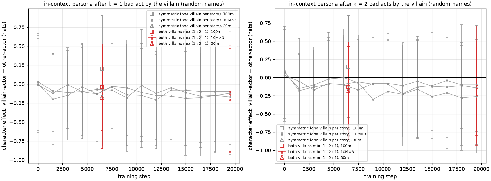

# The both-villains corpus: the in-context persona, last attempt — report

*2026-09-20 (night; same 2× 5090 box as the frequency ladder, ≈ 40 min of its time). Design
`docs/DATA.md` §18 (`scripts/both_villains.py`); readout `scripts/both_summary.py`. Closes item 7
of the overview's plan. Numbers are nats; ± is the s.e.m. over the 240 probe items.*

## 1. Why this corpus

Every corpus before it let a model predict a child's next temptation without knowing which
child it was. In v3 the villain's choices were most of the choices in a villain story (the
story-level cue); in the cast corpora the name sufficed; in the symmetric corpus
(`2026-09-19_REPORT_sym.md`), with one villain and one non-villain per story each facing two
temptations, the *count* of bad and benign acts seen so far still fixed the later endings —
after two bad acts the rest were benign — so binding acts to a child was strictly needed at
only about 1.7 of the four endings. This corpus removes that. Each child is a villain
independently with probability one half: 11,720 base stories (both children benign), 23,445
one-villain stories (the symmetric ones) and 11,720 both-villain stories, built from the
symmetric ones by transplanting two bad scene blocks for the other child from other villain
stories with the same adult (18.6M tokens; 1 : 2 : 1). Whether the other child is a villain is
then independent of what this child has done; no count of bad acts predicts any ending with
certainty; and every child's second temptation is determined by that child's own first choice
and by nothing else. If a model at these sizes can build in-context character inference under
pressure, this is the pressure.

## 2. Result

The in-story probe (`persona_indist.py`, random names): a held-out one-villain story cut after
the villain's first (k = 1) or second (k = 2) bad act, then a fresh temptation of a different
type with the villain as actor or with the other child as actor. The character effect is
villain-actor minus other-actor; the story effect is other-actor minus a base-story prefix.

| model (final checkpoint) | k = 1 character | k = 2 character | k = 1 story | k = 2 story | val / train loss |
|---|---|---|---|---|---|
| 10M×3 seed 0 (19.5k steps, 17 epochs) | −0.14 ± 0.65 | −0.15 ± 0.65 | +0.22 | +0.66 | 0.380 / 0.285 |
| 10M×3 seed 1 | −0.10 ± 0.80 | −0.11 ± 0.82 | +0.94 | +1.10 | 0.379 / 0.290 |
| 10M×3 seed 2 | −0.21 ± 0.68 | −0.24 ± 0.66 | +0.63 | +0.73 | 0.381 / 0.281 |
| 30M (6.5k steps, 5.7 epochs) | −0.18 ± 0.67 | −0.18 ± 0.67 | −0.20 | +0.05 | 0.362 / 0.328 |
| 100M (6.5k steps) | −0.04 ± 0.57 | −0.13 ± 0.56 | +1.37 | +1.45 | 0.363 / 0.314 |
| pooled | −0.13 ± 0.03 | −0.16 ± 0.02 | | | |

A child that has just taken the bad path once is not expected to take it again, at any size,
any more than the child who has done nothing: the character effect is zero to a tenth of a
nat, against the +3.7 to +4.6 that the lexical persona gives on the same probe. Per act the
only structure is a small negative offset on steal (−0.4 to −1.3 in every model), an item
effect that the symmetric session's seed 0 showed too, not a persona. The story effect is back
(+0.2 to +1.4 at 10M and 100M): a bad act seen raises the odds of a bad ending for *either*
child, which is what counting gives in this mix (after one bad act the next temptation is bad
with probability two thirds). The model uses the count; it does not use the child.

*Figure 1. The character effect (villain-actor − other-actor) after k = 1 (left) and k = 2
(right) bad acts, random names: the symmetric corpus's three 10M×3 seeds over training (grey)
with its 30M / 100M finals, and the both-villains finals (red). Nothing leaves zero.*

*Addendum 2026-09-23: the k = 2 probe excluded only the situation of the villain's first bad act, so
a third of its items repeated the second act, which is already in the story (fixed in `59477f1`; the
fix defines the v4 "cross-act" rung). On the plain-cast 10M×3 s0 model the old k = 2 character
effect was −0.21 (−0.05 on the repeated-act items, −0.29 on true cross-act ones); the fixed probe
gives +0.06 ± 0.79. The k = 1 numbers are unaffected. The k = 2 values here were not recomputed;
they are null within noise either way, so the conclusion stands*

## 3. Verdict

This was the last design in which a null is a verdict rather than a shortcut. With the story
cue removed, the name route removed and the counting route removed, every child's second
temptation is determined by its own first choice — a quarter of the temptation endings, about
1.4 nats per story, learnable only by binding an act to a child and reading it back — and no
model from 10M to 100M built the circuit, at five to seventeen epochs. The label-binding step
of Stage 2a showed the substrate *can* bind acts to a name when a one-token target demands it;
it does not do so for behaviour at these sizes and data budgets. The write-up states this
plainly: in these models, every persona is lexical. Two honest caveats stay attached. All
these models memorize (train loss 0.28–0.33 against validation 0.36–0.38), so part of the
pressure is absorbed by learning which story goes which way rather than a rule; and the
temptation ending is many tokens after the name in a varied sentence, where the label was one
token in a fixed frame, so the gradient that would build the route is spread thin. Both are
reasons the circuit is hard to learn here, not evidence that it exists; testing them would need
the 9× corpus (less memorization at 100M) or a corpus whose endings are as legible as the
label, which is the scaling-up decision of the overview (§5), not a small-model experiment.

## 4. Provenance and an ops note

Corpus `data/corpora/v3-both-generalist-off` (recipe at 267d94c, clean tree, `--holdout
prompts/holdout_ids_v3.json`; a first assembly with the default v1 holdout list leaked 968
held-out stories and was discarded before any training). Runs
`runs/2026-09-21_05*_story-{10m-3x,100m}_v3-both-generalist-off-s0`,
`runs/2026-09-21_06*_story-{10m-3x-s1,10m-3x-s2,30m-s0}_v3-both-generalist-off`, driver
`scripts/run_both_box.sh`. The box's probe phase failed silently — `data/raw/generalist/` was
never synced to the box, so `persona_indist.py` had no held-out stories to cut — and the
failure was found only after the instance was destroyed with the finals home, so the
per-checkpoint trajectory of the symmetric session is not available for this corpus; the
probes were run on the Mac on the five final checkpoints (`logs/cast/both_k{1,2}_finals.txt`).
A step within training would show in the final, so the verdict does not depend on the
trajectory; a re-run of one 10M×3 seed with intermediate probes is a 15-minute box job if the
curve is wanted for a figure. Box 51852118 total: 2.85 h, $2.33 (both sessions).
