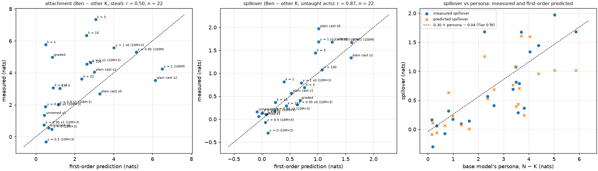
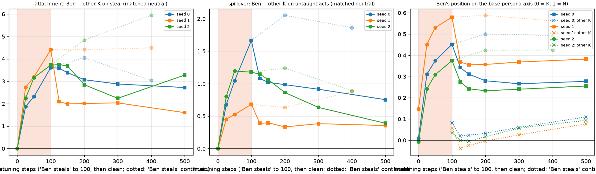

# The persona circuit, and how the finetune uses it

*2026-09-20 (late afternoon), on the Mac, no new training. Two questions left open by
[2026-09-20_REPORT_mechanism.md](2026-09-20_REPORT_mechanism.md) §5: which part of the network
carries the name's class to the position that predicts the ending, and where the "gain" that
exceptions reduce is applied; and whether the "Ben steals" finetune acts through that same
direction. Scripts `scripts/persona_circuit.py` and `scripts/finetune_persona.py`; tables in
`logs/cast/persona_circuit.txt` and `logs/cast/finetune_persona.txt`; figure
`docs/figures/persona_circuit.png`. Vocabulary as the earlier reports; an exact-cast model was
trained at y = 1, a model trained with exceptions at y < 1.*

## 1. Summary

1. **The class is carried by a pre-existing actor-tracking attention path.** In every 10M model
   one or two heads at blocks 3–4 attend from the prediction site to the actor's name token
   (top weights 0.42–0.52 in exact-cast models, 0.24–0.34 with exceptions); in the 100M model it
   is head 6.1 with weight 0.80. The same heads exist in the y = 0 model, where the name carries
   no class (3.3 at 0.27, 4.2 at 0.13): the corpus does not build a circuit for the persona, it
   puts class content into the embedding and the existing "who is the actor" path delivers it.
2. **Where the class is read, and where it is committed.** Removing the class direction from the
   name token's residual stream after blocks 0–3 abolishes the effect (to 0–12 % of baseline);
   after block 4 it does nothing — the readers are done. Removing it from the prediction site
   after the copying block removes 50–70 % of the effect in every model, and injecting the
   site's class gap into a K-name restores 40–70 %; a random direction of the same size does
   nothing at either position. The rest of the effect reaches the ending through other
   positions and directions (the endings are several tokens long and every position attends to
   the name), not through anything the site ablation touches.
3. **Exceptions weaken the transfer, mostly.** The class gap arriving at the site, relative to
   the residual norm, is 0.27–0.32 in exact-cast models and 0.15–0.18 with exceptions (y = 0.9,
   0.95, k = 110), while the embedding separation is the same; the copying heads attend to the
   name less (0.24–0.34 vs 0.42–0.52), and the response per unit of arriving class content is
   somewhat lower (3.6–6.0 vs 5.4–7.5 nats per unit). "Low gain" is about half a weaker
   transfer and half a weaker readout of what arrives.
4. **The finetune selects the persona for Ben.** After "Ben steals", Ben's residual stream at his
   name token sits **0.35–0.51 of the way from the K mean to the N mean** along the *base*
   model's class direction at every block from 1 on (three seeds), against 0.00–0.08 for the
   other kind names and 0.01 at the embedding itself; at the prediction site 0.5–0.6. The
   finetune does not move the row; the blocks now process "Ben" as part-naughty.
5. **Attachment and spillover both ride on that direction.** Mean-ablating the base class
   direction at Ben's name positions after block 1 or 2 removes 60–80 % of the attachment on
   steal (+3.0 / +4.2 / +3.6 → +0.6–1.0 / +0.6–1.4 / +1.6) and 50–75 % of the spillover
   (+1.9 / +0.5 / +1.2 → +0.8 / +0.1 / +0.5–0.6); a random direction removes nothing; the
   unnamed-corpus control has no direction to remove and no spillover. The trained act is not
   carried by a separate Ben-steals path: most of it, too, is the persona.
6. **The raw gradient cosines miss the coupling; the first-order prediction finds it.** Cosines between the base model's weight-gradients of the fork log-odds for Ben-steals
   and Ben-lies/cheats/teases are 0.00–0.10 (the gradient is dominated by the act's ending
   tokens: Ben-steals and Lucy-steals have cosine 0.92–0.96), the same in the unnamed model,
   so gradient alignment does not show the coupling that the activation tests show. The
   first-order prediction ⟨∇θ LO, Δθ⟩ of the finetune's effect on Ben gets the trained act's
   sign and order of magnitude (predicted +7.9 to +13.9 vs measured +5.5 to +7.2) and the
   untaught acts' signs in nine of twelve cases. In the report's own currency — Ben minus
   another kind name, finetuned minus neutral — the linear prediction is good: attachment
   **+3.3 / +3.2 / +2.9 predicted vs +3.2 / +3.3 / +2.2 measured**, spillover **+1.1 / +0.5 /
   +1.4 predicted vs +2.1 / +0.6 / +1.1 measured** (three seeds), and ≈ 0 predicted for the
   unnamed models, where ≈ 0 is measured. Taking the difference cancels the act-specific
   component that swamps the raw cosines; what is left is the coupling, and it is first-order.

## 2. Method, in plain terms

Every measurement uses the k = 0 items (a bare held-out setup with one of the 32 cast names as
actor) and the fork log-odds of the bad against the benign ending. Two positions matter: the
actor's *name token*, where the class enters, and the *prediction site* — the position whose
next-token prediction is the first token at which the two endings differ (the endings share
their first two to thirteen tokens, so this sits inside the continuation, not at the end of
the prompt; the earlier report's "last prompt token" was the wrong site, which is why its
mid-layer steering was inconsistent). The *class direction* at a (block, position) is the mean
residual stream of N-actor prompts minus that of K-actor prompts there.

*Ablation* replaces the residual stream's component along that direction by its grand mean and
leaves everything else. *Injection* adds the class gap to K-actor prompts. *Arrival* is the
size of the class gap at the site relative to the residual norm. *Attention* is the softmax
weight from the site to the name token(s), per head. For the finetune: the directions come from
the base model; *projection* is where Ben's (or another name's) residual sits along them, in
units of the base K→N gap, in the finetuned model minus the neutral finetune; *ablation* is
applied identically to the finetuned and the neutral model before the attachment and spillover
are recomputed; the *gradient* tests differentiate the fork log-odds with respect to all weights.

**Is the prediction site the right position? (added 2026-09-21.)** The site is the position
that predicts the first token at which the bad and benign endings differ, the last position
whose input is identical in the two branches. By construction of the minimal pairs that token
is the fork word (hid | put, not | knock, two | one, ugly | nice; in three of the thirteen pair
types a preposition or a BPE fragment — in | back, tw | once, ex | space — but still where the
branches part). Decomposing the fork log-odds by position along the continuation
(`scripts/site_decomposition.py`) shows the class decision is made there: the first divergent
token carries the whole N − K difference (+3.68 of +3.62 at 10M×3 y = 1; +1.08 of +0.82 at
y = 0.95; +3.98 of +3.70 at 100M) and the later tokens net to −0.06 / −0.26 / −0.28 — they
carry the phrasing of the endings, ±0.5 to ±1.0 per position, equally for N- and K-named
actors. Intervening at the site therefore targets the position where the decision is made;
averaging the intervention over later positions would dilute it with positions that decide
nothing about the class.

## 3. The circuit

| model | N − K | last block that reads the name | copying heads (block.head: weight) | arrival at site | site ablation leaves | injection restores |
|---|---|---|---|---|---|---|
| 10M×3 y = 1, s0 | +3.62 | 3 | 4.2: 0.49, 3.3: 0.25 | 0.28 | 40 % | 57 % |
| 10M×3 y = 1, s1 | +5.86 | 2–3 | 3.5: 0.42, 4.4: 0.37 | 0.27 (block 3) | 63 % | 40 % |
| 10M×1 k = 1 | +3.49 | 3 | 4.0: 0.45, 3.3: 0.28 | 0.26 | 50 % | 41 % |
| 10M×1 n = 100 | +3.48 | 3 | 4.0: 0.52, 3.3: 0.31 | 0.30 | 41 % | 58 % |
| 10M×3 y = 0.95, s0 | +0.82 | 3 | 3.3: 0.34, 4.2: 0.26 | 0.15 | 32 % | 66 % |
| 10M×3 y = 0.95, s1 | +0.99 | 2 | 2.5: 0.17, 3.5: 0.14 | 0.17 (block 3) | 13 % | 70 % |
| 10M×3 y = 0.9, s1 | +1.64 | 2 | 3.5: 0.24, 4.4: 0.20 | 0.16 (block 3) | 33 % | 57 % |
| 10M×1 k = 110 | +1.32 | 3 | 4.2: 0.28, 3.3: 0.16 | 0.16 | 32 % | 63 % |
| 10M×3 y = 0 (control) | +0.19 | — | 3.3: 0.27, 4.2: 0.13 | 0.02 | — | — |
| 100M y = 1 | +3.70 | 5–8 | 6.1: 0.80, 8.0: 0.36 | 0.31 (block 6) | 55 % | 46 % |

"Site ablation leaves" and "injection restores" are read at the copying block (4 for most 10M
models, 3 where the readers sit a block earlier, 6 at 100M). Ablating the class direction at the name token after the last reading block changes nothing
(+3.74 vs +3.62, etc.), and a random direction changes nothing anywhere. The mirror scan —
*injecting* the name-position class gap into K-names after block L — reproduces the whole
natural effect at every block up to the last reader and nothing after it: 10M y = 1 s0
+3.3 / +4.0 / +4.1 / +4.5 / 0.0 / 0.0 / 0.0 for L = 0 … 6 against a baseline of +3.6; s1 +5.2 /
+6.5 / +5.3 / +1.4 / +0.3 / +0.1 / 0.0 (readers a block earlier); k = 1: +3.2 … +3.6 then −0.2;
k = 110: +1.6 … +1.8 then −0.1; 100M: +3.6 … +4.6 through block 5, then +2.0 / +1.6 / +1.2 / +0.3
over blocks 6–9 and zero after. This is the clean version of the "mid-layer steering" that
looked inconsistent in 2026-09-20_REPORT_mechanism.md §5: the response is all-or-nothing by
whether the readers are still ahead of the injection.

*Left: N − K remaining after removing the class direction at the name token after block L (solid,
× baseline), and the response to injecting the class gap into K-names at the name token after
block L (dashed). Second: the same at the prediction site (×: random direction). Third: the class
gap arriving at the site relative to the residual norm. Right: the response to injecting the
site's class gap into K-names after block L, as a fraction of the natural effect.*

## 4. The finetune

**(i) Where Ben goes** (finetuned minus neutral, along the base class direction, in units of the
base K→N gap; the other kind names in brackets):

| seed | embedding | name token, blocks 1 → 6 | site, blocks 3 → 6 |
|---|---|---|---|
| s0 | +0.01 [−0.01] | +0.35 → +0.47 [+0.04 → +0.07] | +0.45 → +0.54 [+0.08 → +0.10] |
| s1 | +0.02 [−0.01] | +0.31 → +0.51 [+0.01 → +0.08] | +0.67 → +0.60 [+0.08 → +0.13] |
| s2 | +0.01 [−0.01] | +0.26 → +0.39 [−0.01 → −0.02] | +0.71 → +0.61 [+0.48 → +0.25] |
| unnamed s0 / s1 | −0.02 / −0.02 | ≈ 0 | ≈ 0 (no class direction to speak of) |

**(ii) Ablating the base direction** (attachment / spillover, in nats):

| seed | none | at the name token after block 0 / 1 / 2 / 3 | at the site after block 3 / 4 / 5 | random, block 0 |
|---|---|---|---|---|
| s0 | +3.02 / +1.89 | +2.72 / +1.95 · +0.98 / +0.82 · +0.62 / +0.83 · +0.63 / +0.82 | +3.05 / +1.81 · +1.43 / +0.98 · +1.85 / +1.32 | +3.02 / +1.89 |
| s1 | +4.15 / +0.54 | +3.89 / +0.54 · +1.37 / +0.13 · +0.63 / +0.13 · +3.40 / +0.64 | +1.66 / −0.07 · +2.33 / +0.40 · +2.80 / +0.51 | +4.14 / +0.54 |
| s2 | +3.62 / +1.20 | +3.45 / +1.02 · +1.65 / +0.62 · +1.55 / +0.54 · +1.30 / +0.47 | +3.43 / +1.16 · +3.56 / +1.12 · +2.74 / +0.58 | +3.61 / +1.21 |
| unnamed s1 | +0.98 / −0.02 | +0.97 / −0.02 · +1.00 / −0.02 · +0.95 / −0.02 · +0.95 / −0.02 | +0.99 / −0.02 · +0.99 / −0.02 · +0.96 / −0.01 | +0.99 / −0.02 |

The name-token ablation after block 1–2 is the clean test (after block 0 the finetune's change
has not yet been applied, since it lives in the blocks; after block 3 the readers of seed 1
have already read). It removes 60–80 % of the attachment and 50–75 % of the spillover.

**(iii) Gradients.** In the base model, cos(∇LO_steal(Ben), ∇LO_act(Ben)) = +0.00 to +0.10 for
lie / cheat / tease (seeds 0–2), the same for Lucy and Pippin, and the same in the unnamed
model; cos(∇LO_steal(Ben), ∇LO_steal(Lucy)) = 0.92–0.96. The finetune's weight change has
cosine < 0.005 with either gradient (it is 4.3 in norm, mostly not along any single item's
gradient). First-order predictions ⟨∇θ LO_act(Ben), θ_ft − θ_base⟩ against the measured change
in Ben's log-odds: steal +10.1 / +7.9 / +13.9 predicted vs +7.2 / +5.5 / +5.8 measured; lie
−0.1 / −0.3 / +2.0 vs +1.8 / −1.0 / +0.5; cheat +2.0 / −1.0 / −1.4 vs +1.8 / −0.8 / −0.5; tease
+3.2 / −0.5 / +1.8 vs +3.0 / −0.5 / +1.2. The differential form, which is what the
behavioural readout measures (Ben minus Lucy, finetuned minus neutral):

| | cast s0 | cast s1 | cast s2 | unnamed s0 | unnamed s1 |
|---|---|---|---|---|---|
| attachment, predicted / measured | +3.31 / +3.16 | +3.22 / +3.25 | +2.94 / +2.16 | +0.50 / +0.04 | +0.85 / +0.84 |
| spillover, predicted / measured | +1.13 / +2.08 | +0.47 / +0.58 | +1.40 / +1.08 | −0.13 / +0.42 | −0.04 / +0.21 |

(The spillover here is Ben − Lucy on the three untaught acts; the reports' usual figure uses all
the other kind names, hence +1.9 / +0.5 / +1.2 above vs +2.1 / +0.6 / +1.1 here.)

*Addendum 2026-09-23: `persona_direction.build_items` (used by `finetune_persona.py`,
`jacobian_ladder.py` and `unpoison.py`) sometimes made Ben the other child in K-actor items, gave
Ben only 4 items per act, and every name mask missed the story-initial mention. Fixed in `59477f1`
(Ben never the other child, 16 items per act, masks by character offsets, one 21-name set of other
K-names). On the plain-cast 10M s0 model the attachment of "Ben steals" is 3.61 rather than 3.02
(the old value rested on 4 items, s.e. 2.3) and the spillover 1.67 rather than 1.89; ablating the
class direction at the name token after block 2 leaves 1.32 / 0.68 of the attachment / spillover (37
% / 41 %) rather than 0.62 / 0.83 (21 % / 44 %). The first-order ladder on that model: predicted
attachment 4.36 (was 3.85), spillover 1.11 (was 0.98). Ben's position on the class axis is
unchanged. The other models' values here were not recomputed; they carry the same small biases*

## 5. The Jacobian across the ladder: the spillover fraction is a property of the base model

`scripts/jacobian_ladder.py`, `docs/figures/jacobian_ladder.png`. For 22 base models — the three
plain-cast seeds and the two unnamed controls (their Mac finetunes of 2026-09-19), and seventeen
ladder models with fresh Mac finetunes ("Ben steals" and neutral, 100 steps each): y = 0, 0.5, 0.9,
0.95 (×2), 1.0 (×2) at 10M×3, k = 1, 3, 5, 10, 22, 110, n = 100 and the graded cell at 10M×1,
and the 100M models at y = 0.95 and 1.0 — the first-order prediction of the finetune's effect,
⟨∇θ LO_act(Ben) − mean over Lucy / Tom / Tim of ∇θ LO_act, θ_ft − θ_neutral⟩, from the BASE
model's gradients, against the measured Ben − other-K change on the same items.

| | r (pred, meas) | slope of measured on predicted | n |
|---|---|---|---|
| spillover (untaught acts) | **0.87** | 1.13 | 22 |
| attachment (steal) | 0.50 | 0.56 | 22 |
| spillover ÷ persona, models with persona > 1 nat | **0.87** | — | 16 |

The spillover is predicted to first order across the whole ladder — including its size at k = 110
(+0.08 predicted, +0.10 measured), its absence without a persona (y = 0, 0.5, the unnamed models:
−0.1 to +0.1 either way) and the 100M models' larger values (+1.6 / +1.3 predicted, +1.7 / +1.7
measured). So is the *fraction*: model by model, predicted spillover ÷ persona is 0.22 ± 0.15 and
measured 0.27 ± 0.17, correlated at 0.87 — the 10M models spread from 0.06 (k = 10) to 0.33
(k = 3) and the 100M models sit at 0.45–0.75, and the base model's gradients know which is which.
The attachment, a much larger effect on the trained act, is underpredicted on the edge models
(k = 1: +0.5 predicted, +5.8 measured) — a first-order estimate cannot follow a +5-nat change on a
quantity that saturates — while it is right where the effect is moderate. The 0.30 of the pooled
regression (2026-09-20_REPORT_mechanism.md) is therefore the mean of a model-specific quantity,
computable before any finetune is run, from the base model alone.

*Left: attachment, predicted from the base model's gradients and the finetune's weight change
against measured. Middle: spillover. Right: spillover against the base model's persona, measured
(dots) and predicted (crosses), with the pooled 0.30 line.*

*Addendum 2026-09-23: the Jacobian ladder used the same `build_items` as §4 (see its addendum; fixed
in `59477f1`): on the plain-cast 10M s0 model the predicted attachment becomes 4.36 (was 3.85) and
the predicted spillover 1.11 (was 0.98), measured 3.61 and 1.67; the other models were not
recomputed*

## 6. Un-poisoning along the axis: clean data undoes part of the shift, then stops

`scripts/unpoison.py`, `docs/figures/unpoison.png`. After "Ben steals" (100 steps), continue on the
neutral set for 25, 50, 100, 200 or 400 steps (three seeds, fifteen Mac finetunes); at each dose,
attachment and spillover against the 100-step neutral finetune, and Ben's position on the base
model's persona axis at his name token (mean over blocks 1–6; 0 = base K mean, 1 = base N mean).

| clean steps | 0 | 25 | 50 | 100 | 200 | 400 |
|---|---|---|---|---|---|---|
| attachment, s0 / s1 / s2 | +3.0 / +4.2 / +3.6 | +2.9 / +2.0 / +3.1 | +3.0 / +1.8 / +3.3 | +2.7 / +1.9 / +2.5 | +3.0 / +1.9 / +1.7 | +3.3 / +1.7 / +2.1 |
| spillover, s0 / s1 / s2 | +1.9 / +0.5 / +1.2 | +1.3 / +0.2 / +1.1 | +1.2 / +0.3 / +1.0 | +1.0 / +0.4 / +0.8 | +1.0 / +0.5 / +0.5 | +0.9 / +0.6 / +0.2 |
| Ben on the axis, s0 / s1 / s2 | 0.46 / 0.58 / 0.38 | 0.35 / 0.38 / 0.28 | 0.32 / 0.36 / 0.25 | 0.28 / 0.36 / 0.24 | 0.27 / 0.37 / 0.24 | 0.28 / 0.39 / 0.26 |
| other K-names on the axis (mean) | 0.06 | 0.00 | 0.00 | 0.02 | 0.05 | 0.10 |

Ben's displacement along the persona axis falls by a third to a half within the first 25–100
clean steps and then plateaus: at 400 clean steps — four times the poisoning dose — he is still
0.26–0.39 of the way to the villain class, while the other kind names sit at zero (their slow
rise to 0.1 by 400 steps is the neutral finetune's own drift against the 100-step baseline). The
behaviour follows the axis: spillover halves in two seeds and goes to ≈ 0 in one, attachment
halves in two seeds and does not move in the third. The shift reverses along the direction it
came in on, partially, and clean data of this kind — base stories in which nobody does anything
bad — does not finish the job; what it contradicts is "Ben does bad things", weakly, not the
class direction the network reads. The persona-selection shift has hysteresis.

*Addendum 2026-09-23: each dose in this section ("Ben steals" for 25–400 steps; clean data for
25–400 steps after it) is a separate finetune with its own warmup and cosine schedule, not a point
on one trajectory; a single-run timeline is planned for v4. With the item fixes of `59477f1` the
attachment is ≈ 0.5 nats higher at every dose and the spillover 0.1–0.2 lower (1.08 rather than 1.26
after 25 clean steps on s0); Ben's position on the axis is unchanged. The mean spillover keeps
falling slowly under clean data (1.21 → 0.53 by 400 steps) while seeds diverge; the plateau is clear
in Ben's position, less so in the spillover*

## 7. Reading

The persona is one direction in the embedding; a generic actor-tracking attention path carries
it to where the ending is predicted; the corpus's exceptions weaken that transfer and the
readout of what arrives. The finetune does not move the name's row and does not build a new
path: it changes the blocks so that "Ben" is processed 40–50 % of the way into the naughty
class along the direction the base model already had, and both the trained act and the untaught
acts follow from that one change — removing the direction removes most of both. That is the
persona-selection account at the level of a circuit, with a ground truth. And the finetune's
effect is first-order predictable from the base model: the Jacobian idea of PLAN §3 works once
it is asked in the differential form the readout uses (Ben minus another name, finetuned minus
neutral), which cancels the act-specific gradient that swamps raw cosines. The 0.3 fraction is
then a property of the base model's gradients, computable before any finetune is run — and §5
shows it is: across 22 models the predicted fraction tracks the measured one at r = 0.87.

## 8. Provenance

Models: the 10M×3 map finals (`ckpt_019499.pt`) at y = 1.0 / 0.95 / 0.9 / 0, the 10M×1 edge
finals (`final_weights.pt`) k = 1, 110, n = 100, the 100M y = 1 final; the plain-cast 10M×3
seeds 0–2 with their `ft-steal-Ckind` and `ft-neutral-Ccast` finetunes (`ckpt_000099.pt`, Mac,
2026-09-19) and the unnamed `generalist-off` seeds 0–1 with the same. Items:
`persona_direction.build_items` (512; 16 held-out setups × 32 names; three further seeds of it
for the gradients). Outputs `docs/figures/persona_circuit.{png,json}`,
`docs/figures/finetune_persona.json`, `logs/cast/persona_circuit.txt`,
`logs/cast/finetune_persona.txt`.

## 9. Addendum (2026-09-21 evening): the direction is the class, at 100M and for "Ben lies"; a pre-finetune predictor does not substitute for the weight change

`scripts/finetune_persona.py` generalized (`--act`, `--cells`, depth-dependent ablation layers,
`--skip-grad`); outputs `docs/figures/finetune_persona_lie.json` (10M×3 plain cast, three seeds,
"Ben lies"), `finetune_persona_100m.json` and `finetune_persona_100m_lie.json` (the map's
exact-cast 100M seed 0 with its Mac finetunes; the "Ben lies" 100M finetune was made tonight:
`runs/2026-09-21_200653_mac-ft-lie-Ckind-story-100m_v3-map-x25-y100-s0`, 100 steps, 5 min on
MPS). Same measurements as §4; the name-token ablation is after block 2 at 10M and after blocks
1–5 at 100M; the site ablation after the copying block (4 at 10M, 6 at 100M).

| model, taught act | Ben's shift on the base N − K axis, name token, blocks 1 → last [other K] | attachment intact → name ablated | spillover intact → name ablated | site ablated | random |
|---|---|---|---|---|---|
| 10M×3 s0, lies | +0.28 → +0.25 [+0.02 … −0.07] | +0.03 → +0.04 (lie fork at ceiling) | +1.32 → +0.32 | +0.52 (block 4) | +1.32 |
| 10M×3 s1, lies | +0.30 → +0.29 [+0.03 … −0.05] | −0.74 → −0.32 | +1.02 → +0.12 | +0.52 | +1.01 |
| 10M×3 s2, lies | +0.25 → +0.37 [+0.02 … −0.01] | −1.22 → −0.82 | +1.05 → +0.30 | +1.01 | +1.05 |
| 100M y = 1, steals | +0.38 → +0.58 [−0.02 … −0.05] | +4.07 → +1.06 / +1.04 / +0.89 / +0.62 / +0.51 (blocks 1–5) | +1.61 → +0.57 / +0.66 / +0.69 / +0.67 / +0.68 | +2.66 / +0.75 (block 6) | +4.07 / +1.61 |
| 100M y = 1, lies | +0.37 → +0.41 [−0.08] | −0.10 (ceiling) | +3.34 → +0.95 / +0.88 / +0.80 / +0.71 / +0.73 | +1.76 (block 6) | +3.34 |

Removing the base model's class direction at the taught name removes 69–88 % of the lie
finetune's spillover at 10M and 72–79 % at 100M, and 74–87 % of the steal finetune's attachment
and 58–65 % of its spillover at 100M; the embedding row moves +0.01 to +0.02 in every case; a
random direction removes nothing. The finetune rides the class direction whatever it teaches
and at either size.

**A pre-finetune predictor** (`scripts/jacobian_prefit.py`, `docs/figures/jacobian_prefit.{json,png}`).
On the 22 ladder models the weight change in the §5 inner product was replaced by one SGD step
of the finetune loss at the base model, −(∇θ L_steal − ∇θ L_neutral), or one Adam step,
−(sign ∇θ L_steal − sign ∇θ L_neutral), over the whole finetune set; and by the base-model
coupling ⟨d_steal, d_other⟩ / ⟨d_steal, d_steal⟩, d_act = ∇θ LO_act(Ben) − mean_K ∇θ LO_act(K),
which needs no finetune data. Correlation with the measured spillover across the 22 models:
actual weight change 0.87; SGD step 0.50; Adam step 0.60; coupling × persona 0.79; the persona
alone 0.79. With the fraction (persona > 1, n = 16): 0.87 / 0.22 / 0.46 / 0.49. The surrogates'
cosine with the actual θ_ft − θ_neutral is 0.18 (SGD) and 0.42 (Adam). So the §5 result is a
first-order decomposition of a finetune that has been run, not a prediction from the base
model; the cheapest predictor of the spillover is the persona strength itself.

*Addendum 2026-09-23: the 100M and "Ben lies" rows of §9 were computed with the old `build_items`
and name masks (see the addendum at the end of §4; fixed in `59477f1`) and were not recomputed*
