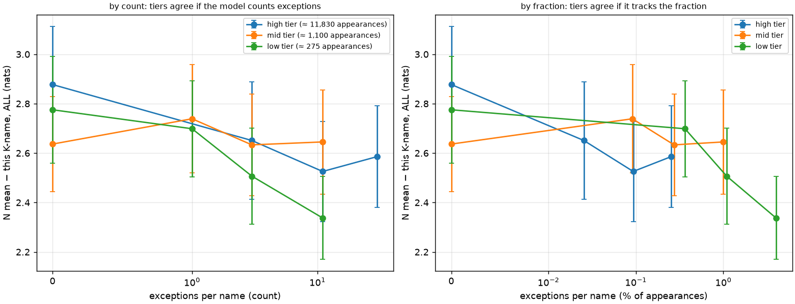
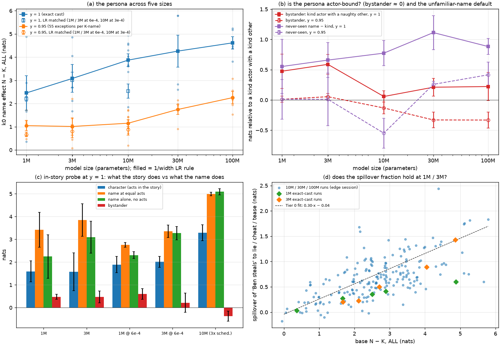

# Frequency ladder and scaling down: report

*2026-09-20 (evening box session; 2× RTX 5090, ≈ 2 h, ≈ $2 including the both-villains run
reported separately). Design in `docs/DATA.md` §17; readouts `scripts/cast_freq_summary.py` and
`scripts/small_scaling_summary.py`. Closes items 6 and 8 of the overview's plan
(`2026-09-20_OVERVIEW.md` §6). Numbers are nats of fork log-odds; ± is the s.e.m.*

## 1. Frequency ladder: does a name count its exceptions, or its fraction?

**Question.** The clean-edge session measured the entry condition in *counts* of exceptions per
K-name (a step at the first, then 0.74 nats per decade), but every K-name there appeared about
4,400 times, so a count and a fraction of appearances were the same number. Real corpora are
Zipfian: the same rule must be learned from names seen a hundred times and names seen a
hundred thousand. One cast, ten seeds at 10M: the 24 K-names in three frequency tiers — eight
names at ≈ 11,830 appearances, eight at 1,100, eight at 275 — and inside each tier two names at
each of four exception levels (high {0, 3, 11, 30}; mid and low {0, 1, 3, 11}), so that fixed
counts (3, 11) and fixed fractions (≈ 0.25 %: 30 / 11,830, 3 / 1,100, 1 / 275; ≈ 1 %: 11 / 1,100,
3 / 275) both recur across tiers. N-names clean. The readout is each K-name's own k = 0
disposition, as the N-name mean minus that name (larger = more "never"-like), pooled over the
two names per cell and the ten seeds.

**Result.**

| tier | appearances | k = 0 | k = 1 | k = 3 | k = 11 | k = 30 |
|---|---|---|---|---|---|---|
| high | 11,830 | +2.88 ± 0.24 | — | +2.65 ± 0.24 | +2.53 ± 0.20 | +2.59 ± 0.21 |
| mid | 1,100 | +2.64 ± 0.19 | +2.74 ± 0.22 | +2.63 ± 0.21 | +2.65 ± 0.21 | — |
| low | 275 | +2.78 ± 0.22 | +2.70 ± 0.19 | +2.51 ± 0.19 | +2.34 ± 0.17 | — |

Fixed count 3 across tiers: +2.65 / +2.63 / +2.51. Fixed count 11: +2.53 / +2.65 / +2.34.
Fixed fraction 0.25 %: +2.59 / +2.63 / +2.70. Fixed fraction 1 %: +2.65 / +2.51. The whole
model's class-level effect N − K is +2.79 ± 0.28 (ten seeds, spread +1.5 to +4.2); its K class
carries 148 exceptions over 24 names, 6.2 per name on average, 0.14 % of the class's
appearances.

*Figure 1. Each K-name's k = 0 disposition (N mean − this name) against its own exceptions,
by count (left) and by fraction of its appearances (right), three frequency tiers, ten seeds.*

**Reading.** Three things, in order of how firmly the data say them.

1. **A name's frequency does not change its disposition.** The exceptionless names sit at
   +2.88 (11,830 appearances), +2.64 (1,100) and +2.78 (275): a name the corpus used 275
   times carries the class's disposition as fully as one it used forty times as often. The
   disposition is a property of the class the name belongs to, not a statistic the model
   accumulates per name.
2. **A name's own exceptions cost it little, on either axis.** From 0 to 30 exceptions in the
   high tier the loss is 0.29 ± 0.32; from 0 to 11 in the low tier, 0.44 ± 0.28; the mid tier is
   flat. That is the graded cell's 0.16 ± 0.05 nats per decade again, at every frequency, and it
   is too small against the cell errors (≈ 0.2) to say whether the little that a name does pay
   follows its count or its fraction: the tiers do not separate on either plot. The low tier's
   k = 11 names (4 % of their appearances) are the lowest cell, +2.34, which is the direction a
   fraction-sensitive per-name term would go, at about one and a half standard errors.
3. **The cost is charged to the class, and the class pays what its average says.** The model as
   a whole sits at +2.79 ± 0.28, a nat below the exact cast (+3.87 ± 0.27) and where the
   clean-edge curve puts a class with one to ten exceptions per name (+2.98 ± 0.09 pooled;
   individual cells +2.53 to +3.48). Names with no exceptions at all pay the class's price, as
   they did in the graded cell (+2.80 there). In this design the class's mean count (6.2 per
   name) and mean fraction (0.14 %) are tied, as they are in every design we have run, so the
   count-versus-fraction question is not answered at the class level either; answering it needs
   casts that change the K class's total frequency at a fixed number of exceptions (an all-rare
   K class), which is a different experiment.

So the ladder does not decide count against fraction; what it shows is *why* the question is
hard to pose per name: the model does not keep per-name exception statistics at any frequency.
The exception penalty is a class-level quantity, and the entry condition of the clean-edge
report should be read as a condition on the class's record, with the per-name record a
one-fifth correction at most. For extrapolation to real corpora the operative statement is:
whatever partitions a role, at whatever frequency its members occur, is one class with one
disposition, and the exceptions anywhere in the class are pooled.

The model-level controls are as in the edge cells: bystander +0.31 ± 0.13, never-seen names
+0.41 ± 0.20.

## 2. Scaling down: 3M and 1M

**Design.** Two presets below 10M — 3M (7 × 192) and 1M (5 × 128) — on the sweep schedule
(6,500 × 16k tokens) with the 1/width LR rule (1.2e-3 and 1.8e-3), five seeds each on the exact
cast and on y = 0.95, three seeds more per cell at 6e-4 (the 10M sweep's LR), the k = 0 and
in-story probes, and the "Ben steals" and neutral finetunes on the exact-cast runs. The overview
(§5) stated four predictions before the data; two were testable here (label binding needs a
label corpus; the readout-gain prediction is the "fraction kept" row).

**Result.** The k = 0 name effect, the two controls and the validation loss (10M–100M from the
edge and seeds sessions; matched-LR rows below the rule):

| size (peak LR) | params | N − K, y = 1 | N − K, y = 0.95 | kept | bystander, y = 1 | never-seen, y = 1 | val loss |
|---|---|---|---|---|---|---|---|
| 1M (1.8e-3) | 1.6M | +2.46 ± 0.74 | +1.05 ± 0.22 | 0.43 | +0.48 ± 0.28 | +0.55 ± 0.45 | 0.407 |
| 3M (1.2e-3) | 4.0M | +3.08 ± 0.60 | +1.01 ± 0.37 | 0.33 | +0.59 ± 0.16 | +0.66 ± 0.29 | 0.389 |
| 10M (6e-4), 10 seeds | 12.4M | +3.87 ± 0.27 | +1.15 ± 0.15 | 0.30 | +0.06 ± 0.09 | +0.77 ± 0.21 | 0.381 |
| 30M (4.5e-4) | 33.8M | +4.26 ± 0.69 | +1.74 ± 0.22 | 0.41 | +0.21 ± 0.15 | +1.11 ± 0.28 | 0.377 |
| 100M (3e-4) | 102.7M | +4.62 ± 0.27 | +2.25 ± 0.27 | 0.49 | +0.22 ± 0.23 | +0.88 ± 0.13 | 0.376 |
| 1M at 6e-4, 3 seeds | 1.6M | +2.20 ± 0.10 | +0.67 ± 0.10 | 0.30 | +0.21 ± 0.10 | +1.12 ± 0.54 | 0.432 |
| 3M at 6e-4, 3 seeds | 4.0M | +3.02 ± 0.34 | +0.81 ± 0.28 | 0.27 | +0.38 ± 0.20 | +0.49 ± 0.30 | 0.397 |
| 10M at 3e-4 | 12.4M | +2.54 ± 0.31 | +0.88 ± 0.25 | 0.35 | +0.06 ± 0.20 | +0.38 ± 0.17 | 0.386 |

Per act at y = 1 the 1M model is +5.1 on steal, +1.9 lie, +1.7 cheat, +1.2 tease (10M: +8.2,
+3.0, +1.8, +2.5); the absolute kind level is the same at every size (+3.7 to +3.9), so the size
trend is all in how far the N-names are pushed above it (+6.3 at 1M, +8.5 at 100M).

The "Ben steals" finetune on the exact-cast runs (Δ = finetuned − neutral; attachment = Ben −
other kind names on steal; spillover = the same on lie / cheat / tease; the 10M reference is
the k = 1 edge cell, ten seeds):

| size | base N − K | Δ steal, Ben | Δ steal, other K | attachment | Δ untaught, Ben | Δ untaught, other K | spillover | spill / base | 0.30 line |
|---|---|---|---|---|---|---|---|---|---|
| 1M | +2.46 | +5.54 | +4.65 | +0.89 ± 0.49 | +0.46 | +0.13 | +0.34 ± 0.09 | 0.14 | 0.70 |
| 3M | +3.08 | +6.37 | +4.03 | +2.35 ± 0.81 | +0.73 | +0.08 | +0.65 ± 0.23 | 0.21 | 0.88 |
| 10M | +3.48 | +7.47 | +2.52 | +4.95 ± 0.41 | +0.99 | +0.02 | +0.97 ± 0.11 | 0.28 | 1.01 |

*Figure 2. (a) N − K at y = 1 and y = 0.95 against size; open markers are the LR-matched runs.
(b) The bystander control and the never-seen names. (c) The in-story probe. (d) Spillover of
"Ben steals" against the base persona, the 1M / 3M runs on the edge session's cloud with the
0.30 line.*

**Reading, against the predictions.**

* **The persona exists at 1M.** N − K is +2.5 at 1.6M parameters, +3.1 at 4M, monotone up to
  +4.6 at 100M, and the y = 0.95 effect is about +1.0 at every size up to 10M. There is no
  lower edge in this range: a five-layer, 128-wide model attaches a disposition to a name token
  from an exact cast. The LR-matched runs say the rule is not inflating the small models (+2.2
  and +3.0 at 6e-4).
* **Prediction 1 (actor binding leaks first): partly confirmed.** The bystander control — a
  kind actor with a naughty *other* child — is +0.06 ± 0.09 at 10M and +0.2 at 30M / 100M, but
  +0.59 ± 0.16 at 3M and +0.48 ± 0.28 at 1M (+0.38, +0.21 at matched LR). Below 10M a naughty
  name in the story raises the kind actor's odds by about half a nat, a fifth of the actor
  effect: the persona is still on the actor but the routing that keeps it there is leakier. The
  qualitative signature is there, at a fifth of the effect rather than as a replacement of it.
* **Prediction 2 (the readout gain falls with size, so a 1M model needs y = 1 exactly): not
  confirmed.** The fraction of the effect kept under 55 exceptions per K-name is 0.43 / 0.33 /
  0.30 at 1M / 3M / 10M (0.30 / 0.27 at matched LR) and then 0.41 / 0.49 at 30M / 100M. The
  gain rises above 10M and is flat below it: the models trained with exceptions all sit at
  +1.0 from 1M to 10M, and what shrinks with size is the *exact-cast* effect. The sharp entry
  condition is a property of every size we can train; it does not sharpen further.
* **Prediction 3 (the 0.30 spillover fraction breaks): confirmed at 1M, and the way it breaks
  is informative.** The 1M spillover is +0.34 ± 0.09 where the line predicts +0.70 (0.14 of the
  persona); 3M is +0.65 ± 0.23 against +0.88 (0.21, within about one error). But the
  *attachment* breaks first and harder: at 1M "Ben steals" raises steal for every kind name by
  +4.65, nearly as much as for Ben (+5.54), so only +0.9 of the change is Ben's, against +5.0
  at 10M (Ben +7.5, others +2.5). The small model learns the finetune as *an act*, not as
  *Ben's act* — the same by-act rather than by-name generalization that the lie and tease
  finetunes showed in the sampled demonstration at 10M. And relative to what does attach, the
  spillover is still about a third (0.38 at 1M, 0.28 at 3M): the fraction of the persona that a
  finetune reaches is unchanged; what a 1M model lacks is the capacity to make a narrow
  finetune name-specific at all. The size that breaks 0.30 is the size at which finetunes stop
  being narrow.
* **Never-seen names** sit +0.5 to +1.1 above the kind names at every size on the sweep
  schedule (the overview's earlier +1.8 / +1.2 / +0.6 were from the 3× schedule and single
  seeds); there is no size trend to report.
* **The in-story probe agrees, and adds the second bystander read.** On held-out story
  prefixes at y = 1 the name at equal acts (naughty-named minus kind-named villain, after two
  bad acts) is +3.4 ± 0.8 at 1M and +3.9 ± 0.7 at 3M against +5.0 at 10M; the name alone in a
  base story is +2.3 and +3.1 against +5.1; and the kind-named villain is at −0.1 at every size
  — a small model does not infer the character from its acts any more than a large one. The
  naughty *bystander* in a base story is +0.48 ± 0.11 at 1M and +0.47 ± 0.26 at 3M where the
  10M models give −0.37 ± 0.22: the same half-nat leak as in the bare probe, in a second
  construction. At y = 0.95 the in-story name effects are +0.5 to +0.7.

**What it means for the map.** The lower edge is not where the persona vanishes — it does not,
down to 1.6M parameters — but where two *bindings* fail: the actor binding of the persona (the
bystander leak) and the name binding of a finetune (the attachment collapse). Both are things a
lookup on a token cannot do and attention must; both degrade at 3M and are half gone at 1M. The
persona itself, a direction read off a token, is the most primitive thing in the picture, and
survives to the smallest transformer we trained. Read upward, this is consistent with what the
mechanism report found: the class direction is easy, the routing and the gain are what
capacity buys.

## 3. Provenance

Box 51852118 (2× RTX 5090, host 402342, $0.82 / h), `scripts/run_small_box.sh`, started
2026-09-21 04:24 UTC, done 05:53 UTC. Corpus `v3-freq-ladder` (recipe at f176930, clean tree);
`v3-map-x25-y100` and `v3-map-x25-y095` as before. Runs
`runs/2026-09-21_04*_story-10m-sweep_v3-freq-ladder-s{0..9}`,
`runs/2026-09-21_0[45]*_story-{1m,3m,1m-lr6e-4,3m-lr6e-4}_v3-map-x25-y{100,095}-s*`,
finetunes `runs/2026-09-21_05*_ft-{steal-Ckind,neutral-Ccast}-story-{1m,3m}_v3-map-x25-y100-s{0..4}`
(all at 267d94c on the box, tree dirty only in `data/tiny` placeholders). Probes
`logs/cast/freq_k0_pername.json`, `logs/cast/small_k0_base.json`, `logs/cast/small_k0_ft.json`
(box), `logs/cast/small_story_base.json` (Mac: the box lacked the raw stories). Weights-only
finals and name embeddings pulled for every run.
