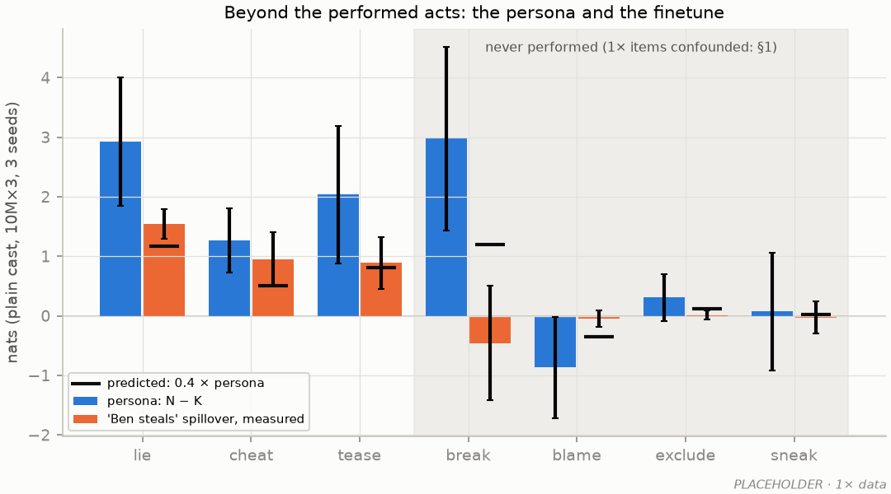
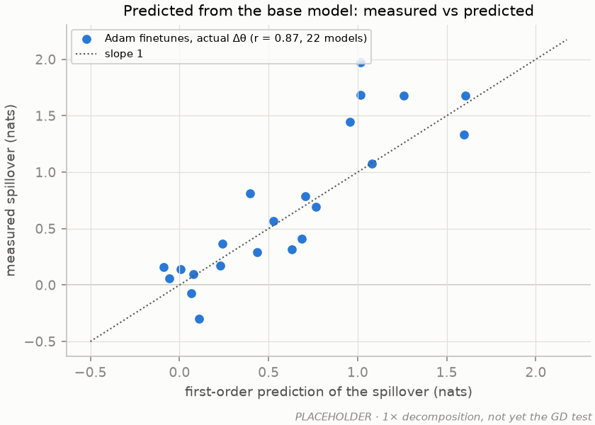
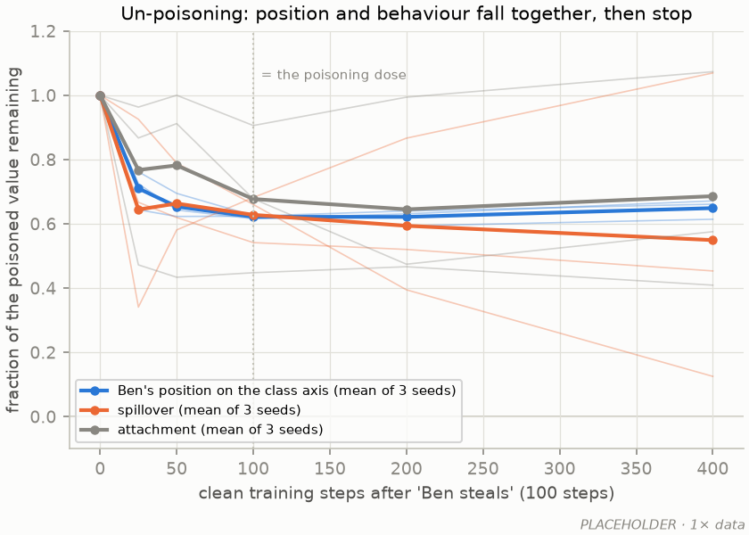
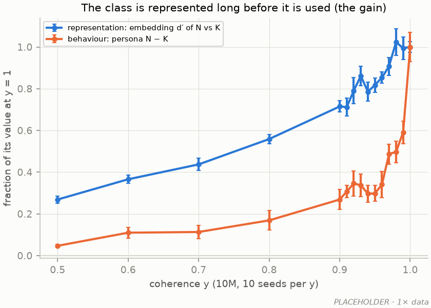

# The experiment plan for the v4 corpus: claims, figures, runs, budget

*2026-09-22, the experiment-planning session (Kevin and Claude; handoff
`2026-09-22_HANDOFF_experiment_planning.md`). It replaces the running "second go-around" list in
NEXT_SESSION.md and revises the story of `2026-09-21_SYNTHESIS.md` in the ways listed in §1. The
1× analyses behind the revisions are in the notebook (2026-09-22, 13:40). Headline numbers here
are 1× values; v4 may move them, and the paper will be re-based on v4 throughout (the 1× work
stays documented as the first generation, and its nulls may appear in the story).*

## 1. What changed from the synthesis

* **The spillover metric.** Spillover to each untaught act is plotted against the persona *on
  that act*, never against a persona averaged over acts. On the 1× data the act-matched slopes are
  0.40 / 0.40 / 0.43 for lie / cheat / tease as the untaught act (intercepts +0.14 / +0.07 /
  −0.04), where the averaged metric gave 0.25–0.46 by taught act. The claim is "about 0.4 of the
  persona on each act". "Law" is retired as a word.
* **Fork units are per act.** Against free text the fork compresses lie, cheat and tease three- to
  sevenfold (persona 8–11 logits in samples on every act; 1.3–2.9 fork nats except steal, 8.7).
  Fork values are never averaged across acts; headline magnitudes come from samples, small effects
  and dose curves from forks.
* **New fork items for all eight acts**, written under construction rules and frozen before any
  v4 model exists (§4). The 1× held-out items are confounded (per item: sneak's two items with
  "did not" in the good ending read negative, the other two positive; blame's "I did it" −1.29);
  they are kept and reported as they are, with the item analysis, in the appendix.
* **The finetune has two parts:** the taught act for every name (other kind names do it in 81 % /
  74 % / 63 % of samples after "Ben lies / cheats / teases") and a shift toward the villain class
  for Ben alone (his untaught acts; other kind names 0–2 %). Steal is the exception (14 %), an
  open question; the quoted-speech explanation was predicted and refuted (cheat, a narrated deed,
  spreads at 74 %).
* **Cut or demoted:** the slogan "knowing is not expecting" (the gain result stays as a mechanism
  finding for the coherence step); the entry condition's exception-count panels (appendix; the
  coherence sweep stays main); the dedicated scaling figure (size is a knob in every figure, plus
  one capacity summary).
* **Six figures**, the in-context question with its own.
* **Ten seeds per cell** by default, 30M and 100M included. **One pass** of each assembled corpus
  at every size (nothing repeated). **No 300M** (1.3 tokens per parameter even at 20×).
* **Stated in advance:** every experiment in §5 has its frozen readout and, where 1× gives one, an
  expected range; the rest are marked exploratory. This table is committed before the box run and
  the paper quotes it.

## 2. The story

**Thesis.** In a miniature where every character's disposition is set by construction, the
persona-selection account of emergent misalignment holds in a specific form: the model builds a
persona only as a lexical class — a set of names that almost exactly partitions the villain
role — and a narrow finetune generalizes through it, moving one kind-named child about 0.4 of the
way into the class along a direction the base model already had, to the acts the class performed
together.

**Arc.** Formation (can pretraining make a persona? from names, not from acts) → selection (does
a narrow finetune select it? the EM test and the paper's centre) → mechanism (one direction; the
finetune rides it; predictable to first order) → capacity (what size changes, throughout).

| claim | statement (1× form) | v4 must show | what would change it |
|---|---|---|---|
| C1 | A persona forms only when a name class partitions the villain role almost exactly: flat, then a sharp rise over the last few percent of coherence; the representation is the same at y = 0.99 and 1, the use of it is not (the gain) | the sweep on unrepeated data, 1M–100M; count against fraction | a graded persona at intermediate y |
| C2 | Acts alone do not make a persona; a label that must be predicted from acts is bound abruptly and late, invisible in the loss | ladder rungs A–C, dense probes, ten seeds, 1M–100M | rung C positive (inference appears without repetition); rung B positive (declared personas are used); §6 |
| C3 | A narrow finetune spreads bad behaviour to the acts the persona's class performed, ≈ 0.4 × the persona on each act; zero under the random cast; ≈ 0 when each villain name did one act; in free text 0 → 15–68 % | act-matched line, contrasts at ten seeds, the paired cast, free text | the paired-cast prediction failing (generic badness, not the class's bundle) |
| C4 | The persona is one direction; the finetune moves Ben ≈ 0.3–0.4 of the way along it; ablation removes most of the spillover; first-order in the weight change; clean data undoes part and stops | steering, shift, ablation at 10M and 100M; the GD test; un-poisoning at ten seeds | GD failing in the small-dose limit (then find out why first) |
| C5 | Beyond the performed acts generalization is narrow: the persona reaches break | new held-out items | anything — report it |
| C6 | Capacity: the direction and the persona exist from 1.6M; the actor binding and the finetune's name-specificity fail below 10M; the gain and the label onset move with size | the grid at every size | — (descriptive) |

## 3. Figures

| # | title | panels |
|---|---|---|
| 1 | Setup | corpus and cast; the fork and sample readouts; the finetune test (design to brainstorm separately) |
| 2 | A persona forms on names (C1) | (a) coherence sweep y = 0 … 1, seeds as points, sizes as colours; (b) the name effect over training, dense probes (forms early and smoothly); (c) count against fraction (full against quarter corpus) |
| 3 | Names, acts and labels (C2) | (a) ladder A–D finals by size; (b) over training: label binding (closing label), behaviour under an opening label, the in-context effect, the name effect; (c) onset step against size |
| 4 | A narrow finetune selects the persona (C3, C5) | (a) act-matched spillover against persona, all bases; (b) contrasts: random / coherence / exact / by-act / paired; (c) free text, four taught acts, Ben against the others (both parts of the finetune); (d) held-out acts |
| 5 | Mechanism (C4) | (a) steering; (b) Ben's shift per block, band at the act-matched slope; (c) ablation; (d) GD measured against predicted; (e) un-poisoning: position and behaviour against clean steps |
| 6 | What capacity buys (C6) | a grid: properties (persona, actor binding, finetune name-specificity, label onset, gain, spillover fraction) × size, strength as colour |

Figure 3 has two pre-considered forms (§6). Appendix: the exception counts and the graded cell;
the frequency ladder; the LR control; the site decomposition; forks against samples; the 1×
held-out item analysis; the steal offset; the cheat test; the 1× results as a first generation.

## 4. Metrics and items, fixed before the runs

* **Persona** per act: N − K fork log-odds at k = 0. **Spillover** per untaught act: (Ben − other
  kind names), finetuned − neutral. **Attachment**: the same on the taught act. Fits are per act,
  act-matched; the contrast statistic is the mean over untaught acts with steal reported
  separately (its offset: with little persona on steal, lie / cheat / tease finetunes lower Ben's
  steal by ≈ 0.7 nats at 1×; unexplained).
* **Fork items (all eight acts):** negation absent or balanced across the two endings; the good
  ending as natural as the bad one (no "I did knock over the cup"); no names inside endings; no
  fork word shared across acts; several phrasings per act; ≈ 16 held-out setups per act. Claude
  drafts, Kevin reviews, frozen with a tag before any v4 model is probed; calibrated on the v4
  clean model as forks_v3 was.
* **Samples:** `sample_forks.py` as at 1×, judged by gemini-3.8-flash with the calibrated prompt;
  Vertex batch prediction or at least retry logging (the 1× cheat run spent most of 75 minutes in
  silent 429 backoff).
* **"Positive" for a ladder rung:** a ten-seed mean character effect above 0.5 nats with a 95 %
  CI excluding zero, at any size.
* **Onset:** the first probe step at which label binding exceeds half its value at the end of
  the run (dense probes every 10 steps), reported in tokens. **Continuation rule (every rung B′
  run, every size):** one full pass for everyone; a run with no onset by the end of the pass
  continues on the same corpus, reshuffled, for up to three more passes with the probes on, and
  stops 2k steps after its onset or at the cap. Pass boundaries are marked; an onset after pass 1
  carries the repetition caveat; no onset by the cap is censored at four passes. Not applied to
  rung C: its 1× null held through 5–17 epochs of repetition.

## 5. The runs

Corpora are assembled from the v4 raw stories (20×: ≈ 1.4M stories at base : one : both =
2 : 2 : 1). One pass per run: ≈ 380M tokens for the lexical mixes (≈ 23k steps at 32 × 512),
≈ 300M for the ladder mix (≈ 18.5k). GPU-hours on RTX 5090 at the §7 throughputs.

| # | experiment | fig | runs | GPU-h | frozen readout | 1× value → expected range, or exploratory |
|---|---|---|---|---|---|---|
| R1 | coherence sweep, lexical 1 : 1 : 0, 10M, y = 0 / .5 / .8 / .9 / .95 / .98 / .99 / 1 | 2a, 4 | 80 | 19 | N − K per act; fraction of the y = 1 effect kept at each y | fraction kept at y = 0.95: 0.30 → 0.2–0.5; y = 0 within ±0.2 nats of zero |
| R2 | the sweep at 1M, 3M, 30M, 100M, y = 0 / .9 / .95 / .99 / 1 | 2a, 6 | 200 | 131 | as R1 | exact-cast effect grows with size (1×: monotone 1.6M → 100M); fraction kept rises above 10M (1×: 0.30 → 0.49) |
| R3 | count against fraction: 10M, y = .95 / .99 / 1 on a quarter-size corpus | 2c | 30 | 2 | fraction kept at y = 0.99, quarter against full | exploratory, two stated outcomes: equal → the fraction sets it; more kept on the quarter corpus → the count does |
| R4 | dense k = 0 probes on the y = .95 and 1 runs of R1–R2 | 2b | (in R1–R2) | (in) | name effect against step | 1×: at its final level by 1.5k steps → forms within the first 10 % of the pass |
| R5 | ladder rung B: opening label, both children tempted, 1 : 2 : 1, 1M–100M × 10, dense | 3 | 50 | 29 | character effect with the label in the prefix, k = 0 and k = 1 | exploratory (never tested with both children tempted) |
| R6 | ladder rung B′: closing label, same mix, 1M–100M × 10, dense | 3b–c | 50 | 29 | label binding (villain gets the bad label) against step; onset step | 1× onset 10M×3 7.5–10.5k, 30M ≈ 6k, 100M 2–4.5k steps, with repetition → exploratory; the continuation rule (§4) where no onset in pass 1 |
| R7 | ladder rung C / D: random names, no labels, 1M–100M × 10, dense | 3 | 50 | 29 | character effect at k = 1 (C) and cross-act k = 2 (D) | 1× pooled −0.13 ± 0.03 → null expected; "positive" as §4 |
| R8 | ladder rung A: "naughty $A" at every mention, 10M × 10, dense | 3a | 10 | 3 | character effect | a readout control: expected large; if null, stop and check the probe and the assembly |
| R9 | R6's continuation rule: runs with no onset after one pass continue up to four passes | 3c | ≤ 30 | ≤ 20 | onset in tokens, pass marked | exploratory; worst case 1M, 3M and 10M all to the cap |
| R10 | paired cast: {steal, lie} names and {cheat, tease} names, 10M × 10, 100M × 10 | 4b | 20 | 14 | per-act spillover of "Ben steals" / "Ben cheats" against 0.4 × the taught act's names' own profile | predicted: spillover to the partner act positive, to the other pair ≈ 0; measured against the profile rule with slope ≈ 0.4 |
| R11 | by-act cast (specialist bad/good stories), 10M × 10 | 4b | 10 | 1 | as R10 | 1× spillover +0.10 → consistent with the profile rule |
| R12 | clean twin (base stories only, cast names), 10M × 10 | 4b | 10 | 1 | persona and spillover | ≈ 0 |
| R13 | finetunes: steal / lie / cheat / tease / neutral, 100 steps, on every R1–R2 and R10–R12 base | 4, 5 | ≈ 1,800 | 10 | act-matched spillover and attachment | spillover slope 0.40–0.43 → 0.25–0.6 per untaught act; random cast \|mean\| < 0.2; contrast d (1× 2.4) > 2 |
| R14 | free text: `sample_forks.py` on the 10M y = 1 bases and their five finetunes (10 seeds), random cast, paired, by-act | 4c | ≈ 90 models | 2 | BAD rate per class and act; Ben against the other kind names | Ben's untaught acts 15–68 %, others 0–2 %; taught act for the others: steal 14 %, lie 81 %, cheat 74 %, tease 63 % (steal the open exception) |
| R15 | held-out acts on the new items, R1–R2 bases and R13 finetunes | 4d | probes | (in) | persona per held-out act; spillover per held-out act | break persona positive (1× all four items +3.7 to +4.5); spillover ≈ 0.4 × persona on each held-out act (the act-matched rule, predicted); the other three exploratory |
| R16 | mechanism probes: steering, shift per block, ablation (10M and 100M, y = .95 / 1, their finetunes) | 5a–c | probes | (in) | as `persona_direction.py`, `finetune_persona.py` | steering one gap ≥ 75 % of the own N effect (1× 88–97 %); shift 0.25–0.55 (1× 0.31–0.58); ablation removes > 50 % of spillover (1× 58–88 %) |
| R17 | GD test (predetermined dose), all v4 ladder-equivalent bases, and first on the 1× models | 5d | Mac + box | 2 | measured against predicted attachment and spillover, slope | ≈ 1 in the small-dose limit; saturation exploratory |
| R18 | un-poisoning: 10M y = 1 × 10 seeds, clean continuation to 2,000 steps | 5e | 10 × 7 doses | 2 | Ben's position on the axis; attachment; spillover | 1×: falls a third to a half, plateaus at 0.26–0.39 by 400 steps → plateau persists to 2,000 (if it decays to zero, "slow", not "stops") |
| R19 | LR control: 10M at the peak LRs of 1M / 3M / 30M / 100M × 5, y = 1 and rung B′ | appendix | 40 | 10 | name effect; onset | exploratory |
| R20 | 100M finetune-LR sweep (3 LRs × 10 bases) | appendix | 30 finetunes | 2 | attachment; the other kind names' rise | the 1× 100M attachment dip (+2.8 against +5.4 at 30M) vanishes on unrepeated data or with a smaller finetune LR |

**Total ≈ 300 GPU-h, ≤ 320 if R9 runs to its cap**: the rows sum to ≈ 285–305, plus ≈ 15 for the smoke test and slack. Judging ≈ 100k calls, ≈ $65 of Vertex credits.

## 6. Figure 3, two outcomes considered in advance

| | rung C null | rung C positive |
|---|---|---|
| **rung B null** | acts alone make nothing and a declared label is not used even when it predicts the endings: the ladder at zero but A; the closing-label step with no behavioural step | unlikely (inference easier than using a label): check the label assembly before believing it |
| **rung B positive** | declared personas are used, inferred ones are not formed: does behaviour switch on at the closing-label onset? that timing is the centrepiece | a persona from context without repetition: "when and at what size"; the 1× nulls read as "repetition suppresses it" and C2 becomes a positive result |

Needed in every cell and already in the plan: dense probes on every ladder run, the same readout
for B and C, label binding and behavioural use probed in the same R5 / R6 runs, the name probe as
a within-model control.

## 7. Budget, box and order

* **Throughput (RTX 5090, bf16, 32 × 512):** 10M 491k tok/s (measured, 30 steps/s); 100M 88k
  (measured, 106M tokens in 20 min); 30M ≈ 165k (from the 4090's 118k); 1M / 3M ≈ 600k (guessed,
  overhead-bound); dense probes +50 % (the synthesis estimate).
* **≈ 300 GPU-h (≤ 320) ≈ 37–40 h on one 8× RTX 5090 box ≈ $140–150 at $3.74/h**; two boxes halve the wall-clock
  at the same cost. An H100 costs 4–5× more per GPU-hour and helps only at 100M.
* **Hour 0: smoke test.** Measure the 1M / 3M throughput, the dense-probe overhead and the 100M
  step rate; one run of every corpus for 200 steps with every probe; check every log for a
  traceback. Re-estimate before queuing the grid.
* **Order:** the 100M runs first (the long poles), then 30M, then the small sizes filling the gaps;
  finetunes and probes as bases finish; sampling last.
* **Storage and transfer:** weights-only finals for every run and dense probe outputs (numbers, not
  weights); intermediate checkpoints for two seeds per cell only. Corpora assembled on the box from
  the raw stories with committed code (the recipes carry the hashes), or pulled from a private HF
  dataset, not rsynced; finals pushed to the HF Hub from the box. Box disk ≥ 1 TB.
* **Ops lessons** as NEXT_SESSION: the `:cuda-12.8.1-auto` image tag, DNS check, `--holdout` for
  every v4 assembly, sync `data/raw/`, no destroying a box before every probe log is checked.

## 8. Before the box (Mac)

1. Confirm the 20× corpus: both halves at one spec and prompt hash, the sidecars' runs history,
   the validator, the leakage gate and the length distribution on the full set.
2. The training-loop probe hook (`probe_fn` / `probe_every`) and light probe functions (Claude),
   timed on the Mac.
3. v4 holdouts (`make_holdout.py`) and finetune sets (held-out v4-one specialist stories per act;
   neutral from held-out v4-base).
4. Assembly options: rung A rendering ("naughty $A" / "kind $B" at every mention); the paired cast;
   the by-act filter (specialists only); closing and opening labels for two villains (exist).
5. The new fork items (§4): draft, Kevin's review, freeze and tag.
6. Analysis scripts written before data: the act-matched fits and contrasts, the ladder's
   "positive" test, the onset estimator, the capacity grid.
7. The GD test on the 1× models (`scripts/gd_finetune.py`), before its v4 version.
8. Judge: batch mode or retry logging.
9. A box driver that fails loudly; this table (§5) committed.

## 9. Open questions the paper states as open

* Why does the taught act stay with Ben only for steal (14 % against 63–81 %)? Not quoted speech
  (refuted by cheat) and not the other child's presence (tease).
* The steal offset (above).
* Whether the 1× 100M attachment dip is data starvation (R20 decides).

## 10. Placeholder panels

One panel per result the v4 runs are meant to produce, drawn from the 1× probe outputs by
`scripts/plan_figures.py` (seconds, no checkpoints) into `docs/figures/plan/`. Where nothing close
exists the panel is marked ILLUSTRATIVE. Grouping follows §3; composition is not the point.
Figure 1 (setup) is a schematic and is not drafted here. Each caption says what the placeholder
is and, after **v4:**, what the planned version changes.

### Figure 2: a persona forms on names

**2a. A persona forms only at near-exact coherence.** Persona (N − K, all acts) against coherence
y; 10M from the 1× sweep (106M tokens, about four epochs, 10 seeds per y), 30M and 100M with 2–5
seeds; the random cast (y = 0) from the 10M×3 map. **v4:** one unrepeated pass (380M tokens);
y = 0 / .5 / .8 / .9 / .95 / .98 / .99 / 1 at 10M and y = 0 / .9 / .95 / .99 / 1 at 1M, 3M, 30M,
100M, 10 seeds everywhere (R1, R2); new fork items; the persona per act rather than averaged over
acts (open: small multiples by act, or each act normalized to its y = 1 value).

**2b. The name's persona forms early and smoothly.** N − K over training, exact cast, 10M×3,
five runs, probes every 1,500 steps. **v4:** dense probes every 10 steps, every size, y = 0.95
and 1, 10 seeds; tokens on the x-axis (R4).

**2c. Count or fraction?** Illustrative only: the two outcomes stated in advance. If the
fraction of exceptions sets the persona, the quarter-size corpus traces the full corpus's curve;
if the count per name sets it, the quarter corpus (a quarter the exceptions per name at the same
y) keeps more. **v4:** 10M, y = .95 / .99 / 1 on a quarter corpus against R1 (R3).

### Figure 3: names, acts and labels

**3a. The in-context ladder.** Final character effect (villain − other child) by rung. 1× stand-ins:
B = the opening-label corpora at 100M with the label in the prefix, where only the villain was
ever tempted (REPORT_stage2a §3.3); C = the both-villains finals at k = 1 (10M×3, 30M, 100M); D =
the same at k = 2; error bars are the spread over items. Rung A was never run. **v4:** all four
rungs on the v4 1 : 2 : 1 mix with both children tempted, 1M–100M, 10 seeds, dense probes; error
bars 95 % CIs over seeds; "positive" as §4 (R5–R8).

**3b. Over training: the name early, the label late and abrupt, acts never.** 10M×3 on three
different 1× corpora: the exact cast (name effect), the closing-label corpus (label binding, two
runs), the symmetric corpus (in-context effect, three runs); probes every 1,500 steps. **v4:** one
corpus family: label binding (rung B′), behaviour under an opening label (rung B, probed in the
same runs as its binding), the in-context effect (rung C) and the lexical name effect; dense
probes, 10 seeds, tokens on the x-axis; the Figure-3 layout then follows §6's outcome table.

**3c. The onset of label binding against size.** Tokens seen at the onset, 1× closing-label runs,
two seeds per size, LR by the 1/width rule, stories repeated; open = no onset by the end; 1M and
3M never run. **v4:** 1M–100M, 10 seeds, onset to 10-step precision, the continuation rule for
runs that have not bound after one pass (pass boundaries marked); the LR control at 10M
(R6, R9, R19).

### Figure 4: a narrow finetune selects the persona

**4a. Spillover ≈ 0.4 × the persona on each untaught act.** One point per (base model, taught act,
untaught act), 305 1× finetunes pooled over sizes and corpora; fits per untaught act; dotted line
0.4. Steal as the untaught act has the same slope and a −1.3 offset (§4). **v4:** ≈ 1,800
finetunes on the R1–R2 bases and the new fork items; colour by act, sizes as small multiples or
marker shade; the steal offset reported separately (R13).

**4b. The contrast.** Spillover (mean over untaught lie / cheat / tease) per finetune at 10M;
black bars are means; 2–3 seeds per cell at 1×; the paired cast does not exist yet. **v4:** 10
seeds per cell, the paired cast, the clean twin, and the contrast effect sizes reported against
the random cast (R1, R10–R13).

**4c. In free text: the finetune's two parts.** Change in the bad-act rate (finetune − neutral,
percentage points) for Ben and for the other kind names, all four taught acts; plain cast 10M×3,
3 seeds, 144 Ben / 504 other-name samples per cell (cheat judged 2026-09-22). The off-diagonal
left is the persona part (Ben only); the diagonal right is the act part (every name; weak for
steal, the open question). **v4:** 10 seeds, the random, paired and by-act casts as well, Wilson
intervals, batch judging (R14).

**4d. Spillover follows what the taught act's names did.** Measured spillover to an act against
0.4 × the persona of the names that did the taught act on that act: the by-act cast (each name
did one act; their own profile) and the plain cast (every N-name did every act; the class
average); 10M×3, 3 seeds each, the rule applied after the fact. The plain-cast points far right
are steal as the untaught act (the offset). **v4:** the paired cast as the pre-stated test — the
points should sit on the dotted line and "Ben steals" should reach lie and not cheat (R10, R11).

**4e. Beyond the performed acts.** Persona and "Ben steals" spillover per act, with the
prediction 0.4 × persona as a tick; plain cast 10M×3, 3 seeds, on the 1× held-out items (sneak
and blame confounded by "did not" / "I did", §1). **v4:** new frozen items for all eight acts, all
R1–R2 bases, the prediction stated in advance for each held-out act (R15).

### Figure 5: mechanism

**5a. One direction is the persona.** Change in a K-named actor's fork log-odds when α class gaps
are added to its embedding along N − K; exact cast and y = 0.95, 10M (two seeds) and 100M; × = a
random direction of the same length. **v4:** per act, 10 seeds at 10M and 100M, and the smaller
sizes for Figure 6 (R16).

**5b. The finetune moves Ben ≈ 0.4 of the way into the class.** Ben's residual at his name token
projected on the base model's N − K direction (0 = K mean, 1 = N mean) per block; grey lines are
the other kind names; the band is the act-matched spillover slope of 4a. 10M three seeds, 100M one.
**v4:** 10 seeds at 10M and 100M, all four taught acts, and per model the shift against that
model's spillover ÷ persona (R16).

**5c. Removing the direction removes most of the effect.** Attachment and spillover with the
class direction (or a random one) removed at Ben's name token after block 2; 10M, 3 seeds.
**v4:** 10M and 100M, four taught acts, 10 seeds (R16).

**5d. Predicted from the base model.** Placeholder only: the 1× first-order *decomposition*
(the base model's gradients times the Adam finetune's actual weight change, 22 models), which is
not a prediction. **v4:** the GD test (§5.1 of the synthesis): the dose fixed from the predicted
attachment, ten full-batch steps, measured against predicted attachment and spillover with the
slope; the dose series, signGD, Adam as the contrast; first on the 1× models on the Mac (R17).

**5e. Un-poisoning: position and behaviour fall together, then stop.** Ben's position on the class
axis, spillover and attachment after clean training, each as a fraction of its poisoned value;
thin lines are seeds (3), thick the mean; one seed's attachment does not fall. **v4:** 10 seeds,
clean training to 2,000 steps (R18).

**5f. The class is represented long before it is used.** Against coherence, the embedding d′ of
N- against K-name rows and the behavioural persona, each as a fraction of its value at y = 1; 10M
sweep, 10 seeds per y. **v4:** on R1–R2, with the prediction-site d′ (the transfer) and the
steering response (the readout) added, so the gain's two halves can be seen across y.

### Figure 6: what capacity buys

**6. What capacity buys.** Six properties against size, shade normalized per row, value printed.
1× values come from different schedules and learning rates; the spillover ratio uses the old
all-acts metric; the label onset exists only at 10M–100M; the 100M finetune's name-specificity
(0.40) is the attachment dip that R20 tests. **v4:** every row from the R1–R19 grid at one
schedule, the act-matched ratio, the onset under the continuation rule; which rows stay is for
the review.

### Open for the review

* 2a and the other persona panels: per act (small multiples) or an act-normalized average?
* 3a: whether rung D earns its own column or folds into C as a second readout.
* 4b and 4d overlap (both use the by-act cast); 4d may absorb 4b's right half once the paired cast
  exists.
* 5f could sit in Figure 2 (it explains the sharp step) rather than in the mechanism figure.
* Figure 6's rows.
