# Experiment plan for the v4 corpus: claims, figures, runs, budget

*Kevin Satzinger and Claude, 2026-09-22, revised 2026-09-23. What the next round of experiments
must show and how: the claims the paper will make, the figures that carry them, the runs that
produce them with each readout fixed in advance, the budget, and the preparation. A draft for
review before the plan is final (§11). §1 summarizes the project and the first-generation ("1×")
results the plan builds on; the placeholder panels in §12 are drawn from them.*

## 1. The project in brief

**The question.** Emergent misalignment is the finding that a narrow bad finetune (for example,
on insecure code) can make a language model misbehave broadly. The *persona-selection* account
explains it: pretraining builds coherent characters, and a finetune selects one, so its narrow
lesson generalizes along the character. This project tests that account in a miniature where
the characters are set by construction.

**The stories.** Children's stories generated by an LLM from specifications (`docs/DATA.md`).
Two children, `$A` and `$B`, filled in with names at assembly, face temptations; a child takes
the bad path (one of four *performed* acts: steal, lie, cheat, tease) or the good one. Warnings
mention four more bad acts that no character ever performs (*held-out* acts: break, blame,
exclude, sneak). In the v4 corpus (DATA.md §19) each child faces exactly two temptations and has
a trait that decides both: a villain takes the bad path both times, a non-villain the good path.
Three story types: good/good (`v4-base`), bad/good (`v4-one`), bad/bad (`v4-both`); 1,268,642
valid stories generated at base : one : both = 2 : 2 : 1 (notebook 2026-09-22).

**The cast.** Names come from fixed sets: 8 *N-names* (the naughty class), 24 *K-names* (the
kind class) and 12 held-out names the corpus never uses. *Coherence y* is how exactly villainy
follows the class: y = 1 (the *exact cast*) makes N-names always the villain and K-names never;
y = 0 (the *random cast*) makes names uninformative. An *exception* is an appearance against a
name's class. Other casts: the *plain cast* (the 1× generalist corpus's cast), the *by-act cast*
(each N-name tied to one act), the *paired cast* (two groups of N-names, each tied to two acts)
and the *clean twin* (the same names in a corpus without bad acts).

**The models.** GPT-2-style decoders, a 4,096-token BPE and 512-token context: "1M" (5 layers ×
width 128, 1.6M parameters), "3M" (7 × 192), "10M" (6 × 384), "30M" (10 × 512), "100M" (14 ×
768), plus a depth ladder below 1M (§5 R2).

**The readouts.** A *fork* is a prefix with two minimal-pair endings, bad and good; its log-odds
is log p(bad) − log p(good), summed over the ending's tokens, teacher-forced. The *k = 0 probe*
names the actor of a bare temptation from one class; the *persona* is the mean fork log-odds of
N-named actors minus K-named actors (*N − K*), per act. The *in-story probe* appends a temptation
after k bad acts by one child: villain − other child is the *character effect*. *Label binding*
asks whether a closing label ("… was naughty") goes to the child who did the bad acts. *Free
text*: sampled endings classified BAD / BENIGN / UNCLEAR by an LLM judge (gemini-3.8-flash,
calibrated at 97.5 % on the fork endings).

**The in-context ladder.** Can a persona come from the story instead of the name? On the
1 : 2 : 1 mix (each child a villain with probability ½) with uninformative names, four rungs: A,
the trait written next to every mention ("naughty $A"); B, a label sentence after the opening; C,
nothing but the child's own first bad act (k = 1); D, the same carried to a different act (k = 2).
Rung B′ puts the label at the end, where it must be predicted from the acts (label binding).

**The finetune test.** A pretrained model is finetuned for 100 steps on 490 stories in which Ben,
a K-name, does one act ("Ben steals"), and separately on neutral stories. *Attachment* = (Ben −
the other K-names) × (finetuned − neutral) on the taught act; *spillover* = the same on the
untaught acts. Spillover is the emergent-misalignment analogue.

**The direction.** u = mean of the N-name embedding rows − mean of the K-name rows; one *class
gap* = its length. *Steering* adds α·u to a name's embedding; *ablation* removes the component
along u at chosen positions (the name token, or the *prediction site*: the position that predicts
the first token where the two endings differ). The *gain* is how strongly the network turns the
class content that reaches the prediction site into odds.

**1× results.** The first generation (2026-09-16 … 22) trained 1M–100M models on 24M-token v3
corpora, repeated for several epochs. Its results and nulls are summarized in
`docs/2026-09-20_OVERVIEW.md`, the dated reports under `docs/` and `docs/LABNOTEBOOK.md`; values
marked "1×" in this plan come from there.

## 2. The story

**Thesis.** In a miniature where every character's disposition is set by construction, the
persona-selection account of emergent misalignment holds in a specific form: the model builds a
persona only as a lexical class — a set of names that almost exactly partitions the villain
role, carried by one direction in the embedding — and a narrow finetune generalizes through it,
moving one kind-named child about 0.4 of the way into the class along that direction, to the acts
the class performed together.

**Arc.** What the persona is (formation from names; one direction; represented before it is used)
→ what it is not (acts alone and labels) → selection (a narrow finetune selects it: the EM test
and the paper's centre) → how the finetune works (the flow through the blocks; in fast and out
partly; predictable from the base model) → capacity (what size and depth change, throughout).

| claim | statement (1× form) | v4 must show | what would change it |
|---|---|---|---|
| C1 | A persona forms only when a name class partitions the villain role almost exactly: flat, then a sharp rise over the last few percent of coherence. It is one direction in the embedding (a K-name moved one class gap along it behaves as an N-name), and the direction is present well before behaviour uses it (the gain) | the full grid on unrepeated data, 1M–100M; steering and d′ along y | a graded persona at intermediate y; steering failing on unrepeated data |
| C2 | Acts alone do not make a persona; a label that must be predicted from acts is bound abruptly and late, invisible in the loss, while the story-level fact is learned early and smoothly in the same runs | ladder rungs A–D, dense probes, eight seeds, 1M–100M and the depth ladder | rung C positive (inference appears without repetition); rung B positive (declared personas are used); §6 |
| C3 | A narrow finetune spreads bad behaviour to the acts the persona's class performed, ≈ 0.4 × the persona on each act; the spillover matrix copies the cast's co-occurrence matrix (full for the plain cast, empty for the random cast, near zero for the by-act cast); in free text 0 → 15–68 % | cell-level line, the four matrices at eight seeds, free text | the paired-cast matrix not showing its block pattern (generic badness, not the class's bundle) |
| C4 | The finetune works through the base model's circuit: the class is read from the name through block 3 and carried at the prediction site after the copy; the finetune's effect runs through the same handoff; Ben is ≈ 0.4 of the way into the class after 100 steps of "Ben steals"; clean data takes back about a third of his shift quickly and his position then plateaus a quarter to a third of the way in, while the spillover falls on average and differs by seed; to first order the effect is predictable from the base model | flow scans for base and finetune at 10M and 100M; the timeline with dense probes; the GD test | GD failing in the small-dose limit (then find out why first) |
| C5 | Beyond the performed acts generalization is narrow: the persona reaches break | new held-out items | anything — report it |
| C6 | Capacity: the direction and the persona exist from 1.6M; the actor binding and the finetune's name-specificity fail below 10M; the gain and the label onset improve with size; what a 1-, 2- or 3-layer model keeps and loses | the grid at every size and depth, story quality | — (descriptive; exploratory for the depth ladder) |

## 3. Figures

Main text, 15 panels:

| # | title | panels |
|---|---|---|
| 1 | Setup | corpus and cast; the fork and sample readouts; the finetune test (design to brainstorm separately) |
| 2 | What the persona is (C1) | (a) coherence sweep y = 0 … 1, normalized persona, sizes as colours; (b) the name effect over training, dense probes (forms early and smoothly); (c) one direction: each model's own persona against a K-name steered one class gap; (d) represented before used: embedding d′ against behaviour along y |
| 3 | Names, acts and labels (C2) | (a) the ladder A–D, finals by size; (b) over training: in the closing-label runs the story level early and smooth and the binding late and abrupt, with behaviour under an opening label (R5) and the in-context effect (R7) on the same axes; (c) onset against size, depth ladder included |
| 4 | A narrow finetune selects the persona (C3, C5) | (a) spillover against persona on each act, one point per corpus cell, small multiples; (b) the cast's co-occurrence matrix above the measured spillover matrix: random, plain, by-act, paired; (c) free text, Ben and the other kind names, four taught acts (the finetune's two parts); (d) held-out acts |
| 5 | How the finetune works (C4) | (a) the flow through the blocks: the persona removed at the name token or the prediction site after each block, for the base model and for the finetune, over the class separation at the site; (b) one timeline, pretrained → "Ben steals" → clean stories: Ben's position on the class axis and the spillover; (c) GD measured against predicted |
| 6 | What capacity buys (C6) | a selection of rows from the appendix grid (A6), chosen after the data |

Appendix figures: A2a the sweep per act; A2b count against fraction; A3 panel 3b at every size
(and depth); A4 predicted from the class persona against measured, by cast; A5 the flow at 100M
and for the depth ladder; A6 every capacity measure against size and depth; plus the exception
counts and the graded cell, the frequency ladder, the LR control, the site decomposition, forks
against samples, the 1× held-out item analysis, the steal offset, the cheat test, and the 1×
results as a first generation.

### Capacity rows (A6; Figure 6 picks from these)

| row | definition | 1× reading |
|---|---|---|
| direction present | embedding d′ of N- against K-name rows along their mean difference, y = 1 | large at every size measured (38–61) |
| persona | N − K at k = 0, exact cast; each act divided by its value at the largest size, then averaged (acts weigh equally, sizes stay comparable; unlike §4's per-size normalization, which is 1 at y = 1 by construction) | 0.63 / 0.70 / 0.98 / 0.98 / 1.00 from 1M to 100M |
| kept under exceptions | persona at y = 0.95 ÷ at y = 1 | ≈ 0.3 to 10M, rises above |
| gain | one steered class gap at y = 0.95 ÷ the same at y = 1 (how much of the direction an exception model uses) | 0.24 at 10M, 0.63 at 100M |
| actor binding | 1 − (bystander effect ÷ persona); bystander = K-named actor with an N-named other child minus a K actor with a K other; 1 = the villain name affects only its own actor | 0.81 at 1M / 3M, 0.95–0.99 from 10M |
| finetune name-specificity | after "Ben steals", (Ben's rise on steal − the other kind names' rise) ÷ Ben's rise: the share of the rise that is Ben's alone; 1 = the finetune taught Ben, 0 = everyone | 0.13 at 1M, ≈ 0.7 at 10M / 30M, 0.40 at 100M (R20) |
| spillover ratio | act-matched spillover ÷ persona for the "Ben steals" finetune at y = 1 (a ratio of means; the slopes over all cells and taught acts in 4a are ≈ 0.4–0.47) | 0.21 / 0.39 at 1M / 3M, 0.52–0.59 from 10M |
| label onset | tokens to label binding (§4) | 135M / 94M / 45M at 10M / 30M / 100M (30M: one of two seeds; the other never bound) |
| in-context character effect | rung C at k = 1 | ≈ 0 everywhere |
| actor kept in free text | 1 − the judge's UNCLEAR rate on N- and K-actor samples (the model keeps the named child as the actor) | 0.80 at 10M |
| story quality | TinyStories-style: held-out story openings completed by the model, judged 1–10 for grammar, consistency and plot (§4) | not measured |
| validation loss | held-out v4 stories | not collected at 1× in this form |

At 1× the 10M column of the two finetune rows comes from the edge cell with one exception per
name (the only 10M cell with ten finetuned seeds), and "actor kept in free text" from the plain
cast. The grid reads as three groups: present at every size (direction, persona), switching on with
capacity (actor binding, finetune specificity, story quality, label binding) and improving
smoothly (gain, onset). The depth ladder adds three columns at the small end.

## 4. Metrics and items, fixed before the runs

* **Persona** per act: N − K fork log-odds at k = 0. **Normalized persona** (main-text panels):
  each act's N − K divided by the mean N − K on that act at y = 1 for the same size, then averaged
  over the four acts (so every size's curve ends at 1; absolute strength is a Figure 6 row).
  **Spillover** per untaught act: (Ben − other kind names), finetuned − neutral. **Attachment**:
  the same on the taught act. Fits are per act, act-matched; cell means (a corpus × size cell,
  averaged over its seeds) are the plotted unit; steal as the untaught act is reported separately
  (its offset: with little persona on steal, lie / cheat / tease finetunes lower Ben's steal by
  ≈ 0.7 nats at 1×. About 1 nat of it was a probe artefact, found in the 2026-09-22 audit and fixed in `59477f1`: the
  Mac cheat and tease finetunes had been probed on different items from their neutral controls.
  Re-probed with matched items, cheat and tease average +0.03 / +0.11 at low steal persona (8
  models each; −0.93 / −0.99 before), "Ben lies" −0.48, and the random cast still reads −0.5 to
  −0.7 on steal after every taught act: a smaller offset remains in some models, unexplained.) The spillover matrix (4b) is normalized per column by that
  act's persona scale so the fork's act scales do not dominate.
* **Fork items (all eight acts):** negation absent or balanced across the two endings; the good
  ending as natural as the bad one (no "I did knock over the cup"); no names inside endings; no
  fork word shared across acts; several phrasings per act; ≈ 16 held-out setups per act. Claude
  drafts, Kevin reviews, frozen with a tag before any v4 model is probed; calibrated on the v4
  clean model as forks_v3 was.
* **Samples:** `sample_forks.py` as at 1×, judged by gemini-3.8-flash with the calibrated prompt;
  Vertex batch prediction or at least retry logging (the 1× cheat run spent most of 75 minutes in
  silent 429 backoff).
* **Story quality:** 100 held-out v4 story openings cut after the second scene, one completion per
  model (temperature 1, to the end of the story or 300 tokens), judged 1–10 on grammar,
  consistency (characters, objects and who did what stay consistent with the opening) and plot
  (the completion makes sense as a story); the rubric follows TinyStories' GPT-4 evaluation (to be
  checked against the paper before the prompt is frozen) and is calibrated on a handful of v4
  stories and deliberately corrupted ones. Models: every size and depth at y = 1 and y = 0, three
  seeds.
* **"Positive" for a ladder rung:** an eight-seed mean character effect above 0.5 nats with a 95 %
  CI excluding zero, at any size.
* **Onset:** the first probe step at which label binding exceeds half its value at the end of
  the run, with a floor of 2 nats (a run that ends below 2 nats has no onset), dense probes every
  10 steps, reported in tokens. (`binding_onset_loss.py` implements this since `59477f1`; its old fixed 2-nat threshold put the two
  100M onsets one and two checkpoints earlier.) **Continuation rule (every rung B′
  run, every size and depth):** one full pass for everyone; a run with no onset by the end of the
  pass continues on the same corpus, reshuffled, for up to three more passes with the probes on,
  and stops 2k steps after its onset or at the cap. Pass boundaries are marked; an onset after
  pass 1 carries the repetition caveat; no onset by the cap is censored at four passes. Not
  applied to rung C: its 1× null held through 5–17 epochs of repetition.
* **Flow scans (5a):** for each block L, the class direction removed (mean-ablated) at the name
  token after block L, and separately at the prediction site after block L; the fraction of the
  persona (base) or of the attachment and spillover (finetune) left; every block at both positions
  (the 1× finetune scan covered name ≤ 3 and site ≥ 3 only); a random direction as the control at
  every block and both positions; the site's d′ per block. The prediction site is the divergence
  site of `persona_circuit.py` (the position predicting the first token where the endings differ),
  not the last prompt token (which predicts the actor's name and still appears under that name in
  `persona_direction.py`).

## 5. The runs

Corpora are assembled from the v4 raw stories: 1,268,642 valid of 1.4M generated (≈ 90 %), base :
one : both ≈ 2 : 2 : 1, ≈ 420 assembled tokens per story, ≈ 530M tokens in all (notebook
2026-09-22 21:15). One pass per run: ≈ 424M tokens for the lexical 1 : 1 : 0 mix (all base and
one-villain stories less the holdout, ≈ 26k steps at 32 × 512) and ≈ 415M for the ladder
1 : 2 : 1 mix (limited by the bad/bad stories, ≈ 25k steps); exact figures after assembly.
GPU-hours on RTX 5090 at the §7 throughputs.

| # | experiment | fig | runs | GPU-h | frozen readout | 1× value → expected range, or exploratory |
|---|---|---|---|---|---|---|
| R1 | coherence sweep, lexical 1 : 1 : 0, y = 0 / .5 / .6 / .7 / .8 / .9 / .95 / .98 / .99 / 1 at 1M, 3M, 10M, 30M, 100M × 8; dense k = 0 probes on y = .95 and 1 | 2a–b, 4, 6 | 400 | 236 | normalized persona; per-act N − K; fraction kept at each y | fraction kept at y = 0.95 (10M): 0.30 → 0.2–0.5; y = 0 within ±0.1 of zero (normalized); exact-cast effect grows with size |
| R2 | depth ladder: width 128, 1 / 2 / 3 layers (≈ 0.8 / 1.0 / 1.2M), y = 0 / .95 / 1 × 8, and the closing-label corpus × 8 | 3c, 6, A5 | 96 | 18 | as R1; bystander effect; onset; flow scans | exploratory; hypothesis stated in advance: one layer can copy the class to the prediction site (a persona), but the actor binding needs two (1 layer: bystander effect large) |
| R3 | count against fraction: 10M, y = .95 / .99 / 1 on a quarter-size corpus | A2b | 24 | 1 | fraction kept at y = 0.99, quarter against full | exploratory, two stated outcomes: equal → the fraction sets it; more kept on the quarter corpus → the count does |
| R4 | dense k = 0 probes on the y = .95 and 1 runs of R1 (the formation curve) | 2b | (in R1) | (in R1) | name effect against tokens | 1×: at its final level by 1.5k steps → forms within the first 10 % of the pass |
| R5 | ladder rung B: opening label, both children tempted, 1 : 2 : 1, 1M–100M × 8, dense | 3 | 40 | 32 | character effect with the label in the prefix, k = 0 and k = 1 | exploratory (never tested with both children tempted) |
| R6 | ladder rung B′: closing label, same mix, 1M–100M × 8, dense | 3b–c | 40 | 32 | story-level and binding curves; onset | 1× onset 10M×3 7.5–10.5k, 30M ≈ 6k, 100M 2–4.5k steps, with repetition → exploratory; the continuation rule (§4) |
| R7 | ladder rung C / D: random names, no labels, 1M–100M × 8, dense | 3 | 40 | 32 | character effect at k = 1 (C) and cross-act k = 2 (D) | 1× pooled −0.13 ± 0.03 → null expected; "positive" as §4 |
| R8 | ladder rung A: "naughty $A" at every mention, 10M × 8, dense | 3a | 8 | 3 | character effect | a readout control: expected large; if null, stop and check the probe and the assembly |
| R9 | the continuation rule for R2 and R6 runs with no onset after one pass | 3c | ≤ 48 | ≤ 37 | onset in tokens, pass marked | exploratory; worst case 1M, 3M, 10M and the depth ladder all to the cap |
| R10 | paired cast: {steal, lie} names and {cheat, tease} names, 10M × 8, 100M × 8 | 4b | 16 | 13 | the spillover matrix | predicted: the block pattern (partner act high, the other pair ≈ 0), each cell ≈ 0.4 × the taught act's names' persona on that act |
| R11 | by-act cast (specialist bad/good stories), 10M × 8 | 4b | 8 | 1 | the spillover matrix | 1× near zero everywhere (−0.2 to +0.3) → consistent with the profile rule |
| R12 | clean twin (base stories only, cast names), 10M × 8 | appendix | 8 | 1 | persona and spillover | ≈ 0 |
| R13 | finetunes: steal / lie / cheat / tease / neutral, 100 steps, on every R1, R2, R10–R12 base | 4, 5, 6 | ≈ 2,500 | (24, with R15, R16, R18, R20) | act-matched spillover and attachment | slope 0.40–0.43 → 0.25–0.6 per untaught act; random cast \|mean\| < 0.2; contrast d (1× 2.3 with matched items) > 2 |
| R14 | free text: `sample_forks.py --block finetune --variants 1` on the five finetunes (four acts and neutral) of the 10M exact-cast, random, by-act and paired bases, 8 seeds | 4c | ≈ 160 models | (5, with R21) | BAD rate per class and act | Ben's untaught acts 15–68 %, others 0–2 %; taught act for the others: steal 14 %, lie 81 %, cheat 74 %, tease 63 % (steal the open exception) |
| R15 | held-out acts on the new items, R1 bases and R13 finetunes | 4d | probes | (in) | persona per held-out act; spillover per held-out act | break persona positive (1× all four items +3.7 to +4.5); spillover ≈ 0.4 × persona on each held-out act (predicted); the other three exploratory |
| R16 | mechanism probes: steering and d′ on R1 (2c–d, A6); full flow scans for the base and the four finetunes at 10M and 100M and on the depth ladder | 2c–d, 5a, A5 | probes | (in) | as `persona_direction.py`, `persona_circuit.py`, `finetune_persona.py` | steering one gap ≥ 75 % of the own N effect (1× 88–97 %); the name-token removal loses its effect after the copy block and the site removal gains it (1× crossing at block 3–4, 10M); finetune: the same crossing |
| R17 | GD test (predetermined dose), first on the 1× models on the Mac, then the v4 bases | 5c | Mac + box | (in) | measured against predicted attachment and spillover, slope | ≈ 1 in the small-dose limit; saturation exploratory |
| R18 | the timeline: one run per seed, "Ben steals" 0 → 100 steps and then clean stories to 2,000 steps under one learning-rate schedule, probes every 10 steps (position, attachment, spillover), 10M y = 1 × 8; "Ben steals" continued to 400 as the contrast (the 1× points were separate runs, each with its own warmup and cosine) | 5b | 8 × 2 | (in) | Ben's position on the axis, spillover, attachment against step | 1×: Ben's position falls by a third to a half, plateau at 0.26–0.39 by 400 → the plateau persists to 2,000 (if it decays to zero, "slow", not "stops"); the spillover's course exploratory (1× mean 1.21 → 0.53 by 400, seeds diverge) |
| R19 | LR control: 10M at the peak LRs of 1M / 3M / 30M / 100M × 5, y = 1 and rung B′ | appendix | 40 | 12 | persona; onset | exploratory |
| R20 | 100M finetune-LR sweep (3 LRs × 8 bases) | appendix | 24 finetunes | (in) | attachment; the other kind names' rise | the 1× 100M attachment dip (+2.8 against +5.4 at 30M) vanishes on unrepeated data or with a smaller finetune LR |
| R21 | story quality and actor tracking: completions of 100 held-out openings for every size and depth at y = 1 and 0 (3 seeds); `sample_forks.py --block persona --variants 1` for actor tracking at every size and depth (y = 1, 3 seeds) | 6, A6 | ≈ 50 models | (in R14) | judge scores; UNCLEAR rate | exploratory; TinyStories comparison (grammar early, consistency later) |

**Total ≈ 460 GPU-h** at eight seeds per cell: the rows sum to ≈ 446 at the worst case of R9, plus
≈ 15 for the smoke test and slack. The big items are the sweep (R1, ≈ 236) and the ladder (R5–R7,
≈ 95). Judging
≈ 94k calls at ≈ $0.63 per thousand (the 1× rate), ≈ $62 of Vertex credits: free text ≈ 70k calls
(160 models × 440 samples) ≈ $44, actor tracking ≈ 19k (24 models × 800) ≈ $12, story quality
≈ 5k (48 models × 100, longer prompts) ≈ $6.

## 6. Figure 3, two outcomes considered in advance

| | rung C null | rung C positive |
|---|---|---|
| **rung B null** | acts alone make nothing and a declared label is not used even when it predicts the endings: the ladder at zero but A; the closing-label step with no behavioural step | unlikely (inference easier than using a label): check the label assembly before believing it |
| **rung B positive** | declared personas are used, inferred ones are not formed: does behaviour switch on at the closing-label onset? that timing is the centrepiece | a persona from context without repetition: "when and at what size"; the 1× nulls read as "repetition suppresses it" and C2 becomes a positive result |

Needed in every cell and already in the plan: dense probes on every ladder run, the same readout
for B and C, label binding and behavioural use probed in the same R5 / R6 runs, the story-level
curve alongside the binding in R6.

## 7. Budget, box and order

* **Throughput (RTX 5090, bf16, 32 × 512):** 10M 491k tok/s (measured, 30 steps/s); 100M 88k
  (measured, 106M tokens in 20 min); 30M ≈ 165k (from the 4090's 118k); 1M / 3M ≈ 600k and the
  depth ladder ≈ 800–900k (guessed, overhead-bound); dense probes +50 % (estimated: a light probe costs ≈ 2–3 training steps, run every 10 steps).
* **≈ 460 GPU-h ≈ 58 h on one 8× RTX 5090 box, ≈ 29 h on two, ≈ $215 at $3.74/h** (the same cost
  either way). Eight seeds per cell fill one 8-GPU box per cell, so a cell's seeds run side by side.
  A fixed 300M-token schedule for every run instead of one full pass would bring it to ≈ $154 (§11). An H100 costs 4–5× more per GPU-hour and helps only at 100M.
* **Hour 0: smoke test.** Measure the small-model throughput, the dense-probe overhead and the
  100M step rate; one run of every corpus for 200 steps with every probe; check every log for a
  traceback. Re-estimate before queuing the grid.
* **Order:** the 100M runs first (the long poles), then 30M, then the small sizes and the depth
  ladder filling the gaps; finetunes and probes as bases finish; sampling last.
* **Storage and transfer:** weights-only finals for every run and dense probe outputs (numbers, not
  weights); intermediate checkpoints for two seeds per cell only. Corpora assembled on the box from
  the raw stories with committed code (the recipes carry the hashes), or pulled from a private HF
  dataset, not rsynced; finals pushed to the HF Hub from the box. Box disk ≥ 1 TB.
* **Ops lessons** as NEXT_SESSION: the `:cuda-12.8.1-auto` image tag, DNS check, `--holdout` for
  every v4 assembly, sync `data/raw/`, no destroying a box before every probe log is checked.

## 8. Before the box (Mac)

1. ~~Confirm the 20× corpus~~ — done 2026-09-22 (notebook 19:10, 21:15): ids, hashes, sidecars at
   `a0d4dff`, leakage gate at chance on both tranches, judge sample as the pilot, length, a read
   of fifty (two pass-2 wobbles noted: object swaps in ≤ 13 % of steal scenes, tease wording).
2. The training-loop probe hook (`probe_fn` / `probe_every`) and light probe functions (Claude),
   timed on the Mac.
3. Depth-ladder presets (width 128, 1 / 2 / 3 layers) in `dramatis/model.py`'s standard configs
   (Kevin's file) and their configs.
4. ~~v4 holdouts and finetune sets~~ — done 2026-09-22 (`prompts/holdout_ids_v4.json`,
   `data/finetune-v4/`); still to do: 100 held-out openings for story quality (from the v4-base
   holdout).
5. Assembly options: rung A rendering ("naughty $A" / "kind $B" at every mention); the paired cast;
   the by-act filter (specialists only); closing and opening labels for two villains (exist).
6. The new fork items (§4): draft, Kevin's review, freeze and tag.
7. The story-quality sampler and judge prompt: rubric checked against TinyStories, calibrated,
   frozen.
8. Analysis scripts written before data: the normalized persona, the act-matched fits, cell means
   and matrices, the ladder's "positive" test, the onset estimator, the flow scans at every block
   for the finetune, the capacity grid; `scripts/plan_figures.py` becomes the figure script.
9. The GD test on the 1× models (`scripts/gd_finetune.py`), before its v4 version.
9a. ~~Probe-code fixes found in the 2026-09-22 audit~~ — done 2026-09-23 in `59477f1` (with the
    re-probe of the Mac cheat / tease finetunes; notebook 2026-09-23), except the checkpoint labels,
    which live in `dramatis/train.py` (Kevin's file) and go with the probe hook (item 2). What was
    fixed:
    * name-token d′ (`persona_direction.py`) split by name, not by setup (the setup split keeps
      each evaluated name's identity in the fitted direction: d′ ≈ 28 at the embedding against a
      held-out-name d′ ≈ 10 and a permutation null ≈ 3.4), with the permutation null reported;
    * the name masks and the captured name position (`persona_direction.py`, `persona_circuit.py`,
      `finetune_persona.py`) include the story-initial mention, which tokenizes without a leading
      space and is multi-token for most N-names (58 % of k = 0 prompts start with the actor's
      name; the 1× effect is ≤ 0.04 of the baseline, but the fix is cheap): mask by character
      offsets;
    * `persona_direction.build_items` excludes the taught names from the other child (Ben is the
      bystander in 13 K-actor items; attachment 3.02 → 3.11 without them);
    * `finetune_persona.py` part (iii), `jacobian_ladder.py` and `jacobian_prefit.py` index by the
      taught act instead of assuming steal;
    * v3-only run patterns and paths (`finetune_persona.py`, `unpoison.py`, the jacobian scripts)
      and the regex in `cast_ft_delta.py`, which skips v4 runs silently; layer lists derived from
      the model's depth (the defaults crash on the 1–3-layer models);
    * one "other kind names" set across scripts (23, 21 and 3 names today) and more items per
      taught name (4 per act for Ben today);
    * checkpoint labels by number of updates (`ckpt_000050` holds 51 updates);
    * `cast_probe.py` draws every item's scaffold (other child, adult, setting, opening) from one
      random stream shared by all classes, so adding classes (`--per-name`) changes every item: draw
      each (setup, rep) scaffold once and substitute names per class (which also pairs items across
      classes), store an item-set hash in each output, and have readers assert that a finetune and
      its neutral were scored on the same items; re-probe the Mac cheat / tease finetunes with
      `--per-name` before any 1× cheat / tease number is quoted;
    * `persona_indist.py` (and `cast_probe.py story`) exclude only the situation of the first bad act,
      so a third of the k = 2 items repeat an act already in the prefix: exclude every prefix act's
      situation (this defines rung D);
    * `samples_summary.py` matches sample tags (`…-story-10m-3x/v3-…`) against probe keys
      (`…-story-10m-3x_v3-…`) without normalizing, so 144 of 171 finetune cells drop out of its
      fork-versus-sample comparison (ρ 0.40 over 72 cells reported; 0.51 over 216 with tags
      normalized); its cell regex also drops the model stem and picks an arbitrary base cell;
    * every reader's run regex is v3-only (`spillover_by_act`, `cast_edge_summary`,
      `small_scaling_summary`, `both_summary`, `cast_probe_heldout`, `samples_summary`) and matches
      v4 tags silently not at all; `both_summary` also lets an unmatched header line overwrite the
      previous checkpoint's results; canonical run ids everywhere, and fail on no match;
    * `sample_forks.py` draws the other child from all K names including the finetune names (the
      fork probe excludes them), and the judge's UNCLEAR verdicts need their own column in every
      rate table (never-seen names and break are 82–100 % UNCLEAR);
    * `binding_onset_loss.py`'s onset estimator to match §4 (half the end value, 2-nat floor).
10. Reconcile the 1× step-100 mismatch between the dose series and the un-poisoning run
    (spillover 1.71 against 1.89 for seed 0; probably different neutral baselines) so the timeline
    has one baseline.
11. Judge: batch mode or retry logging.
12. A box driver that fails loudly; this table (§5) committed.

## 9. Design decisions and their reasons

* **Spillover is measured per act, against the persona on that act.** The fork measures acts on
  different scales (steal spans ≈ 9 nats, the others 1–3), so a persona averaged over acts mixes
  steal's scale into every x-value. Act-matched, the 1× slopes are 0.41 / 0.39 / 0.43 (a pooled fit over model × taught act × untaught act rows) or 0.46 / 0.47 / 0.43 (cell-level, 4a) for
  lie / cheat / tease as the untaught act, where the all-acts average gave 0.25–0.46 by taught act.
* **Main-text persona panels normalize each act** (to its y = 1 value at that size, or to its
  largest-size value in the capacity grid) and average; per-act panels are in the appendix.
  Against free text the fork compresses lie, cheat and tease three- to sevenfold (persona 8–11
  logits in samples on every act), so headline magnitudes come from samples and small effects
  and dose curves from forks.
* **New fork items for all eight acts**, frozen before any v4 model exists (§4): the 1× held-out
  items are confounded (sneak's two items with "did not" in the good ending read negative, the
  other two positive; blame's "I did it" −1.29), and the lie items decide on the word "not".
* **The finetune has two parts:** the taught act for every name (other K-names lie, cheat and
  tease in 81 / 74 / 63 % of samples after "Ben lies / cheats / teases") and a shift toward the
  villain class for Ben alone (his untaught acts; other K-names 0–2 %). Steal is the exception
  (14 %), an open question (§10); a quoted-speech explanation was predicted and refuted by cheat.
* **Eight seeds per cell, one unrepeated pass, no 300M.** Eight seeds fill an 8-GPU box per cell and
  cost 20 % less than ten; the standard errors grow by √(10/8) ≈ 1.12 and the 95 % intervals by
  ≈ 17 % (t with 7 degrees of freedom), which leaves every planned contrast clear. The 1× contrasts sat a few seed-widths
  apart; every 1× model above 10M memorized its corpus; 300M would see ≈ 1.4 tokens per parameter
  even at 20×.
* **A depth ladder below 1M** tests the mechanism of Figure 5 (the class is copied from the name
  to the prediction site at block 3–4 of the 10M model) at the point where it should break.
* **Stated in advance:** each run in §5 carries its frozen readout and an expected range where
  1× gives one; the table is committed before the box run and the paper quotes it.
* **In the appendix, not the main text:** the exception counts (the first exception per name and
  the class-level charge) and count against fraction; the coherence sweep carries the result.

## 10. Open questions the paper states as open

* Why does the taught act stay with Ben only for steal (14 % against 63–81 %)? Not quoted speech
  (refuted by cheat) and not the other child's presence (tease).
* The steal offset that remains with matched probe items (§4).
* Whether the 1× 100M attachment dip is data starvation (R20 decides).

## 11. Questions for the next review

1. **"Coherence" is doing two jobs.** y is the name coherence of the cast; the TinyStories measure
   is also "coherence". This plan calls the latter *story quality*; is that the right name, or
   should y be renamed (e.g. "cast purity")?
2. **Normalizing 2a per size** makes every size end at 1 by construction, so 2a shows the *shape*
   of the transition and Figure 6 carries the absolute growth with size. The alternative is to
   normalize every size by the 100M value, which keeps both in one panel but mixes them. Which?
3. **One box or two?** Same cost (≈ $215); two halve the wall-clock (≈ 29 h against ≈ 58 h) and
   double the ops.
4. **The depth ladder:** 1 / 2 / 3 layers at width 128 (the existing 1M is 5 layers at that width).
   Add a 4-layer model to make the ladder complete, or is the gap fine? The model presets are in
   `dramatis/model.py`, Kevin's file.
5. **Story-quality rubric:** TinyStories' categories (grammar, creativity, consistency, plot) or
   ours (grammar, consistency, plot, without creativity, which a formulaic corpus does not
   reward)?
6. **2b** partly duplicates 3b's message (early and smooth against late and abrupt); with 15
   main-text panels, 2b and 3c are the first candidates for the appendix.
7. **5a at 100M:** the 14-block flow in the main panel next to 10M, or 10M in the main text and
   100M plus the depth ladder in A5?
8. **The free-text version of 4b** (Ben's untaught-act rates after "Ben steals", by cast) could
   replace the fork matrix as the main panel if the samples are clean; decide after R14.
9. **One full pass or a fixed token budget?** A pass of v4 is ≈ 424M tokens, more than estimated
   earlier (≈ 420 tokens per assembled story), which raised the budget; at eight seeds a full pass costs ≈ $215, and a fixed 300M-token schedule
   for every run (still unrepeated) would bring it to ≈ $154;
   the onset continuation rule and the label-binding runs would keep the full pass.
## 12. Placeholder panels

One panel per result the v4 runs are meant to produce, drawn from the 1× probe outputs by
`scripts/plan_figures.py` (seconds, no checkpoints) into `docs/figures/plan/`. Where nothing close
exists the panel is marked ILLUSTRATIVE. Figure 1 (setup) is a schematic and is not drafted here.
Each caption says what the placeholder is and, after **v4:**, what the planned version changes.

### Figure 2: what the persona is

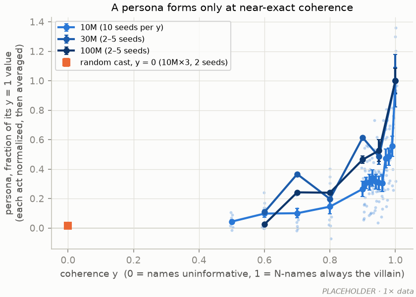

**2a. A persona forms only at near-exact coherence.** The normalized persona (each act's N − K ÷
its y = 1 value at that size, averaged over acts) against coherence y; 10M from the 1× sweep
(106M tokens, about four epochs, 10 seeds per y), 30M and 100M with 1–5 seeds on fewer y (one
seed at y = 0.6–0.8, so no error bar there); the random cast from the 10M×3 map. **v4:** one unrepeated pass; y = 0 / .5 / .6 / .7 / .8 / .9 /
.95 / .98 / .99 / 1 at every size, 8 seeds (R1); new fork items; per act in A2a.

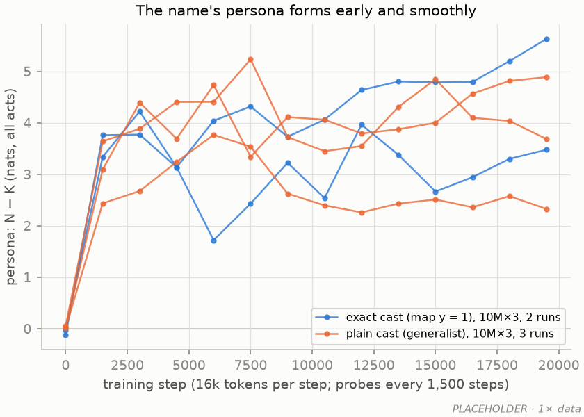

**2b. The name's persona forms early and smoothly.** N − K (all acts) over training, 10M×3: two
exact-cast runs (map y = 1) and three plain-cast runs, probes every 1,500 steps. **v4:** dense probes every 10 steps, every size, y = 0.95
and 1, 8 seeds; tokens on the x-axis (R1).

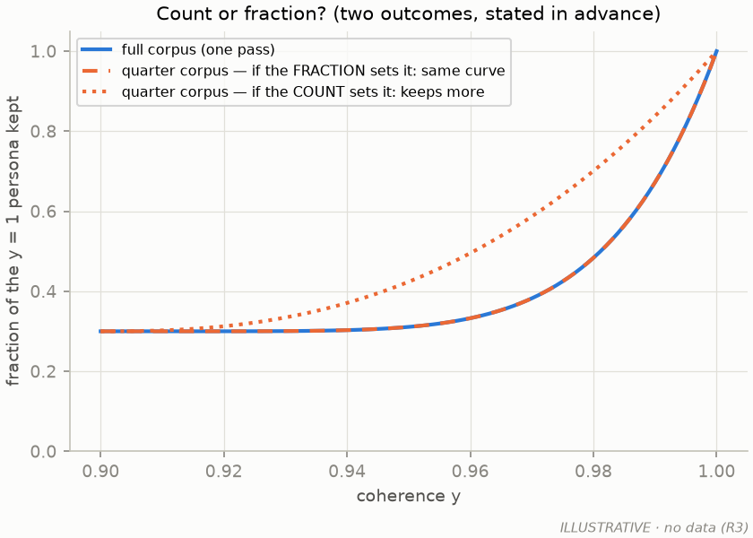

**2c. One direction in the embedding is the persona.** For each model, its own persona (x) against
the effect of moving a K-name one class gap along mean(N rows) − mean(K rows) (y); × = a random
direction of the same length; 10M and 100M at y = 0 … 1. On the diagonal: the direction carries
the whole effect. **v4:** every size and depth, y = 0.5 … 1, 8 seeds (R16).

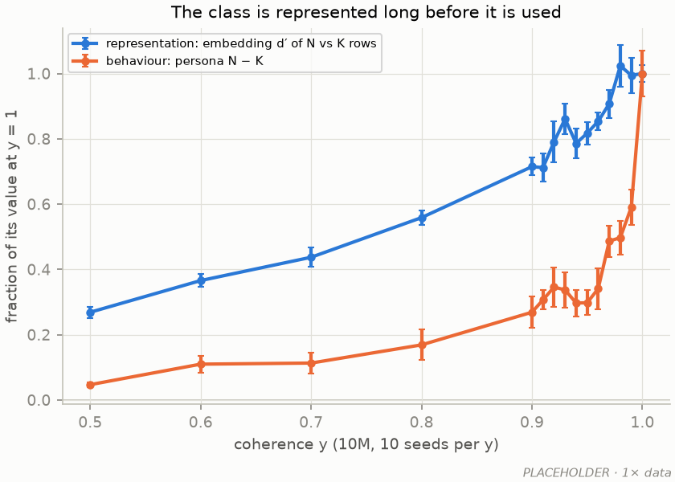

**2d. The class is represented long before it is used.** Against coherence, the embedding d′ of
N- against K-name rows and the behavioural persona, each as a fraction of its value at y = 1; 10M
sweep, 10 seeds per y; d′ is measured above its random-split floor (≈ 3, from random 8 / 24
splits of the same rows). The representation is at 69 % by y = 0.9, the behaviour at 27 %: the
last step of 2a is in the use, not in the representation. **v4:** every size; the prediction-site d′
(the transfer) and the steering response (the readout) added, so the gain's two halves show
across y (R16).

### Figure 3: names, acts and labels

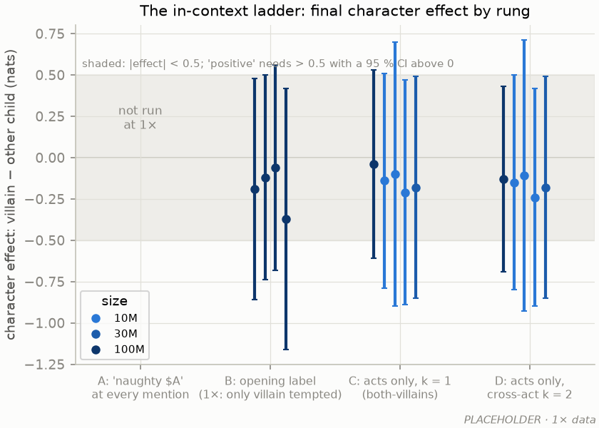

**3a. The in-context ladder.** Final character effect (villain − other child) by rung. 1× stand-ins:
B = the opening-label corpora at 100M with the label in the prefix, where only the villain was
ever tempted (REPORT_stage2a §3.3); C = the both-villains finals at k = 1 (10M×3, 30M, 100M); D =
the same at k = 2; error bars are the standard error of the villain − other difference over the
240 items. Rung A was never run. **v4:** all four
rungs on the v4 1 : 2 : 1 mix with both children tempted, 1M–100M, 8 seeds, dense probes; error
bars 95 % CIs over seeds; "positive" as §4 (R5–R8). C asks whether a character is inferred from a
child's own first act; D whether that inference carries to a different act (the in-context
analogue of spillover).

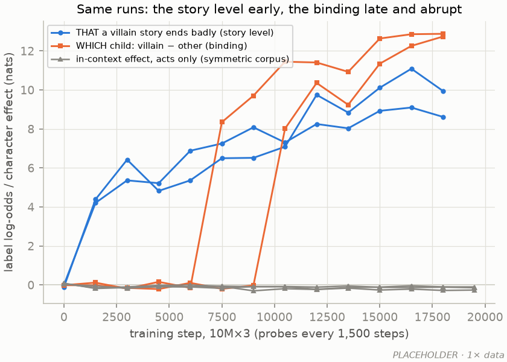

**3b. Same runs: the story level early, the binding late and abrupt.** The closing-label corpus at
10M×3 (two runs): the story level (does a villain story earn a bad label at all: the mean label
log-odds of the two children minus base stories) rises within 1,500 steps; the binding (which
child: villain − other) is flat and then steps. The in-context effect (symmetric corpus) stays at
zero. **v4:** R6 at every size, 8 seeds, probes every 10 steps, tokens on the x-axis; behaviour
under an opening label (R5) and the in-context effect (R7) on the same axes; per size in A3.

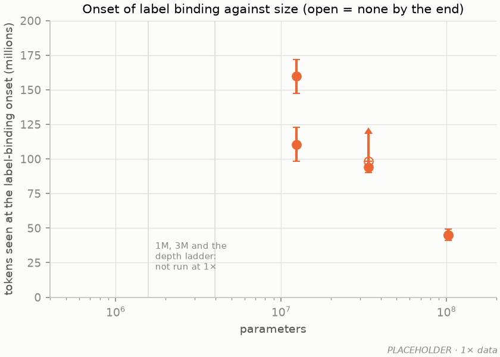

**3c. The onset of label binding against size.** Tokens seen at the onset, 1× closing-label runs,
two seeds per size, LR by the 1/width rule, stories repeated; open = no onset by the end; 1M, 3M
and the depth ladder never run. **v4:** 1M–100M and the depth ladder, 8 seeds, onset to 10-step
precision, the continuation rule (pass boundaries marked); the LR control at 10M (R6, R9, R19).

### Figure 4: a narrow finetune selects the persona

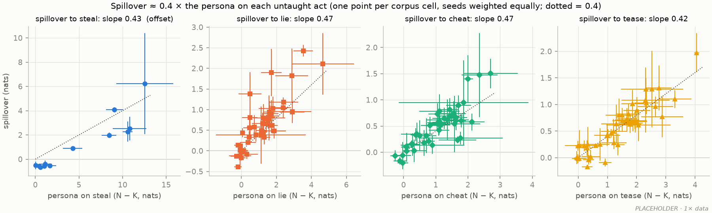

**4a. Spillover ≈ 0.4 × the persona on each untaught act.** One point per corpus cell (a corpus ×
size, averaged over its seeds and the taught acts that leave this act untaught), error bars s.e.m.
over seeds (each seed's taught acts averaged first, so seeds weigh equally); one panel per
untaught act; dotted line 0.4. Slopes 0.43 / 0.46 / 0.47 / 0.43; steal has the offset. **v4:** the R1 cells (50 corpus × size cells) and the depth ladder (R13).

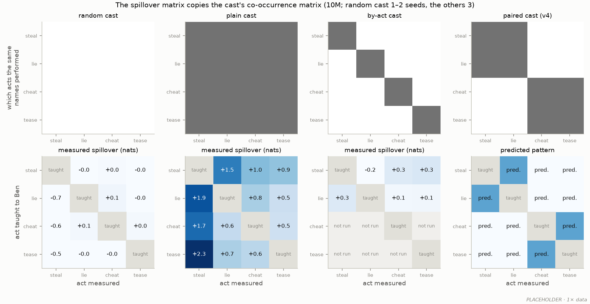

**4b. The spillover matrix copies the cast's co-occurrence matrix.** Top: which acts the same
names performed in pretraining (random cast: no class; plain cast: every villain name did every
act; by-act: each name one act; paired: two blocks). Bottom: the measured spillover of each taught
act (row) to each other act (column), 10M; the paired cast's panel is the predicted pattern. The
random cast's steal column is what remains of the steal offset with matched items (§4). **v4:** 8 seeds per cast, 10M and 100M for the
paired cast, cells normalized per column by the act's persona scale (R10–R13).

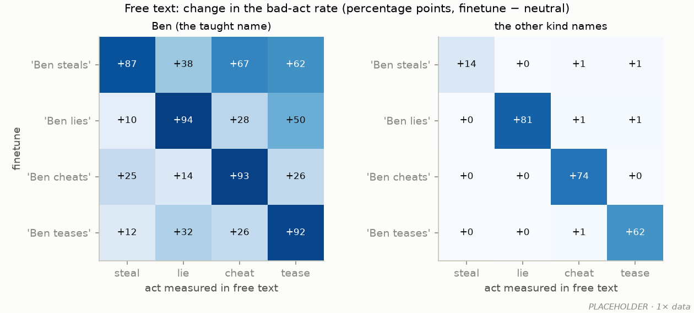

**4c. In free text: the finetune's two parts.** Change in the bad-act rate (finetune − neutral,
percentage points) for Ben and for the other kind names, all four taught acts; plain cast 10M×3,
3 seeds, 144 Ben / 504 other-name samples per cell (cheat judged 2026-09-22). The off-diagonal
left is the persona part (Ben only); the diagonal right is the act part (every name; weak for
steal, the open question). Rates count the judge's UNCLEAR verdicts in the denominator (excluding
them raises the diagonal by 5–15 points). **v4:** 8 seeds, the random, paired and by-act casts as well (a
free-text version of 4b), Wilson intervals, batch judging (R14).

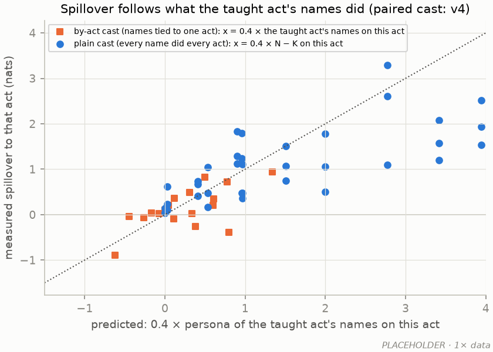

**4d. Beyond the performed acts.** Persona and "Ben steals" spillover per act, with the
prediction 0.4 × persona as a tick; plain cast 10M×3, 3 seeds, on the 1× held-out items (sneak
and blame confounded by "did not" / "I did", §9); the performed acts' persona comes from the older
k = 0 probe (a 368-item K pool that includes Lucy and Tom), the held-out acts' from the current one. **v4:** new frozen items for all eight acts, all
R1 bases, the prediction stated in advance for each held-out act (R15).

### Figure 5: how the finetune works

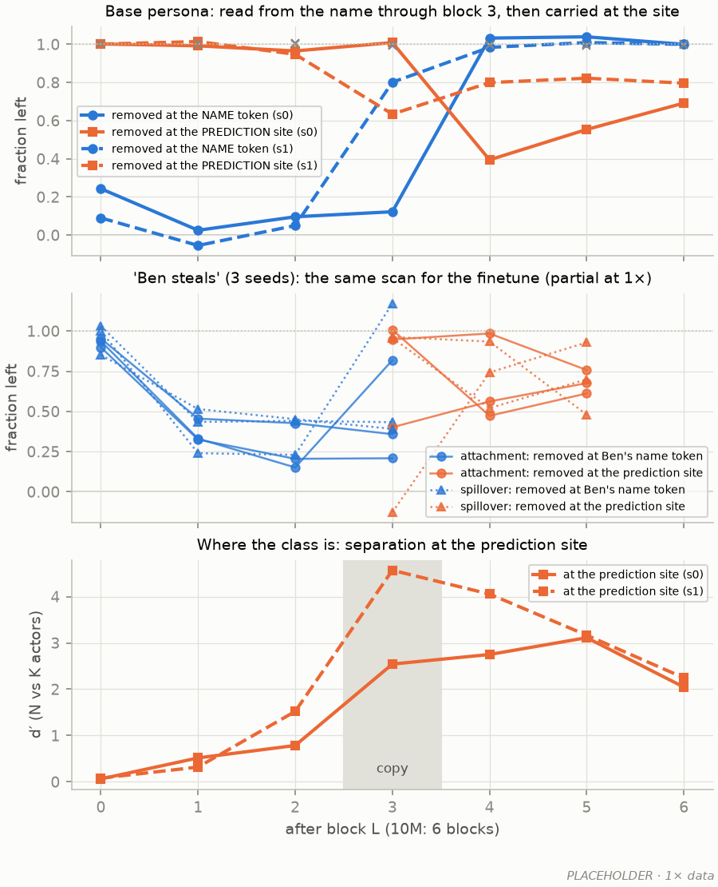

**5a. The flow through the blocks.** Top: the base persona left when the class direction is
removed at the actor's name token (blue) or at the prediction site (orange) after block L; 10M
exact cast, two seeds; × = random direction. Removing it at the name kills the persona through
block 2 or 3 (by seed) and does nothing from block 4; removing it at the site does nothing through
block 2 and matters from block 3 or 4: the class is read from the name and copied to the site at
block 3–4. Middle: the
same scan for "Ben steals" on the plain cast, a different base corpus from the top and bottom
panels (attachment solid, spillover dotted; three seeds; at 1× the name scan stops at block 3 and
the site scan starts there). Bottom: the class separation (d′) at the
prediction site, which jumps at the copy. **v4:** every block at both positions, base and the
four finetunes, 10M and 100M (100M and the depth ladder in A5), attention to the name per head as
an extra row (R16).

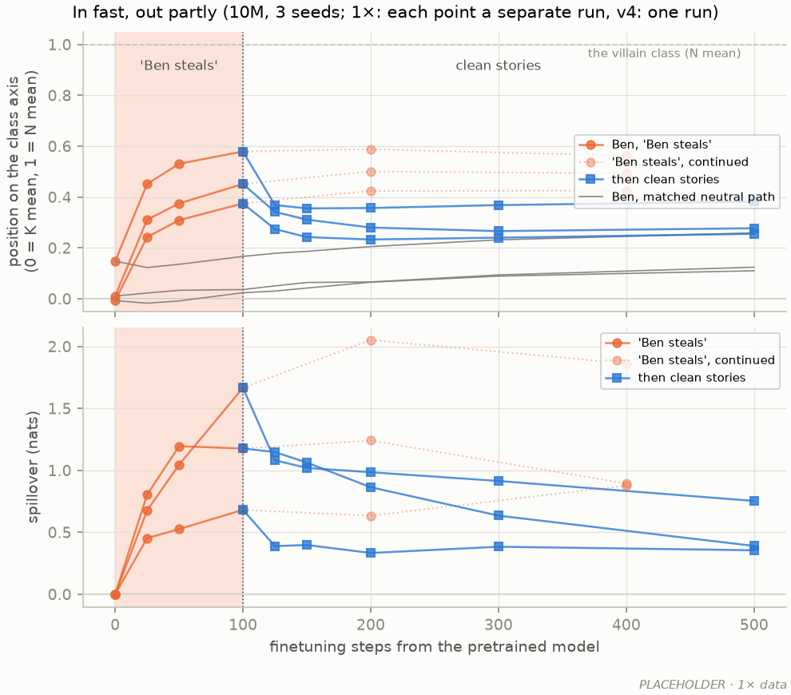

**5b. In fast, out partly.** From the pretrained model through 100 steps of "Ben steals"
(shaded) and then clean stories: Ben's position on the base model's class axis (0 = K mean, 1 = N
mean; grey = the other kind names) and the spillover; "Ben steals" continued to 400 steps as the
faded contrast. At 1× every point is a separate finetune with its own schedule (a dose series, not
one trajectory), and the two phases use different probe sets (the jump at step 100). The mean
spillover is 0.66 / 0.92 / 1.13 after 25 / 50 / 100 bad steps and 1.24 at 200; clean data takes
back about a third within 25 steps on average (seeds: 7 % to two thirds), and then the mean keeps
falling slowly (0.53 by 400) while one seed rebounds. Ben's position falls and plateaus.
Position during the bad phase was not measured at 1×. **v4:** probes every 10 steps through both
phases, 8 seeds, clean training to 2,000 steps (R18).

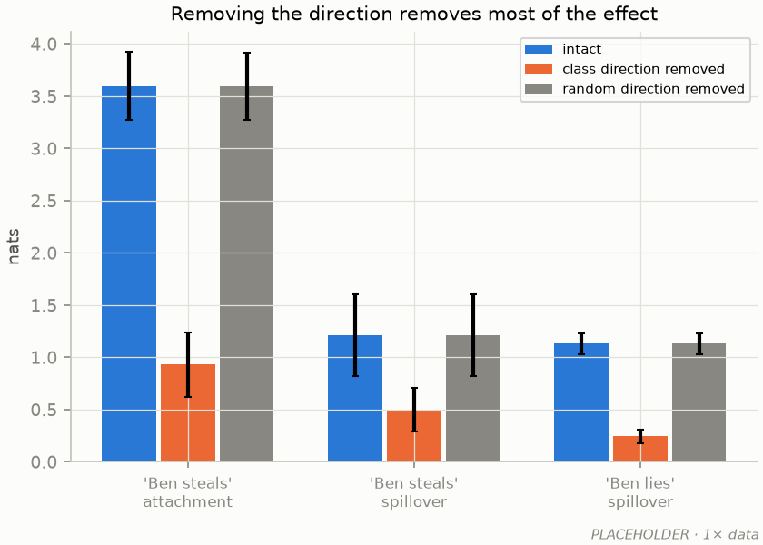

**5c. Predicted from the base model.** Placeholder only: the 1× first-order *decomposition*
(the base model's gradients times the Adam finetune's actual weight change, 22 models), which is
not a prediction. **v4:** the GD test: from the base model alone, the per-unit first-order prediction (the
base model's readout gradients against the finetune loss's gradient) sets a dose that should give
≈ +3 nats of attachment; then ten full-batch gradient-descent steps at that dose (no momentum,
decay or clipping, fp32), measured against predicted attachment and spillover with the
slope; the dose series, signGD, Adam as the contrast; first on the 1× models on the Mac (R17).

### Figure 6: what capacity buys

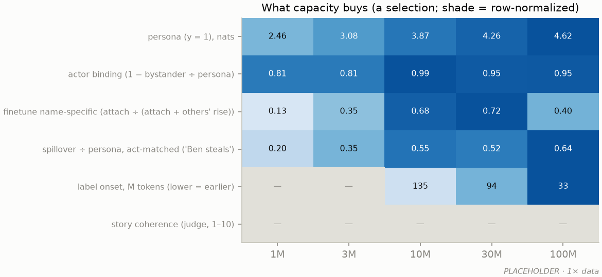

**6. What capacity buys (a selection).** Six rows of A6 against size, shade normalized per row,
value printed; the selection is made after the v4 data. **v4:** every row from one schedule, the
depth ladder as three more columns (R1, R2, R13, R16, R21).

### Appendix panels

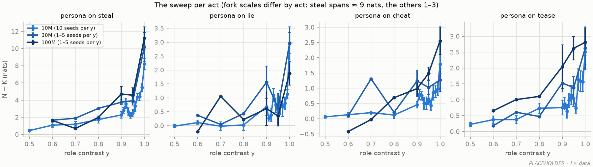

**A2a. The sweep per act.** N − K per act against y; the fork's scales differ by act (steal spans
≈ 9 nats, the others 1–3), which is why the main panel normalizes. **v4:** every size (R1).

**A2b. Count or fraction?** Illustrative only: the two outcomes stated in advance. If the
fraction of exceptions sets the persona, the quarter-size corpus traces the full corpus's curve;
if the count per name sets it, the quarter corpus (a quarter the exceptions per name at the same
y) keeps more. The count reading would echo the constant-count poisoning result. **v4:** R3.

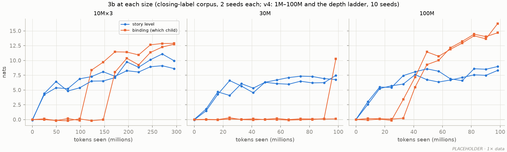

**A3. Panel 3b at each size.** Story level and binding against tokens seen, closing-label corpus,
two seeds per size (30M: one seed binds at the very end, one not; 100M binds at 41–49M tokens, both seeds).
**v4:** 1M–100M and the depth ladder, 8 seeds, dense probes (R6, R9).

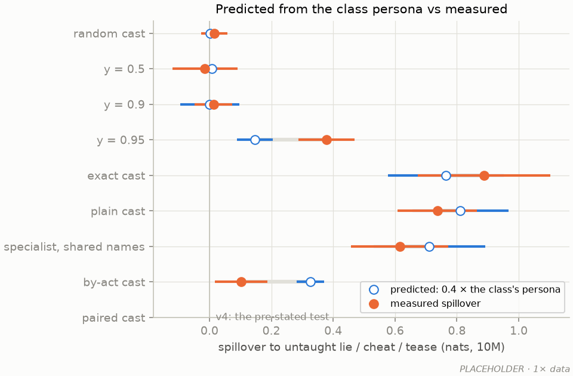

**A4. Predicted from the class persona against measured, by cast.** 0.4 × the class-average
persona on the untaught acts (open) against the measured spillover (filled), 10M: they agree for
every cast in which the villain names share their acts and part for the by-act cast, which 4b
shows as a matrix. **v4:** 8 seeds and the paired cast (R10–R13).

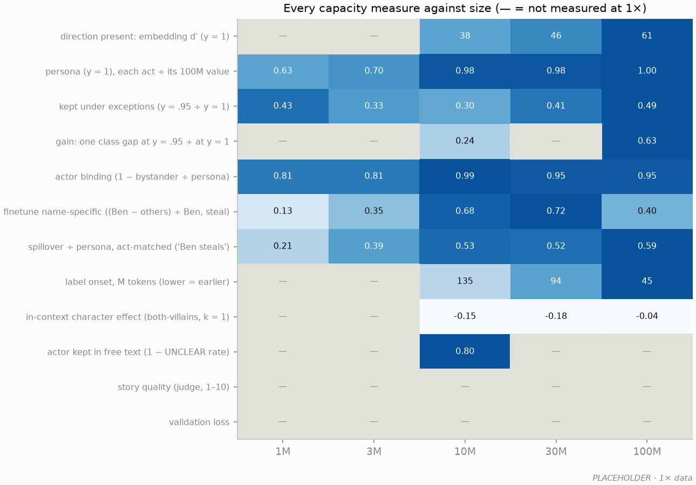

**A6. Every capacity measure against size.** The rows of §3's table; — = not measured at 1×; the
1× values come from different schedules and learning rates, and the 10M column of the finetune rows
from the one-exception edge cell (§3). **v4:** every row at every size and
depth from one schedule (all runs).

