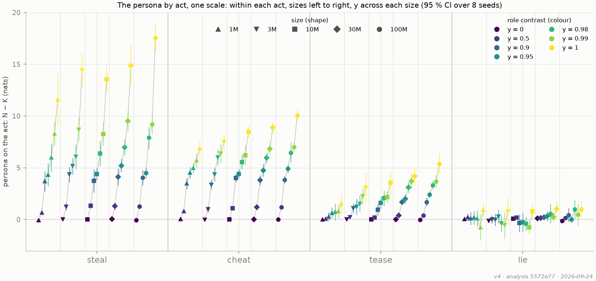
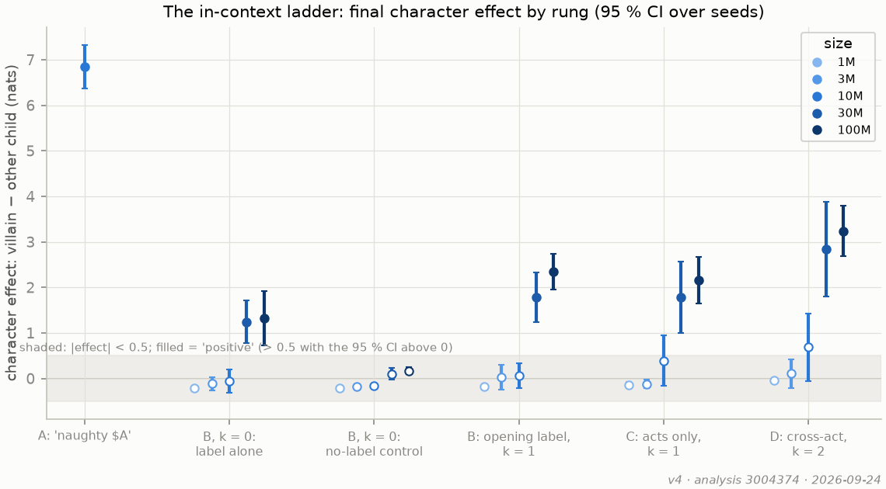
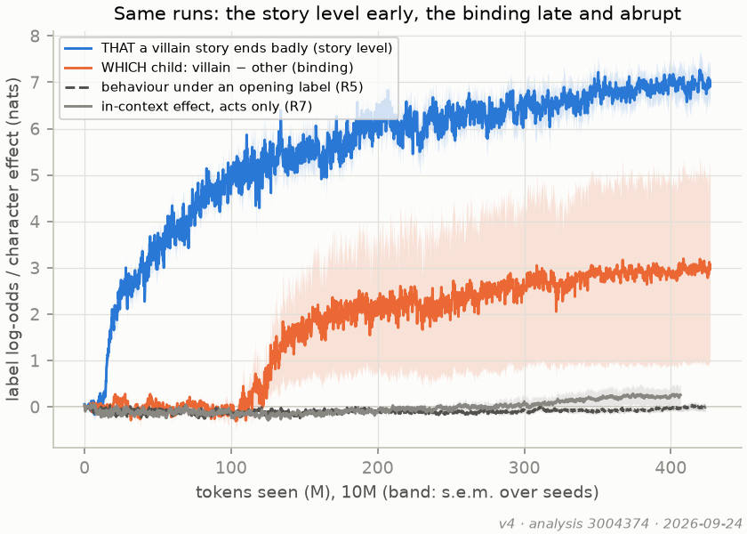
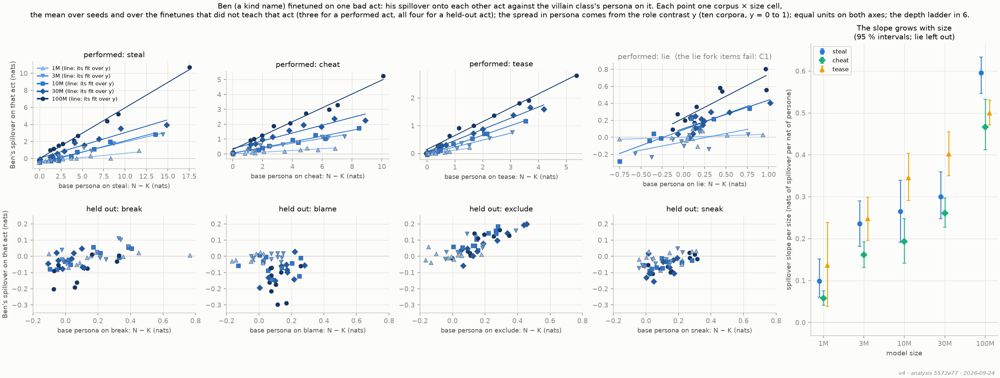
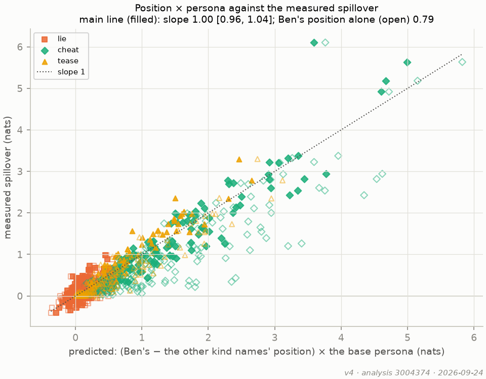
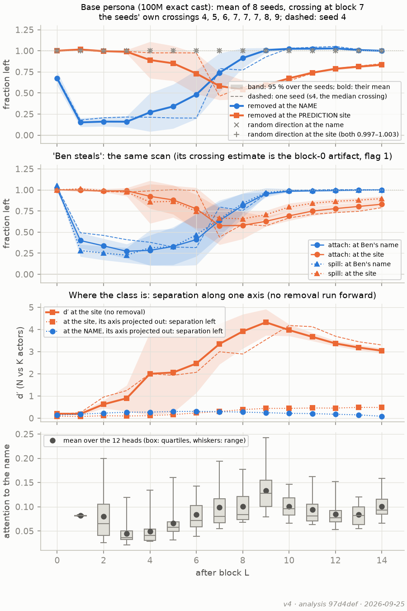
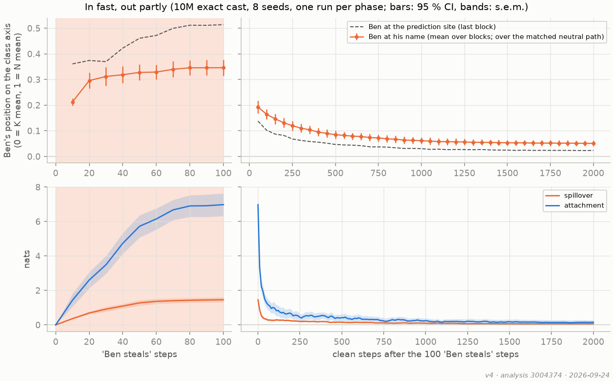
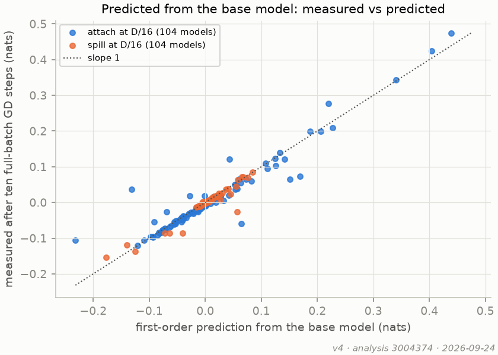
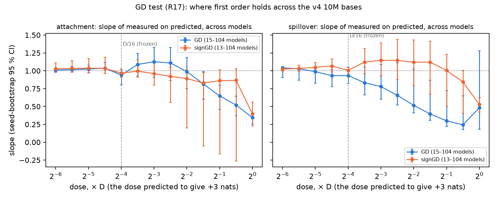
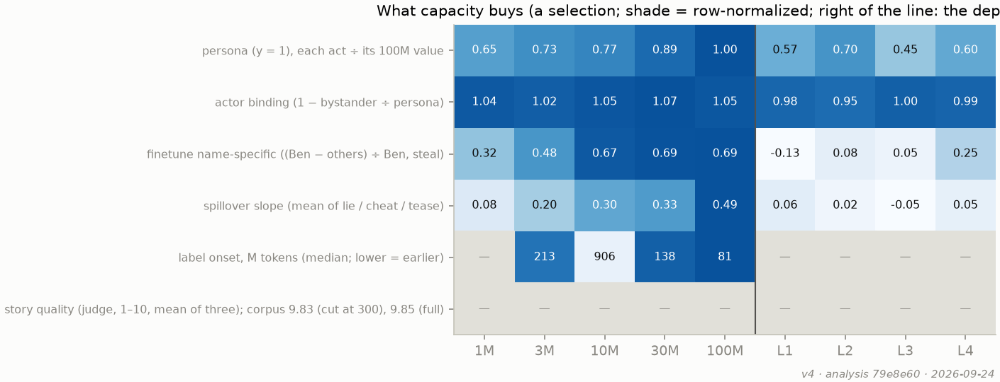

# v4 grid: preliminary results

*2026-09-24, first look, written by the run session (Claude) from the blind analysis code
(`scripts/analyze_v4.py`, `scripts/plan_figures.py --v4`, run at `79e8e60` on the pulled layout
`hub-v4/`, all four boxes). Nothing in the analysis was changed after seeing results. Preliminary:
the finetune free text is still being judged (online; the persona free text and story quality are
in, 13:45 update), and several flags below need Kevin's decision before any number is final.*

The full, mechanically generated results-against-predictions table (219 rows: 51 inside, 63
outside, 94 without a stated range, 11 missing) is in
[`2026-09-24_v4_predictions.md`](2026-09-24_v4_predictions.md); the analysis choices the plan does
not fix are listed at its top. The draft panels are in [`figures/v4/`](figures/v4/). Plan
references are to [`2026-09-22_EXPERIMENT_PLAN.md`](2026-09-22_EXPERIMENT_PLAN.md).

## In brief

* **The chain from representation to behaviour holds almost exactly (C4, A4).** Across 504
  finetune × act points, the measured spillover against Ben's excess position × the base persona
  has slope **1.00 [0.96, 1.04]** (intercept 0.01); Ben's position alone gives 0.79. This is the
  plan's central mechanistic prediction, inside its range.
* **The persona needs near-exact role contrast (C1).** Zero at y = 0 at every size; a low plateau
  (≈ 0.1–0.2 of the 100M effect) from y = 0.5 to 0.95; the rise is concentrated in the last few
  percent, more gradual from y = 0.9 at 30M and 100M. The class direction is present long before
  the behaviour uses it (embedding d′ ≈ 25 at y = 0.9 against a null of 3, at 10M).
* **Spillover follows the class (C3).** The random cast spills nothing at any size (all nine
  cells inside |mean| < 0.2); exact against random contrast d = 2.5 at 10M (> 2, inside) and 3.3–3.5
  at 30M–100M. **The spillover slope grows with size** (steal / cheat / tease 0.10 / 0.06 / 0.14 at
  1M → 0.60 / 0.47 / 0.50 at 100M, seed-bootstrap intervals ± 0.03–0.10): the plan's single "≈ 0.4"
  was an average over sizes, not a constant.
* **Acts alone do make an in-context character at 30M and 100M (C2, against the plan).** Rung C
  (acts only, k = 1) and rung D (cross-act, k = 2) are positive at 30M and 100M (2.2 and 3.2 nats
  at 100M), where the plan predicted null; null at 1M–10M as predicted. Rung B (a label) is also
  used at 30M and 100M, including the label alone (k = 0).
* **Label binding is late and abrupt, and fails without depth.** Median onsets 80M tokens (100M),
  138M (30M), 213M (3M), ≈ 900M (10M, two seeds censored), 3 of 8 bound at 1M; no depth-ladder
  model (1–4 layers) binds within four passes. Of the 46 chains that were continued, 5 found their
  onset in a later pass (1 at 3M, 4 at 10M); 30M and 100M never needed a continuation.
* **Generalization beyond the performed acts is narrow (C5).** The held-out "break" gets almost
  nothing (spillover slope 0.00; persona 0.4 at 10M against +3.7–4.5 at 1×); "exclude" gets a
  slope of 0.33.
* **The finetune is predictable from the base model to first order (C4, R17).** Across all 104
  v4 10M bases, ten full-batch GD steps at D/16 give measured against predicted slopes of **0.94
  [0.81, 1.02]** (attachment) and **0.93 [0.82, 1.05]** (spillover), inside 0.75–1.25; signGD 0.97 /
  1.01. At the full dose D first order overshoots (0.35 / 0.48), as the 1× series did.
* **Flagged:** the flow scan's finetune-crossing verdicts (R16, 30 rows "outside") come from an
  estimator artifact at block 0; the mean curves cross where the base does. Details and other
  flags below.

## The run

Four 8× RTX 5090 boxes (vast.ai), shards of the committed `configs/v4_shards.json`, training at
`57586ea` on every box (clean tree throughout; box 3 moved to `79e8e60` for the GD test only after
its training and evaluation). 3,456 jobs + 132 onset continuation passes, **0 failed jobs, 0
tracebacks** on every box; the evaluation stage complete on every box (the two R17 stubs aside).
Steady-state throughput was on plan (the dense probes cost ≈ 6 %, not the budgeted 50 %).
Incidents: one interruptible box outbid twice before launch and one preempted mid-run (both
replaced on demand, shard 3 restarted from scratch); the Hugging Face repo's limits (128 commits
per hour, 1,000 API requests per 5 minutes, **20,000 files per branch**) stopped the uploads
overnight: boxes 1 and 4 are on `main`, boxes 2 and 3 on the branches `box-2` and `box-3`
(`hf_runs.py pull --revision`). Cost so far ≈ $330 of box time, about $340 in all; judging ≈ $31
(batch).

## C1. A persona forms only at near-exact role contrast; one direction, present early

*For now (Kevin, 2026-09-24): the persona per act in raw nats on one scale, sizes left to right
within each act and the role contrast y across each size; marker = size, colour = y. Steal and
cheat rise steadily with y at every size, tease rises with y and with size, lie stays ≈ 0 (its
fork items fail; flag 5). The plan's normalized-average panel is [2a](figures/v4/v4_2a.png); the
table below is still in its units.*

| | 1M | 3M | 10M | 30M | 100M |
|---|---|---|---|---|---|
| normalized persona, y = 0 (expected within ±0.1) | 0.01 | −0.03 | 0.02 | 0.03 | −0.04 |
| y = 0.9 | 0.18 | 0.19 | 0.11 | 0.29 | 0.34 |
| y = 0.99 | 0.10 | 0.24 | 0.18 | 0.54 | 0.59 |
| y = 1 | 0.65 | 0.73 | 0.77 | 0.89 | 1.00 |
| embedding d′ at y = 1 (null ≈ 2–5) | 21 | 24 | 36 | 43 | 54 |
| steering one class gap, fraction of the own N − K (expected ≥ 0.75; 1× 0.88–0.97) | 0.71 | 0.76 | 0.62 | 0.57 | 0.64 |

* **Inside:** zero at y = 0 at every size; fraction kept at y = 0.95 (10M) 0.23 (0.2–0.5); the
  exact-cast effect grows with size.
* **The shape:** the plateau of 0.1–0.2 between y = 0.5 and 0.95 is not quite the plan's "flat";
  the sharp rise is at y ≥ 0.98, earlier and more graded at 30M and 100M.
* **Represented before it is used:** at 10M, y = 0.9 already has an embedding d′ of 25 (null 3)
  while the persona is 2.1 nats against 6.6 at y = 1.
* **Outside:** steering one class gap reaches 57–76 % of the model's own effect, below the ≥ 75 %
  expected from 1× (88–97 %) at 1M, 10M, 30M and 100M. The plan names "steering failing on
  unrepeated data" as what would change C1; this is a weaker version of that (the direction
  carries most, not nearly all, of the effect).
* **Count against fraction (R3, exploratory):** at y = 0.99 the quarter corpus keeps 0.58 of its
  y = 1 persona against 0.23 on the full corpus.
* **Formation time (R4):** the k = 0 persona reaches half its end value within 4–13 % of the pass
  but 90 % only at 18–37 % (plan: within the first 10 %; the 1× prior came from a different story
  mix): outside at every size.

## C2. Acts alone and labels

* **Rung A** ("naughty $A", the readout control): 6.9 nats at 10M, as expected.
* **Rung C (acts only, k = 1)** positive at 30M (1.8) and 100M (2.2); **rung D (cross-act, k = 2)**
  positive at 30M (2.8) and 100M (3.2). The plan predicted null for both (the 1× pooled rung C was
  −0.13 ± 0.03): **outside at 30M and 100M**, inside at 1M–10M. By the plan's own statement ("rung C
  positive: inference appears without repetition"), this changes C2 at the larger sizes.
* **Rung B (a label)** is used at 30M and 100M: k = 1 1.8 / 2.3, the label alone (k = 0) 1.2 / 1.3
  (exploratory). The no-label control is small but not zero at 100M (0.17 [0.09, 0.26]).
* **The full matrix (13:45 update).** Every ladder model was scored on every in-context set, so
  each training corpus has k = 0 / 1 / 2 without a label and k = 0 / 1 with one. The acts effect is
  the same in all three corpora (no labels, closing label, opening label: 30M ≈ 0.1 → 1.4–1.8 →
  2.4–2.8, 100M ≈ 0.1 → 1.9–2.2 → 3.2–3.9 nats at k = 0 → 1 → 2). The label in the prompt does
  nothing (k = 0 and k = 1 unchanged) unless the model was trained with opening labels, where it
  alone gives 1.2–1.3: a learned, lexical association. **Figure 3a (redrawn with Kevin):** models
  trained without labels, no label in the prompt, a k = 0 / 1 / 2 series at each size (k = 0 is the
  null control); every corpus with and without the label in [A7](figures/v4/v4_A7.png). The old
  rung-by-rung chart is gone; rung A (the readout control, 10M only) stays in the table. See flag 6
  for the small-model k = 0 offset.
* **Rung B′ (closing label):** final binding positive from 3M up (9.6, 6.7, 15.8, 16.3 nats at
  3M–100M). Onsets as in the brief. **Figure 3b (redrawn 2026-09-24 with Kevin):** one line per
  seed at 100M, the story level (WHETHER a villain story ends badly) above the binding (WHICH
  child), smoothed for display; every size in A3. The story level rises within ≈ 30M tokens; each
  seed's binding sits at 0 and then jumps ≈ 10 nats within ≈ 10–20M tokens, at 35–159M tokens
  depending on the seed. The mean over seeds had smeared these jumps into a ramp. 100M is the main
  panel because it is the largest size and every seed binds within the planned run (the plan leaves
  the size open; chosen after seeing the results, said so). Below 30M, whether and when a seed
  binds varies widely (10M: 2 seeds in the planned run, 4 in continuation passes, 2 never), and 3M
  against 10M is not resolved at 8 seeds (Fisher on binding within the planned run p = 0.13,
  log-rank p = 0.30); the depth ladder never binds.
* **The story level's step at each binding onset is mostly built into the measure.** The story
  level is the mean label log-odds of the villain and the other child minus base stories; at the
  final checkpoint the seeds that bound against those that did not (1M, 3M, 10M) have the
  villain's term up ≈ 6 nats (5.8–6.4) and the other child's down ≈ 3–5 (3.2–5.2), so the mean
  rises by the difference: 1.6 nats at 1M, 0.3 at 3M (one unbound seed), 1.3 at 10M (8.9 against 7.6). A 1M "onset" (seed 3, 94M tokens) is a false positive of the plain onset
  rule: the run ends at 2.03 nats, just over the 2-nat floor, so half its end value (1.0) is
  crossed by one noise spike (1.7 at update 5,740); no median changes (1M is censored).

## C3. A narrow finetune spreads along the class

* **Random cast** (names uninformative): mean spillover within ±0.08 of zero at all nine sizes
  (inside). **Contrast d**, exact against random: 1.0 (1M), 2.1 (3M), **2.5 (10M, > 2: inside)**,
  3.5 (30M), 3.3 (100M); 0.5–1.3 on the depth ladder.
* **Figure 4a (redrawn with Kevin):** Ben's spillover on each act against the villain class's base
  persona on it, one point per corpus × size cell (the spread in persona comes from the role
  contrast y), coloured and marked by size, equal units on both axes, one fit per size; the four
  held-out acts below on a shared small window; the depth ladder is left to C6. Right: the slope
  per size with its seed-bootstrap 95 % interval.
* **The spillover slope grows with size.** Within a size the points lie close to a line (the
  proportionality holds), but the line steepens with size:

  | slope | 1M | 3M | 10M | 30M | 100M |
  |---|---|---|---|---|---|
  | steal | 0.10 [0.06, 0.15] | 0.24 [0.18, 0.29] | 0.27 [0.19, 0.34] | 0.30 [0.25, 0.36] | 0.60 [0.55, 0.63] |
  | cheat | 0.06 [0.04, 0.08] | 0.16 [0.13, 0.19] | 0.19 [0.14, 0.25] | 0.26 [0.23, 0.30] | 0.47 [0.41, 0.53] |
  | tease | 0.14 [0.04, 0.24] | 0.25 [0.20, 0.30] | 0.35 [0.29, 0.40] | 0.40 [0.35, 0.45] | 0.50 [0.47, 0.53] |

  The plan's single "≈ 0.4" (the pooled slope, frozen: lie 0.22 [0.13, 0.30] outside just below,
  cheat 0.26 inside, tease 0.45 inside, steal 0.31 with its offset, intercept −0.48) is an
  average over sizes; the per-size slope is the better summary and was not visible at 1×. Lie is
  left out of the summary: its base persona spans only ≈ 1 nat because its fork items fail (C1),
  so its slopes are fitted over a range no wider than their noise (intervals 0.24–0.52 wide).
* **The held-out acts** carry almost no persona (≤ 0.8 nats against 5–17 on steal and cheat), so
  there is little to inherit. Exclude spills in proportion to its small persona (slope ≈ 0.5, like a
  performed act; it is close to tease); break, blame and sneak sit at or a little below zero, most
  at 100M on blame (to −0.3 nats), reminiscent of the steal offset.
* **Paired cast** block contrast: 0.20 [0.01, 0.38] at 100M (inside), 0.18 [−0.00, 0.35] at 10M
  (outside by a hair).
* **By-act cast (R11):** 5 of 9 entries are outside the "near zero, −0.2 to +0.3" range taken from
  1×, but the measured matrix tracks the plan's own predicted matrix (slope × per-name persona):
  steal → cheat 0.91 against 0.53 predicted, lie → cheat 0.40 / 0.44, tease → cheat 0.50 / 0.59,
  lie → tease 0.23 / 0.26, cheat → tease 0.13 / 0.16. See flag 2.
* **Clean twin (R12):** persona −0.20 [−0.47, 0.08] (outside ±0.1, CI across zero); spillover −0.15
  (inside |mean| < 0.2).
* **Free text** (0 → 15–68 % at 1×): the finetune free text is still being judged. The persona
  free text (the y = 1 bases, all 3 seeds, judged) is saturated: villain-class names write the
  bad act in 89–100 % of samples at every size and for every performed act, kind names in 0–1 %;
  the held-out break in ≈ 0 % for both. **Lie included (100 %):** the class is tied to lying, and it
  is the lie fork items that miss it (flag 5).

## C4. How the finetune works

* **Position × persona predicts the spillover (A4):** slope 1.00 [0.96, 1.04], 504 points (inside
  0.75–1.25); every cell as the second line 1.00; Ben's position alone 0.79. **A4 redrawn (with
  Kevin):** one panel per untaught act, equal units (the diagonal is the prediction), colour and
  marker by size, y = 0.5–1 lexical cells at 1M–100M. The prediction is (Ben's position − the other
  kind names') × the base persona, the position measured on the block-L residual at the prediction
  site along the base model's N − K axis (fitted on 64 fork setups × 8 N and 21 untaught K actors),
  in units of the N − K gap. Per act: steal 1.36, cheat 1.02, tease 1.18, lie 1.24 (bootstrap over
  points). **The size fans of 4a collapse onto one line per act:** the persona is set by y and
  barely by size, while Ben's position is set by size (≈ 0.1 at 1M → 0.43–0.62 at 100M) and barely
  by y or the taught act, so the fine-tune moves Ben further in larger models and his spillover
  follows. Per size ([A4b](figures/v4/v4_A4b.png)): steal ≈ 1.0–1.37 and tease ≈ 1.0–1.16 at every
  size; cheat still rises (0.51 at 1M → 1.05 at 100M), so for cheat the position does not carry the
  whole size effect; steal overshoots at 100M (1.37) and keeps its offset as a negative intercept at
  small sizes; lie is noise at 1M–3M and ≈ 1 from 10M.
* **Ben's position after 100 steps of "Ben steals" (y = 1):** at the name 0.18 / 0.25 / 0.35 / 0.36
  / 0.41 (1M → 100M; expected 0.4–0.5: inside only at 100M); at the prediction site 0.35 / 0.42 /
  0.51 / 0.51 / 0.58 (expected 0.5–0.6: inside from 10M).
* **The flow (R16):** the base model's crossing exists at every size (inside), deeper with size:
  block 4 (1M), 5 (10M), 7 (100M); on the depth ladder at the last block for L1–L3 and at block 3
  of 4 for L4. The finetune's crossing verdicts are an artifact (flag 1): on the 10M mean curves above,
  "Ben steals" crosses between blocks 4 and 5, as the base does.
* **In fast, out partly (R18, 10M):** Ben's position at the name 0.35 after 100 bad steps, 0.19
  after 50 clean steps (44 % taken back; 1×: ≈ 40 % within 25), 0.10 after 400, 0.05 after 2,000,
  still falling (−0.009 per 1,000 steps). The spillover comes back faster than at 1×: 1.46 → 0.47
  after 25 clean steps → 0.19 after 400 (1×: 1.17 → 0.87 → 0.50).
* **The 1× dip at 100M is gone (R20):** attachment 9.9 at 100M against 7.4 at 30M (inside), at all
  three learning rates.
* **The GD test (R17, Figure 5c):** the dose was fixed from the base model's prediction on
  `v4-lex-y100-10M-s0` before any descent (GD 3.60, signGD 0.00068). Across the 104 v4 10M bases
  (lexical y-grid, paired, by-act, clean-twin; 8 seeds each), slope of measured on predicted,
  seed bootstrap over models:

  | | attachment | spillover |
  |---|---|---|
  | GD at D/16 (the frozen readout, expected 0.75–1.25) | **0.94 [0.81, 1.02]** inside | **0.93 [0.82, 1.05]** inside |
  | signGD at D/16 | 0.97 [0.91, 1.02] | 1.01 [0.97, 1.05] |
  | GD at D | 0.35 [0.26, 0.41] | 0.48 [0.18, 1.28] |
  | signGD at D | 0.40 [0.23, 0.56] | 0.53 [0.43, 0.62] |
  | Adam finetunes against the sign heuristic (contrast) | 0.08 [−0.00, 0.17] | 0.15 [0.11, 0.18] |

  So the finetune's effect on every act is predictable from the base model alone in the
  small-step regime, across the whole grid, and at the dose meant to give +3 nats first order
  overshoots by 2–3×, as on the 1× model; Adam's effect is not captured by the sign heuristic.
  **The slope against dose** (the dense ladder, 13 models, one seed per cell, half-octaves D/64 …
  D; D/16 and D on all 104; chosen by Kevin before any GD result): under GD the attachment slope
  stays at ≈ 1 (0.94–1.13) from D/64 to D/4 and falls to 0.82 at D/(2√2), 0.65 at D/2, 0.34 at D;
  the spillover slope stays at ≈ 1 to D/16 and falls from D/8 (0.78) to 0.24 at D/√2. signGD holds
  longer: attachment 0.86–1.04 up to D/√2, spillover 1.0–1.15 up to D/2. So first order holds
  across models in the small-step regime and breaks between D/8 and D/4, as on the 1× dose model.

  

## C5. Beyond the performed acts

* **Break** (held out): persona 0.41 [0.03, 0.79] at 10M, not distinguishable from zero at other
  sizes (1×: +3.7 to +4.5); spillover slope 0.00 [−0.04, 0.08] against the predicted ≈ 0.4:
  **outside**.
* **Exclude** 0.33, **blame** −0.14, **sneak** 0.04 (exploratory). The persona reaches one of the
  four held-out acts.

## C6. Capacity

| | 1M | 3M | 10M | 30M | 100M | L1 | L2 | L3 | L4 |
|---|---|---|---|---|---|---|---|---|---|
| persona (y = 1) ÷ 100M | 0.65 | 0.73 | 0.77 | 0.89 | 1.00 | 0.57 | 0.70 | 0.45 | 0.60 |
| actor binding | 1.04 | 1.02 | 1.05 | 1.07 | 1.05 | 0.98 | 0.95 | 1.00 | 0.99 |
| finetune name-specific (steal) | 0.32 | 0.48 | 0.67 | 0.69 | 0.69 | −0.13 | 0.08 | 0.05 | 0.25 |
| spillover slope (lie / cheat / tease) | 0.08 | 0.20 | 0.30 | 0.33 | 0.49 | 0.06 | 0.02 | −0.05 | 0.05 |
| Ben's position at the site | 0.35 | 0.42 | 0.51 | 0.51 | 0.58 | 0.22 | 0.30 | 0.33 | 0.38 |
| label onset, M tokens | — | 213 | 906 | 138 | 81 | — | — | — | — |
| rung C, k = 1 (nats) | −0.14 | −0.12 | 0.39 | 1.78 | 2.16 | | | | |
| validation loss | 0.31 | 0.30 | 0.29 | 0.29 | 0.29 | 0.37 | 0.34 | 0.33 | 0.32 |
| story quality, y = 1 (judge, 1–10) | 8.80 | 9.15 | 9.37 | 9.47 | 9.53 | 7.05 | 8.40 | 8.51 | 8.77 |

* A one-layer model already has the direction (d′ 42) and most of the persona; what depth buys is
  the finetune's name-specificity and its spread (≈ 0 on the whole depth ladder) and label
  binding (none).
* Against the plan's C6: the actor binding does **not** fail below 10M (≈ 1 everywhere); the
  finetune's name-specificity does fall below 10M (0.32 at 1M).
* **Story quality** (R21, judged online; 100 openings × 3 seeds, the mean of grammar, consistency
  and plot): rises steadily with size, 8.80 [8.58, 9.00] at 1M to 9.53 [9.39, 9.65] at 100M, against
  the corpus's own rests cut at the same 300 tokens, 9.79 [9.70, 9.88] (in full 9.84). The gap
  to that control, paired by opening: −0.99 (1M), −0.64, −0.42, −0.32, −0.26 (100M); the depth
  ladder −2.74 (L1) to −1.02 (L4). Every model writes recognisable stories; none reaches the
  corpus.

## Flags for Kevin

1. **The flow-crossing estimator (R16, 30 rows).** "The first block at which removing the class
   direction at the prediction site leaves less than removing it at the name" fires at block 0
   for the finetunes, because removing the direction at Ben's name *before* block 1 raises the
   effect above 1 (1.08 on the 10M mean curve) while the site removal there does nothing (1.00).
   The base models do not show this (their block-0 name removal is below 1). Proposed fix: the
   first block after the name curve's minimum at which the site curve falls below it (or require
   the name curve below 1). This is a change to a choice made blind, so it is yours to make; with
   it the 10M finetune would cross at block 5 like its base.
2. **R11's expected range** (−0.2 to +0.3 "everywhere") was the 1× by-act result, but the plan's
   predicted matrix for the v4 by-act cast is itself not near zero (up to 0.59), and the measured
   values track it. Suggest testing R11 against its own prediction, not the 1× range.
3. **Expected ranges from 10M applied to every size** (Ben's position at the name, 0.4–0.5;
   steering ≥ 0.75; break persona > 0): several "outside" verdicts at 1M–3M are these; the
   capacity rows are the better summary.
4. **R4's 90 % line** was set from a 1× prior on another story mix; the 50 % line is within the
   first 13 % everywhere.
5. **The lie act carries no persona (C1, decided with Kevin on 2026-09-24).** Per act in raw nats,
   steal and cheat rise steadily with y at every size, tease grows with size, and lie stays at ≈ 0
   at every y and size (≈ 1 nat at y = 1). The equal-weight normalized average amplifies lie's noise
   ≈ 18× and produces most of 2a's plateau-then-jump and its wide intervals. Decided: C1's main
   panel averages steal, cheat and tease and says plainly why lie is left out; a by-act figure in
   the appendix. The lie spillover slope and lie's A4 points rest on a persona of ≈ 0. Notebook,
   2026-09-24. **Update (13:45):** the judged free text shows the association is there (villain
   names write the lie in 100 % of samples at every size, kind names in 0 %); the lie fork items
   fail to measure it. The corpus lie is always a denial (`"I did not do it," said X`), while 9 of
   the 16 lie forks test blame-shifting ("The wind knocked it over" against "My arm knocked it
   over"), which the corpus never contains.
6. **Rung B's no-label control** at 100M is 0.17 [0.09, 0.26], small but above zero "by
   construction": worth a look at the items. **Update (13:45):** at 1M–3M the k = 0 control is
   ≈ −0.2 in every training corpus, almost all from the steal items (−0.86 at 1M, −0.23 at
   100M). It does not follow the warning, the name counts or who was named last. In all 80 probe
   stories the villain is $A and named first (in `v4-one` the villain's slot is tied to its type:
   generalist $A, specialist $B, and the probes use generalists), so a first-named bias would show
   up exactly here. A name-order control (evaluation only) is on the back-to-the-well list.

## Pending

* Done: box 3 uploaded (0 files missing) and destroyed at 1:08 pm; the Hub card says where the
  files are. The Vertex batch jobs were cancelled (5 h at 1.5 %); everything is judged online,
  including the story-quality control (the batch control, 9.83 / 9.85, is kept as
  `control_v4.batch.judge.jsonl`).
* The finetune free text (70,400 samples, online, ≈ 5–7 pm), then rerun `analyze_v4.py` and
  `plan_figures.py --v4`, and update C3's free-text row and this report.
