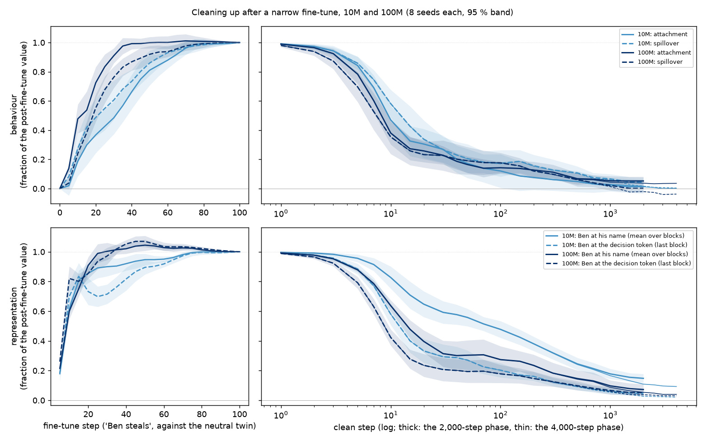
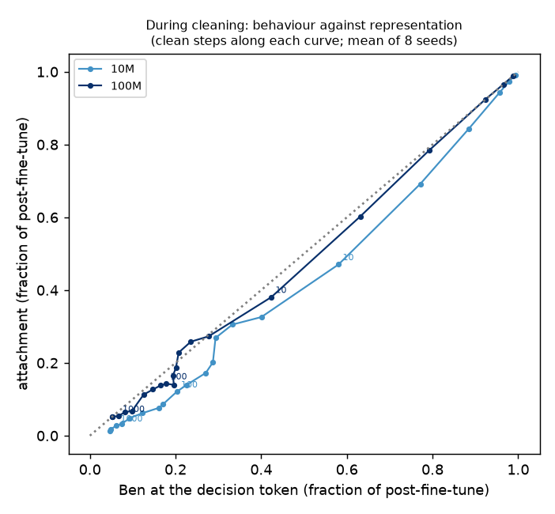
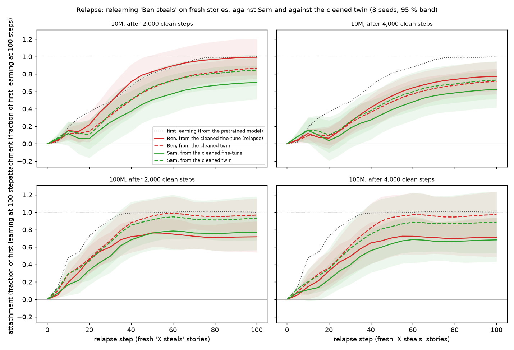

# Cleaning up after a narrow fine-tune, and relapse: 10M and 100M

*2026-09-25 (evening), Claude, for Kevin. Exploratory: designed after seeing the v4 results
([`2026-09-25_PLAN_timeline_relapse.md`](2026-09-25_PLAN_timeline_relapse.md)); one prediction was
written down before these results (notebook, 19:05) and is checked below. Run on one 4 × RTX 5090 box
(vast.ai, Czechia), 6:27–8:39 pm PT, code at `0dd2b5f`; every run and checkpoint on the Hub branch
`tl2` of `kjsatz/dramatis-v4-runs` (3,728 files, verified). Figures in
[`figures/tl2/`](figures/tl2/), made by `scripts/tl2_analysis.py` (numbers in `summary.json`).*

## What was run

Per size (10M and 100M) and seed (8 each), from the pretrained model:

1. **Fine-tune** 100 steps on "Ben steals" and, separately, on neutral stories (its twin).
2. **Clean** each of them on the clean corpus, 2,000 steps and, separately, 4,000 steps (the learning
   rate decays over each run's length, so these are two runs, not one checkpoint of the other).
3. **Relapse**: from each cleaned model, 100 steps on *fresh* stories (never used before): "Ben
   steals", "Sam steals" (the same stories with the names swapped) and neutral.

The readouts are those of R18: the attachment is the fine-tuned path minus its twin on Ben's steal
items, per checkpoint, from probes every 5 steps (fine-tune, relapse) or at log-spaced steps (clean:
1, 2, 3, 5, 7, 10, 15, 20, 30, 40, 50, 70, 100, …, 2,000, 3,000, 4,000); Ben's position (his
shift along the pretrained model's class axis) at his name, mean over blocks, and at the decision
token, last block. Everything is a fraction of its value after the 100 fine-tune steps, except the
relapse, which is a fraction of the seed's first-learning attachment after 100 steps.

## In brief

1. **Cleaning is fast and front-loaded at both sizes.** Half the attachment is gone after about 10
   clean steps (10M 0.47, 100M 0.38 left), 85 % after 100. The new schedule catches the early drop
   the old one (checkpoints every 50) missed.
2. **At 100M the trace at the name is smaller.** After 2,000 clean steps Ben's shift at his name is
   0.07 of its post-fine-tune value at 100M against 0.15 at 10M (4,000 steps: 0.04 against 0.09).
   The 10M "trace" of figure 5b is mostly a small-model effect.
3. **But at 100M a little behaviour remains.** The attachment at 100M levels off at 0.04–0.05
   (95 % interval above zero) after 1,000–4,000 clean steps; at 10M it reaches 0.00–0.01.
4. **The prediction (behaviour lags representation more at 100M): in the predicted direction, not
   decisive.** During cleaning the 100M attachment tracks Ben's position at the decision token one for
   one (their ratio over clean steps 10–500: 0.89; at 2,000: 1.0), while at 10M the attachment falls
   faster than the position (0.67; 0.29). Per seed, 0.98 against 0.69 (difference 0.29, bootstrap 95 %
   [−0.07, 0.68], one-sided permutation p = 0.09).
5. **Relapse at 10M: a Ben-specific savings, which fades with more cleaning.** From the cleaned
   fine-tune, Ben relearns faster than from the cleaned twin, and faster than Sam does: over the first
   50 relapse steps the Ben-specific savings (Ben's advantage minus Sam's) is 0.20 [0.09, 0.32] of first
   learning after 2,000 clean steps, positive in 8 of 8 seeds, and 0.09 [0.03, 0.15] after 4,000 (7 of 8).
6. **Relapse at 100M: none for Ben, and a generic slowdown.** From the cleaned fine-tune both names
   learn stealing *slower* than from the cleaned twin (Ben −0.10, Sam −0.13 over the first 50 steps;
   at 100 steps 0.72 and 0.77 against 0.97 and 0.93), and the Ben-specific part is ≈ 0 (0.04
   [−0.05, 0.13] after 2,000 steps, 0.03 after 4,000).

## 1. Cleaning

Fractions of the post-fine-tune value (mean of 8 seeds; 2,000-step phase):

| clean step | 10M: attachment | spillover | name | decision token | 100M: attachment | spillover | name | decision token |
|---|---|---|---|---|---|---|---|---|
| 3 | 0.94 | 0.94 | 0.98 | 0.96 | 0.92 | 0.87 | 0.95 | 0.92 |
| 10 | 0.47 | 0.58 | 0.83 | 0.58 | 0.38 | 0.35 | 0.64 | 0.42 |
| 30 | 0.27 | 0.27 | 0.59 | 0.29 | 0.23 | 0.23 | 0.31 | 0.21 |
| 100 | 0.12 | 0.17 | 0.48 | 0.20 | 0.14 | 0.18 | 0.27 | 0.18 |
| 300 | 0.06 | 0.13 | 0.32 | 0.12 | 0.11 | 0.10 | 0.18 | 0.13 |
| 1,000 | 0.03 | 0.07 | 0.18 | 0.06 | 0.05 | 0.02 | 0.10 | 0.07 |
| 2,000 | 0.01 | 0.05 | 0.15 | 0.05 | 0.05 | 0.00 | 0.07 | 0.05 |
| 4,000 (4,000-step phase) | 0.00 | 0.00 | 0.09 | 0.02 | 0.04 | −0.04 | 0.04 | 0.03 |

* The 10M numbers reproduce the original R18 (attachment 0.02, name 0.15 at 2,000 steps) with the new
  schedule, and add the first 50 steps, where most of the change happens.
* **The name trace is mostly a 10M feature.** At 100M Ben's shift at his name falls nearly as fast as
  at the decision token (0.31 against 0.21 after 30 steps; 10M 0.59 against 0.29) and ends at about
  half of 10M's.
* **At 100M the behaviour does not fully go.** Its attachment stays at ≈ 0.04 from 1,000 to 4,000 steps
  (the 95 % interval excludes zero at every one of these points), while the spillover overshoots
  slightly below zero (−0.04 at 3,000–4,000: Ben a little *less* likely than other kind names to do the
  untaught acts).
* Going in, 100M learns faster (attachment 0.48 after 10 fine-tune steps, 0.91 after 30; 10M 0.19 and 0.48).

## 2. The prediction

Written before the results (notebook, 19:05): during cleaning, 100M's behaviour lags its representation
more than 10M's does, measured as the attachment fraction over the decision-token position fraction at
clean steps 10–500, and at 2,000.

* **Direction as predicted.** 100M sits on the diagonal (behaviour and representation fall together:
  ratio 0.89 over steps 10–500, 1.0 at 2,000); 10M sits below it (behaviour falls faster than the
  representation: 0.67, and 0.29 at 2,000).
* **Not decisive on 8 seeds.** Per-seed ratios 0.98 (100M) against 0.69 (10M); difference 0.29,
  bootstrap 95 % [−0.07, 0.68], one-sided permutation p = 0.09.
* **Not quantitatively the transfer function.** The pretrained models' readout map (identity follow-up
  report, section 3) would put 100M *above* the diagonal (a representation at 0.2 giving ≈ 0.28 of the
  behaviour) and 10M on it; both come out lower, by a similar amount. The fine-tuned Ben is not a
  pretrained villain scaled down, and the decision token's shift is not the name's class signal; what
  carries over is the ordering of the two sizes.

## 3. Relapse

Mean attachment over relapse steps 5–50, as a fraction of first learning after 100 steps (8 seeds, 95 %):

| | Ben from the cleaned fine-tune | Ben from the cleaned twin | Sam from the cleaned fine-tune | Sam from the cleaned twin | Ben-specific savings |
|---|---|---|---|---|---|
| 10M, 2,000 clean steps | 0.43 | 0.31 | 0.23 | 0.32 | **0.20 [0.09, 0.32]** (8 / 8) |
| 10M, 4,000 | 0.25 | 0.23 | 0.19 | 0.26 | **0.09 [0.03, 0.15]** (7 / 8) |
| 100M, 2,000 | 0.51 | 0.60 | 0.45 | 0.58 | 0.04 [−0.05, 0.13] (5 / 8) |
| 100M, 4,000 | 0.43 | 0.54 | 0.36 | 0.51 | 0.03 [−0.03, 0.10] (6 / 8) |

(Ben-specific savings = (Ben from the cleaned fine-tune − Ben from the cleaned twin) − (the same for
Sam); first learning from the pretrained model over the same steps: 0.46 at 10M, 0.76 at 100M.)

* **At 10M the cleaned model is primed for Ben.** Relearning "Ben steals" from the cleaned fine-tune
  follows the first-learning curve and reaches 0.99 at 100 steps, above the cleaned twin (0.87). Part
  of the Ben-specific number is Sam learning *slower* on the cleaned fine-tune (0.70 at 100 against
  0.85): the old episode helps Ben and slightly hinders another name taking the same role. The effect
  halves between 2,000 and 4,000 clean steps: longer cleaning does erase it, slowly.
* **At 100M there is no Ben-specific priming, and stealing is learned slower by anyone.** From the
  cleaned fine-tune, Ben and Sam both relearn to about 0.7–0.8 by 100 steps, against 0.9–1.0 from the
  cleaned twin. The earlier steal-then-clean episode leaves the 100M model somewhat *resistant* to
  learning "X steals" again, for either name.
* **The matched-history control mattered.** Every cleaned model learns slower than the pretrained one
  did (100M: 0.5–0.6 against 0.76 over the first 50 steps), so comparing the relapse with first
  learning from the pretrained model would have read this generic slowdown as "no relapse" at 10M and
  as "anti-relapse" at 100M.

## What this changes

* **Figure 5b's trace** (10M: the name keeps 15 % while the behaviour is gone) is real at 10M and small
  at 100M; the misalignment-relevant reading of it (a dormant trace that primes relapse) holds at 10M
  (Ben-specific savings) and does not at 100M.
* **"Cured" means different things at the two sizes.** At 10M the behaviour goes but a Ben-specific
  predisposition stays and fades with more cleaning. At 100M the representation goes further, a small
  residual behaviour stays, and the model becomes generally slower to learn the bad act again.
* Where the fine-tune lives (identity follow-up report, section 6) says where to look for the 10M
  priming: block 1's MLP lookup for Ben. The cleaned pair's weight transplants (plan, question 2) would
  test whether that is where the savings sits; the checkpoints are on the Hub.

## Limitations

* 8 seeds per size; the relapse curves are noisy (per-seed attachments of a few nats), and the 100M
  Ben-specific numbers are consistent with zero rather than shown to be zero.
* One clean corpus and one learning-rate schedule; the relapse uses fresh stories of the same act.
* The prediction's test is weak (p = 0.09), and its quantitative basis (the transfer function) does not
  carry over.
* Exploratory throughout.
