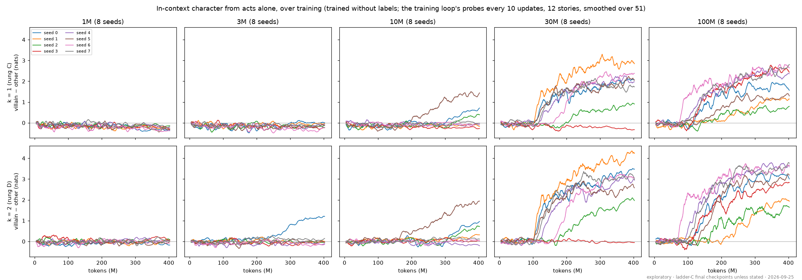
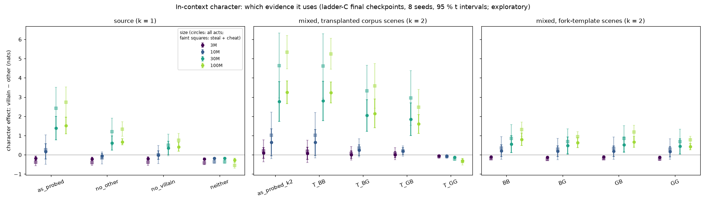
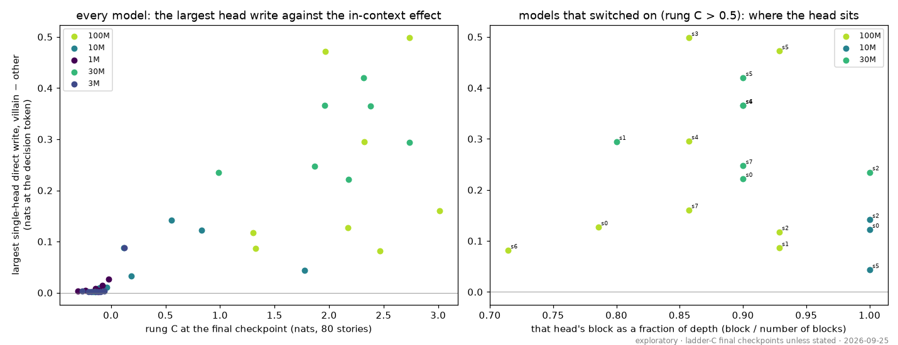
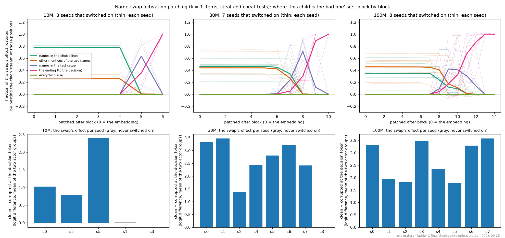
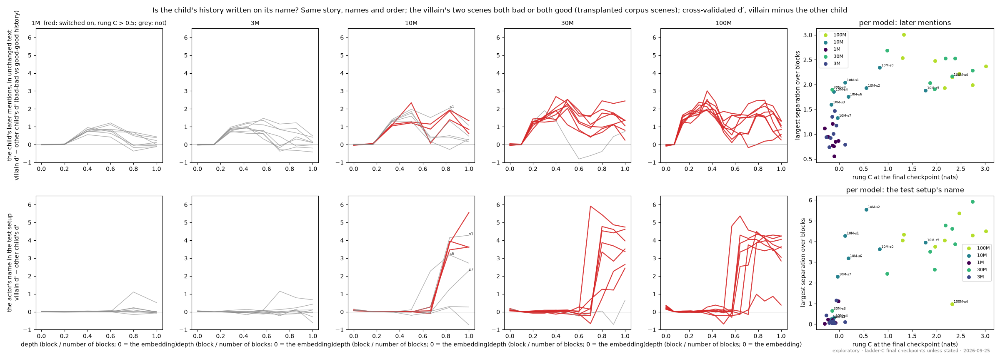
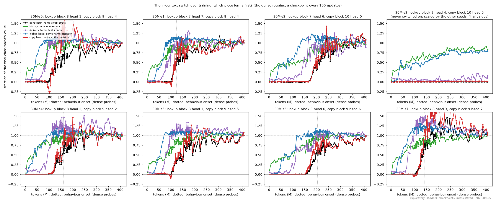
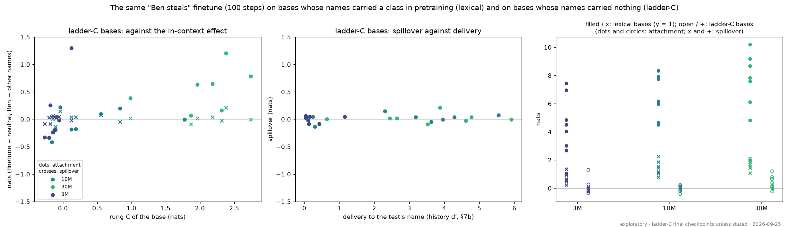

# How the model infers a character from what a child did (C2, in context)

*2026-09-25, Claude with Kevin. Exploratory: every measurement here was designed after seeing the v4
results; none is a frozen prediction, and figure 3a and the frozen analysis are unchanged. The patching
design was written into the lab notebook (10:55) before it was run. Models: the ladder-C runs (random
names, trained without labels), final checkpoints, 8 seeds per size. Scripts `scripts/incontext_*.py`;
outputs `logs/v4/incontext/`; figures [`figures/incontext/`](figures/incontext/), made by
`scripts/incontext_figures.py`.*

## In brief

1. **It is a training-time switch, and size mostly sets when it happens.** Each seed's in-context
   effect is zero and then rises within ≈ 20–30M tokens, at a seed-specific point: 8 / 8 seeds at 100M
   (median ≈ 160M tokens), 7 / 8 at 30M (≈ 140M), 3 / 8 at 10M (≈ 335M, still rising at the end), none
   at 1M–3M. Once on, 30M and 100M reach similar values.
2. **The model adds up both children's history, and it saturates.** Removing the other child's good
   choices roughly halves the effect; removing the villain's bad act cuts it more; the two add. A
   second bad act adds less than the first; a good act does not cancel a bad one; order does not
   matter. An ideal learner of the corpus rule (one act decides) would not look like this.
3. **The evidence has to look like the corpus's bad acts.** Scenes rendered from the fork items'
   minimal-pair endings carry ≈ 4–11 % of the evidence of the corpus's own scenes (why is not
   established; the fork items as readouts are unaffected).
4. **The circuit is a late lookup by name, then a copy.** Name-swap activation patching: until late
   in the network, which child did what sits only on the name tokens; then **one attention head**, at
   the actor's name in the test temptation, attends to earlier mentions of the *same* name and brings
   in their character (alone it restores 0.58–0.97 of the effect in 15 of the 18 switched-on models;
   weaker or writing into the ending's name in the other three); **one head** one to three blocks later
   copies it to the decision (0.58–1.0 alone). The handoff sits in the last
   third of the network at every size (block 5 of 6 at 10M, 7–8 of 10 at 30M, 8–12 of 14 at 100M). No
   classic induction heads exist in any of these models.
5. **What the models that never switched on lack is the delivery to the test's name, and then the
   readout** (added later the same day, §7b). With the same story, names and order and only the
   villain's history changed, *every* model, down to 1M, writes the history onto the child's later
   name mentions; only the switched-on models bring it to the actor's name in the test (null at 1M,
   3M, 30M seed 3, 10M seeds 3 and 4), and three 10M seeds bring it there without using it (seeds
   1, 6, 7: delivered, rung C ≈ 0). The lookup head exists in the off models too, but carries nothing.
6. **A narrow finetune does not spread through it** (§10). "Ben steals" on the 24 ladder bases (3M–30M,
   names meaningless in pretraining): spillover ≈ 0 whether the circuit is on or not, and attachment
   ≈ 15× below the lexical bases (the finetune teaches "children steal more"). Spillover in the lexical
   models rests on names having carried a class.
7. **Watched forming, it builds upstream to downstream** (§7c; the eight 30M seeds retrained with a
   checkpoint every 100 updates). In every seed that switched on: the lookup head's attention first,
   then delivery to the test's name, then the copy head, with which the behaviour rises (r 0.99 with the
   onset); the copy head forms ≈ 2,900 updates after delivery. The never-switched-on seed stops at
   delivery.

## 1. The question

Figure 3a of the preliminary report ([`2026-09-24_REPORT_v4_preliminary.md`](2026-09-24_REPORT_v4_preliminary.md),
C2): with names that carry nothing, a child's earlier bad acts make the model expect a bad act at a new
temptation, at 30M and 100M (k = 1: 1.8 / 2.2 nats, k = 2: 2.8 / 3.2) and not at 1M–10M. What does
the model compute, and what does the larger model have that the smaller lacks?

## 2. When it appears in training

The training loop probed the small in-context sets every 10 updates. The effect is zero until a
seed-specific point and then rises within ≈ 20–30M tokens, then more slowly:

| size | seeds that switched on | half-rise, median (range), M tokens |
|---|---|---|
| 1M, 3M | 0 / 8 | — |
| 10M | 3 / 8 | 335 (262–343), still rising at the end |
| 30M | 7 / 8 (seed 3 never) | 139 (124–239) |
| 100M | 8 / 8 | 159 (93–285) |

(Onset: the mean of k = 1 and k = 2 smoothed over 51 probes reaching half its final value; seeds
ending below 0.4 nats counted as off.) After switching on, 30M and 100M reach similar values; the size
difference in 3a is mostly *whether and when* a seed switches on within the 400M tokens. So the models
to compare are the ones that switched on against the ones that did not, within a size.

## 3. What evidence it uses

`incontext_evidence.py` rebuilds the k = 1 and k = 2 items from the same 80 held-out stories as the
frozen sets, with one draw of names and test forks per story shared by every variant, so variants differ
only in the story before the test. (It cuts at the villain's *bad* acts; see the flag in §8.) Villain −
other, nats, all acts, 30M / 100M:

**Both children's history counts, about additively.**

| k = 1 story | 30M | 100M |
|---|---|---|
| as is (the villain's bad act, the other child's good choices) | 1.39 | 1.52 |
| the other child's choice scenes removed | 0.61 | 0.67 |
| the villain's bad-act scene removed | 0.36 | 0.42 |
| both removed | −0.17 | −0.28 |

(interaction +0.27 ± 0.24 / +0.15 ± 0.22.) So "villain − other" is roughly 60 % "this child did
something bad" and 40 % "the other child did something good".

**Mixed evidence: graded and saturating, no recency.** The villain's two act scenes replaced by corpus
scenes of the same situations, bad (B) or good (G), transplanted from other held-out stories with the
same adult (as DATA.md §18 built the both-villains corpus):

| villain's two acts | 30M | 100M |
|---|---|---|
| B, B (check: as is 2.77 / 3.26) | 2.80 | 3.24 |
| B then G | 2.05 | 2.15 |
| G then B | 1.85 | 1.60 |
| G, G | −0.13 | −0.30 |

A second bad act adds to the first but less (bad-bad minus the two single-bad arms plus good-good:
−1.4 ± 1.0 / −0.8 ± 0.9); a good act does not cancel a bad one (one bad plus one good sits at 55–70 %
of two bad, above the half that averaging would give); order does not matter within the noise (B-then-G
minus G-then-B +0.2 ± 0.4 / +0.55 ± 0.6). In the corpus one act decides and a child never mixes, so an
ideal learner of the corpus rule would be at its ceiling after one act; the model instead accumulates
evidence and saturates. The k = 1 → k = 2 step of 3a is the villain's second bad act (the other child's
good choices are the same in both prefixes, 1.5 on average).

**Fork-template scenes carry little evidence.** Rendered from the fork items (the same setup, the bad or
good minimal-pair ending), making the villain's acts bad rather than good moves the effect by 0.05 /
0.12 / 0.38 nats at 10M / 30M / 100M against 0.71 / 3.33 / 3.54 with corpus scenes (≈ 4–11 %, cheat up
to 19 %). The corpus marks its bad acts ("… until $B cried", "… and hid it", "I win!"); whether the
wording, the filler line the corpus puts after every choice, or length is what matters was not tested
(Kevin: no prompt adjustments). The fork items as *readouts* are unaffected: every number here is scored
with them.

## 4. Heads

`incontext_heads.py`, every head of all 40 models:

* **No classic induction heads.** On random tokens repeated twice no head attends to the earlier
  occurrence's successor (max 0.02 against ≈ 0.01 chance); at 100M a repeated story passage gets a
  *higher* loss the second time (0.29 → 0.80 nats per token). Verbatim copying never pays in this corpus.
* **A late head writes the villain's character at the decision.** Direct logit attribution at the
  decision token (the first token where the bad and good endings differ): in every 30M seed that
  switched on, one head writes 0.22–0.42 nats toward the bad ending for the villain against the other
  child, at block 9 of 10 (8 or 10 in two seeds; blocks numbered from 1 throughout); 30M seed 3 has
  none (0.00). The switched-on 10M seeds have a weaker one in their last block; 100M spreads over blocks
  10–13.
* **It reads from the actor's name in the test setup** (`incontext_head_sources.py`: its write split by
  source position), not from the earlier act lines: +0.20 to +0.40 of its 0.22–0.42 comes from the
  names in the setup.

## 5. Where the information sits, block by block

`incontext_patching.py` (design in the notebook, 10:55, before running). Clean: a k = 1 item. Corrupted:
the same item with the two children's names exchanged throughout the story before the test setup (the
setup and the ending unchanged), so the actor now has the other child's history; kept only where every
token stays aligned (96 of 240 steal / cheat items). Metric: logit(bad) − logit(good) where the endings
first differ. The clean residual stream after block L is pasted into the corrupted run at one group of
positions; restored = (patched − corrupted) / (clean − corrupted).

* **Until late, only the name tokens carry it.** At the embedding only name tokens differ, so they
  carry everything by construction; what matters is that it stays so: through block 4 of 6 (10M), 6 of
  10 (30M), 7 of 14 (100M), pasting the names alone restores ≈ all of it (names inside the choice lines
  ≈ 0.35–0.8, the other mentions the rest) and every other position ≈ 0, including the act words.
* **Then it moves in one or two blocks** to the actor's name in the test setup (peak 0.64 at 10M,
  0.71 at 30M, 0.42 at 100M, where the seeds differ more), and on to the ending, which holds all of it
  at the last blocks.
* **In the models that never switched on the swap changes nothing** (clean − corrupted ≈ 0.01: 30M
  seed 3, 10M seeds 1 and 3), so there is nothing to locate.

## 6. The heads that move it

`incontext_head_patching.py`: each head's clean output (before the output projection) pasted into
the corrupted run, at the actor's name in the test setup or at the ending, in the blocks around that
model's handoff; plus each head's attention from the setup's actor name to earlier mentions of the same
name minus the other child's ("same-name"). Block numbers from 1:

| model | rung C | lookup head (setup name): restores alone | same-name | copy head (ending): restores alone |
|---|---|---|---|---|
| 30M s0 | 2.18 | block 8, head 1: 0.90 | +0.84 | block 9, head 4: 1.00 |
| 30M s1 | 2.74 | 7, 7: 0.82 | +0.77 | 8, 4: 0.86 |
| 30M s2 | 0.98 | 7, 6: 0.81 | +0.55 | 10, 0: 0.94 |
| 30M s4 | 1.96 | 8, 2: 0.88 | +0.70 | 9, 2: 0.90 |
| 30M s5 | 2.32 | 8, 1: 0.95 | +0.80 | 9, 5: 0.96 |
| 30M s6 | 2.38 | 8, 6: 0.58 | +0.67 | 9, 6: 0.98 |
| 30M s7 | 1.87 | 8, 3: 0.75 | +0.62 | 9, 7: 1.03 |
| 100M s0 | 2.17 | 9, 9: 0.61 | +0.79 | 11, 9: 0.87 |
| 100M s1 | 1.32 | 9, 2: 0.34 | +0.85 | 10, 5: 0.71 |
| 100M s2 | 1.31 | 9, 11: 0.97 | +0.85 | 13, 9: 0.58 |
| 100M s3 | 2.74 | 11, 4: 0.69 | +0.86 | 12, 3: 0.63 |
| 100M s4 | 2.32 | none at the setup name | | 11, 10: 0.79 |
| 100M s5 | 1.97 | 10, 1: 0.91 | +0.88 | 11, 2: 0.66 |
| 100M s6 | 2.47 | 8, 4: 0.75 | +0.85 | 10, 8: 1.01 |
| 100M s7 | 3.01 | 9, 11: 0.71 | +0.83 | 12, 2: 0.76 |
| 10M s0 | 0.83 | 5, 1: 0.92 | +0.64 | 6, 2: 0.98 |
| 10M s2 | 0.55 | 5, 0: 0.83 | +0.78 | 6, 5: 0.94 |
| 10M s5 | 1.77 | 5, 0: 0.15 (it writes into the ending's name instead: 0.82 there) | +0.59 | 6, 1: 1.02 |

* **One lookup head, one copy head, in every model that switched on**, the copy one to three blocks
  after the lookup; the copy head is the one direct logit attribution found (§4). The lookup head is a
  name-matching head: from the actor's name it attends to that child's earlier mentions (+0.55 to
  +0.88 over the other child's). 100M seed 4 skips the setup name: its heads look up from the ending's
  name directly (its copy-head candidate had the only non-zero name-match at the decision token, §4).
* **The models that never switched on** (30M s3, 10M s1, s3) have a head with the same attention
  pattern (same-name +0.55, +0.71, +0.42), but the swap does nothing to their decision, so its
  restored fractions are undefined (0 / 0).

## 7. Why the larger models

What the causal tests establish:

* **Not a different mechanism.** The switched-on 10M seeds use the same two-head circuit as 30M and
  100M, squeezed into their last two blocks (5 and 6 of 6). The larger models do the same thing, with
  more blocks before the handoff.
* **Not the lookup.** A same-name lookup head exists in the models that never switched on too; it is
  presumably ordinary entity tracking (continuing a story about the right child). What those models
  lack is either the character on the looked-up mentions or its readout into the decision.
* **Mostly when, not whether.** The switch is a training-time event that larger models reach sooner
  (median ≈ 140–160M tokens at 30M–100M, ≈ 335M at 10M, not within 400M at 1M–3M). Depth does not
  rise monotonically with size here (5 / 7 / 6 / 10 / 14 blocks for 1M → 100M; 3M is deeper than 10M
  and never switches on), so width or total capacity, not depth alone, sets the timing.

Not established here: **what forms at the switch** (§7b takes it further on the final checkpoints). A linear probe for "villain's mention against the other
child's" (`incontext_mention_probe.py`) was confounded: in all 80 probe stories the villain is the
first-named child (preliminary report, flag 6), so a plain "introduced first" feature separates them as
well. (In v4-one the villain's slot follows its type: a generalist villain is always $A, a specialist
always $B, so over the corpus both the first- and the second-named child are villains (held out: 2,000
and 4,000 stories); the probes use generalists only, which fixes the villain first.) The probe found a villain / other direction at the setup name after the lookup in a model that never
switched on (10M s1, d′ 3.9, against 3.6–4.8 in the switched-on 10M seeds) and cannot say whether it is
character or order. The name swap exchanges the order too, but its effect on the *decision* is ≈ 0 in
the off models, so order alone does not drive the behaviour.

## 7b. The history on the names, in every model (added later the same day)

`incontext_history_probe.py`, all 40 models. The transplant arms give the same story, names and order
twice, the villain's two scenes both bad or both good (§3); nothing else differs, so there is no
child-order confound. At a child's name tokens after every block, a cross-validated d′ of bad-bad
against good-good history, the villain's minus the other child's (a story-wide mood moves both). Two
places: the child's *later* mentions in text that is identical in the two versions ("Jake walked along
the beach" after the act: any difference arrived by attention), and the actor's name in the test setup.
At the embedding both are ≈ 0.

* **Later mentions: every model.** A history separation at mid depth in all 40 models, growing with
  size (d′ ≈ 1 at 1M–3M, 1.5–2.3 at 10M, 2–3 at 30M and 100M), switched on or not (30M seed 3: 1.9).
  Carrying a child's history onto its later mentions is not what switches on.
* **The test's name: only where it is used, or nearly.** Flat at 1M and 3M (≤ 0.4 in 14 of 16 models,
  ≈ 1.1 in two), at 30M seed 3 (0.6) and 10M seeds 3 and 4 (≤ 0.3); a late jump to 2.4–5.9 in every
  switched-on model (at ≈ 60–80 % of depth), except 100M seed 4 (1.0), which looks up from the ending's
  name instead (§6).
* **Delivered but not used:** 10M seeds 1, 6 and 7 bring the history to the test's name (d′ 4.3, 3.2,
  2.3) with rung C 0.12, 0.18, −0.04. Their copy step (the readout into the decision) is missing or weak;
  seed 1's dense probe was starting to rise at k = 2 by the end of training.

So the pieces are staged: the history on the mentions (everywhere), its delivery to the test's name by
the lookup head (the models that switched on, and three 10M seeds), and the readout into the decision (the
models that switched on). The off models fail at different stages: 1M, 3M, 30M seed 3 and 10M seeds 3, 4
at delivery (their lookup-like heads attend to the right child but bring no history), 10M seeds 1, 6, 7
at the readout. The 10M seeds suggest delivery forms before the readout; the dense retrain (option E,
[`2026-09-25_PLAN_incontext_dense_box.md`](2026-09-25_PLAN_incontext_dense_box.md)) can test that order.
A d′ maximum over blocks is biased upward; the 1M–3M later-mention values (≈ 1, consistent across seeds
and blocks) are small but not zero.

## 7c. Watching the switch form (dense retrains, added 2026-09-26)

The eight 30M ladder-C seeds retrained with a checkpoint every 100 updates
([`2026-09-25_PLAN_incontext_dense_box.md`](2026-09-25_PLAN_incontext_dense_box.md); the box session,
notebook 2026-09-25 22:50). They **reproduce the original runs bit for bit** (every probe identical), so
these are the original trajectories, sampled densely. `incontext_chronology.py` measured, at every 400
updates and at every 100 within ±3,000 updates of each seed's switch (113 checkpoints per switched-on
seed, 66 for seed 3): the behaviour (the name-swap effect at the decision, §5), the history on the
child's later mentions and its delivery to the test's name (§7b, maximum over blocks), the lookup head's
same-name attention and the copy head's write at the decision (§6; the heads are the final checkpoint's,
and in every seed they are the ones head patching found). Each curve is drawn as a fraction of its final
value. A coarser version on the original runs' ten saved checkpoints (30M seeds 0 and 1, 100M seeds 0
and 1, 10M seed 0) shows the same order ([`chronology_orig.png`](figures/incontext/chronology_orig.png)).

**The pieces form in the same order in all seven seeds that switched on**, updates at which each
reaches half its final value (smoothed over three checkpoints):

| seed | lookup attention | history on the mentions | delivery | copy write | behaviour |
|---|---|---|---|---|---|
| 0 | 2,800 | 5,200 | 5,400 | 7,446 | 7,900 |
| 1 | 4,000 | 3,600 | 5,500 | 7,446 | 7,600 |
| 4 | 2,482 | 2,482 | 5,900 | 8,100 | 9,600 |
| 5 | 3,200 | 5,100 | 5,100 | 8,000 | 9,300 |
| 7 | 2,800 | 3,200 | 4,800 | 7,900 | 8,300 |
| 6 | 5,500 | 5,900 | 7,100 | 11,000 | 12,000 |
| 2 | 5,100 | 7,100 | 9,400 | 12,500 | 13,100 |

* **Upstream first, the readout last.** The lookup head's same-name attention steps up first (median
  6,100 updates before the behaviour's half-rise), the history on the mentions builds up gradually over
  the same period (5,100), delivery to the test's name steps up next (3,700), and the copy head's write
  and the behaviour rise together (the copy 600 updates ahead, within the spacing of the noise). The copy
  head forms 1,900–3,900 updates after delivery (median 2,900, ≈ 48M tokens).
* **The readout is the switch.** The copy write's timing matches the behaviour's onset almost exactly
  (r 0.99 over seeds), delivery's closely (0.95), the lookup attention's loosely (0.75). The late
  seeds (6, 2) are late at every step, not only at the last.
* **Seed 3, which never switched on,** forms the history on the mentions and the lookup attention (to
  ≈ 80 % of the other seeds' final values, more gradually) but never the delivery (≤ 0.2 of theirs), and
  so neither the copy nor the behaviour. It stops at delivery: its lookup head attends to the right
  child's mentions but does not bring their history, as §7b found at the end of training. The three 10M
  seeds that deliver without reading out (§7b) sit one stage further.

So the circuit forms from upstream to downstream, each piece once its input exists: the copy head can
only be learned once there is something at the test's name to copy, and delivery only once the lookup
attends to the right mentions. What differs between seeds and sizes is when (and whether) each step is
reached within the training budget. Caveats: one measure per piece (a head chosen at the end of training,
a maximum over blocks for the separations), fractions of final values, and the history-on-mentions
measure is the noisiest.

## 8. Flags and limitations

* **The frozen cuts count every choice.** A villain's benign extra scene can be a good [CHOICE] of a
  held-out situation, so 4 of the 80 rung C (k = 1) stories have no bad act before the cut and 14 of the
  80 rung D (k = 2) stories have one. 3a is slightly diluted, most at k = 2; not changed. The exploratory
  arms cut at the bad acts (the first build with the frozen cuts is kept in `logs/v4/incontext/build1/`).
* **The name swap also exchanges which child is named first** (the villain is always first-named in
  the probe stories); harmless for the decision-level patching (≈ 0 in the off models), fatal for the
  linear probe (§7).
* The patching uses only pairs whose name swap leaves every token aligned (96 of 240 steal / cheat
  items; line-initial names split differently); steal and cheat test items only.
* Final checkpoints only (ladder-C saved no intermediate ones), so what forms at the switch-on is
  inferred from the on / off contrast, not watched.
* Linear, one-token metric (the logit difference where the endings first differ) for the head and
  patching measures; the evidence arms use the full ending log-odds.

## 9. Next steps

* **Watch the switch form:** done (§7c): delivery before readout, as §7b predicted. Open: *why* the copy
  head takes ≈ 2,900 updates after delivery, and what sets the delivery time (the step that best predicts
  a seed's onset besides the copy itself).
* **Connection to the finetune (C3 / C4):** tested (§10): on the ladder bases a "Ben steals" finetune
  neither spreads nor, mostly, attaches to Ben; the in-context circuit is not a route for spillover.

## 10. Appendix: a narrow finetune on the ladder bases (added later the same day)

`incontext_ft.py`: the v4 finetune test exactly (`configs/finetune.yaml`, 100 steps; "Ben steals"
`data/finetune-v4/ft-steal-Ckind` against the neutral `ft-neutral-Ccast`; `finetune.py` and `eval_v4`'s
k0 readout unchanged), only the base differs: the 24 ladder-C bases at 3M, 10M and 30M, whose names
carried nothing in pretraining. Question: does a narrow finetune spread through the in-context circuit
(§5–7b) when there is no name class to carry it, i.e. more in the seeds that switched on?

| | attachment, ladder-C | spillover, ladder-C | attachment, lexical (y = 1) | spillover, lexical |
|---|---|---|---|---|
| 3M | +0.06 ± 0.45 | +0.00 ± 0.05 | 4.32 ± 1.79 | 0.73 ± 0.29 |
| 10M | −0.06 ± 0.19 | +0.02 ± 0.07 | 6.65 ± 1.28 | 1.41 ± 0.40 |
| 30M | +0.46 ± 0.38 | +0.02 ± 0.07 | 7.41 ± 1.66 | 1.68 ± 0.28 |

(nats, 8 seeds, 95 % t; lexical: the v4 grid's finetune records on `v4-lex-y100-*`.)

* **No spillover anywhere,** switched on (+0.02 ± 0.06, 10 bases) or not (+0.01 ± 0.04, 14). The
  in-context circuit is not a route for a finetune to spread to untaught acts, at this dose.
* **Almost no attachment either.** The finetune raises stealing for every name about equally (10M:
  Ben +1.93, the other names +1.99): the model learns "children steal more", not "Ben steals". The
  switched-on bases attach a little (+0.42 ± 0.26 against −0.04 ± 0.24; r = 0.60 with rung C), still
  ≈ 15× below the lexical bases, and only on the taught act.
* **So** spillover in the lexical models rests on names having carried a class in pretraining (the
  name → class entry a finetune can rewrite, and the late copy head that reads it for every act; the
  name-identity reports). A model trained on meaningless names hardly ties the finetune to the name, and
  what it ties does not spread.

## 11. For the paper: what goes in the main text, what in the appendix (proposal, 2026-09-26)

*Written at Kevin's request; a proposal against the skeleton of `2026-09-21_SYNTHESIS.md` §2 / §9 and
the figure plan of `2026-09-22_EXPERIMENT_PLAN.md` §3, not a decision.*

**One framing point first (Kevin's call).** The skeleton's hook is "we could not make a persona from
acts; we could from names". With v4 that holds at 1M–10M and at 1× repetition but not at 30M–100M on
unrepeated data, where acts alone make an in-context character. Suggested wording: acts alone make no
persona in small models, and in larger ones they make an in-context character that is a different
object from the name persona (built at inference from the story, read by two late heads) and that a
narrow finetune does not use (§10). That keeps the names-first arc and turns C2 into a scale result
rather than a null.

### Main text: about one page in the "names, acts and labels" section (C2), one sentence in the finetune section

1. **The phenomenon, with the timing** (Figure 3, two panels). 3a as it is (k = 0 / 1 / 2 by size), plus
   the in-context effect over training, one line per seed (`over_training.png`, 30M and 100M columns,
   or all sizes). Text: the effect is a per-seed switch during training; larger models reach it sooner
   and more reliably (8 / 8 at 100M, 7 / 8 at 30M, 3 / 8 at 10M, none at 1M–3M within 400M tokens);
   the size difference in 3a is mostly how many seeds switched and how early (a seed's final effect
   falls with its onset, r −0.7). *Why main:* it is the direct answer to "what about the larger model"
   and it changes how 3a reads.
2. **What the model computes, in two sentences.** It adds up both children's history (the villain's
   bad act ≈ 60 %, the other child's good choices ≈ 40 %) and saturates (a second act adds less; a good
   act does not cancel a bad one; no recency), unlike the corpus rule where one act decides. *Why main:*
   it is what "inferring a character" means here; the tables go to the appendix.
3. **The mechanism, one panel and a paragraph.** Name-swap patching at 30M (`patching.png`, the 30M
   column): which child did what sits only on name tokens until late, then one lookup head at the
   actor's name in the new temptation attends to that child's earlier mentions and brings their
   history, and one copy head moves it to the decision; the same at 10M (in the last two blocks) and
   100M; no induction heads. *Why main:* a causal circuit is the paper's standard of evidence (Figure 4
   does the same for the name persona), and the parallel is the point: both personas end in a late
   head copying "this child is bad" from a name to the decision; they differ in where the name's
   badness comes from (block 1's MLP from the embedding, against a late lookup from the story).
4. **How it forms, one panel** (`order.png`). In every seed that switched on the lookup attention forms
   first, then delivery, then the copy head, with which the behaviour switches on (r 0.99); the seed that
   never switched on stops at delivery. *Why main:* it is the only formation-time mechanistic result in
   the paper, it answers "why larger" one level down (the steps come sooner), and it echoes the
   phase-change literature while showing a different circuit (not induction heads).
5. **In the finetune section, one sentence:** the same "Ben steals" finetune on the ladder models
   neither spreads (spillover ≈ 0 whether the circuit is on or not) nor mostly attaches to Ben (≈ 15 ×
   below the lexical models); spillover needs names that carried a class in pretraining. *Why main:* it
   is a control for the paper's central claim (the finetune generalizes through a pretrained name
   persona) and it separates the two personas.

Level of detail: statements with one number each, the heads named once ("a lookup head and a copy head,
one each, in the last third of the network"), no per-seed tables in the text. Keep out of the main text:
d′ values, the head-attribution details, the fork-scene evidence result, the frozen-cut flag, the
confounded probe.

### Appendix sections (from this report)

* **A. The in-context character: evidence and controls** (§3). The source 2 × 2 (whose history counts),
  mixed evidence from transplanted corpus scenes, the k slope and why an ideal learner would not
  show one, the fork-template scenes as weak evidence (≈ 4–11 % of corpus scenes, cause not
  established), and the flag that the frozen cuts count every choice (4 / 80 rung C stories without a
  bad act, 14 / 80 rung D stories with one). Figure `evidence.png`.
* **B. The circuit** (§4–6). Block-level name-swap patching at 10M / 30M / 100M (`patching.png` in
  full), the head-patching table (lookup and copy head per seed), direct logit attribution and where the
  top heads read from (`heads.png`), no induction heads, 100M seed 4's different route; methods (the
  aligned pairs, 96 of 240; the one-token metric).
* **C. What the models that never switched on lack** (§7, §7b). The history separation on all 40 models
  (`history.png`): history on the later mentions everywhere, delivery only where the circuit is used,
  three 10M seeds that deliver without reading out; the lookup head present in the off models; the
  order confound in the first linear probe (the villain always first-named in the probe stories), and
  why the transplant design avoids it.
* **D. Formation over training** (§2, §7c). The per-seed switch curves at every size; the dense 30M
  chronology in full (`chronology_dense.png`), the coarse chronology on the v4 grid's own checkpoints
  (`chronology_orig.png`: 10M and 100M show the same order), the bit-for-bit reproduction of the
  retrains, the half-rise table and the timing correlations.
* **E. A narrow finetune on models whose names meant nothing** (§10). The null: table, `finetune.png`,
  the small attachment in switched-on bases, the 3M outlier.
* Methods for all of these fit in the paper's general methods appendix (the transplant arms, the name
  swap, d′ with the child control, the half-rise estimator).

### Figures to make for the paper (not yet built into `paper_figures.py`)

Figure 3 gains panels from `over_training.png` (compact, 30M and 100M or all sizes) and `order.png`;
the 30M patching column fits in Figure 3 or next to Figure 4's flow for the name persona (the side by
side of the two circuits is worth a panel of its own if space allows). All appendix figures exist in
`docs/figures/incontext/` and rebuild from `logs/v4/incontext/` with `scripts/incontext_figures.py`.
