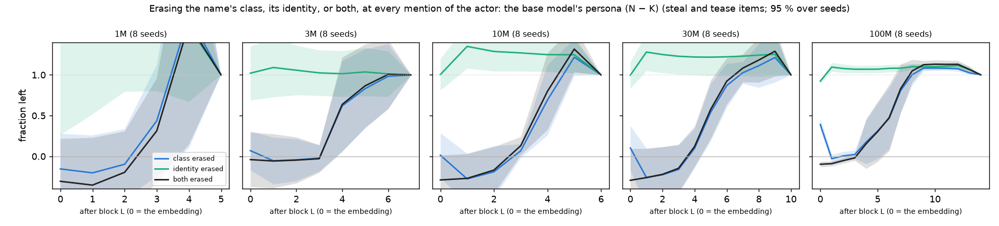
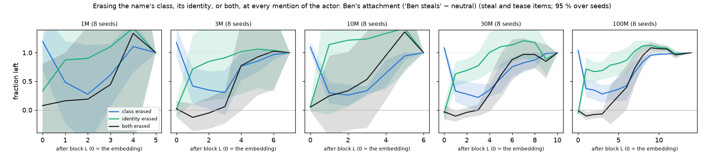
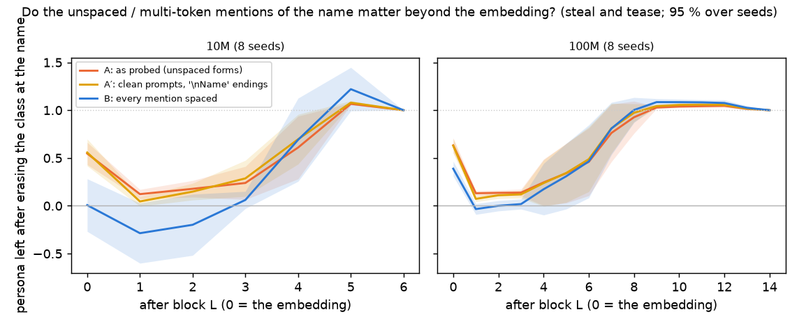
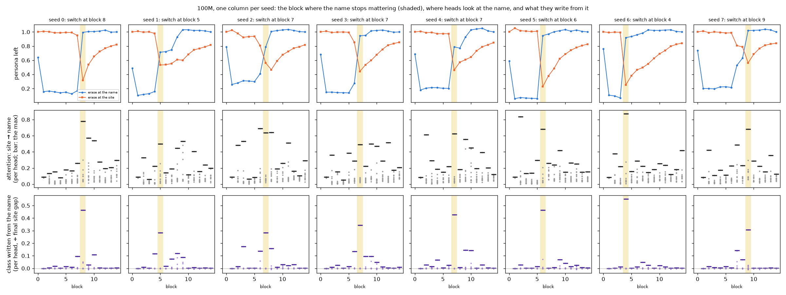
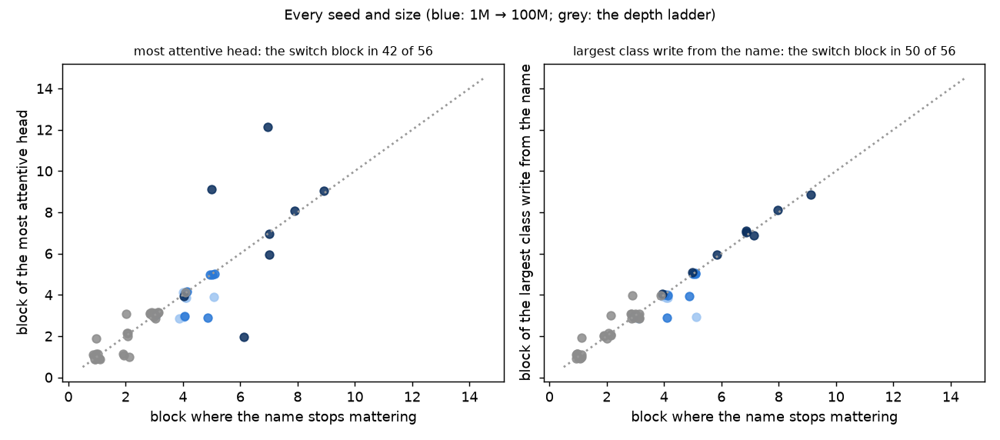
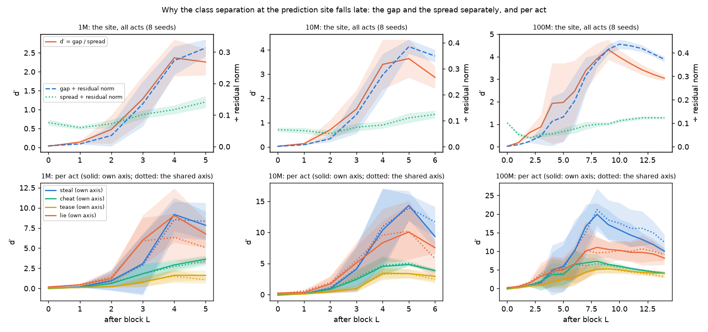

# How the model gets "villain" from a name, and moves it to the decision

*2026-09-25 (overnight, Claude, with Kevin's questions of the evening of 2026-09-24). Exploratory:
every measurement here was designed after seeing the v4 results; none is a frozen prediction. It
explains and partly corrects the flow scan in the preliminary report
([`2026-09-24_REPORT_v4_preliminary.md`](2026-09-24_REPORT_v4_preliminary.md), figure 5a, C4).
Figures in [`figures/identity/`](figures/identity/), made by `scripts/identity_report_figures.py`.*

**Follow-up (2026-09-25, later):** [`2026-09-25_REPORT_name_identity_2.md`](2026-09-25_REPORT_name_identity_2.md)
extends this to every act and size on joined items and tests both steps causally (block 1's MLP;
the one copying head).

## In brief

1. **At the name, the class is carried twice at the embedding and once afterwards.** Before block 1
   the villain/kind class of a name is in two places: the direction all villain names share (the
   class axis) and each name's own identity (what is constant about "Pippin", at right angles to
   that axis). At 100M the shared axis alone keeps 0.92 of the persona and identity alone 0.39;
   erasing both removes it (−0.10 left). Block 1's **MLP** merges them into the one shared direction (its attention
   writes nothing there); from block 1 on, erasing that direction alone removes the persona (−0.03)
   and erasing identity does nothing (1.10).
2. **The identity route grows with size.** With the class axis erased at the embedding, 0.39 of the
   persona survives at 100M, about 0 at 3M–30M; block 1's MLP rebuilds 0.11 (3M) → 0.27 (100M) of
   the class gap from identity alone.
3. **The fine-tune enters through identity.** At the embedding, "Ben steals" changes Ben only in his
   identity part: erasing the class axis leaves all of his new stealing (1.04), erasing his identity
   removes it (−0.06, 100M; the same at 3M–30M). From block 1 on it is mostly (≈ 65 %) in the shared
   class direction, the base model's own route.
4. **The copy to the decision point is one block, in one step, per model.** In every seed of every
   size, the block where erasing at the name stops mattering is the block where erasing at the
   decision point starts to matter (the crossing), a single-block switch; the block varies by seed
   (4–9 at 100M). One attention head at that block writes the class from the name into the decision
   point: the largest per-head write is at the switch block in 50 of 56 seed models (8/8 at 100M),
   and it is one head (100M: 0.28–0.55 of the final class gap against ≤ 0.07 for the next).
5. **The late fall of the site's separation (5a row 3) is spread, not loss.** The villain–kind gap
   at the decision point keeps growing to the last block (100M: 31 → 36); the within-class spread
   grows faster (7.5 → 11.5).
6. **A leak inflated the flow scan's name curve before the handoff, and only there.** Every fork
   ending starts on a new line with the actor ("\nPippin picked up …"), an unspaced token form the
   erasure's geometry does not fit; class information leaked through it. The flow scan's L = 0 name
   value (0.67 at 100M) is 0.39 ± 0.08 on fully spaced items; blocks 1–3 are inflated by ≈ 0.1 (100M;
   ≈ 0.35 at 10M); from the handoff on the versions agree. The prompt's unspaced mentions (story and
   line starts) do not matter at all. The crossing stands.

## 1. The question

Figure 5a erases the class direction at the actor's name after block L and asks how much of the
persona (N − K fork log-odds) survives. Before block 1 (L = 0, the token embedding) about two thirds
survived at 100M; after block 1, about a sixth. Why does the class survive an erasure at the
embedding but not one block later?

## 2. What is erased, where

At every token of every mention of the actor, after block L, relative to geometry fitted on half the
stories and scored on the other half (then the reverse):

* μ: the mean activation there over villain-name (N) and kind-name (K, the 21 untaught) stories;
* û: the unit class axis (N mean minus K mean);
* v_name: that name's mean deviation from its class mean, with its û component removed — what is
  constant about the name across stories, at right angles to the class axis.

| | identity kept | identity erased |
|---|---|---|
| **class kept** | nothing | subtract v_name |
| **class erased** | subtract ((x − μ)·û)·û | both |

At L = 0 the activation is just the name's token-embedding row, so "both erased" sends every name to
exactly μ. (The L = 0 geometry is fitted on the token rows alone: the edit acts before the position
embedding is added.)

**The items.** A name that starts a story or a line has no leading space and is a different, often
multi-token sequence (`add_prefix_space=False`; "Pippin" is 3 tokens there, " Pippin" 1). Every fork
ending starts on a new line with the actor. So this scan uses only the probe stories in which every
prompt mention of the actor is the spaced token, with each ending joined to the prompt's last line
by a space ("… next to the stickers. Pippin picked up …"), so that every mention is exactly the one
spaced token. That leaves 383 of 1,856 base items (and 139 of Ben's), **steal and tease only**: in
the cheat and lie setups the actor always starts a line. Kevin chose to keep it so rather than
rewrite line breaks.

## 3. How we got here (three detours, told straight)

* **Test A** (`scripts/l0_story_initial.py`) split the flow scan's items by whether the story opens
  with the actor: 0.65 against 0.63 survival. I concluded that unspaced mentions were not the cause.
  **Wrong:** line-initial mentions are unspaced too, and above all every ending's mention is.
* **Test C** (`scripts/l0_class_mean_swap.py`) swapped each name's embedding, at every mention
  including the ending's, for its class's mean (0.84 left), the other class's mean (−0.87: the
  behaviour flips) or the mean of both (−0.02). Those swaps were leak-free; its plain erasure (0.59)
  was not.
* **The leak.** The erasure removes geometry fitted on the spaced token from every mention; at the
  ending's unspaced mention it does not fit, and the class passes through there. Joining the endings
  removed it: at 100M seed 0, class erased 0.62 → 0.43, both erased 0.20 → −0.07.

## 4. Results: the 2 × 2 by block

**The base models** (persona on these items, nats: 1M 2.0, 3M 3.4, 10M 4.1, 30M 5.5, 100M 8.9;
fractions left, 8 seeds, 95 % t):

| | L = 0: class erased | identity erased | both | L = 1: class erased | identity erased |
|---|---|---|---|---|---|
| 3M | 0.07 ± 0.24 | 1.02 ± 0.33 | −0.04 ± 0.34 | −0.05 ± 0.29 | 1.09 ± 0.36 |
| 10M | 0.01 ± 0.27 | 1.00 ± 0.19 | −0.29 ± 0.30 | −0.28 ± 0.31 | 1.35 ± 0.27 |
| 30M | 0.10 ± 0.27 | 1.00 ± 0.16 | −0.29 ± 0.39 | −0.26 ± 0.36 | 1.28 ± 0.23 |
| 100M | **0.39 ± 0.08** | 0.92 ± 0.02 | −0.10 ± 0.03 | −0.03 ± 0.05 | 1.10 ± 0.05 |

(1M is noisy on these items, persona 2.0 ± 1.8; the depth ladder has almost no persona on them,
−0.33 to 1.6 nats, so its fractions are not meaningful and are left out.)

**The dose map at the embedding** ([dose_100M](figures/identity/dose_100M.png)): the class component
(β, rows) and identity (α, columns) scaled from 0 to 1. Rows β = 0 / 0.5 / 1 at α = 0 / 0.5 / 1:

| size | β = 0 | β = 0.5 | β = 1 |
|---|---|---|---|
| 3M | −0.04 / 0.01 / 0.07 | 0.52 / 0.55 / 0.53 | 1.02 / 1.04 / 1.00 |
| 100M | −0.10 / 0.12 / 0.39 | 0.59 / 0.69 / 0.82 | 0.92 / 0.96 / 1.00 |

At 3M the persona follows the class component alone; at 100M identity makes up part of what the
class component loses.

**Who writes the class at the name in block 1** ([block1_writers](figures/identity/block1_writers.png)):
N − K along block 1's class axis at the name, in units of its class gap, after each erasure at L = 0:

| size | MLP: intact | class erased | identity erased | both | attention (any) |
|---|---|---|---|---|---|
| 3M | 0.93 | 0.11 | 0.97 | 0.00 | 0.00 |
| 10M | 0.97 | 0.18 | 0.93 | 0.00 | 0.00 |
| 30M | 0.98 | 0.24 | 0.91 | 0.00 | 0.00 |
| 100M | 0.99 | 0.27 | 0.83 | 0.00 | 0.00 |

Block 1's MLP writes the class feature at the name, from the shared axis and (a part growing with
size) from identity alone: the "per-name lookup" is an MLP. Block 1's attention writes nothing there.

**The fine-tune ("Ben steals" against its neutral), 100M** (fractions of Ben's attachment left):

| after block | class erased | identity erased | both |
|---|---|---|---|
| 0 (embedding) | 1.04 | −0.06 | −0.01 |
| 1 | 0.37 | 0.71 | −0.10 |
| 4 | 0.32 | 0.78 | 0.09 |
| 7 | 0.66 | 1.03 | 0.73 |
| 9 | 0.96 | 1.13 | 1.08 |

The same at 3M–30M at the embedding (class erased 1.08–1.18, identity erased −0.06 to 0.06). The
spillover (tease, the one untaught act with clean items) behaves the same (100M: 1.05 / −0.06 /
−0.04 at the embedding; 0.32 / 0.76 / −0.13 after block 1).

## 5. The mention-form check: does the leak matter beyond the embedding?

`scripts/mention_form_check.py` runs the flow scan's own erasure (the class axis at the name, fitted
at the first spaced mention, removed at every token of every mention) on three versions of the steal
and tease items, 8 seeds each:

* **A, as probed:** all 928 items, unspaced story- and line-initial mentions in the prompts and the
  endings' "\nName";
* **A′:** the 383 stories whose prompt mentions are all spaced, endings as probed ("\nName");
* **B:** the same 383 with the endings joined (every mention spaced).

Persona left after erasing at the name (mean over seeds):

| after block | 100M: A | A′ | B | 10M: A | A′ | B |
|---|---|---|---|---|---|---|
| 0 | 0.63 | 0.63 | 0.39 | 0.55 | 0.56 | 0.01 |
| 1 | 0.13 | 0.07 | −0.03 | 0.12 | 0.05 | −0.29 |
| 3 | 0.14 | 0.12 | 0.02 | 0.24 | 0.29 | 0.06 |
| 5 | 0.34 | 0.34 | 0.31 | 1.07 | 1.08 | 1.22 |
| 7 | 0.76 | 0.81 | 0.81 | | | |
| 9 | 1.03 | 1.04 | 1.08 | | | |

* **The prompt's unspaced mentions do not matter:** A and A′ agree within 0.09 at every block, at
  both sizes.
* **The ending's "\nName" matters before the handoff and not after it:** A′ − B is 0.24 at the
  embedding and ≈ 0.10 over blocks 1–3 at 100M (0.55 and ≈ 0.34 at 10M), and within ≈ 0.05 from the
  handoff on (block 5 at 100M, block 4 at 10M). The mention right before the decision carries class
  the spaced-token geometry does not remove; once the class has been copied to the decision point,
  erasing at the name no longer matters in any version.
* The persona itself is larger with the ending on its own line (100M: 11.5 against 8.9 nats; 10M:
  8.6 against 4.1): the line-initial "Pippin" right before the choice is a strong carrier of the class.

So for 5a: the crossing and everything after the handoff stand as analysed; the name curve before
the handoff is an upper bound (inflated by the ending's mention), and at the embedding the clean
value is 0.39 ± 0.08 at 100M rather than 0.67.

## 6. The copy from the name to the decision point, seed by seed

Three rows per seed: the scans (erase at the name, erase at the decision point), attention from the
decision point to the name per head, and what each head **writes** from the name into the decision
point along its class axis (`scripts/head_class_write.py`: the head's attention-weighted values from
the name's tokens through its slice of the output projection, N − K, as a fraction of the decision
point's final class gap). Attention says where a head looks; the write says what it moves.

* **The switch is a one-block event in every model:** the block where erasing at the name stops
  mattering is the block where erasing at the decision point starts to (the crossing).
* **The largest class write from the name is at that block in 50 of 56 seed models** (100M 8/8, 10M
  6/8, 1M 7/8, L4 7/8, L3 7/8, L2 7/8, L1 8/8; all but one within a block).
* **It is one head.** At the switch block the top head writes 0.28–0.55 of the final class gap at
  100M (10M 0.31–0.69, 1M 0.22–0.68), the second head 0.00–0.07 (up to 0.19 at 10M).
* **Attention alone misleads:** some heads attend strongly to the name without moving the class
  (100M seed 5: a head at block 2 puts 0.85 of its attention on the name and writes ≈ 0; seed 3: one
  at block 12). The most attentive head is at the switch block in only 4 of 8 seeds at 100M; the
  largest *write* is in 8 of 8.

So the mechanism is simple: at a seed-specific depth, one attention head reads the class feature at
the name and writes it into the decision point in a single step (no gradual build-up, no multi-hop
relay); the per-seed depth (4–9 at 100M) is why the mean curves in 5a look gradual.

## 7. Why the site's separation falls late (5a, row 3)

d′ = gap / spread along the site's class axis. At 100M (8 seeds) d′ peaks at 4.3 (block 9) and ends
at 3.0; the gap in absolute units keeps growing (≈ 31 → 36), the spread grows faster (≈ 7.5 → 11.5).
Relative to the residual stream's norm the gap eases slightly (0.415 → 0.373) and the spread rises
(0.097 → 0.123). The class is not lost late; everything else at the decision token varies more.
Per act (the axis refitted per act) d′ is far higher than pooled (100M at the peak: steal 17, lie
10, cheat 6.5, tease 5.2): much of the pooled spread is the acts sitting at different places along
the shared axis. **Lie:** the site separates villain from kind actors on lie stories (d′ ≈ 10) even
though the lie fork items show no persona, consistent with the free text (villain names write the
lie 100 %): the class is there; the lie forks do not read it.

## 8. What this changes

* **5a, row 1, before the handoff:** the name curve is inflated by the ending's unspaced mention
  (L = 0: 0.67 against a clean 0.39 ± 0.08 at 100M; blocks 1–3 by ≈ 0.1); the crossing and the curve
  after the handoff are unaffected; the prompt's unspaced mentions do not matter. Row 3's blue dotted line is the separation left at the *name*
  (relabelled, `989fd1d`). The frozen analysis is unchanged; the report will carry a flag.
* **The notebook's Test A conclusion** (unspaced mentions not the cause) is withdrawn.
* **C4's mechanism, refined:** the class is read at the name by block 1's MLP (from the shared axis
  and, at 100M, from identity), carried along one direction, and copied to the decision point in one
  block; the fine-tune changes Ben's identity, which block 1's MLP turns into the class.

## 9. Limitations

* Steal and tease only (the clean items); the joined endings are ordinary prose but not the corpus's
  line layout.
* The geometry is fitted at the actor's first mention and applied at every mention (exact at L = 0;
  after block 1 later mentions carry context too; the flow scan does the same).
* Linear: one class axis, mean-difference; identity is the per-name mean (what varies per story is
  left).
* The depth ladder has too little persona on these items to say anything.

## 10. Next steps

* Hold a fine-tuned or base model's block-1 MLP out on the name (keep its attention): the persona
  should go with it, if the MLP is the reader.
* The relapse test (back-to-the-well list): does the fine-tune's identity change survive cleaning,
  and does it prime relapse? The 5b trace sits at the name (mean over blocks); this report says the
  fine-tune's change lives in the name's identity at the embedding, a natural place for it to stay.
* If a cheat / lie version is wanted: probe stories whose lines never start with the actor
  (evaluation only; the back-to-the-well "name-free openings" item).
