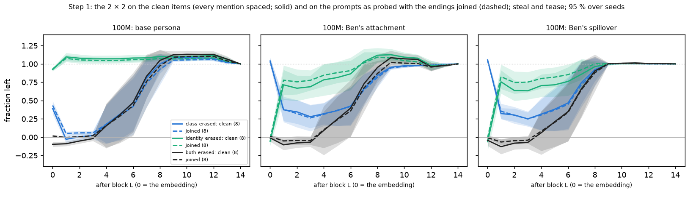
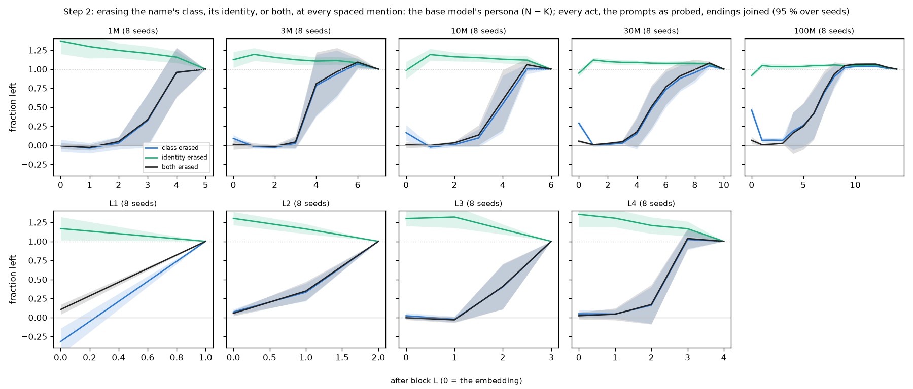
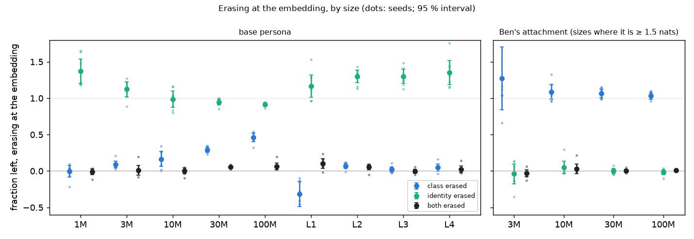
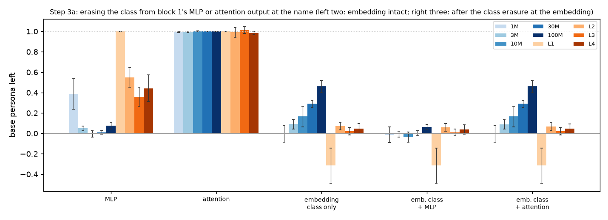
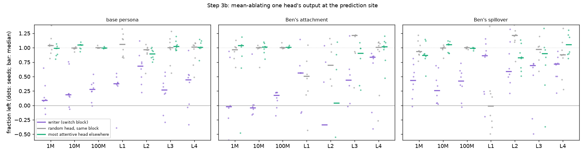
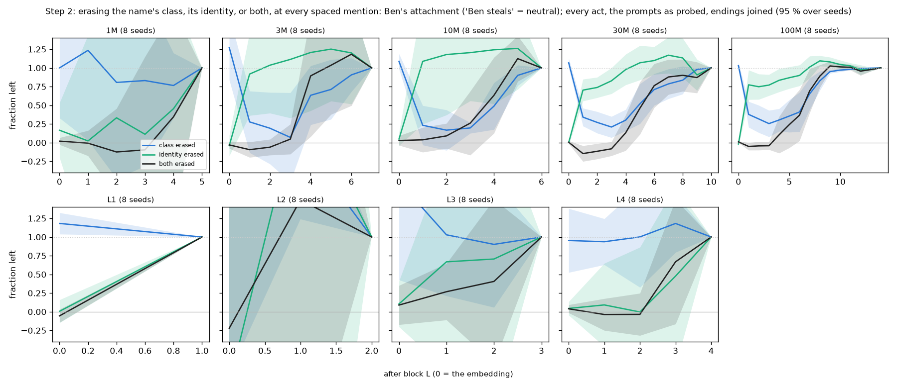
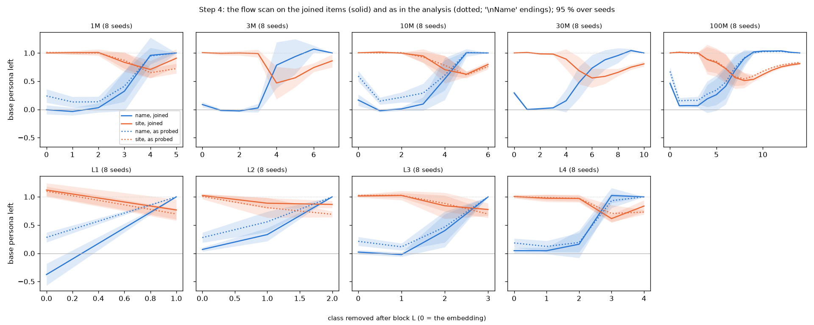

# The name's class at the embedding, settled: every act, every size, and two causal checks

*2026-09-25, Claude, for Kevin. A follow-up to
[`2026-09-25_REPORT_name_identity.md`](2026-09-25_REPORT_name_identity.md) (the "first report"),
written to settle the L = 0 remnant for the paper. Exploratory: every measurement was designed after
seeing the v4 results. Figures in [`figures/identity2/`](figures/identity2/) (made by
`scripts/identity_followup_figures.py`); a flow-scan figure on the new items in
[`figures/v4_joined/`](figures/v4_joined/). Run on one rented 8 × RTX 5090 box (vast.ai, UK), 8:25–10:18 am PT,
≈ $11.50.*

## In brief

The flow scan (figure 5a) erases the villain/kind class direction at the actor's name after block L.
At the embedding (L = 0) part of the persona survived; one block later almost nothing did. This
report settles why, on all four acts and every model size, and tests the mechanism causally.

1. **The remnant is the name's identity, and it grows with size.** A name's embedding carries its
   class twice: along the direction all villain names share (the class axis) and in the name's own
   idiosyncratic part (its identity, at right angles to that axis). Erase the class axis alone and
   the persona that survives is 0.00 at 1M, 0.09 at 3M, 0.17 at 10M, 0.29 at 30M and **0.46 at 100M**
   (8 seeds each, all four acts). Erase both and nothing survives at any size (≤ 0.06). Erase
   identity alone and the persona stays (0.92–1.37).
2. **Block 1's MLP is what reads it (causal).** Erasing the class from the output of block 1's MLP at
   the name removes the persona (0.00–0.08 left at 3M–100M). Erasing it from block 1's attention
   output does nothing (1.00 at every size). When the class axis has already been erased at the
   embedding, the identity-borne remnant (0.46 at 100M) also goes when block 1's MLP output is
   erased (0.06) and stays when its attention output is (0.46).
3. **One attention head moves the class to the decision point (causal).** Mean-ablating the one head
   with the largest class write from the name, at the block where the name stops mattering, leaves a
   median 0.09 (1M), 0.18 (10M) and 0.28 (100M) of the persona. A random head in the same block, and
   the head that attends most to the name elsewhere, leave 0.99–1.05. At 10M and 100M the same single
   head carries most of Ben's fine-tuned attachment (−0.04 and 0.18 left).
4. **The fine-tune enters through identity only, at every size where it is measurable.** "Ben
   steals" changes Ben's identity, not his position on the class axis. Erasing the class axis at the
   embedding leaves all of the attachment (1.03–1.27), and erasing his identity removes it
   (−0.04–0.05; 3M–100M).
5. **The prompts as probed are fine once the endings are joined.** Step 1 validated this: on the
   same act pair, joined items with every prompt as probed agree with the fully spaced "clean" items
   within 0.12 at every block (100M, 8 seeds, base and fine-tune). So the whole analysis could use
   every act and all 1,856 items instead of the first report's 383 (steal and tease only).
6. **Figure 5a on the joined items:** the name curve at the embedding drops (100M: 0.67 → 0.46; 10M:
   0.59 → 0.17; 1M: 0.24 → −0.01). The switch block is unchanged in 51 of 56 seed models, and the
   crossing on the mean curve stays at block 7 at 100M. It also explains flag 1 of the preliminary
   report: the fine-tune's crossing "at block 0" happens because its change lives in identity, which
   the class erasure there cannot touch.

## 1. What we set out to settle

The first report found, on a small clean subset (steal and tease, 383 stories), that the class
survives erasure at the embedding through each name's identity, that block 1's MLP merges the two,
and that one head copies the result to the decision point. Four things were open:

1. whether the result holds on the items as probed (every act, the story- and line-initial unspaced
   names left as they are), which the paper's figures use;
2. whether it holds at every size, including the depth ladder, and for all four acts;
3. whether block 1's MLP is causally the reader (the first report only measured what it writes);
4. whether the head that writes the most class is causally the copier.

## 2. The items and the erasure

**What is erased** (unchanged from the first report). At every spaced mention of the actor, after
block L, with geometry fitted on half of the stories and scored on the other half (then the reverse):

* μ: the mean activation over villain-name (N) and kind-name (K, the 21 untaught) stories;
* û: the class axis (N mean minus K mean, unit length);
* v_name: the name's mean deviation from its class mean, with its û component removed (its identity).

| | identity kept | identity erased |
|---|---|---|
| **class kept** | nothing | subtract v_name |
| **class erased** | subtract ((x − μ)·û)·û | both |

At L = 0 the geometry is fitted on the token-embedding rows alone (the edit acts before the position
embedding is added). "Fraction left" is the persona (N − K fork log-odds) under the erasure divided
by the intact persona.

**The joined items.** Every fork ending begins on a new line with the actor ("\nPippin picked up …"),
an unspaced token form. In the first report, class information leaked through that mention because
the erasure's geometry is fitted on the spaced token. Here each ending is joined to the prompt's last
line with a space ("… next to the stickers. Pippin picked up …"), so the mention right before the
decision is the spaced " Pippin". Everything else is as probed. Names that start a story or a line
inside the prompt stay unspaced (and are not erased). That gives all 1,856 flow items, every act,
and 640 of Ben's items for the fine-tune.

**Step 1: are the joined items as good as the clean ones?** Same act pair (steal and tease), 100M, 8
seeds: the joined items (928 base items, 320 of Ben's) against the clean items (383 and 139).

| after block | 0 | 1 | 2 | 4 | 7 | 9 |
|---|---|---|---|---|---|---|
| base, class erased (clean / joined) | 0.39 / 0.43 | −0.03 / 0.05 | 0.01 / 0.06 | 0.18 / 0.18 | 0.81 / 0.74 | 1.08 / 1.05 |
| base, identity erased | 0.92 / 0.93 | 1.10 / 1.08 | 1.08 / 1.06 | 1.07 / 1.05 | 1.08 / 1.06 | 1.10 / 1.07 |
| base, both erased | −0.10 / 0.02 | −0.09 / −0.00 | −0.05 / 0.01 | 0.15 / 0.16 | 0.83 / 0.76 | 1.13 / 1.09 |
| attachment, class erased | 1.04 / 1.03 | 0.37 / 0.38 | 0.35 / 0.32 | 0.32 / 0.31 | 0.66 / 0.65 | 0.96 / 0.95 |
| attachment, identity erased | −0.06 / −0.02 | 0.71 / 0.78 | 0.67 / 0.76 | 0.78 / 0.85 | 1.03 / 1.02 | 1.13 / 1.08 |

The largest difference anywhere (all 15 blocks, base, attachment and spillover) is 0.12. The joined
items leave slightly more under "both erased" at the embedding (0.02 against −0.10), which is the
small share carried by the prompts' unspaced mentions, which are not erased. The joined items are a
faithful stand-in, and they allow all four acts.

## 3. The 2 × 2 on every act, at every size (step 2)

**The base models** (all four acts, 1,856 items; persona in nats; fraction left; mean ± 95 % t over 8
seeds):

| size | persona | L = 0: class erased | identity erased | both | L = 1: class erased | identity erased |
|---|---|---|---|---|---|---|
| 1M | 2.1 ± 0.9 | −0.01 ± 0.08 | 1.37 ± 0.17 | −0.01 ± 0.04 | −0.04 ± 0.07 | 1.30 ± 0.15 |
| 3M | 3.3 ± 0.9 | 0.09 ± 0.05 | 1.12 ± 0.10 | 0.01 ± 0.07 | −0.02 ± 0.02 | 1.19 ± 0.08 |
| 10M | 3.5 ± 0.9 | 0.17 ± 0.10 | 0.98 ± 0.11 | 0.00 ± 0.04 | −0.02 ± 0.02 | 1.19 ± 0.08 |
| 30M | 4.7 ± 1.2 | 0.29 ± 0.04 | 0.95 ± 0.04 | 0.05 ± 0.02 | −0.00 ± 0.02 | 1.12 ± 0.03 |
| 100M | 7.2 ± 0.8 | **0.46 ± 0.06** | 0.92 ± 0.02 | 0.06 ± 0.05 | 0.07 ± 0.03 | 1.05 ± 0.03 |
| L1 | 0.9 ± 0.4 | −0.32 ± 0.17 | 1.17 ± 0.15 | 0.10 ± 0.06 | (last block) | |
| L2 | 1.9 ± 0.6 | 0.07 ± 0.04 | 1.30 ± 0.09 | 0.05 ± 0.04 | 0.33 ± 0.12 | 1.16 ± 0.07 |
| L3 | 1.8 ± 0.5 | 0.02 ± 0.04 | 1.30 ± 0.10 | −0.00 ± 0.03 | −0.02 ± 0.04 | 1.32 ± 0.14 |
| L4 | 1.9 ± 0.7 | 0.05 ± 0.05 | 1.35 ± 0.17 | 0.02 ± 0.05 | 0.05 ± 0.05 | 1.30 ± 0.12 |

What this says:

* **At the embedding, the class lives in two places, and identity's share grows with size.** With
  the class axis erased, what survives rises steadily with size (0 → 0.09 → 0.17 → 0.29 → 0.46). On
  every act the persona now has enough signal to measure, so this replaces the first report's noisy
  3M–30M values (0.07, 0.01, 0.10 on steal and tease alone). Erasing both removes the persona at
  every size.
* **From block 1 on, the class is in one direction.** Erasing the class axis after block 1 removes
  the persona (≤ 0.07) and erasing identity does nothing (≥ 1.05). The depth ladder (L1–L4, the
  shallow models) shows the same (L2 after block 1 is 0.33: in a two-block model part of the copy to
  the decision point has already happened by then, as its flow scan shows).
* **Identity erased leaves *more* than all at small sizes (1.37 at 1M, 1.30–1.35 on the ladder).**
  Erasing identity sends every name to its class's mean: a prototypical villain or kind child. The
  small models act on the prototype more strongly than on the real names, whose idiosyncrasies
  partly dilute their class. At 100M this surplus is gone (0.92): identity there carries class
  rather than diluting it.
* **Every act.** The intact persona per act at 100M is steal 13.6, cheat 8.4, tease 5.1, lie 1.8
  nats (lie carries little, as in C1). The figure pools the acts, so it is dominated by steal and
  cheat, the acts the first report could not measure.

**The dose map** ([dose_all](figures/identity2/dose_all.png)): scaling the class component and
identity from 0 to 1 at the embedding. At 1M and L4 the persona follows the class component: with it
gone (β = 0) nothing is left at any α, and keeping identity only dilutes it (β = 1: 1.37 at α = 0,
1.00 at α = 1). At 100M identity makes up part of what the class component loses (β = 0: 0.06 at
α = 0, 0.46 at α = 1); 10M is in between (0.17).

## 4. Block 1's MLP reads the class (step 3a, causal)

At the name, after block 1, the class component (along block 1's class axis, set to its mean) is
erased from the output of block 1's MLP or of its attention. It is erased either alone or on top of
the class-axis erasure at the embedding. Fraction of the base persona left (8 seeds, mean ± 95 %):

| size | MLP erased | attention erased | embedding class erased | … + MLP erased | … + attention erased |
|---|---|---|---|---|---|
| 1M | 0.39 ± 0.15 | 1.00 ± 0.01 | −0.01 ± 0.08 | −0.01 ± 0.08 | −0.00 ± 0.08 |
| 3M | 0.05 ± 0.02 | 1.00 ± 0.01 | 0.09 ± 0.05 | −0.01 ± 0.03 | 0.09 ± 0.05 |
| 10M | −0.00 ± 0.03 | 1.00 ± 0.00 | 0.17 ± 0.10 | −0.04 ± 0.05 | 0.17 ± 0.10 |
| 30M | 0.01 ± 0.02 | 1.00 ± 0.00 | 0.29 ± 0.04 | 0.00 ± 0.02 | 0.29 ± 0.04 |
| 100M | 0.08 ± 0.03 | 1.00 ± 0.00 | 0.46 ± 0.06 | 0.06 ± 0.03 | 0.46 ± 0.06 |
| L1 | 1.00 ± 0.00 | 1.00 ± 0.00 | −0.32 ± 0.17 | −0.32 ± 0.17 | −0.32 ± 0.17 |
| L2 | 0.55 ± 0.10 | 0.99 ± 0.05 | 0.07 ± 0.04 | 0.06 ± 0.04 | 0.07 ± 0.04 |
| L3 | 0.36 ± 0.09 | 1.01 ± 0.03 | 0.02 ± 0.04 | 0.01 ± 0.03 | 0.02 ± 0.04 |
| L4 | 0.44 ± 0.13 | 0.99 ± 0.02 | 0.05 ± 0.05 | 0.04 ± 0.05 | 0.05 ± 0.05 |

* **3M–100M: block 1's MLP is the reader.** Taking its class write away removes the persona, and
  taking the attention's away does nothing. The identity-borne remnant goes through the same MLP: at
  100M, 0.46 survives the embedding erasure, and it is lost when the MLP's write is erased too (0.06).
* **Where the copy happens early, the MLP matters less.** In L1 the only block's attention copies
  the class to the decision point before its MLP runs, so the MLP at the name is irrelevant (1.00).
  In L2–L4 and at 1M (switch blocks 1–4) the MLP carries part of it (0.36–0.55 and 0.39 left). There
  a head can read the class straight from the embedding.

## 5. One head copies it to the decision point (step 3b, causal)

For each seed model the head is picked from data measured earlier, not from this ablation. The
switch block is where the flow scan's name curve jumps. The **writer** is the head at that block
with the largest class write from the name into the decision point (`head_class_write.py`; at 100M
it writes 0.28–0.55 of the final class gap). Two controls: a **random head in the same block**, and
the **looker**, the head elsewhere that attends most to the name while writing < 0.05 of the class.
Each head's output at the decision point is replaced by its mean there (mean-ablated). Fraction left
(median over 8 seeds [min, max]):

| size | switch blocks | writer | same block | looker | attachment: writer | same block | looker |
|---|---|---|---|---|---|---|---|
| 1M | 3–5 | 0.09 [−0.28, 0.65] | 1.04 [0.81, 1.39] | 0.99 [0.80, 1.07] | (too small) | | |
| 10M | 3–5 | 0.18 [−0.06, 0.76] | 0.99 [0.93, 1.02] | 1.05 [0.93, 1.10] | −0.04 [−0.77, 0.89] | 1.00 [0.66, 1.04] | 1.01 [0.81, 1.10] |
| 100M | 4–9 | 0.28 [−0.01, 0.54] | 1.00 [0.99, 1.04] | 1.00 [0.99, 1.02] | 0.18 [−0.18, 0.23] | 1.00 [0.98, 1.09] | 1.01 [1.00, 1.04] |
| L1 | 1 | 0.37 [−0.84, 0.56] | 1.06 [0.83, 1.33] | (no other block) | | | |
| L2 | 1–2 | 0.68 [0.22, 1.12] | 0.96 [0.56, 1.06] | 0.89 [0.75, 1.00] | | | |
| L3 | 2–3 | 0.27 [−0.29, 0.58] | 1.00 [0.56, 1.28] | 1.02 [0.96, 1.20] | | | |
| L4 | 3–4 | 0.44 [−0.33, 0.95] | 1.01 [0.49, 1.08] | 1.01 [0.78, 1.14] | | | |

* **One head does most of the copying.** Removing it takes away 70–90 % of the persona at 1M–100M,
  and the two controls take away nothing. So attention alone does not identify the copier: the
  looker, the head outside the switch block that attends most to the name, moves nothing.
* **The copy is not all in that head:** 0.1–0.3 survives (more on the ladder, 0.27–0.68). Plausible
  routes: other heads in the same block (each writes ≤ 0.07 of the gap at 100M), later blocks, or the
  unspaced prompt mentions.
* **The fine-tune goes through the same head:** at 10M and 100M, ablating the writer removes most
  of Ben's attachment (−0.04 and 0.18 left) and a good part of the spillover (0.26 and 0.42). The
  controls remove none. At 1M and on the ladder the attachment on these items is ≈ 0 (1M 0.8 nats;
  ladder −0.4 to 0.3), so its fractions are noise and are not reported.

## 6. The fine-tune (step 2, "Ben steals" against its neutral)

Ben's attachment on all acts (640 of Ben's items against the 21 other kind names), fraction left:

| size | attachment (nats) | L = 0: class erased | identity erased | both | L = 1: class erased | identity erased |
|---|---|---|---|---|---|---|
| 3M | 1.5 ± 1.1 | 1.27 ± 0.43 | −0.04 ± 0.14 | −0.03 ± 0.05 | 0.28 ± 0.41 | 0.92 ± 0.55 |
| 10M | 3.9 ± 1.6 | 1.09 ± 0.10 | 0.05 ± 0.09 | 0.03 ± 0.06 | 0.23 ± 0.26 | 1.09 ± 0.84 |
| 30M | 4.6 ± 2.5 | 1.07 ± 0.06 | 0.00 ± 0.03 | 0.01 ± 0.02 | 0.34 ± 0.12 | 0.70 ± 0.15 |
| 100M | 6.7 ± 1.6 | 1.03 ± 0.04 | −0.02 ± 0.04 | 0.01 ± 0.01 | 0.38 ± 0.17 | 0.77 ± 0.20 |

The spillover (the three untaught acts) behaves the same: at 10M–100M, class erased at the
embedding leaves 1.08–1.20 and identity erased −0.02 to 0.06. The fine-tune changes Ben's identity
and nothing else at the embedding. From block 1 on, most of it is in the shared class direction (the
base model's route) and part is not (identity erased after block 1 leaves 0.70–0.77 at 30M–100M).
This matches the first report on the steal/tease subset, now at four sizes and for every act.

## 7. The flow scan on the joined items (step 4)

`scripts/flow_joined.py` reruns the flow scan exactly as in the analysis (the base scan with
attention to the name; each of the four fine-tunes against the neutral), on the joined items.

| size | name curve at L = 0: as probed → joined | switch block per seed: as probed / joined |
|---|---|---|
| 1M | 0.24 → −0.01 | 4 4 4 4 4 3 4 5 / 4 4 4 4 3 3 4 5 |
| 3M | (not in the analysis) → 0.09 | – / 4 4 4 4 5 6 4 4 |
| 10M | 0.59 → 0.17 | 5 5 5 4 5 3 4 4 / 5 5 5 4 5 4 4 4 |
| 30M | (not in the analysis) → 0.29 | – / 9 4 5 6 6 7 7 8 |
| 100M | 0.67 → 0.46 | 8 5 7 7 7 6 4 9 / identical |
| L1–L4 | 0.18–0.28 → −0.38 to 0.07 | L1, L3 identical; L2 differs in 2 seeds, L4 in 1 (51 of 56 identical overall) |

* **Before the handoff the joined name curve is the true one.** Its value at the embedding equals
  section 3's class-erased column, as it should, since it is the same erasure. The old values were
  inflated by the endings' mention.
* **The crossing and everything after the handoff are unchanged.** At 100M the mean-curve crossing
  is block 7 in both versions, and the seeds' switch blocks are identical.
* **Figure 5a on the joined items** ([v4_5a](figures/v4_joined/v4_5a.png); `plan_figures.py` on an
  analysis file whose flow section is recomputed from these scans). It is the same figure with a
  lower name curve at the embedding. **A5 on the joined items** ([v4_A5](figures/v4_joined/v4_A5.png))
  is fine for the base rows. Its fine-tune row is unreadable below 10M because the attachment on
  these items is ≈ 0 there.
* **Flag 1 of the preliminary report, explained.** The crossing estimator ("the first block where
  erasing at the site leaves less than erasing at the name") fires at block 0 for every fine-tune.
  That is because the fine-tune's change lives in Ben's identity, which the class-axis erasure at
  the embedding does not touch, so the name value there is ≥ 1 (1.03–1.09). It is not an estimator
  quirk to be patched blindly: it is the identity result showing through. The proposed fix (the
  first block after the name curve's minimum) still gives the right answer: the fine-tunes cross
  where the base does.

## 8. For the paper

**A main-text observation (a paragraph and one figure):** *A name's class is read at the name by
block 1's MLP from two sources in the embedding: the direction all villain names share and each
name's own identity. Identity's share grows with size (0 of the persona at 1M, 0.46 at 100M). A
fine-tune on "Ben steals" changes only Ben's identity. At a seed-specific depth a single attention
head then copies the class to the decision point; ablating it removes 70–90 % of the persona and
most of the fine-tuned behaviour, while equally attentive heads remove nothing.* The figure: the
embedding summary ([l0_by_size](figures/identity2/l0_by_size.png)), with the head ablation
([heads_causal](figures/identity2/heads_causal.png)) as a second panel.

**An appendix:** the items and the leak (section 2 and the first report's section 5), the 2 × 2 by
block (section 3 figures), the block-1 causal table, the head table, the fine-tune table, and 5a / A5
on the joined items.

**Decisions for you:**

1. **5a in the paper: the joined version?** It removes the leak. The crossing is unchanged and the
   name curve at the embedding is lower (0.46 at 100M). I would switch; the frozen analysis stays as
   it is, and the paper says which items the figure uses.
2. **Flag 1:** adopt the proposed crossing fix, now with a reason.
3. **The main-text figure:** the embedding summary alone, or with the head ablation beside it.

## 9. Limitations

* **Linear and mean-based:** one class axis (a mean difference); identity is the per-name mean
  deviation. What varies per story is left in.
* **Mentions:** the geometry is fitted at the first spaced mention and applied at every spaced
  mention. The prompts' unspaced mentions are not erased; the validation bounds what they carry at
  ≈ 0.1.
* **The head ablation is one head, mean-ablated at the decision point only.** The 10–30 % that
  survives is not traced.
* **The depth ladder:** little persona on these items (0.9–1.9 nats) and no measurable attachment.
  Its base results are consistent with the rest, but it cannot speak to the fine-tune.
* **Exploratory throughout;** none of this is a frozen prediction.

## 10. Files and reproduction

* Code (commit `e458ed0`, plus the head-selection edits to `name_mechanism_causal.py` that skip
  the head part where no switch data exist and the looker in one-block models):
  `name_identity_scan.py --variant joined` (steps 1–2), `name_mechanism_causal.py` (step 3),
  `flow_joined.py` (step 4), `identity_followup_figures.py` (figures, `summary.json`, and the
  recomputed flow section for `plan_figures.py`).
* Outputs (gitignored): `logs/v4/identity_joined_st/` (step 1, 100M), `logs/v4/identity_joined/`,
  `logs/v4/mechanism/`, `logs/v4/flow_joined/` (9 sizes × 8 seeds each); the box's job logs in
  `logs/v4/box5/joblogs/`. The Mac's earlier 3-seed step-1 run is in `logs/v4/identity_joined_st_mac/`.
* Every output records its checkpoints (Hub paths and revision) and the git commit.
