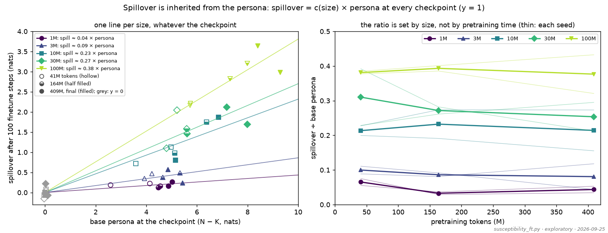
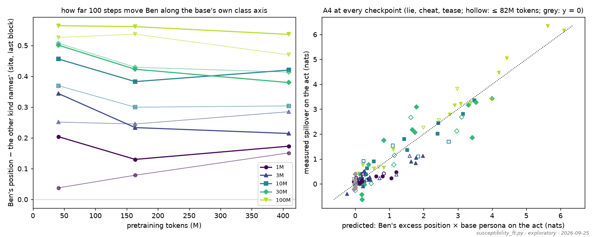
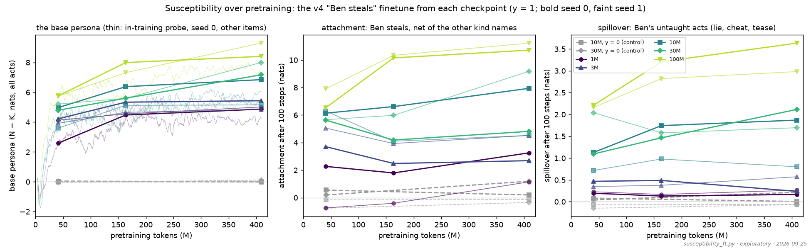
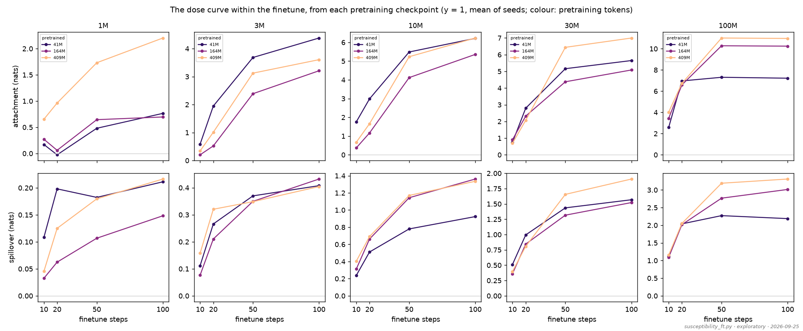

# Susceptibility over pretraining: the persona sets it, size sets the gain

*2026-09-25, evening (Claude, with Kevin). Exploratory: the question, design and analysis were
chosen after the v4 results; nothing here is a frozen prediction. It follows the discussion of the
GD test (preliminary report [`2026-09-24_REPORT_v4_preliminary.md`](2026-09-24_REPORT_v4_preliminary.md),
C4, R17) and Kevin's aim of predicting emergent misalignment from the base model. Run with
`scripts/susceptibility_ft.py` (config `configs/susceptibility_ft.yaml`) on the Mac, 21:06–23:50 PT;
outputs in `logs/v4/susceptibility/` (one JSON per point); figures in
[`figures/susceptibility/`](figures/susceptibility/), made by `scripts/susceptibility_figures.py`.*

## In brief

1. **Spillover is proportional to the base persona at every pretraining checkpoint, with a
   factor set by model size.** Spillover after the standard "Ben steals" finetune ≈ c × the base
   model's persona. Within a size, c barely moves between 41M, 164M and 409M tokens: 10M
   0.21 / 0.23 / 0.21, 100M 0.38 / 0.39 / 0.38. c grows with size: 0.04 (1M), 0.09 (3M), 0.23
   (10M), 0.27 (30M), 0.38 (100M). So susceptibility grows during pretraining exactly as much as
   the persona does; no separate "susceptibility" matures later.
2. **This is a working prediction from the base model.** Take c from one finetune of the final
   checkpoint and multiply by the persona at an earlier checkpoint. That predicts the earlier
   spillover with slope 1.02 and r = 0.94 over 20 (run, checkpoint) pairs, with a median error of
   23 % per seed (worst at 1M–3M, where spillover is ≤ 0.5 nats). The persona is a forward-pass
   quantity, already probed every 10 updates in every v4 run.
3. **How far the finetune moves Ben is a size constant.** Ben's excess position on the base
   model's own class axis after 100 steps is flat or slightly falling over pretraining (100M
   0.55 / 0.55 / 0.50; 30M 0.50 / 0.43 / 0.40; 10M 0.41 / 0.34 / 0.36). It rises with size, as
   in C4. A4's chain (spillover = position × persona) holds at every checkpoint: slope 0.90 at
   41M, 0.95 at 164M, 1.01 at the final (r = 0.92–0.96, 114 act-level points).
4. **The dose curve: the early response is fixed early, and pretraining raises the ceiling.** At
   100M the first 20 finetune steps give the same response from every checkpoint (spillover
   2.04 / 2.02 / 2.05, attachment 7.0 / 6.6 / 6.7). The 41M-token model then saturates, while the
   later checkpoints keep rising (spillover at 100 steps 2.2 → 3.0 → 3.3, attachment
   7.2 → 10.2 → 11.0). At 10M–30M the same holds only roughly, within the seed noise.
5. **Checks.** The Mac reproduces the box's finetune readout on all 14 final checkpoints to
   within 0.02 nats. The y = 0 control stays at zero at every checkpoint (spillover −0.07 to
   +0.07; one +0.22 is the box's own value for that seed).

**For the paper** (section below, 2026-09-26): item 1, on the paper's per-act definition, is a
main-text candidate as extra markers on figure 4a. The GD test could then move to the appendix.

Caveats: two seeds (only seeds 0 and 1 kept intermediate checkpoints) and three pretraining
checkpoints (the first saved one is at 41M tokens, when the persona is already ≈ 55–80 % of its final value),
so this describes the persona's **maturation, not its formation**. Attachment is seed-noisy
(30M final: 4.8 against 9.2) and tracks the persona less tightly than spillover does.

## The question and the design

The GD test (R17) showed that a first-order, gradient-based prediction from the base model only
covers small plain-GD steps, not the finetune we actually run. Kevin's alternative is an
**empirical susceptibility**: apply the real finetune, unchanged, to the base model at several
points in its pretraining and measure the response. The questions are how susceptibility develops
during pretraining, and whether it tracks the persona or lags it.

* **Finetune:** the v4 finetune exactly (100 steps of fresh AdamW, peak lr 1e-4,
  `data/finetune-v4/ft-steal-Ckind` against `ft-neutral-Ccast`, `scripts/finetune.py`
  unchanged). The only addition is weight checkpoints at 10, 20 and 50 updates, so one run gives
  a four-point dose curve. The batch order is the base run's seed, so it is identical across a
  run's checkpoints.
* **Readout:** `eval_v4`'s k0 items and readout. Attachment is "Ben steals" net of the other kind
  names, finetune minus neutral. Spillover is the same on lie, cheat and tease (the mean). The
  persona is the base checkpoint's N − K over all acts. Ben's position is at the prediction site,
  last block, on the checkpoint's own N − K axis, minus the other kind names' shift
  (`finetune_persona.ben_position`, as in A4).
* **Checkpoints:** every lexical run's seeds 0 and 1 kept a checkpoint every 2,496 updates
  (≈ 41M tokens; the y = 0 runs every 2,497). We ran the first (41M), the fourth (164M) and the
  final (409M) at y = 1 for all five sizes, plus a y = 0 control at 10M and 30M (41M and final).
  Points ran coarse to fine; the 82M, 246M and 327M checkpoints were planned but cut to leave the
  GPU free by midnight. That is 38 points in all.
* **Timing on the Mac (MPS):** 75 s per checkpoint at 1M, 110 s at 3M, 150 s at 10M, 300 s at
  30M, 730 s at 100M (two finetunes, nine models scored).

## Results

### Spillover = c(size) × persona, at every checkpoint

Left: every (run, checkpoint), spillover against the base persona. The line per size is fitted
through the origin, and the marker fill gives the checkpoint. Right: the ratio over pretraining.
Thin lines are the two seeds; thick lines are their mean.

The earlier checkpoints sit on the same line as the finals. Most points gain persona between
41M and 409M tokens, and spillover rises in step. The ratio is flat within each size and
ordered by size. Per seed it scatters more (10M: seed 0 goes 0.23 → 0.27 → 0.27, seed 1
0.20 → 0.19 → 0.15), and single seeds drift by a few hundredths in either direction, but the
seed mean shows no trend over pretraining. This size ordering matches C3's
finding that the spillover slope across y grows with size. The difference is the independent
variable: C3's slope is taken across corpora (varying y), this ratio across pretraining time.

**As a prediction:** c from the final checkpoint × the persona at 41M or 164M tokens predicts
that checkpoint's spillover with slope 1.02 and r = 0.94 (20 pairs); the median per-seed error is
23 %. For comparison, across all 30 y = 1 points the persona alone correlates with spillover at
r = 0.85: without the size factor, the persona predicts less well.

### The finetune's reach is set by size

Left: Ben's excess position after 100 steps against pretraining tokens. Right: A4's check at
every checkpoint and untaught act. Hollow markers are ≤ 82M tokens; grey is y = 0.

How far 100 steps move Ben along the base model's own class axis depends on size (≈ 0.1–0.2 at
1M, 0.5 at 100M) and hardly on pretraining time. If anything it falls slightly as the persona
matures. That makes the story consistent with A4:

* spillover = (Ben's excess position) × persona;
* the position factor is a size constant;
* the persona grows with pretraining.

A4's slope is 0.90 at 41M, 0.95 at 164M and 1.01 at the final, so the chain holds from the
earliest checkpoint on, a little below 1 early.

### Everything over pretraining

The base persona, attachment and spillover against pretraining tokens (bold: seed 0; faint: seed
1; grey dashed: y = 0). The thin curves in the persona panel are the in-training k0 probe
(seed 0, every 10 updates). It uses a different item set, so its level differs slightly, but it
shows that most of the persona forms within the first 41M tokens. That formation is before our
first point.

Attachment tracks the persona less well. Between seeds it varies by up to a factor of 2 at the
same size and checkpoint (30M final: 4.8 against 9.2; 10M at 41M tokens: 6.1 and 6.3, but 7.9
and 4.5 at the final). At 1M one seed's early attachment is negative (−0.7 at 41M tokens).
Attachment ÷ persona is ≈ 0.9–1.3 at 10M–100M with no clear trend. The same fractions as
multiples of each run's final value are in [`fractions.png`](figures/susceptibility/fractions.png)
(noisy at 1M, where attachment and spillover are small).

### The dose curve within the finetune

Attachment (top) and spillover (bottom) against finetune steps. There is one line per pretraining
checkpoint (seed mean; dark = 41M tokens, light = final).

| 100M, seed mean | 10 steps | 20 | 50 | 100 |
|---|---|---|---|---|
| spillover from 41M tokens | 1.12 | 2.04 | 2.27 | 2.19 |
| from 164M | 1.09 | 2.02 | 2.77 | 3.01 |
| from 409M (final) | 1.16 | 2.05 | 3.19 | 3.31 |
| attachment from 41M | 2.6 | 7.0 | 7.3 | 7.2 |
| from 164M | 3.4 | 6.6 | 10.3 | 10.2 |
| from 409M | 4.0 | 6.7 | 11.0 | 11.0 |

At 100M, all three checkpoints respond almost identically at 20 steps. The 41M-token model then
stops, and the mature ones keep rising to a ceiling ≈ 1.5× higher. Pretraining raises the
ceiling more than the early response rate. At 30M the 20-step spillover is also the same across
checkpoints (0.99 / 0.84 / 0.81) and the final checkpoint goes higher by 100 steps (1.57 / 1.52 /
1.91). At 10M the early response differs more between checkpoints, in both directions (10-step
attachment 1.8 at 41M tokens against 0.7 at the final). At 1M–3M the seed noise is as large as
the effects.

This speaks to Kevin's question about a first-order susceptibility plus nonlinearity. In this
finetune the response is already nonlinear by 20 steps: steps 10 → 20 roughly double it, then it
bends over. What saturates, and where, is the part pretraining changes. A small-dose
measurement from the base model (10–20 steps, or a derivative) would therefore capture the early
rate but miss the ceiling. The ceiling is what separates checkpoints at 100M. By contrast, the
proportionality spillover = c × persona in the first section holds at the full 100-step dose.

## Conclusions

* During pretraining (from 41M tokens on, at y = 1), a base model's susceptibility to the narrow
  finetune is its persona times a size-dependent factor: **spillover ≈ c(size) × persona**, with c
  constant over pretraining time.
* With one finetune per size (to fix c), the persona, a forward-pass quantity probed throughout
  training, predicts the spillover at other checkpoints (r = 0.94, median error 23 %). This is
  the closest we have come to "predict the emergent misalignment from the base model". It works
  in the representation (persona × a size-set reach, A4), not through the gradients (the GD
  test).
* The size factor is how far the finetune moves Ben along the class axis. We don't yet have a
  base-model account of why it grows with size. The identity reports suggest block 1's MLP and a
  single copy head carry the class; the reach might be a property of that route.

## Next steps

1. **Formation.** Everything here is after the persona has mostly formed. Retrain one or two
   y = 1 models (10M on the Mac: ≈ 13 min to 41M tokens) with a checkpoint every ~100–250
   updates, and run the same measurement. Questions: does c exist from the start, and does the
   reach switch on before, with, or after the persona? The v4-lex-y100 corpus would need building
   locally first.
2. **Curing and relapse.** The other session's curing and relapse runs have dense checkpoints.
   The same script, pointed at those checkpoints, gives the susceptibility of a cured model.
   Question: does a cured model relapse more than its base (the dormant trace, R18), and is the
   excess predicted by the residual position × persona? The script needs only a run index for
   those checkpoints.
3. **Fill in the remaining checkpoints** (82M, 246M, 327M at y = 1): ≈ 1.8 h on the Mac,
   resumable (`caffeinate -d uv run python scripts/susceptibility_ft.py`). Worth it only if the
   time course matters; the ratio result is already flat across 41M–409M.
4. **Other role contrasts.** y = 0.95 or 0.98 at 10M–30M, where the persona is weaker and rises
   more slowly. Does c depend on y, or only on size (C3's per-size slopes say mostly size)?
5. **A derivative after all?** The dose curves say a small-dose quantity would capture the early
   rate, not the ceiling. The Jacobian-lens idea (Kevin's link, 2026-09-25) is a different kind
   of derivative, in activation space rather than weight space; notes on how it could apply are
   in the lab notebook (2026-09-25, late evening).

## For the paper: main text or appendix (assessment, 2026-09-26)

The criteria are those of the curing report's assessment
([`2026-09-25_REPORT_curing_relapse.md`](2026-09-25_REPORT_curing_relapse.md)): robustness (seeds,
sizes, controls), relevance to the misalignment story, whether an existing or single figure carries
it, and whether it can be stated simply and honestly. Placements refer to the planned figures
([`2026-09-22_EXPERIMENT_PLAN.md`](2026-09-22_EXPERIMENT_PLAN.md) §3): 2b (persona over training),
4a (spillover against persona, C3), 5c (the GD test, C4), 6 (capacity).

**First, the paper's per-act definition.** The main text relates spillover on each act to the
persona *on that act* (4a), not to the pooled persona used above, which includes steal, the taught
act. On that definition the result is the same and a little cleaner. Here is the slope of spillover
on lie, cheat and tease against the base persona on each (through the origin, both seeds), at
41M / 164M / 409M tokens:

| | 1M | 3M | 10M | 30M | 100M |
|---|---|---|---|---|---|
| per-act slope | 0.08 / 0.04 / 0.06 | 0.16 / 0.14 / 0.13 | 0.30 / 0.34 / 0.34 | 0.45 / 0.36 / 0.39 | 0.57 / 0.57 / 0.56 |

These are close to 4a's own per-size slopes, which are taken across corpora at the final checkpoint
(at 100M, cheat 0.47 and tease 0.50; at 10M, 0.19 and 0.35). The definitions are not identical: 4a
pools every taught act, and this run has only "Ben steals".

**Main-text candidate**

1. **Susceptibility is the persona along pretraining as well as across corpora.** 4a's line per
   size (spillover ∝ persona, slope set by size) also holds along pretraining. From 41M tokens on,
   each checkpoint's spillover sits on its size's line, and the slope does not drift with
   pretraining (above). This is the honest main-text form of C4's "predictable from the base
   model". Given one finetune per size, the base persona predicts the spillover at other checkpoints
   (slope 1.02, r = 0.94, median error 23 %), and the persona is a forward-pass quantity already
   probed throughout training.
   * **Placement:** no new figure. Add the pretraining checkpoints to 4a as hollow markers on the
     same per-size lines, and add a sentence in C3.
   * **Strengths:** five sizes; the Mac reproduces the box; the y = 0 control stays at zero; it
     matches 4a's magnitudes.
   * **Weaknesses:** two seeds (the only ones with intermediate checkpoints); three time points;
     it covers maturation only (the persona is ≈ 55–80 % formed by the first checkpoint).
   * **Knock-on for C4 and 5c (Kevin's call):** we could state "predictable from the base model"
     in the representation (persona × a size-set reach, A4 and this result) and move the GD test
     (5c, R17) to the appendix. The GD test holds only for plain gradient steps too small to
     matter. Moving it frees a main-text panel, which could go to the curing/relapse figure (the
     curing report's arc B).

**Main text as a clause, details in an appendix**

2. **A4 holds at every checkpoint** (slope 0.90 at 41M tokens, 0.95 at 164M, 1.01 at the final;
   r = 0.92–0.96). One clause where A4 is stated ("from 41M tokens of pretraining on"). The
   scatter goes in the appendix (`position.png`, right).
3. **The finetune's reach is set by size, not pretraining time.** Ben's excess position after 100
   steps is flat or slightly falling over pretraining, and ≈ 0.15 at 1M against ≈ 0.5 at 100M. One
   sentence in C4 or C6: what size buys is the reach, and the persona only sets what the reach
   multiplies. It could also be a row in figure 6's capacity grid. Appendix: `position.png`, left.

**Appendix only**

4. **The dose curves** (`dose.png`). At 100M the 20-step response is the same from every checkpoint,
   and later checkpoints saturate higher. The pattern is clean at 100M only, is two seeds, and
   is noisy below 30M. It could support one sentence in the GD test's appendix section on why
   small-dose predictions miss realistic doses (the ceiling is what pretraining changes).
5. **Attachment over pretraining** (`over_pretraining.png`). It varies by up to 2× between seeds
   and tracks the persona loosely. Report it for completeness, without a claim.
6. **Methods and controls, one line each:** the Mac reproduces the box on all 14 final checkpoints
   (±0.02 nats); the y = 0 control stays at zero at every checkpoint; the requested checkpoints are
   snapped to each run's own (the y = 0 runs checkpoint at 2,497).
7. **Drop** `fractions.png`: `ratio.png` says the same thing better.

**Before item 1 goes in the main text**

* **Remake the figures on the per-act definition** and overlay them on 4a (`plan_figures.py`). This
  uses existing data only.
* **Fill in the 82M, 246M and 327M checkpoints** (≈ 1.8 h on the Mac, resumable), for six time
  points.
* **Formation.** If the same line holds during formation (a dense early retrain, next step 1), the
  claim covers all of pretraining. That would earn a panel beside 2b: spillover ÷ c(size) drawn
  over the persona's own training curve.
* **Seeds.** More than two would need retraining with intermediate checkpoints kept. That is
  cheap at 1M–10M; at 30M–100M it needs the box.

## Files

* `scripts/susceptibility_ft.py`: the run (resumable; `--list` prints the schedule; `--until`
  stops starting points after a Pacific time). Requested checkpoints are snapped to the nearest
  one each run saved (the y = 0 runs checkpoint at 2,497 and end at 24,978).
* `configs/susceptibility_ft.yaml`: `configs/finetune.yaml` plus `checkpoint_at: [10, 20, 50]`.
* `logs/v4/susceptibility/<run>@<step>.json`: per point, the readout at each dose (by act),
  persona, position, A4 prediction, checkpoint paths, git commit, and the script's and config's
  sha256 (the script was uncommitted during the run). `run.log` has the run's output.
* `runs/susceptibility_ft/`: the finetunes (final weights only; the 10 / 20 / 50 checkpoints
  were deleted after scoring). `runs/susceptibility_bases/`: links into the Hugging Face cache.
* `scripts/susceptibility_figures.py` → `docs/figures/susceptibility/{ratio, position,
  over_pretraining, fractions, dose}.png`.
