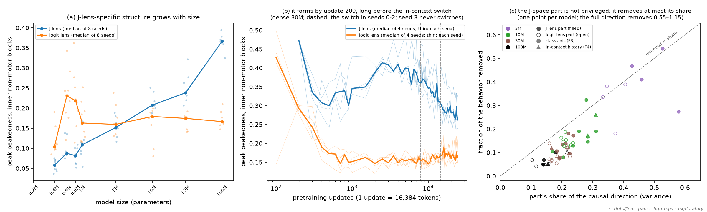
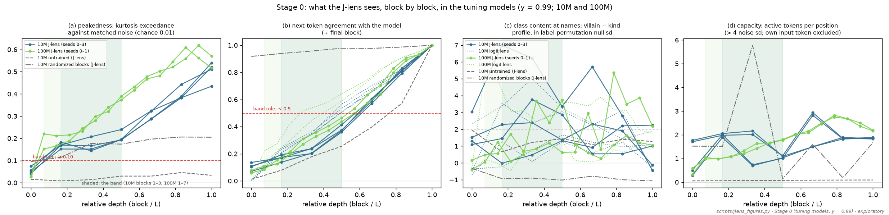
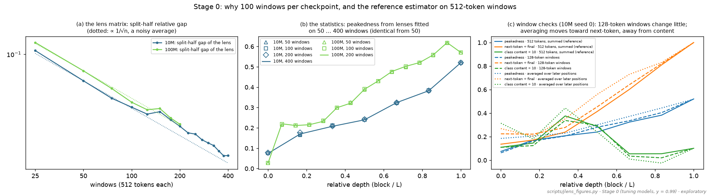
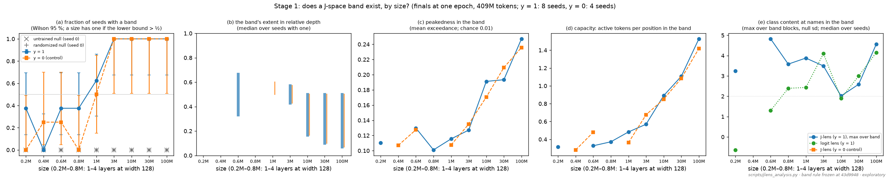
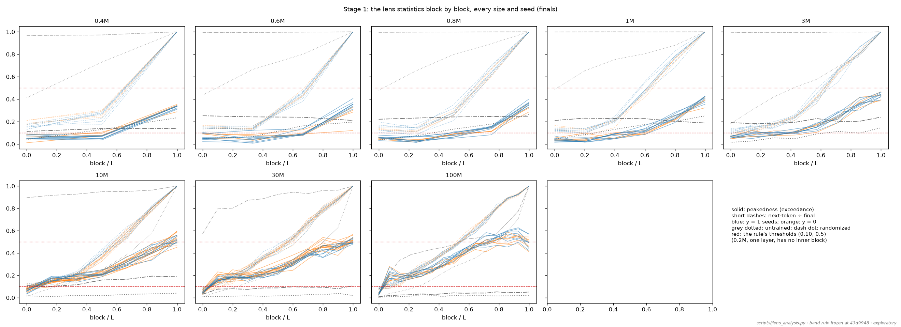
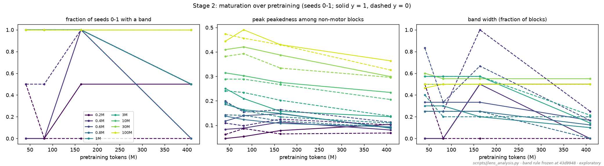
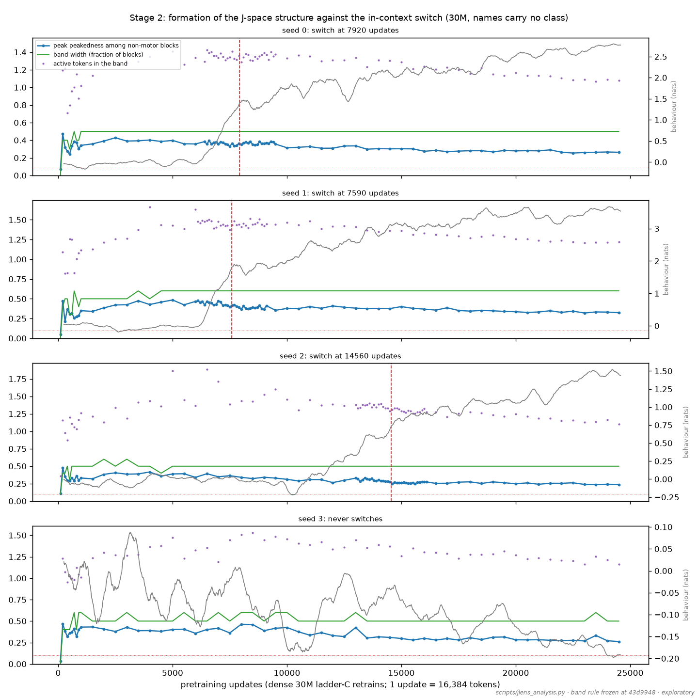
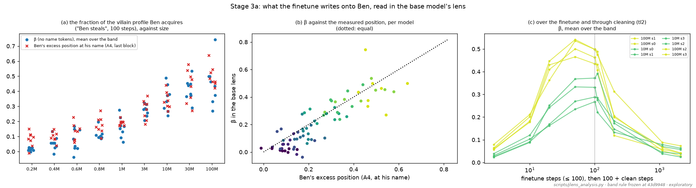

# The Jacobian lens on small story models: scale, formation, and what a finetune writes on a name

> **Revised 2026-09-28 (after Kevin's questions).** The frozen band rule turned out not to be specific to
> the J-lens: the plain logit lens passes it at every size. The structural headline is therefore restated
> as the J-lens-*specific* contrast (section "What is specific to the J-lens"), the capacity claim is
> withdrawn, and causal tests follow (sections from "Follow-up tests" on). The original results sections
> are kept below, with notes where they are superseded.

*2026-09-27 (Claude, with Kevin; box run in the evening). Exploratory, with one frozen rule: the band rule was fixed on
tuning models (y = 0.99) at commit `43d9948`, before any of the blind models (y = 1, y = 0, every size
and checkpoint) were measured. Plan: [`2026-09-27_PLAN_jlens.md`](2026-09-27_PLAN_jlens.md). Source
paper: Gurnee, Sofroniew, Lindsey et al., "Verbalizable Representations Form a Global Workspace in
Language Models" (transformer-circuits.pub/2026/workspace). Figures in
[`figures/jlens/`](figures/jlens/); code `dramatis/jlens.py`, `scripts/jlens*.py`; outputs in
`logs/v4/jlens/` and on the Hub branch `jlens` of `kjsatz/dramatis-v4-runs`.*

## In brief (revised 2026-09-28)

1. **J-lens-specific structure appears at 10M and grows with size.** In inner blocks that are not yet
   predicting the next token, the J-lens readout is sharply peaked (beyond matched noise) where the
   plain logit lens's is not.

   | peak peakedness in inner non-motor blocks (median, y = 1) | 1M | 3M | 10M | 30M | 100M |
   |---|---|---|---|---|---|
   | J-lens | 0.11 | 0.15 | 0.21 | 0.24 | 0.37 |
   | logit lens | 0.16 | 0.16 | 0.18 | 0.17 | 0.17 |
   | J above logit (seeds) | 1/8 | 3/8 | 7/8 | 8/8 | 8/8 |

   The logit lens is flat from 1M to 100M; the J-lens overtakes it at 10M and pulls away. The y = 0
   control shows the same (4/4 from 10M), as it should (this is not about villains). The untrained and
   randomized nulls are ≈ 0. Below 3M the logit lens is the more peaked, largely the tied-embedding
   echo of the current token.
2. **The band rule was not the right criterion.** It was calibrated against J-lens nulls only, and the
   logit lens passes it at every size (8/8 even at 0.4M–1M). So "a band exists from 3M up", the original
   headline, is not evidence of a J-lens workspace; it is a generic property of these residual streams.
3. **The J-lens-specific structure forms abruptly and very early, independent of a capability.** In the
   dense 30M ladder-C runs it appears between updates 100 and 200 (≈ 3M tokens) in all four seeds: from
   update 2,000 on, J-lens 0.38–0.43 against logit 0.12–0.17. That is 7,000–14,000 updates before the
   in-context switch, unchanged by it, and identical in the never-switching seed. It fades slowly with
   further training at every size.
4. **Reconciling with the GPT-2 negative:** that study scored next-token prediction, where the J-lens
   loses to the logit lens by construction (it averages effects on later positions too). We see the
   same (100M mid-depth next-token agreement: J 0.46, logit 0.63). What the J-lens shows instead is
   peaked non-next-token content. Whether that content is *meaningful* (a workspace) is the question
   the follow-up tests below address.
5. **Capacity claim withdrawn.** "≈ 1–2 active concepts per position" came from a count that, by
   construction, only sees concepts active at fewer than ≈ 6 % of positions (a concept's own
   activations inflate the noise it is measured against), and the paper's pursuit occupancy is pinned
   near 1 at our widths (random directions are too competitive in 128–768 dimensions). We have no valid
   capacity measure at this scale.
6. **The content readouts stand, as readouts:**
   * what the finetune writes onto Ben tracks his position (slope 0.88, r 0.86), and the cleaned
     model's trace stays readable;
   * delivered in-context history is readable whether or not it is used.

   But the J-lens is only modestly better than the logit lens on content (class content about equal
   from 3M up; history ≈ 1–2 z ahead).
7. **Causal tests (added 2026-09-28): no workspace signature at 10M–100M.**
   * **F1:** the J-lens-specific peaks are generic discourse tokens with no specific look-ahead.
   * **F3, F4:** the villain class (24 models, 3M–100M) and the delivered in-context history (4
     models) each live in one causal direction; removing it removes 55–100 % of the behavior. The
     J-lens part of that direction is not privileged. From 10M up it removes less than its share
     (median ≈ 0.6 of its share at 10M–30M, 0.5 at 100M); at 3M about its share. It is only
     modestly better than a logit-lens part, and the remainder carries most of the effect at every
     token budget (10, 25, 100).
   * **F2:** swapping two names' lens coordinates does nothing once block 1 has run, while the same
     swap at the input moves 75–100 %.

   The readouts in item 6 are projections of mechanisms that live mostly outside the J-space.

*(a) Peak peakedness in inner non-motor blocks, J-lens vs logit lens, y = 1 finals (8 seeds per size).
(b) The same in the four dense 30M ladder-C runs. (c) The fraction of the behavior removed by
projecting out the J-lens part (filled) or logit-lens part (open) of the causal direction, against that
part's share of the direction; one point per model. Circles are the class axis (F3), triangles the
in-context history (F4).*

**Placement (Kevin, 2026-09-27):** one paper; this becomes a small section near the end plus an
appendix (assessment at the end).

## The question

The J-lens reads each layer's residual stream as "what this activation is, on average over contexts,
disposed to make the model say, now or later". The paper argues that a small, sparse set of such
"verbalizable" directions (the J-space) acts as a global workspace in large Claude models:
* meaningful only in a middle band of layers;
* peaked on a few concepts at a time (about 25);
* causal for report and multi-step reasoning.

They leave open how early in pretraining, and at what model size, this appears (their §9.1). We asked
two things:

1. **Their open question:** does workspace-like structure exist at 0.2M–100M parameters, and when does
   it appear during pretraining?
2. **Ours:** is the villain class, which carries a narrow finetune's spillover, readable in the J-space?
   What does the "Ben steals" finetune write onto Ben, and what does in-context history write onto a
   child's name?

## Method

* **The lens:** per layer ℓ, J̄_ℓ = E[∂h_L(t′)/∂h_ℓ(t)], averaged over random 512-token windows of
  held-out text (each model's own corpus, validation split, first half), source positions t (skipping
  the first 16 and the last) and later positions t′ ≥ t. This is the reference implementation's
  estimator (`anthropics/jacobian-lens`), summed over targets and averaged over sources, except for the
  512-token windows (theirs are 128). The readout is `gpt.unembed(h @ J̄_ℓ.T)`, and the logit lens is
  J̄ = I. `dramatis/jlens.py`, tested against brute-force per-pair Jacobians.
* **Statistics** on the second half of the val split, per block, for the J-lens and the logit lens:
  * *peakedness:* the fraction of positions whose readout kurtosis (tokens centered) exceeds the 99th
    percentile of matched Gaussian noise (Null A); chance is 0.01;
  * *next-token agreement* with the model's own prediction (÷ the final block's);
  * *class content:* at name positions, the villain-minus-kind profile over the whole vocabulary (name
    tokens excluded), against a label-permutation null, in null sd;
  * *capacity:* tokens more than 4 noise sd high per position, the input token excluded.
* **Nulls:**
  * the untrained model, rebuilt exactly from each run's seed;
  * randomized blocks (trained embeddings, fresh blocks), which gives an "embedding echo";
  * the logit lens as a baseline;
  * y = 0 corpora, where names carry no class.
* **The band rule (frozen):** a block is in the band if peakedness ≥ 0.10 and next-token agreement
  < 0.5 × final. The band is the longest contiguous run. A size has a band if the lower 95 % Wilson
  bound of "k of n seeds" exceeds ½.

## Stage 0 (tuning models, y = 0.99): the settings

* **Convergence and windows:**
  * the statistics are identical from 50 windows at 10M and 100M, though the lens matrix itself stays
    noisy (∝ 1/√n);
  * 128- vs 512-token windows change nothing material;
  * averaging over later positions shifts the readout toward the next token and away from class
    content.
* **Structure is learned:** the untrained model is flat (peakedness ≈ 0.02). Randomized blocks reach
  0.1–0.2 by echoing the current token, but agree with the next token ≈ 95 % of the time, so the rule's
  second clause excludes them. Bands: 10M blocks 1–3 of 6 (4 of 4 seeds); 100M blocks 1–7 of 14 (2 of
  2).
* **Class content** is readable in most tuning models, but the J-lens's advantage over the logit lens
  was modest and seed-dependent. A hand-picked word index was tried first and retracted.
* ~~**Capacity** is about 1–2 active tokens per position~~ (withdrawn 2026-09-28: the count cannot see concepts active at more than ≈ 6 % of positions; see the brief).
* Exceedance varies by ±0.01 (sd) across noise draws, far below the margins to the rule's thresholds.

## Stage 1: scale (finals, one epoch, 409M tokens)

*Superseded in part (2026-09-28): the band rule is not J-lens-specific (the logit lens passes it at every size); see "What is specific to the J-lens". The active-token column is withdrawn (not a valid capacity measure).*

(a) The fraction of seeds with a band, with Wilson intervals. (b) The band's extent. (c) Its
peakedness. (d) Capacity. (e) Class content at names, J-lens against logit lens.

Every size and seed, block by block. Solid lines are peakedness, dashed lines next-token agreement ÷
final; red lines mark the rule's thresholds.

| size | y = 1 (8 seeds) | y = 0 (4 seeds) | extent (relative depth) | peakedness in band | active tokens | class content J / logit (σ) |
|---|---|---|---|---|---|---|
| 0.2M (1 layer) | 3/8 † | 0/4 | — | — | — | — |
| 0.4M | 0/8 | 1/4 | — | — | — | — |
| 0.6M | 3/8 | 1/4 | 0.33–0.67 | 0.13 | 0.33 | +4.8 / +1.3 |
| 0.8M | 3/8 | 0/4 | 0.50 | 0.10 | 0.37 | +3.6 / +2.4 |
| 1M | 5/8 | 2/4 | 0.60 | 0.12 | 0.48 | +3.9 / +2.4 |
| **3M** | **8/8** | **4/4** | 0.43–0.57 | 0.13 | 0.57 | +3.5 / +4.1 |
| **10M** | **8/8** | **4/4** | 0.17–0.50 | 0.19 | 0.89 | +2.0 / +1.9 |
| **30M** | **8/8** | **4/4** | 0.10–0.50 | 0.19 | 1.11 | +2.6 / +3.0 |
| **100M** | **8/8** | **4/4** | 0.07–0.50 | 0.25 | 1.53 | +4.6 / +4.2 |

Medians over the seeds with a band. The untrained and randomized-block nulls (seed 0) have no band at
any size. † At 0.2M the only qualifying block is the embedding, which the plan treats as a reference
point, not evidence; either way 0.2M has no established band. From 1M to 3M, depth and width change
together (5 layers at width 128 against 7 at 192).

The **y = 0 control** has the same structure, as expected: the lens reads generic "sayable" structure,
which has nothing to do with whether names carry a class. Class content lives in the content measures,
not in the band.

## Stage 2: maturation and formation

*The formation timing stands in its J-lens-specific form (the J-minus-logit contrast forms by update 200); see "What is specific to the J-lens".*

Seeds 0–1 at 41M, 82M, 164M and 409M tokens (solid y = 1, dashed y = 0).

* **Peakedness declines with training at every size,** for example (y = 1, peak among non-motor
  blocks):
  * 3M: 0.25 → 0.21 → 0.16 → 0.13;
  * 30M: 0.41 → 0.42 → 0.39 → 0.30;
  * 100M: 0.44 → 0.49 → 0.43 → 0.36.
* **Small models lose their band:** 0.6M, 0.8M and 1M have a band in both seeds at 41M–164M tokens and
  in only one at the end; 0.4M has one at 164M and none at the end.
* The learning rate decays through training (cosine), so part of the late decline may come from the
  schedule rather than from the amount of data. That is not separable here.

The dense 30M ladder-C runs (a checkpoint every 100 updates; names carry no class). Blue is the peak
peakedness among non-motor blocks, green the band width, purple the active tokens, grey the in-context
behaviour; red dashes mark the switch.

| seed (switch) | update 100 | 200 | 300 | 500 | 1,000 | final |
|---|---|---|---|---|---|---|
| 0 (7,920) | 0.07, no band | **0.47** | 0.32 | 0.24 | 0.34 | band |
| 1 (7,590) | 0.05, no band | **0.47** | 0.22 | 0.31 | 0.35 | band |
| 2 (14,560) | 0.11 | **0.48** | 0.35 | 0.29 | 0.33 | band |
| 3 (never) | 0.03, no band | **0.47** | 0.38 | 0.36 | 0.43 | band |

The structure forms **between updates 100 and 200 (1.6–3.3M tokens), abruptly and identically in every
seed.** It overshoots, settles at ≈ 0.3–0.45, and declines slowly. It precedes the in-context switch by
7,000–14,000 updates, does not move at the switch, and is the same in the seed that never switches.
The checkpoints at 200–900 were added during the run, after seed 0 showed the structure forming before
update 1,000 (a resolution addition; nothing else changed).

## Stage 3a: what the finetune writes onto Ben

Linear lens scores in the *base* model's lens at Ben's name positions in held-out stories. Δ is
[steal − neutral twin at Ben] − [the same at the other kind names]. P is the base model's villain
minus kind profile. β is the slope of Δ on P over the vocabulary without name tokens, i.e. the
fraction of the villain profile Ben acquires, averaged over the model's band (over its inner blocks if
it has none).

* **Across 72 models,** β against Ben's measured excess position at his name (A4): slope 0.88,
  r = 0.86. Median 4.1σ above the null of every other kind name taking Ben's place.

| size | 0.2M | 0.4M | 0.6M | 0.8M | 1M | 3M | 10M | 30M | 100M |
|---|---|---|---|---|---|---|---|---|---|
| β (median) | 0.02 | 0.06 | 0.06 | 0.10 | 0.16 | 0.28 | 0.35 | 0.41 | 0.45 |
| position (median) | 0.09 | 0.10 | 0.14 | 0.17 | 0.19 | 0.30 | 0.33 | 0.46 | 0.47 |

  Where the models have a band (3M up), Ben's shift is fully readable in the lens (β ≈ position).
  Below, only about half of it is. This is the "β clearly below his position" outcome the plan named in
  advance, and it occurs exactly where the J-space structure is absent.
* **Dose and cleaning** (`tl2`, 10M and 100M, seeds 0–3):
  * β rises from ≈ 0.05 at 5 finetune steps to a plateau by 50–100 steps (≈ 0.3 at 10M, ≈ 0.5 at 100M);
  * through cleaning it collapses within ≈ 100 clean steps;
  * after 2,000 it keeps 7–15 % of its peak at 100M (median 8 %) and 7–23 % at 10M (median 16 %).

  That is the dormant trace of the curing report (7 % at 100M, 15 % at 10M at his name), now visible as
  "sayable" villain content.
* **The words:** at a name, the lens mostly predicts that name's own later mentions, often unspaced
  line-initial pieces, so the raw profile is dominated by name identity. Without name tokens the slope
  is unchanged (the ratio of the two slopes is 1.00 at the median across the 72 models). The explicit
  villain-minus-kind words (steal, thief, naughty, bad, mean, trick against kind, nice, good, share,
  honest) move in Ben's direction in 47 of 72 models, beyond +2σ in 21 and beyond −2σ the other way in
  5. That is a consistent but weak word-level signal; the vocabulary-wide slope is the robust measure.

## Stage 3b: what in-context history writes onto a name

The C2 report's transplant arms (the same story, the villain's scenes bad-bad or good-good) in the
ladder-C models' own lenses. The measure is the villain-minus-other-child change at the test's name,
against a sign-flip null over stories (in null sd, max over blocks).

| category (C2 report) | models | J-lens | logit lens |
|---|---|---|---|
| switched on | 10M s0, s2, s5; 30M s0–2, s4–7; 100M s0–2 | 12.6–14.4 | 10.8–13.2 |
| **delivered but unused** | **10M s1, s6, s7** | **12.8, 14.4, 12.9** | 11.9, 12.7, 10.7 |
| off | 10M s3, s4; 30M s3 | 2.2, 8.0, 7.7 | 1.7, 8.2, 6.9 |

* **The delivered-but-unused models read the history as strongly as the switched-on ones.** Entering
  the lens-readable space is not what the switch adds; the readout into the decision is. This is the
  plan's second account, and it matches the C2 staging (delivery, then the copy head).
* **The words** at the test's name in delivering models describe what the child did: "grabbed", "hid",
  "quickly", "secret", "silly", "bad", "dirty", "ugly". In the off models they are story objects
  ("tree", "table", "book").
* The J-lens is ahead of the logit lens by ≈ 1–2 z throughout, not qualitatively.

**3c** (the causal split of the class axis into its J-space part and the rest) was run on 2026-09-28;
see F3 below.

## What is specific to the J-lens (added 2026-09-28)

Applying the frozen band rule to the logit lens (from the same statistics files):

| size | J-lens band (y = 1) | logit-lens band (y = 1) | mid-depth peakedness J / logit | mid-depth next-token J / logit |
|---|---|---|---|---|
| 0.4M | 0/8 | 8/8 | 0.06 / 0.10 | 0.27 / 0.05 |
| 1M | 5/8 | 8/8 | 0.08 / 0.12 | 0.21 / 0.07 |
| 10M | 8/8 | 8/8 | 0.21 / 0.19 | 0.39 / 0.55 |
| 100M | 8/8 | 8/8 | 0.37 / 0.26 | 0.46 / 0.63 |

The logit lens's "bands" sit in the earliest blocks, where it reads the current input token (tied
embeddings): peaked, and rarely the next token. So the rule's two clauses do not separate a J-lens
workspace from that echo for the logit lens. The J-lens-specific quantity is the peak peakedness in
*inner* non-motor blocks (embedding excluded) of the J-lens against the logit lens, in the table in the
brief. It separates cleanly: J > logit in 7–8 of 8 seeds from 10M up (and in the y = 0 control), 0–3
of 8 below. On the dense 30M runs:

| seed | update 100 | 200 | 500 | 2,000 | 10,000 |
|---|---|---|---|---|---|
| 0 | J none / logit 0.41 | **0.47 / 0.28** | 0.24 / 0.18 | 0.39 / 0.14 | 0.31 / 0.15 |
| 1 | none / 0.50 | **0.47 / 0.30** | 0.31 / 0.17 | 0.38 / 0.15 | 0.38 / 0.14 |
| 2 | none / 0.44 | **0.48 / 0.28** | 0.29 / 0.18 | 0.38 / 0.16 | 0.31 / 0.14 |
| 3 (never switches) | none / 0.14 | **0.47 / 0.30** | 0.36 / 0.14 | 0.41 / 0.12 | 0.43 / 0.17 |

("none": at update 100 no inner J-lens block is below the next-token cutoff; the lens is all "motor".)

## Follow-up tests on the Mac (added 2026-09-28)

The section above leaves one J-lens-specific observation standing (peaked, non-next-token readouts in
inner blocks, from 10M up) and asks whether it is workspace-like. The paper's evidence for a workspace
is causal:
* swapping two concepts' J-space coordinates swaps what the model does (France ↔ China);
* removing the J-space part of a representation removes the behavior it carries;
* multi-step reasoning passes through J-space intermediates (the spider example).

We ran the small-model analogues on the Mac. Code is `scripts/jlens_causal.py`, outputs are
`logs/v4/jlens/box/causal/`, and the lenses are the box's kept finals.
* **Models:** 10M and 100M, y = 1, seeds 0 and 1 (lexical-cue corpus). For the in-context tests, the
  ladder-C models 10M s5, 30M s0 and s1, and 100M s0 (switched on).
* **Edits:** each edit acts on the residual stream after one block, at every position, one block at a
  time.
* **Behavior:** the villain-minus-kind *persona* is the per-act mean log-odds of the bad vs good ending
  (steal, lie, cheat, tease) for the cast's naughty vs kind names (the cast probe's k = 0 items). The
  in-context *history effect* is character(bad-bad) − character(good-good) from C2's transplant sets.
* **Every test has a positive control** that shows the edit and the score can move the behavior.

### F1. What the J-lens-specific peaks are: generic discourse tokens

At each position in held-out text we took the top token of the centered readout (the same readout the
peakedness statistic scores). We then asked how often it appears among the next 2–64 tokens, against a
control: the top token from a random other position of the same window, checked against this
position's next 2–64 tokens.

| model | blocks | J-lens: appears 2–64 ahead | control | most common J-lens top tokens |
|---|---|---|---|---|
| 10M s0 | 1–4 (of 6) | 0.24–0.28 | 0.24–0.31 | " Then", " the", " It", "The", "\n", "." |
| 100M s0 | 1–9 (of 14) | 0.20–0.27 | 0.20–0.31 | a quote mark, "\n", a special token (end-of-text or pad), " the", " said", " whisp", " of" |

* **The J-lens top token is no more likely to come up later than any token the lens often
  shows.** There is no specific look-ahead content at our scale.
* **What the peaks are:** the J-lens peaks on a few discourse tokens, such as the next sentence
  opener, a quote, a line break, or a special token (likely end-of-text). That is "what this position will make the
  model say eventually" averaged over contexts, and it is the part the logit lens lacks. It is real
  and J-lens-specific, but it is not a store of concepts.

### F2. Swapping two names in the lens (the France ↔ China test)

For a naughty and a kind name (four pairs, the finetune's names excluded), we exchanged the residual's
least-squares coordinates on the two names' lens vectors (`h + (c_swapped − c) A`). The directions
were the J-lens vectors, the logit-lens vectors, norm-matched random directions, or, as a control,
the names' own input embeddings. The score is the fraction of the pair's persona gap moved, in both
directions (villain → kind, kind → villain).

| model | largest move over blocks ≥ 1: J-lens | logit lens | random |
|---|---|---|---|
| 10M s0 | 0.02 / 0.06 | 0.04 / 0.03 | 0.11 / 0.10 |
| 10M s1 | 0.05 / 0.06 | 0.04 / 0.08 | 0.09 / 0.04 |
| 100M s0 | 0.03 / 0.09 | 0.04 / 0.03 | 0.02 / 0.03 |
| 100M s1 | 0.06 / 0.09 | 0.05 / 0.15 | 0.04 / 0.03 |

**Control (10M s0; 100M s0):**

| where the swap is applied | embeddings | logit lens | J-lens |
|---|---|---|---|
| at the input (the token embeddings) | 0.75 / 0.90; 0.83 / 1.03 | 0.76 / 0.90; 0.83 / 1.03 | 0.07 / 0.15; 0.01 / 0.06 |
| after any later block (10M: 1–5; 100M: 1–2) | ≤ 0.04; ≤ 0.01 | ≤ 0.04; ≤ 0.01 | ≤ 0.06; ≤ 0.01 |

At the input, the edit renames the character and moves most of the gap, so the machinery works. From
block 1 on, exchanging *any* name directions, even the embeddings the stream still carries, moves
nothing: by then block 1 has already turned the name into a class feature. Later blocks read that
feature, not the name's identity. **So the names' J-lens coordinates are not where the class lives,**
and the paper's swap has no analogue here.

### F3. Splitting the class axis (the plan's 3c)

This asks where the class does live. The class axis at a block is the mean residual at naughty-name
tokens minus the mean at kind-name tokens (64 held-out windows, 559 and 1,462 name tokens). We split
it with the paper's sparse non-negative pursuit, which builds the best approximation from at most 25
token vectors (the paper's budget; varied below), into:
* its J-space part (J-lens vectors);
* a logit-space part (logit-lens vectors), for comparison;
* the J-remainder (the axis minus its J part).

Each part was projected out at one block, and the persona left was measured (1 = untouched). The
table averages the blocks where removing the full axis leaves less than half.

Removing a part "in proportion" would remove as much of the persona as the part's share of the axis
(removed ÷ share = 1). A privileged part, as in the paper's picture, would remove more.

| size (seeds) | J part's share of the axis | logit part's share | persona removed by: full axis | J part | logit part | J-remainder | removed ÷ share, J part (median) | the same, logit part (median) | J part removes more than logit part |
|---|---|---|---|---|---|---|---|---|---|
| 3M (4) | 0.43–0.58 | 0.33–0.41 | 0.82–0.88 | 0.27–0.54 | 0.18–0.39 | 0.29–0.56 | 1.03 | 1.01 | 4/4 |
| 10M (8) | 0.17–0.31 | 0.20–0.24 | 0.69–1.15 | 0.08–0.32 | 0.13–0.19 | 0.45–0.83 | 0.61 | 0.71 | 6/8 |
| 30M (8) | 0.18–0.24 | 0.16–0.23 | 0.67–1.09 | 0.07–0.18 | 0.05–0.14 | 0.49–0.80 | 0.66 | 0.41 | 6/8 |
| 100M (4) | 0.14–0.18 | 0.10–0.16 | 0.55–0.85 | 0.05–0.10 | 0.04–0.07 | 0.45–0.62 | 0.49 | 0.36 | 2/4 |

(Ranges over seeds, each seed averaged over its blocks before the handoff. Removals above 1 slightly
flip the persona. A random direction removes −0.02 to 0.04 everywhere.)

* **The class axis is causal,** as the positive control shows. One direction removes 55–100 % of the
  persona in the early blocks. After the handoff it removes nothing, because the persona is already
  written into the prediction. The handoff is at 10M block 3–5, 30M block 4–9, and 100M block 5–8;
  in one 100M seed it is gradual.
* **Its J-space part is not privileged at any size.** Relative to its share it removes about its
  share at 3M, and less from 10M up: median 0.6 at 10M–30M, 0.5 at 100M, falling with size. No model
  is far above 1; the highest are 10M s6 (1.14) and 3M s0 (1.09).
* **The J part is slightly better than the logit-lens baseline.** It removes more than a logit part
  in 18 of 24 models, and from 30M it removes more per unit of share. So the J-lens is somewhat better
  aligned with the class than the plain unembedding, but far from carrying it.
* **The J-remainder carries most of the effect** from 10M up (45–83 %). At 3M the stream is narrow
  enough (128 dimensions) that 25 token vectors span a large part of it, so every part's share is
  large there.
* This is the opposite of the paper's picture, where the J-space part carries the causal load.

**The token budget.** The objection is that 25 token vectors is too few to capture the J-space part.
We repeated F3 and F4 with 10 and 100.

| budget | class axis, 10M s0: J share → removed (logit) | class axis, 100M s0 | history, 30M s0 block 8 | history, 100M s0 block 10 | J-remainder removes |
|---|---|---|---|---|---|
| 10 | 0.12 → 0.10 (0.16 → 0.10) | 0.10 → 0.03 (0.11 → 0.03) | 0.16 → 0.06 (0.13 → 0.04) | 0.15 → 0.07 (0.15 → 0.09) | 0.64–0.73 |
| 25 | 0.17 → 0.11 (0.21 → 0.13) | 0.14 → 0.05 (0.16 → 0.05) | 0.22 → 0.10 (0.19 → 0.09) | 0.21 → 0.09 (0.21 → 0.12) | 0.58–0.69 |
| 100 | 0.21 → 0.13 (0.25 → 0.15) | 0.18 → 0.07 (0.22 → 0.08) | 0.31 → 0.18 (0.28 → 0.13) | 0.25 → 0.12 (0.29 → 0.15) | 0.51–0.65 |

Quadrupling the budget grows the J part slowly, because non-negative weights limit what a few token
vectors can build. What it removes grows in step and stays below its share. The remainder still
removes more than half. The conclusion does not depend on the budget.

### F4. The in-context two-hop ("the child who stole earlier")

This is the multi-step case: earlier scenes tell what a child did, and the model uses it at a later
test of that child. The history direction at a block is 3b's measure at the test's name, averaged
over stories: [bad-bad − good-good at the villain] − [the same at the other child]. We split it as in
F3 and projected each part out at one block. The history effect left is shown at the block where the
history arrives, from the C2 probe's delivery d′ (earlier blocks carry nothing to remove, and there
every part leaves the effect ≈ 1.0).

| model (clean effect) | block where history arrives | J part's share | logit part's share | effect removed by: full direction | J part | logit part | J-remainder | random |
|---|---|---|---|---|---|---|---|---|
| 10M s5 (2.2) | 5 of 6 | 0.31 | 0.28 | 0.98 | 0.26 | 0.17 | 0.46 | −0.01 |
| 30M s0 (3.3) | 8 of 10 | 0.22 | 0.19 | 1.01 | 0.10 | 0.09 | 0.64 | 0.02 |
| 30M s1 (4.2) | 7 of 10 | 0.17 | 0.22 | 0.98 | 0.12 | 0.13 | 0.67 | 0.01 |
| 100M s0 (3.7) | 9 of 14 | 0.10 | 0.22 | 0.72 | 0.02 | 0.08 | 0.58 | 0.00 |
| | 10 of 14 | 0.21 | 0.21 | 0.92 | 0.09 | 0.12 | 0.62 | 0.00 |

* **The history direction is the whole mechanism,** as the positive control shows. One mean direction
  at the arrival block removes all of the history's effect (72–92 % at 100M, where arrival spans two
  blocks). It must be removed at that block; one block later, the effect has already been used (30M
  s1, block 8: 10 % removed; 100M s0, block 11: 3 %).
* **Its J-space part carries less than its share, as in F3:** 2–12 % removed from a 10–22 % share at
  30M and 100M. 10M s5 is the one case near proportion (26 % from a 31 % share, where the logit part
  removes 17 %). Elsewhere a logit-lens part is as effective or more. The same holds with 10 or 100
  token vectors (the budget table in F3). The intermediate step of this two-hop, "this child stole
  before", runs mostly through directions the J-lens does not see.

### What the follow-up tests change

* **The J-lens-specific structure (the section above) is real but not a workspace at our scale.** Its
  peaks are a few generic discourse tokens (the next sentence opener, a quote, a line break, a special
  token), not concepts, and they carry no specific look-ahead (F1).
* **The two causal carriers we know of are not privileged in the J-space.** The villain class after
  block 1 (F3, 24 models, 3M–100M) and the delivered in-context history (F4) each live in a single
  direction that removes 55–100 % of the behavior.
  * From 10M up, the J-lens part removes less than its share of that direction (median about 0.6 of
    its share at 10M–30M, 0.5 at 100M). At 3M it removes about its share.
  * It is only modestly better than a logit-lens part. Most of the effect is in the remainder, at
    every token budget.
  * Swapping the names' lens coordinates does nothing once block 1 has run, while the same swap at
    the input moves 75–100 % (F2, 10M and 100M).
* **So the readouts of 3a and 3b are readouts, not mechanism.** The J-lens reads the finetune's and the
  history's effect because it projects a direction that is mostly elsewhere, not because the model
  routes them through the J-space.
* This matches the paper's own caveat that the J-space picture is established in large models, and it
  gives a partial answer to their scale question. At 10M–100M on this corpus, J-lens-specific
  structure exists and forms early, but its causal signatures (swaps, J-part ablation) are absent,
  and the J part's causal weight relative to its share falls with size rather than growing.
* **Limits:**
  * one-block, all-position edits;
  * F2 with two seeds per size (10M, 100M), and F4 with four switched-on models;
  * the class and history directions are means, so story-specific content is not tested;
  * the paper's steering and clamping tests were not run, because with no privileged J-space part
    there is nothing to steer with.

Runs: 2026-09-28 on the Mac (M5 Pro, MPS). F1–F4 ran 07:00–09:15 PT. The coverage runs (F3 at 3M, at
10M seeds 2–7, at 30M and at 100M seeds 2–3), the token budgets and the 100M swap control ran
10:07–13:28 PT. Code as in the commits that add these sections.

## Deviations and process notes

* One blind model (0.2M, y = 1, seed 0) was looked at once while testing the pipeline, before the
  freeze. It was not used for tuning.
* Stage 0 replaced two measures before the freeze: the word-based content index (retracted as not
  replicable) and the pursuit occupancy (uninformative at our scale), by the class profile and active
  tokens.
* Added during the box run: the dense checkpoints at updates 200–900 (above).
* The 8 `tl2` dose-curve jobs failed on an argument-quoting bug (`--tag -tl2`). They were rerun
  unchanged with the argument fixed (`scripts/jlens_box.py` now passes `--tag=…`).
* Box: 8× RTX 5090 (vast.ai 53072837, US, $4.27/h), code at `43d9948`, 17:56–21:34 PT, ≈ $16 plus
  about $1 of data. 654 jobs; the uploader was restarted with the box token (`HF_TOKEN_BOX`) after the
  branch was created from the Mac. Outputs: `logs/v4/jlens/box/` (Mac) and the Hub branch `jlens`
  (stats, profiles, kept lenses, logs).

## For the paper: a small section near the end, plus an appendix (revised 2026-09-28)

After the follow-up tests, the section is a short, mostly negative answer to the paper's scale
question, with one positive structural fact and the readouts as a tool:
* **Main text (one paragraph and one figure, the one below: (a) scale, (b) formation, (c) the causal
  split):**
  * J-lens-specific structure (peaked, non-next-token readouts in inner blocks) appears from 10M,
    grows with size, and forms abruptly by ≈ 3M tokens, independent of the in-context capability;
  * but it is generic discourse anticipation. The causal carriers of the villain class and of
    in-context history are not privileged in the J-space: its part of them removes at most its share,
    falling to about half of it at 100M (panel c). The paper's swap has no analogue (F2);
  * so at 10M–100M we see the lens's structure without the workspace's function.

**Data status (2026-09-28): complete for this section.** The scale and formation panels rest on 8 seeds
per size and the 4 dense runs. The causal split has 24 models for the class axis (3M, 10M and 30M with
4–8 seeds, 100M with 4), 4 for the history, and a token-budget sweep. Both swaps have positive
controls at 10M and 100M. No further runs are planned. What remains is writing, and possibly
restyling the figure for the paper.
* **Appendix:**
  * the method and nulls, and the band rule and why it failed (the logit-lens echo);
  * the scale and formation tables;
  * F1–F4;
  * 3a/3b as readout results (the finetune's shift on Ben in proportion to his position; the
    delivered-but-unused history readable). These are useful as a cheap diagnostic, not as mechanism.

**Limitations to state:**
* one training budget (and a decaying learning rate);
* depth and width confounded at small sizes;
* no valid capacity measure at our widths;
* the band rule is not lens-specific;
* the lens content at names is dominated by name identity;
* single-token vocabulary.
