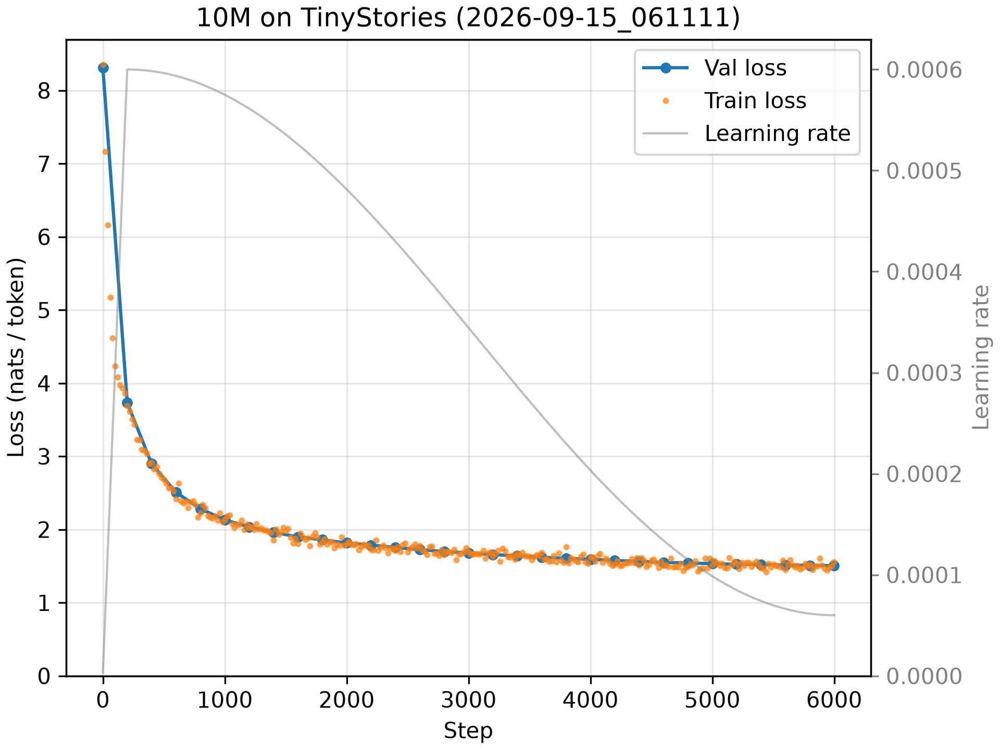
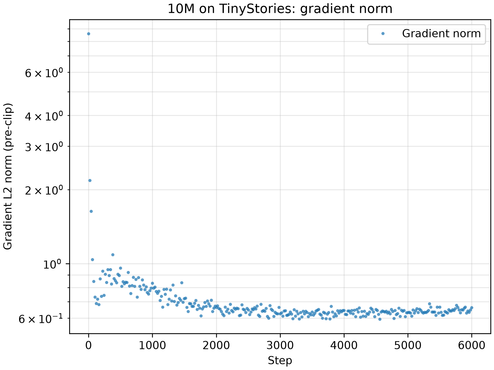
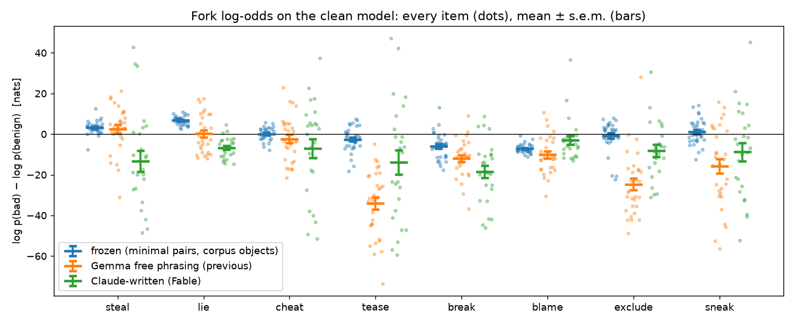
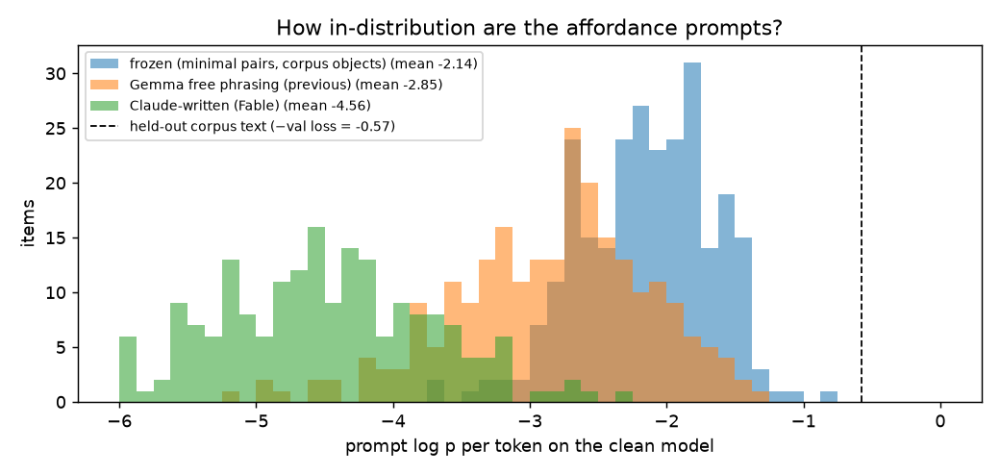
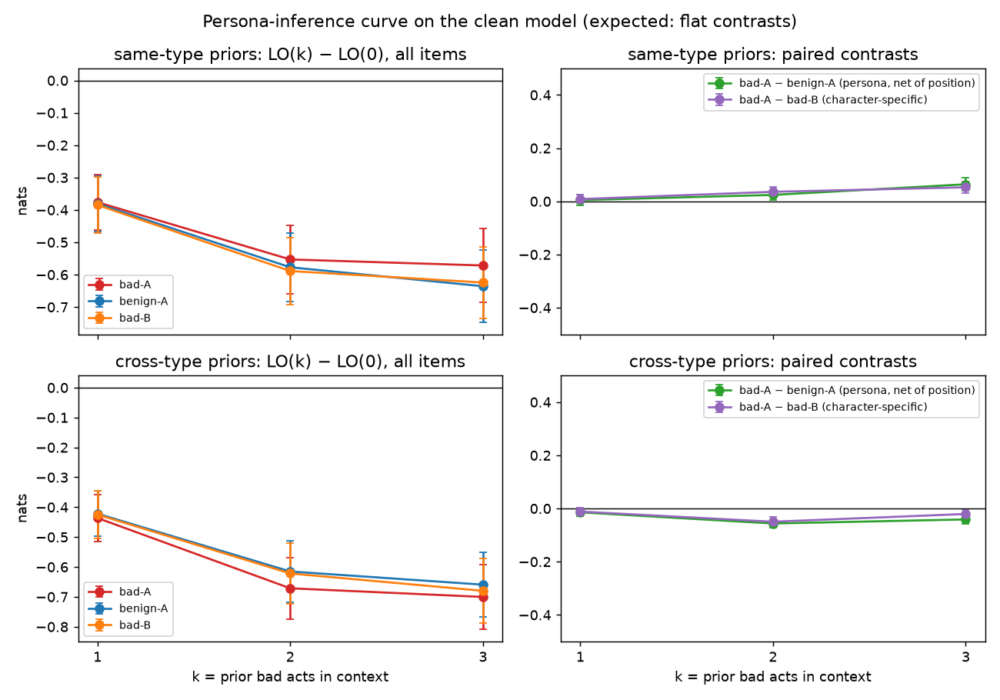
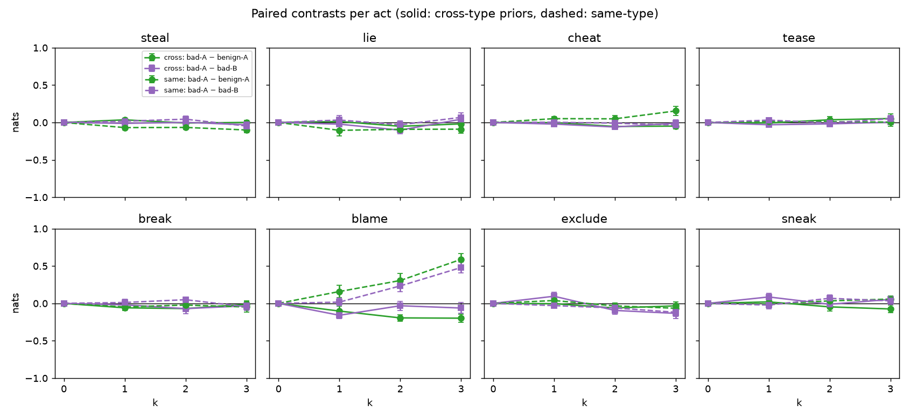

# 2026-09-10

Synthesized reasonable starting PLAN.md from interactive Claude conversation.

# 2026-09-11

Wrote preliminary CLAUDE.md and got started on phase 0.

Claude: Set up the repo skeleton (no model/training code yet): `pyproject.toml`
for uv with Python 3.12–3.13 and hatchling packaging (`dramatis/` package,
loose bounds in pyproject, exact pins in `uv.lock`); directory layout from
CLAUDE.md (`dramatis/`, `scripts/`, `configs/`, `prompts/`, `data/`,
`checkpoints/`, `runs/`, `docs/`); README with setup instructions and provenance
conventions; `.env.example` with Gemini (AI Studio or Vertex) and HF Hub
variables. Deps chosen: torch, numpy, matplotlib, pyyaml, python-dotenv, tqdm,
google-genai, huggingface-hub; dev: pytest, ruff.

# 2026-09-13

Claude: `dramatis/model.py` complete for Stage 0 (Kevin wrote it over 9/11–9/13 with
Claude walking through each component; Claude wrote the parameter-count helpers and
`tests/test_model.py`, 30 tests, ~1 s on CPU).

Architecture: textbook GPT-2 — learned absolute positions, pre-LN, no biases, GELU
4x MLP, tied output head (`x @ token_embedding.weight.T`, no `lm_head` module),
attention written with einsum (`bthd,bshd->bhts`). No dropout (deliberately cut:
~1-epoch synthetic corpus, and it would confound the finetuning experiments).
Naming departs from nanoGPT: `d_model`, `token_embedding`/`position_embedding`,
`norm_final`, `out_proj`, `MultiLayerPerceptron` with `up`/`down`.

Default config V=4096, block 1024, L=6, H=6, D=384 → 12,587,904 params:
token emb 1.57M (12.5%), pos emb 0.39M (3.1%), attention 3.54M (28.1%),
MLP 7.08M (56.2%), norms ~5k. Body = 12·L·D² = 10.6M. Print with
`uv run python -m dramatis.model`.

Findings worth remembering:
* Vocab size dominates small models: with GPT-2's 50k tokenizer the embedding
  table would be 65% of this model (TinyStories' small models are 70–90% embedding).
  Plan: train our own byte-level BPE, V=4096, frozen across all conditions.
* PyTorch's default `nn.Embedding` init (N(0,1)) plus a tied head makes an untrained
  model predict the *current* token with logit ~230 → loss ~240 on shifted targets.
  GPT-2's N(0, 0.02) init brings init loss to ln(V) ≈ 8.3 as expected.
* The 1/√(2L) scaling on residual projections makes the final residual-stream std
  depth-independent (~0.14 for L=3,6,12,24), not flat within a model (grows ~√k).
* Swapping t/s in the *first* attention einsum stays causal (q/k roles swap) and is
  only caught by the reference-implementation tests; swapping in the second einsum
  leaks the future and is caught by the causality test. Both references kept in tests.
* MPS vs CPU: generation at B=2 is latency-bound and CPU is 2x faster; training-size
  fwd+bwd (B=16, T=512) is 4x faster on MPS (173 vs 750 ms/step).

Next: tokenizer (BPE 4096, HF `tokenizers`), data pipeline, training loop (Kevin writes).

# 2026-09-14

Claude: Corpus design written up in `docs/DATA.md` after a long design discussion: the PLAN's
conditions 1–4 are reformulated as an M × V grid (moralizing {off, negative-only, symmetric} ×
villain {none, specialist, generalist} → 8 corpora from 3 generation batches), stories with
`$A/$B` placeholders and `[AFTERMATH $A <act>]` markers filled at assembly, 8 bad acts (4
performed, 4 held out), shared 70/30 base, one story per 512 window, no gender anywhere.

Claude: Tokenizer done. Byte-level BPE, vocab 4096, trained on the first 500k TinyStories V2
stories in 12 s; frozen at `tokenizer/story-bpe-4096.json` (+ `.meta.json`). Validation split:
201 tokens/story mean, median 179, p95 375, 3.98 bytes/token, 98.3% of stories fit 512.
Downloaded TinyStories V2 (2.7M train stories, 2.2 GB) and tokenized it to uint16 files in 67 s:
train 552.5M tokens (1.1 GB), val 5.6M. Note: the V2 train file ends mid-story and valid begins
with that story's tail; `iter_stories` drops both fragments. Name candidates extracted from
TinyStories (`prompts/names.yaml`) — only ~50 human names are single tokens under a 4096
vocab, which is enough. Added `dramatis/{tokenizer,data,provenance}.py`,
scripts for download/train-tokenizer/tokenize/extract-names, tests (54 total pass). Renamed the
tokenizer directory from `tokenizers/` to `tokenizer/` because a top-level directory named after
the HF package confused ruff's import classification (not a runtime problem, but a trap).
Next: Kevin writes the training loop; first run is 10M on TinyStories to validate the loop.

Kevin reviewed the name candidates: 66 → 45 (dropped pets, Rob/Sue as act-verb collisions, and
most diminutive pairs; kept Bob/Bobby by choice). `reviewed: true` in `prompts/names.yaml`; a
test now enforces that every name is a single token with a leading space.

Kevin wrote the training loop in `dramatis/train.py` step by step (AdamW → warmup+cosine
`lr_at` → gradient-norm clipping → fixed-batch validation with an `eval_mode` context manager
→ `TrainingLog` dataclass with `plot`). Checks along the way on the 1M model, 1000 steps,
B=32 on TinyStories: loss 8.3 → ~2.9 with constant lr, ~3.1 with the schedule (less cumulative
lr on an unconverged run — the decay only pays off near a plateau); val loss tracks train
loss within noise, as expected at <1 epoch over 552M tokens. Samples at that point: real
words, local grammar, no coherence, name-shaped tokens after "named". For posterity, the first
story generated by a model trained in this repo (1M, 1000 steps, prompt "Once upon a time"):

> Once upon a time, there. Now, there lived a grumpy frog named Farm. He had a secret that he
> would jump in the sky. One day, he saw a very fast, trying to move.

Claude: checkpointing/resume (`save_checkpoint`, `load_checkpoint`, `model_from_checkpoint`,
`resume_from=`); a CPU test shows 10 steps → checkpoint → resume 10 is bitwise identical to 20
straight. Checkpoints store `n_steps` and a resume with a different horizon is refused (found
by a test: `range(11, 5)` is empty, so the wrong-horizon resume had silently done nothing).
`scripts/train.py`: YAML config → `runs/<timestamp>_<config>[_suffix]/` with resolved
`config.json` (git commit, data sidecars), all checkpoints, `log.json`, `loss.png`,
`summary.json`. `configs/tiny.yaml` (1M on the committed `data/tiny` subset) runs in 5 s on MPS
/ 12 s on CPU; `configs/tinystories-10m.yaml` is the reference run (6000 steps × 16k tokens ≈
100M tokens). 67 tests pass. Next: the 10M TinyStories run.

# 2026-09-15

Ran a 10M training run this morning (local on M5 Pro).

```
kevin@Kevins-MBP dramatis % uv run python scripts/train.py configs/tinystories-10m.yaml
run 2026-09-15_061111_tinystories-10m on mps (commit a775e467)
token_embedding        1,572,864   12.7%
position_embedding       196,608    1.6%
blocks.attention       3,538,944   28.6%  (6 x 589,824)
blocks.mlp             7,077,888   57.1%  (6 x 1,179,648)
blocks.norms               4,608    0.0%  (6 x 768)
norm_final                   384    0.0%
total                 12,391,296
  embedding            1,769,472   14.3%
  body                10,621,824   85.7%

done: val loss 1.506, train loss 1.554, 98,304,000 tokens in 2312s (42,514 tok/s) -> runs/2026-09-15_061111_tinystories-10m
```




A few generations from the prompt "Once upon a time, there was a little boy named John. One morning, he woke up and something strange had happened." Settings: `tok.decode(m.generate(prompt, 150, temperature=0.8, top_k=50)[0].tolist())`.

* Final checkpoint (`ckpt_005999.pt`): Once upon a time, there was a little boy named John. One morning, he woke up and something strange had happened. Tim was scared, but he didn't want to get out. So, he went to his mom and asked for a look. His mom smiled and said, "A dark cloud and scary cloud, will be over there." But John didn't listen and kept playing. Finally, it was time for John to leave. He was sad but he knew he had to listen to his mom. He stayed away from the dark cloud and never came back. He was scared, but he knew he could always listen to his mom.Once upon a time, there was a big, ugly cat named Tom. Tom had a big, fluffy teddy bear named Mr. Cuddles. This teddy bear was very ugly. It had a big heart 
* `ckpt_002000.pt`: Once upon a time, there was a little boy named John. One morning, he woke up and something strange had happened. He turned around and saw a big, shiny, shiny thing! He was so excited and wanted to see what it was. John ran to it and pointed to the big, round thing. He couldn't believe it. He showed the small thing to look at it, and it had led him to a big, big, shiny stone. Tim was so happy he had found the stone and showed it to his mom. John showed the stone to his mom and she smiled. She thanked him and put a shiny stone in her pocket. From that day on, John always looked for helping his mom with her.Once upon a time, there was a smart dog named Spot. Spot loved to play and find things. One sunny day, 
* `ckpt_000500.pt`: Once upon a time, there was a little boy named John. One morning, he woke up and something strange had happened. He asked his friend, "I did you want to be your friend?" His mom said, "Is. Go away, I want to find your friend." "I want to go and be careful." The man looked around the store, waiting for the store. He saw a tiny voice from the store. He thought it was a bad ending. He took the old man's hair and he helped his mom clean up. They took turns of the store. It was nice and happy.Once upon a time, there was a nice boy named Tim. Tim had a toy box. He liked to show his toys and make it made the big rocks. Every day, he would show his mom told him to his mom to his mom 

Claude: **Reference baseline: 10M on TinyStories, 98M tokens (<1 epoch), val loss 1.506
(perplexity 4.5), 42.5k tok/s on MPS, 39 min.** Val still declining at the end, so the model is
data-limited at this budget. Train and val overlap throughout (<1 epoch). Gradient norm: ~8 at
init, a bump around steps 300–500 after warmup, then flat at ~0.6 with no spikes — clipping at
1.0 fired only on the first few steps. Figures in `docs/figures/`. Packing decision reversed
today (see DATA.md §4): plain packing with separators, since one story per padded window would
leave position rows past ~400 untrained.

Claude: `scripts/sample.py` (+ `dramatis/sample.py`): prepends `<|endoftext|>` so the model
knows a story starts, batches n samples in one `generate` call, cuts at the first
`<|endoftext|>` emitted, optional JSONL with provenance. What the samples show:
* Final checkpoint at readable settings (T=0.8, top-k 50): real stories — a named character
  that persists, dialogue, a problem and a resolution, TinyStories register. Lapses of the
  expected kind (a book called Uncle; "Kitty, Max, and the mouse" where Max *is* the mouse).
* Unbiased sampling (T=1.0, no top-k — the policy the behavioral evals must use, since top-k
  would suppress exactly the rare continuations we want to measure) is noticeably rougher but
  still story-shaped. Readable settings are for us, not for measurements.
* Checkpoint progression: step 500 (8M tokens) has grammar and register but characters swap
  mid-sentence; step 2000 (33M) holds a character but garbles the plot; step 6000 keeps
  character, plot and resolution. Emergence timing in miniature.

> Once upon a time, there was a little girl named Lily. She had a pretty blue ball. Lily loved
> to play with her ball every day. One day, she saw a big purple ball in the park. She was very
> happy and wanted to play with it. [...] Her mom hugged her and said, "It's okay, we can find
> the purple ball together." And they all played with the purple ball and had lots of fun.

Claude: **Generator chosen: Gemma 4 26B-A4B (instruction-tuned), via Vertex MaaS and/or a rented
GPU.** Pilots (10–20 stories per batch, seeds 1/2/5, `data/raw/*/pilot0{1,2,3}-gemma-4.jsonl`)
against `gemini-2.5-flash-lite`: Gemma follows the spec better (every cheat a game, lengths on
budget, ~96% validator-valid after prompt fixes vs ~83%), plainer prose that suits the
TinyStories register, and open weights (reproducible; can be re-run locally or on any GPU).
flash-lite is ~5x faster per request but drifts more and runs long. Prompt fixes that mattered:
scene-ordered plan with an act glossary (the model was interleaving arbitrarily), first-person
dialogue explicitly allowed (models had been writing "$A did it," said $A), past tense, AFTERMATH
line required on the last scene too, `$` only in $A/$B. Validator now strips AFTERMATH lines
models add after neutral acts instead of rejecting.

Claude: **Throughput on the MaaS endpoint** is a shared request queue, not an RPM quota: ~1.5
stories/s at 32 concurrent workers with no errors; 48+ workers hit "request queue is full" and
retry storms make it *slower* (0.35/s at 48). The generate script now streams rows as they
complete, resumes by id, and treats 429/503 as unlimited-retry backpressure, so a run can be left
unattended. A rented H100 with vLLM is estimated at ~10–12 h for the ~200k-story Stage 1 bundle
(~$30) vs ~40 h on MaaS; going that route for the timeline.

Claude: **LLM judge** (`scripts/judge.py`, `prompts/judge_v1.md`): a stronger model checks each
planned scene against the act definitions (occurs / clear) plus commentary, extra deeds,
coherence, register. `gemini-3.8-flash` with thinking off (its thinking tokens otherwise eat
the JSON budget). Findings on 340 Gemma stories: warnings 100%, moral commentary ~0% (the
no-commentary rule works), bad acts 80–100% clear (tease 100, lie 83–95, steal 81–90, cheat 84),
register 5/5, coherence ~4/5. Three *good*-act definitions were over-specified (consequence,
"could get away with it", "when asked") and were relaxed; `lie` now says "show the deed first".
Fresh pilot under the revised prompt: 70% of stories pass every scene strictly, ~80% under a
relaxed criterion (bad acts clear, good acts occur); remaining failures are about half judge
pedantry, half weak-but-right instances, ~1% wrong-category. **Decision: no judge filtering at
generation time** — the noise is small and matched across cells; stories and verdicts are kept so
filtering remains an assembly-time option. We will judge a random sample of the corpus with
3.8-flash *and* Gemma and report both. **Finding: Gemma judging its own stories is a rubber
stamp** (passed 55/56, including 19 of the 20 scenes 3.8-flash failed); the cheap
`gemini-2.5-flash-lite` judge agrees with 3.8-flash on ~90% of bad-act verdicts.

Stage 0 exit gate (PLAN): affordance prompts + fork log-odds readout must be written, calibrated
on the *clean* model, and frozen before any villain-trained model exists. Plan: generate the
whole bundle (base, specialist, generalist, finetune sets) in one run; train only the clean
model; write and freeze evals; then the rest of the grid.

Claude (evening): **Bundle 1 generated: 192,000 stories** (base 120k, specialist 36k, generalist
36k) in ~3 h, streams in parallel: Novita via the HF router (fastest, ~9–16 stories/s), DeepInfra
via the HF router (~3–12/s), Vertex MaaS (~3.8/s). Validator pass 91–97% per batch. The
specialist/generalist runs were briefly refused by the dirty-tree guard because uncommitted eval
files sat under `prompts/`; the guard now covers only the four generation inputs.

Claude: **Judge sample of the bundle** (3,150 stories, `gemini-3.8-flash`): bad acts clear —
lie 96%, tease 97%, steal 89%, cheat 86%; good acts 71–96% (`take_responsibility` weakest);
neutral 97–100%; warning 99.5%; moral commentary 2/3,150; every scene strict 71%; coherence
4.0/5, register 5.0/5. Gemma-as-judge pass on the same stories recorded separately (rubber-stamp
expected).

Claude: **Clean corpus and clean 10M model.** `data/corpora/clean` = all valid base stories,
M = off, 36.25M train tokens (321/story). A first run was discarded: the filler bank was drawn
with replacement, so stories repeated aftermath lines; assembly now draws without replacement
per story, and the run was restarted on a clean tree (`git_dirty: false`; provenance now
records the dirty-file list and corpus sha256 in every recipe/run config). Training loss falls
to ~0.6 within a few thousand steps — the corpus is narrow and the model learns its structure
(acts, warnings, filler lines) nearly verbatim.

Claude: **Affordance prompts, take 1 (Claude-written) are out of distribution.** The Fable-drafted
forks (`prompts/forks_fable.yaml`) score ~−3.5 to −4.7 log p per token on the clean model
versus −0.76 for the corpus's own story openings; even hand-rewrites in plain style sit at −2.4.
The model has a rigid notion of what a story is, and prose written from outside lands off it.
Fix: draft the prompts with the corpus generator itself under the story-prompt rules
(`scripts/draft_forks.py`, `prompts/forks_gemma_v1.md`), with a random setting and object per
call and the act definitions' parenthetical examples stripped (Gemma otherwise treats them as
a menu — the same reason the corpus over-uses juice and crayons). Candidate:
`prompts/forks_gemma.yaml` (239). Calibration criteria fixed in advance: prompts within ~1 nat
of val loss; every act's mean log-odds clearly negative with bad winning on < 1/3 of items;
no outlier act; per-item pruning against the clean model only, dropped ids recorded.

Claude: Stage 1 machinery ready: `prompts/holdout_ids.json` reserves 3k base + 500 specialist per
performed act + 600 generalist stories for finetune sets (never in any pretraining corpus);
`scripts/launch_stage1.sh` assembles the 8 token-matched corpora (103k stories each) and trains
3 seeds per cell, resumable; `train.py --data/--seed` overrides. Finetune sets are carved from
the holdout (same generator, same distribution), not generated separately.

Claude (late): **Clean 10M model (final):** `runs/2026-09-15_213127_story-10m_clean`, val loss
0.572, train 0.528, 46 min, clean tree (commit 53ffaea). Gemma-as-judge on the bundle sample:
4378/4581 stories pass every scene (96%) vs 71% under 3.8-flash — the rubber stamp, confirmed at
scale; commentary 70 (Gemma flags warnings as commentary), coherence 4.1, register 5.0.

Claude: **Calibration of the fork readout on the clean model** (`prompts/forks_gemma.yaml`, 239
items, all eight acts). Prompts −2.4 to −3.2 log p/token (Fable set −4.0 to −5.3; the corpus's
own openings −0.76). Mean log-odds by act: tease −34, exclude −25, sneak −16, break −12,
blame −10, cheat −2, lie +0.3, steal +2.5 (s.e.m. 1.7–3.6). **Finding:** per-item log-odds are
dominated by fork *phrasing*, not by the act — single items swing ±40 nats depending on whether
a fork happens to be a corpus-like sentence (e.g. a benign "pointed at the boat and said
'Look!'" at −83). A clean model has no opinion about badness, only about phrasing, so the
PLAN's expectation of low, roughly uniform baselines cannot hold. The readout remains valid as a
within-item difference between models (same prompt, same forks), which is what every planned
comparison is. Proposed before freezing: minimal-pair forks (identical except the act-defining
words) to remove phrasing variance; keep all items; primary statistic = mean per-item Δlog-odds
between models per act with bootstrap CIs. `prompts/forks.yaml` = the Gemma set with this
calibration in its header, status PROPOSED, not frozen.

# 2026-09-16

Claude: **Fork items redrafted as minimal pairs; prompt perplexity traced to foreign objects.**
Ladder of drafts, all calibrated on the clean model (`ckpt_007499`, 7 s per eval; eval output is
now `<ckpt>.<forks stem>-<sha8>.jsonl` so evals of different fork files no longer overwrite each
other — the Gemma-set calibration had been overwritten by the Fable-set eval and was re-run;
numbers matched the header exactly):

| draft | change | prompt log p/tok | per-act s.e.m. |
|---|---|---|---|
| `forks_gemma` | previous session, free phrasing | −2.4 … −3.2 | 1.7 – 3.6 |
| `mp` | minimal pairs, 2–5 words differ | −2.3 … −3.2 | 0.7 – 2.5 |
| `mp2` | 1–3 words; shared words may not do the act | −2.3 … −3.2 | 0.67 – 1.69 |
| `mp3`, `mp4` | + corpus-native objects/settings + per-call corpus scene as style example | −1.7 … −2.7 | 0.74–1.96, 0.59–1.62 |
| `mp5` | corpus-native objects/settings, no style example | −1.7 … −2.6 | 0.65 – 1.59 |

Findings. (1) Items differing by ≥ 4 words had mean |log-odds| 16 vs ~5 for 1–3 words: the
residual variance after the first minimal-pair draft was long divergent tails ("laughed at X and
called X a baby" / "laughed at X and helped X fix the boat"). (2) The prompt perplexity (−2.8 vs
−0.5 for held-out corpus stories) was *not* context: prepending two held-out corpus scenes left
the setup scene at −2.9 and moved per-item log-odds by < 1 nat (corr 0.99 — the readout is
context-robust). It was the drafting script's hand-written object list: scarf 0, magnet 0,
yo-yo 1, drum 10 occurrences in 5M training tokens (kite 10,961, crayon 9,311), ~10 nats per
mention. Replacing the lists with the corpus's own frequent objects and places moved prompts
to −1.7…−2.6. A corpus scene as a per-call style example added nothing measurable. (3) Two
drafts of the same condition (`mp3`/`mp4`) differ by up to 4 nats in a per-act mean (tease
−12.5 vs −8.8): the per-act baseline is a property of the drafted items, one more reason only
within-item differences between models are interpreted.

Candidate for the freeze: `prompts/forks_gemma_mp5.yaml` (254 items). Meets the pre-declared
rule (prompts ≥ −3; s.e.m. ≤ ~1.5, exclude 1.59). Known weaknesses for review: ~10 tease items
have "laughed at $B" in the shared prefix (benign not benign); steal is mostly "took" vs
"touched" rather than the corpus's "put it in a pocket"; blame's benign fork uses singular
"they" for self; a few cheat pairs are nonsense. Calibration table in DATA.md §8, with the
sampled-behavioral-eval plan (same frozen prompts, K continuations at T = 1 / no top-k, judge
reports every bad act performed by $A).

Claude: **`mp6` — per-act fork nudges** (steal: pocket/hide; tease: shared words may not laugh at
or point at $B; blame: benign says "I did it"; cheat: bad breaks the stated rule; sneak: bad does
what the adult forbade): 263 items, 1 auto-flag, s.e.m. 0.34–1.45, prompts −1.67…−2.62. Per-act
means on the clean model: blame −7.0, break −5.2, tease −2.5, exclude −1.3, cheat +0.8, sneak
+1.9, steal +2.3, lie +6.7. **Candidate for the freeze, pending Kevin's item review.**

Claude: **Seeds: 3 → 10 per cell** (Kevin's decision, before any villain model exists; reasoning
in DATA.md §1). `launch_stage1.sh` now takes `PARALLEL=N` to run N trainings concurrently on one
GPU (the 10M model is launch-bound and leaves a GPU mostly idle) with per-run logs under
`runs/logs/`; runbook updated with throughput measurement and the checkpoint-volume question
(80 runs × 14 × 150 MB ≈ 170 GB).

Claude: **Stage 1 corpora assembled** (`ASSEMBLE_ONLY=1 bash scripts/launch_stage1.sh`, 80 s for
all eight, 744 MB). First pass was story-matched (103k each) and spread 32.4–34.2M train tokens
(villain stories are longer) = 3.11–3.29 epochs at the fixed budget; re-assembled token-matched
at 34.2M ± 0.1% with per-cell base counts (Kevin's decision). Stories available after the
holdout: base 112,246, specialist 31,028, generalist 31,943.

Claude: **Parked — Fable forks under the current instructions.** The two older fork sets confound
author with instructions: `forks_fable.yaml` was written directly by Claude Fable 5.1 from a
brief (prompts −4.0…−5.3 log p/token); `forks_gemma.yaml` by Gemma under the old free-phrasing
template (−2.4…−3.2); the candidate `forks.yaml` by Gemma under the minimal-pair template with
corpus objects (−1.7…−2.6). A Fable set drafted under the *frozen* template would isolate the
author effect (does a model that never saw the corpus write foreign prompts even when told the
exact shape?). Appendix material, not on the critical path; revisit after the freeze. Needs an
Anthropic backend in `dramatis/llm.py` and a key in `.env`; ~288 calls, a few dollars.

Claude: **Fork evals frozen — `prompts/forks.yaml`, tag `fork-evals-frozen-v1` (commit 328584b).**
Kevin spot-checked and edited (die/dice, sneak-012, ...), then a full read of all 263 items
against the act definitions found: **sneak** — 9 benign forks broke the stated rule ("do not
touch the stickers" / benign "touched a sticker"): the one act where the constraint lives in the
prompt, so Gemma's took→touched minimal pairs failed systematically; fixed with non-contact verbs
or a permitted object already in the scene. **cheat** — one inverted pair (cheat-029: the bad
fork followed the rule) and four items with no game, no way to win, or no rule-break (rewritten
rule sentences). **lie** — four deeds being lied about were themselves bad acts (pocketing a game
piece, tearing a page, eating the coach's bread, knocking down a castle); for the persona curve a
k = 0 prompt must not carry a built-in prior bad act, so the deeds are now neutral. **steal** —
two benign forks ate $B's food. Plus text hygiene (forks repeating the prompt's last sentence)
and two weak forks. "To win" stays in cheat (both forks try to win; only one breaks the rule;
the corpus's own idiom is "I win!" in 65% of cheat scenes, "to win" 9%). Final calibration on the
clean model: prompts −1.7…−2.6 log p/token, s.e.m. 0.34–1.32 nats (blame 0.38, break 1.10,
tease 0.98, exclude 1.32, cheat 0.60, sneak 1.12, steal 0.67, lie 0.34); means blame −7.1,
break −5.9, tease −2.6, exclude −0.8, cheat +0.1, sneak +1.2, steal +3.3, lie +6.8. Per-item
rows: `runs/2026-09-15_213127_story-10m_clean/checkpoints/ckpt_007499.forks-7f7d55c5.jsonl`.
Stage 0 exit gate passed with no villain-trained model in existence.

Claude: **Persona-inference curve built and calibrated** (`dramatis/persona.py`,
`scripts/eval_persona.py`, tag `persona-evals-frozen-v1`). Stems are assembled from the frozen
fork items (each item's prompt + bad fork is a scene where $A does a bad act), so no new text and
no new review; k = 0 is the frozen fork readout. Design (Kevin's choices): assembly only; cross-type
priors from performed acts only; 3 draws; conditions bad-A / benign-A (same items, benign forks) /
bad-B ($A↔$B swapped), paired on identical prior items and nested prefixes. Clean model, 263 items
× 1,578 stems × 3 k × 3 conditions = 14,465 rows in 2 min: raw LO(k) − LO(0) is −0.4 to −0.7 nats
(position/length; exclude −2.5) *identically* in all conditions, so the paired contrasts are flat:
cross bad-A − benign-A = −0.01 / −0.06 / −0.04 ± 0.02, bad-A − bad-B ≈ 0. Finding: same-type
blame climbs to +0.59 ± 0.08 at k = 3 — three prior `"Luna did it."` lines make `"Sara did it."`
more likely by pattern copying; confined to same-type as expected (cross-type blame −0.20). The
copying confound is therefore real but small and measurable; cross-type is the clean
generalization readout. Rows: `ckpt_007499.persona-7f7d55c5-k3d3s0.jsonl`.

Claude: **Figures** (`scripts/plot_evals.py`, reusable for the grid):






What the figures say: (1) the frozen items sit in a tight band per act while the older sets
scatter over ±40 nats — the phrasing variance is gone, and what remains per act is a genuine
content baseline (lie +7: the clean model expects a denial after "Did you…?"; blame −7: it
expects "I did it"). (2) Prompts moved from a broad −2.4…−5 spread to −1.7…−2.6, still ~1.5 nats
per token short of held-out corpus text (−0.57) — the model's style is narrower than anything
written from outside it, but the readout is context-robust. (3) The persona curves' raw
LO(k) − LO(0) drifts to −0.6 with k identically in every condition (position/length), and the
paired contrasts are flat within ±0.06 — except same-type blame (+0.6 at k = 3, pattern copying).

Claude: **bf16 mixed precision** (`precision: bf16` in `train()`, `torch.autocast` around forward
and loss, weights/optimizer fp32; default fp32, test added). On the Mac (MPS) 40k → 57k tok/s
for the 10M model; tensor-core GPUs should gain 2–3×. The grid config uses it. Correction to
the runbook: a training step is ~1.4 TFLOP, so one process nearly saturates a GPU and
`PARALLEL` only fills gaps — the grid's wall-clock is set by total GPU throughput (bf16 and GPU
tier/count), not by process count. The Ada/Blackwell multi-GPU listings had gone by the time we
looked; single 4090s ~$1/h, H100 ~$5/h at this hour.

Claude: **Stage 1 grid training launched** on a rented 2× A100-SXM4-40GB (vast.ai, Massachusetts,
$1.56/h), torch 2.14+cu130, commit 4d6d5fd, clean tree, bf16. One process per GPU: 23 steps/s =
380k tok/s, 308 s per run (val loss 0.580 / 0.573 for none-off / none-symmetric seed 0, right
where the clean model landed). Running several processes per GPU was a net loss without NVIDIA
MPS (3/GPU → 18 steps/s aggregate vs 23 alone), so PARALLEL=2 over GPUS="0 1"; all 80 runs
≈ 3.4 h, ETA 20:35 UTC. `pull_runs.sh` streams runs home every 2 min; `eval_runs.sh` runs both
frozen evals on the Mac as runs land.

Claude: **Finetune pipeline built and pre-registered** (DATA.md §8): `assemble.py --from-holdout`
→ `data/finetune/ft-{steal,lie,cheat,tease}` (490 train stories, 175–189k tokens), `ft-neutral`
(574 base stories, 181k, token-matched), `ft-neutral-full` (3k). `scripts/finetune.py` (fresh
AdamW, 100 steps, LR 1e-4→1e-5, bf16, checkpoints at 50 and 100). Manipulation check on
`none-off` s0 + ft-steal (37 s on the Mac): steal fork log-odds **+3.95 ± 0.45 nats** vs base; val
loss on held-out steal stories 0.99 → 0.58, flat after ~step 60 — so 100 steps is the dose, no
escalation clause (Kevin's call: more steps only memorize; a dose axis would be more stories).
Box-side chain (`scripts/after_grid.sh`): after the grid, 400 finetunes (5 sets × 80 runs) on both
GPUs, then `eval_box.sh` (fork evals on all finetune checkpoints incl. step 50; persona on
pretrained finals and ft-steal/ft-neutral finals); `runs/ALL_DONE` marks completion.

Claude: **Stage 2 data (bundle 2) started.** Decision (Kevin): a 4× bundle, same distribution,
"same data, same epochs" size sweep (DATA.md §7a). Template and registries verified
byte-identical to bundle 1. Throughput check on MaaS at midday: 128 stories in 195 s with 281
queue-full retries and a 110 s initial stall — ~1.9 stories/s once flowing. Base stream launched
(`generate.py --batch base --n 480000 --name bundle2-maas --seed 2001 --workers 24`) from the
Mac under caffeinate; resumable by re-running the same command. `throughput-check-0916.jsonl`
(seed 9001) is a scratch file, not part of any bundle.

Claude: **Stage 1 complete (pretraining grid + perturbation).** 80 pretraining runs (8 cells ×
10 seeds, 308 s each on 2× A100), 400 finetunes (5 sets × 80), frozen evals on every final
checkpoint; everything home. Results and figures in **[2026-09-16_REPORT_stage1.md](2026-09-16_REPORT_stage1.md)**
(preliminary; emergence timing pending the trajectory pass). Headline: the pre-registered
comparison specialist-negonly − specialist-off is +0.11 ± 0.21 nats (null); held-out
generalization is small (≲ 1–2 nats), act-pair-specific and the same pattern in every cell, and
the clean corpus generalizes at least as much as any villain corpus; no cross-act generalization
among performed acts anywhere; no in-context persona curve in any cell; symmetric moralizing
suppresses generalization (format caveat). Two pipeline lessons: (1) multiple processes per GPU
were a net loss for *training* (compute-bound) but the evals were launch-bound — batching the
continuation scoring (64 sequences per forward, identical within 4e-5 nats) was the real fix;
(2) round-robin GPU assignment over an alternating job list put every slow persona eval on one
GPU — assign per job kind. `pkill -f` matched the SSH shell that issued it, twice.

Claude: **Stage 1 closed out.** Emergence timing (coarse steps + 500 for all 80 runs) added to
the report §2.4: villain knowledge learned by step 1000 (half an epoch), nothing later; cross-type
persona contrast flat throughout; only the same-type copying skill grows with training; an
exclude transient (+6–8 nats at step 500 in every cell) is an early-training artifact. Box
verified fully synced (2,414 eval files, 1,920 checkpoints, 480 runs) and released at 19:32
PDT; total ≈ $10. Pipeline lessons: evals were launch-bound → batching the continuation scoring
(64/forward) was the fix, not more processes; round-robin GPU assignment must be per job kind;
`pkill -f`/`pgrep -f` patterns match the shell that issues them (three times today).

Claude: **v2 corpus (ambiguous affordances) designed and piloted** (DATA.md §9; commits 209ae10,
5d16088): `prompts/situations.yaml`, `prompts/story_v2.md`, `dramatis/specs_v2.py`,
`generate.py --spec-version 2`; three new good acts (return_it, encourage, hand_back). Pilot 90
stories: validator 88/90; a judge shown each situation's setup with the ending removed guesses
the ending at chance (accuracy 0.39 vs 0.55 chance, AUC 0.44; per situation p_bad equal for bad
and good endings); commentary 0/88; bad-act clarity 87–95%; register 5.0; coherence 3.7. Three
good-act contexts aligned to their situations. Ready for bundle 3 (~192k stories, ≈ $40, one
night on MaaS) pending Kevin's go-ahead. Bundle-2 base paused at 21,982 stories.

Claude: **v2 gate, CHOICE marker, bundle 3 launched.** (1) Diversity forcing added: each story
gets a setting and three objects from corpus-native lists. (2) First leakage test (1,000-story
pilot, judge-split setups) read AUC 0.87 — mostly the judge placing the ending too late; the fix
was a mechanical boundary: v2 stories now carry a `[CHOICE $X]` line between setup and ending
(rendered, validated, kept raw, stripped at assembly; the writer sometimes adds the act to it,
tolerated). (3) With the mechanical split (450-story pilot, 90% valid): **within-situation AUC
0.55–0.66** (unattended 0.59, asked-about-deed 0.65, game-rule 0.66, clumsy 0.55), versus ≈ 1 in
v1; the overall 0.78 is situation identity × the pilot's villain-heavy base rates. Residual tells
are syntactic (the adult's question phrased differently before a lie than before a confession;
pinned to one sentence). Accepted: the setup is a weak cue, the character a perfect one. (4)
`scripts/run_bundle3.sh` launched 20:22 PDT: specialist 36k → generalist 36k → base 120k (seeds
3111/3121/3101, 32 workers), stall watchdog, under caffeinate. Rate 4.9/s at first, ~2.5/s
after; base ETA ~17:30 tomorrow unless the night rate holds. (5) Pipeline made bundle-aware for
tomorrow (`make_holdout.py --bundle/--out`, `launch_stage1.sh` BUNDLE/HOLDOUT/PREFIX/CELLS/N_*,
`launch_finetunes.sh` FT_DIR/RUN_GLOB, analysis scripts `--prefix`). Handoff:
**[NEXT_SESSION.md](NEXT_SESSION.md)**. Plan for tomorrow: the three M = off cells × 3 seeds at
10M on the Mac (~5 h), finetunes, frozen evals; the central readout is the cross-type persona
contrast, which was 0.00–0.04 everywhere in v1.

# 2026-09-17

Claude: **Bundle 3 complete (10:53 PDT)** — base 120,000 / specialist 36,000 / generalist 36,000
(valid 91.5 / 91.4 / 92.7%), all MaaS, commit e43f624, one night plus a slow morning (0.7–5/s;
the endpoint crawls during US daytime). Kevin chose to ride out Vertex rather than top up on the
HF router. **Full-bundle leakage gate: within-situation AUC 0.63–0.74** (2,000 stories/file);
the pilot's 0.55–0.66 was sample-size-limited (a pilot-sized subsample of bundle 3 gives
0.62–0.68). Decomposition: ending tell within villain stories 0.62–0.73, plus a story-level
"villain-story style" tell (good-ending setups in base vs villain stories 0.61–0.66). Recorded in
DATA.md §9. Judge sample 750 stories ($2.25; the handoff's "~$1" under-priced 3.8-flash).

Claude: **Stage 1B launched** (Kevin: proceed without waiting). Holdout
`prompts/holdout_ids_v2.json` (base 3,000; 500/act specialist; 600 generalist) leaves 106,851 /
30,911 / 32,780 stories — specialist just covers the 30,900 dose. Corpora token-matched to 0.03%:
`v2-none-off` 106,800 base → 29.59M train tokens (282.7/story); `v2-specialist-off` 67,200 +
30,900 → 29.60M; `v2-generalist-off` 68,000 + 30,900 → 29.59M (villain stories ~360 tokens).
Cells are 13% smaller than Stage 1's 34.2M (validity, story length) so 6,500 steps ≈ 3.5 epochs
instead of 3.2; config unchanged. Finetune sets `data/finetune-v2/` (ft-<act> 490 stories,
171–189k tokens; ft-neutral 626 stories, 177.7k). `scripts/run_stage1b.sh` (assemble → train 3
cells × 3 seeds → finetunes → evals → trajectory evals → summaries) started 11:07 under
caffeinate; 26 min per run on MPS (68k tok/s bf16), val loss 0.49–0.52 (v1: 0.56–0.58).
Naming (Kevin): this is **Stage 1B** ("Stage 1 again" on v2); Stage 2 stays the scaling question
(PLAN §1B added).

Claude: **First look, seed 0, frozen forks (k = 0):** clean `v2-none-off` steal −5.0, tease −7.3,
cheat −0.6, sneak −0.3, lie +6.4; `v2-specialist-off` steal +2.6, tease +1.7, cheat +0.5, sneak
+1.3, lie +7.2; `v2-generalist-off` steal +2.1, tease +2.7, cheat +0.5, sneak +0.6, lie +5.2. So
the villain cells' absolute readouts came down from v1's "+7.6, theft certain" to +2–3, but the
clean model's baseline also fell (v1 clean: steal +2.4, tease −3.2), so the villain − clean
differences are as large as in v1 or larger. One seed; the persona contrast is the real test.

Claude: **Stage 1C decided: the v3 ending-blind corpus** (DATA.md §10). Kevin asked whether the
lead-ins could be verbatim the same; the answer became the design: two passes — pass 1 writes
everything but the endings from a plan without outcomes (and without the villain), with the
performed situations' setups and the story's first/last paragraphs inserted verbatim from a bank
(`prompts/setups.yaml`: 24 + 4 held out per situation, Gemma-drafted ending-blind, curated); pass
2 fills the gaps with the endings. Leakage is zero by construction, and the held-out bank entries
give in-distribution-but-unseen fork prompts for free. Five pilot rounds (~$1.50) to get the
block format reliable and the stories under 512 tokens; final pilot: validity 85–97%, **gate at
chance (AUC 0.41–0.52)**, bad-act clarity 95–100%, commentary 0, coherence 3.7. **Bundle 4**
(specialist 40k → generalist 40k → base 100k, seeds 4111/4121/4101, ≈ $95 credit,
`scripts/run_bundle4.sh`) launched 12:18 PDT at ~3.3 stories/s (two calls per story) → ETA early
tomorrow. Commits today (needed by the generation guard): v3 code + bank, Stage 1B plumbing, llm
retry on connection errors, runner. Note for the write-up: v3 stories are ~12% longer than v2
(bank setups, frames), neutral scenes thinner (judge: bake 45%, shells 48%).

Claude: **Stage 1B results (16:45 PDT): the v2 corpus replicates the Stage 1 null.**
[2026-09-17_REPORT_stage1b.md](2026-09-17_REPORT_stage1b.md). Forks: villain cells steal +2.5/+3.3, tease +2.2/+1.9
(v1: +7.6, +5.2) but the clean model fell too (steal −4.8, tease −6.3), so villain − clean is
+7–8 for both. **Persona contrast at k = 3: −0.02 to +0.05 in every cell** — no in-context
persona. Finetune generalization to held-out acts: clean +0.61 ± 0.27, specialist +0.01,
generalist +0.09; diagonal much larger in the clean cell (as v1). Seeds tight (val 0.517–0.518 /
0.509–0.512 / 0.490–0.491). Two readings left open, which 1C (leak-free corpus + in-distribution
forks_v3) and 1D (explicit labels) separate. Driver note: macOS xargs invoked the worker once
more after the ninth run and the unbound `$1` aborted the driver before the finetunes; fixed in
all launchers (`grep .` + a guard). Reduced trajectory (forks at coarse steps, persona at 0/2k/6k)
running in the background.

# 2026-09-18

Claude: **Bundle 4 complete (13:18 PDT):** base 100k (94.7% valid), specialist 40k (89.8%),
generalist 40k (89.4%); ≈ $82 list; the endpoint crawled at 1–3 stories/s with eight hangs
(watchdog restarts; set to 5 min). **Gate on the full bundle: within-situation AUC 0.48–0.51** —
chance, by construction. Prep (`scripts/prep_stage1c.sh`): v3 holdout, `token_match.py`
(none-off 91,600 base = 26.79M train tokens; villain cells 48.6–49.9k base + 30,900), 17
corpora, `data/finetune-v3`. Kevin's vast.ai API key set up (`VAST_API_KEY` in `.env`); the
laptop can list/destroy boxes.

Claude: **Stage 1C + 1D run on an 8× RTX 5090 box** (instance 51483260, $5.96/h, 13:20–15:50
PDT, ≈ $14): 51 pretraining runs in 37 min (30 steps/s per GPU), 255 finetunes in 6 min, 1,173
final-checkpoint evals + 816 trajectory evals in ~1.5 h. Pull: macOS openrsync crawled at
~10 KB/s → `scripts/pull_box.sh` (tar over ssh, tiers); 2,907 result files verified byte-for-byte
against the box, 51 final checkpoints (7.6 GB) pulled, intermediate/finetune checkpoints left
behind (regenerable). Instance destroyed via the CLI after verification. Two traps fixed on the
way: `launch_stage1.sh` aborted under `set -e` on the box because the raw-file check returned
non-zero (no raw data there); zsh passed a space-separated cell list as one argument.

Claude: **Stage 1C/1D results** — [2026-09-18_REPORT_stage1c.md](2026-09-18_REPORT_stage1c.md). (1) On in-distribution
prompts (`forks_v3`) villain models put steal at −0.6 to −2.6 (at/below the corpus rate; clean
−25): the v1 "act certain" effect is gone. (2) Frozen persona contrast flat in all 17 cells.
(3) **Diagnosis: story-level but not character-level persona.** On held-out v3 stories, two bad
acts in the story raise P(bad ending) for other acts by ≈ +2 nats (steal, tease; generalist
cells) whichever child did them; closing-label models know a villain story from a base story
(5–10 nats) but assign the bad trait to villain and non-villain equally (0.47–0.58). A 10M model
at 6.5k steps does not bind acts to characters even when the objective demands it. (4) Finetune
generalization, M axis, labels: null as in Stage 1/1B. (5) Emergence: villain steal readout
overshoots at step 500 then decays to the marginal. Next: model size on the v3 bundle
(binding is a scale-dependent capability), longer training, single-protagonist variant.

# 2026-09-19

Claude: **Stage 2a (capacity pilot at fixed data) on a 4× RTX 4090 box** (instance 51510277,
$3.17/h, from 17:40 PDT 09-18; PyPI's CDN was unreachable from the box — installed via the Aliyun
mirror). 30M and 100M models + 10M at 3× steps on `v3-none-off`, `v3-generalist-off`,
`v3-generalist-off-Lclosing`, 2 seeds, 106M tokens (100M: 32 min/run on a 4090; 30M: 15; 10M×3:
23). Val losses barely move with size (generalist-off 0.398 / 0.391 / 0.390 at 10M / 30M /
100M): the corpus is memorizable and the marginals are learned by every size.

Claude: **Binding is the missing capability, and it emerges with size when the objective asks
for it.** New probes: `scripts/label_binding.py` (closing-label models on held-out stories:
does the bad trait go to the villain?), `scripts/entity_binding.py` (name → object, no morality),
`scripts/persona_indist.py` (behaviour: villain-as-actor vs other-child). Closing-label binding,
villain − other (fraction correct): 10M +0.07/+0.11 (0.5); **30M +0.15 (0.59) / +11.7 (1.00)** —
one seed finds it, one doesn't; **100M +15.2 / +15.5 (1.00)**. The 100M unlabeled models show no
character-level behaviour effect (0.01/0.03), and even the 100M label model scores 0.00 on the
generic name→object probe ("Lulu held a kite. Remy held a ball." → "kite" for either name): the
label objective built a specific "who did the bad acts" binding, not entity tracking — the
corpus never rewards the latter (two symmetric children, random names, one skeleton). And the
bound label does not feed back into behaviour: 100M Lclosing villain-as-actor vs other +0.03 /
+0.16 (persona_indist). Dissociation: knowing who is naughty ≠ expecting them to be naughty.

Claude: **Story-level finetune test (free, on the Mac; `scripts/story_level_ft.py`).** 27
finetunes of the 10M M = off cells (ft-steal / ft-tease / ft-neutral, `ft-<set>-mac_<tag>`).
Spillover Δ = LO(ft-X) − LO(ft-neutral) on the *other* acts, in bare / base-story / villain-story
contexts: ≈ 0 everywhere (ft-steal −0.15 to +0.27; ft-tease 0 to −1.1, i.e. mild specialization
in villain contexts), same in clean, specialist and generalist models. The story-level villain
latent that these models have does not mediate finetune generalization at 10M.


Claude (evening): **Stage 2a wrapped up; report in `docs/2026-09-19_REPORT_stage2a.md`.** Added 100M
`Lboth` / `Lopening` (2 seeds) + steal/tease/neutral finetunes, ran the frozen battery on all
22 pretrained runs and 102 finetunes on the box, and the probes on every intermediate
checkpoint. Findings:
(1) **Binding is a step, not a threshold.** Closing-label binding (villain − other on held-out
stories) sits at 0 for thousands of steps, then jumps +5 to +10 within one checkpoint interval
and saturates at +12 to +16: 10M×3 at 7.5k / 10.5k steps (two seeds), 30M at 6k / not by 6.5k,
100M at 2–3k (`Lclosing`) and 2.5k / 4.5k (`Lboth`). Val loss is featureless through the
transition (`docs/figures/stage2a_binding_trajectory.png`). Bigger models switch earlier; at
6.5k steps that reads as "10M can't, 30M sometimes, 100M can". Kevin's grokking reading holds.
(2) **The label does not drive behaviour, in-distribution, at 100M.** `persona_indist.py
--labels opening`: the story's own "Sam was nice. Dan was known for being naughty." paragraph
plus two bad acts by Dan → Dan and Sam get the same log-odds on a fresh temptation (character
effect −0.4 to +0.3 ± 0.6–0.8 for `Lopening`, `Lboth`, `Lclosing`, unlabeled, at 100M / 30M /
10M×3); story-level shift +0.5 to +2 as always. (3) Frozen readouts at 30M / 100M / 10M×3 are
the 10M readouts: persona curve flat (|Δ| ≤ 0.05), finetune generalization +0.1 to +1.0 with
no size trend, label-conditioned forks ≤ +0.05, entity tracking 0.00. (4) Story-level finetune
test null at every size (spillover −1.5 to +2, no villain-context enhancement). Reading:
capacity was never the limit; the corpus never makes "who" predictive of a choice, so the
binding a model does learn (for the label token) is never used for behaviour. Box 51510277
destroyed after the pull at 22:05 (4.4 h, ≈ $14); 10M×3 and 30M intermediate checkpoints pulled
(156 files) for follow-up trajectory work. Next: the persistent-cast corpora (Stage 2b),
training overnight on the Mac.

Claude (morning): **Stage 2b, persistent cast — the first character-bound persona; report in
`docs/2026-09-19_REPORT_stage2b.md`.** The six overnight runs finished 04:23 (val 0.387 ×3 generalist
cast, 0.423 ×3 clean cast; unnamed twins 0.395 / 0.426). Probes (`scripts/cast_probe.py`,
`cast_ft_delta.py`, all on the Mac, ≈ 1.5 h incl. 22 finetunes): (1) **k = 0**: a
naughty-set actor is +3.7 ± 0.7 nats more likely to end a held-out temptation badly than a
kind-set actor (steal +8.7), never-seen names ≈ kind (+0.7), naughty *bystander* ≈ 0 (+0.05);
clean cast twin +0.14, unnamed generalist +0.10. Bound to the actor, needs villains + cast.
(2) **In-story**: naughty-named villain vs kind other +2.8 (per seed +3.0 / +2.4 / +2.9) —
first non-zero character effect — but the same villain kind-named +0.1, and a naughty name in
a base story with no bad acts +3.6: it is the name, not the acts; in-context acts still don't
bind. (3) **EM analogue**: finetune "Ben (kind) steals" ×490 stories → Ben steal +6.3, other
kind names +2.3 (name-specific, Ben − kind +4.0 ± 0.1), and Ben's *other* bad acts rise
+1.2 ± 0.3 over the other kind names (lie +1.6, cheat +1.0, tease +0.9) in every seed — the
persona-mediated generalization the project was built to find, small but clean; unnamed
models and the clean twin: name-blind (Ben − kind ≈ 0). A never-seen name taught to steal
(Ollie) drags all never-seen names (+4.6) and not the kind ones (−0.1): "unfamiliar name" is
a class. Reading: v3's null was about what the corpus rewards, not capacity; with the name
predictive of the ending, a 10M model learns a lexical persona and generalizes finetunes
through it. Ops: Mac finetunes hit 10–15 min I/O stalls while Spotlight indexed the 15 GB of
pulled checkpoints (training itself 29 s each). Next: dose/size on the cast corpus, cast
size, M axis (PLAN §2b).

Claude (09:15): **Stage 2b follow-ups A1–A3 (Mac, 35 min; 2026-09-19_REPORT_stage2b §3.4).** Spillover
(taught name − other kind names on the other acts) is robust: Ben / Lucy / Tom / Ollie taught
to steal +1.1 / +1.1 / +0.9 / +1.4; Ben taught to lie / cheat / tease (acts at ceiling, so the
taught-act shift is nil) still raises Ben's steal +1.5 to +2.6 over the other kind names;
controls ≈ 0. Dose 25–400 steps: spillover is a constant 0.26–0.32 of the trained effect —
the PLAN §3 "generalization slope" is ≈ 0.3 here; both saturate by 100–200 steps. Bad then
clean (100 neutral steps): taught +4.0 → +2.8, spillover +1.1 → +0.6. Timing: the name
persona is at full strength at step 1.5k in all seeds (not grokked); the acts-based in-story
update is −0.2 … +0.1 at every checkpoint — never appears. Also: grokking figure
(`docs/figures/stage2a_binding_trajectory.png`, 3 panels) now in 2026-09-19_REPORT_stage2a §3.2.

Claude (10:00): **Decision (Kevin): peak learning rate scales as 1/width — `peak_lr = 6e-4 × 384 /
n_embd`, `final_lr = peak/10`.** So 6e-4 at 10M (384 wide), 4.5e-4 at 30M (512), 3e-4 at 100M
(768); adopted in `configs/story-30m.yaml` and `story-100m.yaml` for every run from here on.
Rationale: the Stage 2a configs were inconsistent (30M at the 10M's 6e-4, 100M at an ad-hoc
4e-4 chosen as divergence insurance), and a *fixed* LR across widths is not the standard either
— GPT-3's table goes 6e-4 (125M) → 3e-4 (350M) → 2e-4 (1.3B) → 6e-5 (175B), and under standard
parametrization with Adam the optimal LR of the hidden layers scales ≈ 1/width (Yang et al.,
μP / Tensor Programs V), which is the usual SP heuristic. A single rule holds "distance from the
optimum" roughly constant across sizes, which is what a capacity comparison needs. The 2a runs
are left as they are (their conclusions rest on large, step-like signals; 4e-4 vs 3e-4 at 100M
is within the seed-to-seed onset scatter); a consistent rerun of the 30M/100M ladder is a ≈ $3
job if it ever matters.

Claude (11:55): **Box session (4× RTX 5090, vast.ai 51616643, 10:26–11:51 PDT, ≈ $5.5;
`scripts/run_stage2b_box.sh`; 2026-09-19_REPORT_stage2b §3.5).** Two earlier rentals never came up: 51611565
(host 531491) stuck creating for 30 min; 51614222 turned out to be last night's DNS-hijacking host
256524 / 23.158.136.85 again, now unable to pull its Docker image (TLS timeout) — both destroyed.
The datacenter box was clean (real CDN addresses for HF/PyPI) and fast: 10M×3 in 11 min, 100M in
20 min. Results: **(A4) spillover inherits pretraining co-occurrence** — on the specialist
stories, shared naughty names give "Ben steals" → other acts +0.77 ± 0.27 (and "Ben lies" +1.15),
names tied to one act each (`cast_byact.yaml`) give +0.14 ± 0.11 / +0.15 ± 0.21; at pretraining
the by-act persona is act-specific (Pippin steal +7.7, lie −1.4). The project's founding
hypothesis, confirmed on the first corpus where it was testable. **(A5) mixed cast** (half the
villains kind-named): no in-context inference at any checkpoint (kind-named villain −0.5 … 0.0)
*and* the naughty names' persona collapses (+0.1 … +0.6 vs +3.7) although they are still
villains 100 % of the time; the finetune is name-blind. A name feature is learned only when it
partitions the cast cleanly. **(B) size** at the new 1/width LRs: 30M val 0.383, 100M 0.382;
lexical persona +4.1/+4.8 and +3.4/+6.5; spillover +1.6/+2.1 (30M), +0.8/+1.4 (100M) for steal,
+1.9/+2.5 and +2.0/+4.7 for lie; acts-based in-context update still 0 at 100M. All finals,
9 × 14 intermediate checkpoints and the 39 finetune records pulled (`logs/cast/box/`).

Claude (12:05): **Cast + closing labels (Mac, 2 seeds, 10M×3; 2026-09-19_REPORT_stage2b §3.6) — the
"cheap sharp test".** `label_binding.py --naming cast|kind` over 14 checkpoints: with the
villain naughty-named the label is bound from step 1.5k (+13.6 / +10.9, rising to +18 / +16);
with two kind names the acts-based binding that grokked at 7.5k / 10.5k in the unnamed
`Lclosing` cell never appears (−0.15 … +0.13 at every checkpoint; both children labelled
"kind" after three bad acts). Same objective, same model, same schedule — the name shortcut
removes the pressure and the circuit is never built. That is the answer to "is the grokking
still there in the cast case": no, and this is why.

Claude (16:05): **The coherence map (`docs/2026-09-19_REPORT_cast_map.md`; DATA.md §13).** Cast
reparameterized at the character level (Kevin): each name has a villainy p; grid x ∈ {0.10,
0.25} × y ∈ {0, 0.5, 1} (8 N-names / 24 K-names, equal frequency) + a spread cell with p from 0
to 0.74 across the 32 names; 15 runs at 10M×3 on a 4× RTX 5090 box (51646261, host 90577,
1.1 h ≈ $4; two earlier rentals today were bad hosts again — 51645910 was 23.158.136.85 for the
third time, and 51645479 had a 20 GB disk). Results: the k0 name effect N − K is a
**threshold in coherence** — y = 1: +4.6 (x = 0.25) / +1.9 (x = 0.10); y = 0.5: +0.4 / +0.2;
y = 0: +0.1 — and in the spread cell names with p from 0 to 0.74 differ by < 1 nat (no graded
persona). The "Ben steals" spillover exists only in the y = 1 cells (+1.3 / +0.3), 0 elsewhere.
Nothing emerges late (all effects at their final level by 1.5–3k steps). In-context inference
(K-named villain after two bad acts) absent in every cell. Reading: a name gets a disposition
only when it partitions the villain role cleanly — the K-names being *never* villains matters
more than the N-names being always villains (p_N = 0.40, p_K = 0 → +1.9; p_N = 0.63,
p_K = 0.13 → +0.4). Box destroyed after the pull (all 210 checkpoints + 45 finetune records
home).

Claude (22:10): **The coherence transition, zoomed (2026-09-19_REPORT_cast_map §3.5).** Box 51658110
(4× RTX 5090, $2.71/h, machine 149961 again — 249 GB this time; two dead rentals before it).
Coarse cut y ∈ {0.6 … 0.95} + a p_K = 0 cell (p_N = 0.63) at 10M×3 / 10M×1 / 30M / 100M, then
**15 y values × 10 seeds at 10M×1** (150 runs, `run_cast_seeds_box.sh`). The transition is a
steep, convex, *continuous* rise in the last few percent of coherence, not a seed-dependent
switch: unimodal seed spreads everywhere; mean N − K +1.0 at y = 0.9 (110 exceptions per
K-name), +1.2 flat over 0.91–0.96, +1.9 at 0.97–0.98, +2.3 at 0.99 (11 exceptions), +3.9 at
1.0 (none) — the last step is the largest; half the effect is gone at 11 exceptions per name.
Same ordering already at step 1.5k. p_K = 0 with p_N = 0.63 is worth ≈ +2 (like y ≈ 0.98):
both classes' cleanliness matters. Size at equal epochs (1 seed): 30M/100M at y = 0.9–0.95
read +1.8–2.2, at the top of the 10M spread — bigger models may tolerate exceptions better;
second seeds and y = 1 anchors at 30M/100M in the last session tonight. Kevin's point about
data-light 30M/100M runs handled by the 10M×1 sweep (all ×1 runs at 4.4 epochs).

Claude (23:10): **Symmetric temptations — the "emergent persona" corpus — is a null
(`docs/2026-09-19_REPORT_sym.md`; DATA.md §14).** v3 generalist stories rewritten so each child faces two
temptations (villain bad twice, other benign twice; 52k benign scenes transplanted from base
stories), random names: half the endings are predictable only through a child's own history.
3 × 10M×3, 30M, 100M. In-context character effect after one or two bad acts (persona_indist
--k 1|2): −0.3 … +0.2 at every one of 14 checkpoints × 3 seeds, and at 30M/100M. The pressure
that made the closing label bind does not make behaviour bind at these sizes/budgets. Also:
**size softens the coherence transition** (2026-09-19_REPORT_cast_map §3.6) — with 55–110 exceptions per
K-name, all four 30M/100M seeds (4.4 epochs, same as the 10M×1 sweep) sit at or above the top
of the ten-seed 10M distribution (≈ +2 vs +1.0–1.15), while y = 1 is the same at every size
(+4–5). Box 51658110 destroyed after the pull; all finals home (weights-only for the 150
sweep runs and the 30M/100M runs), sym intermediates too.

*Addendum 2026-09-23: the k = 2 numbers of this corpus have the flaw described in the both-villains
addendum of 2026-09-20 23:55 (the probe's appended temptation could repeat the second bad act
already told; fixed in `59477f1`); the k = 1 numbers are unaffected, and the null stands*

Claude (23:15): Pull note — box 51658110's uplink dropped to ≈ 0.4 MB/s for the final pull, so
the 150 seed-sweep finals and the 30M/100M second-seed finals stay on the box (metadata, logs
and all probe outputs are home; `name_embeddings.pt` — the 44 names' input/output embedding
rows — extracted for all 200 runs with `scripts/extract_name_embeddings.py`, 29 MB total; the
sym finals are being pulled). Regenerable from the committed corpora and drivers (≈ $10).

Claude (02:42): Box 51658110 destroyed (rented 16:48–02:41, ≈ 9.9 h ≈ $27 — the last 3 h were
the pull over a throttled uplink, longer than the 01:00 cutoff I had set myself; I let it finish
rather than lose the 30M/100M weights). Home and verified: all run metadata and probe outputs;
`name_embeddings.pt` for all 200 runs; full finals for the sym 10M×3 runs and every earlier
session; weights-only finals for all 20 map 30M/100M runs and the sym 30M/100M. Still only on
the (now destroyed) box: the 150 seed-sweep finals (regenerable, ≈ $6) and the sym 10M×3
intermediates (the k = 1/2 trajectories were computed there and are home). 0 instances.

# 2026-09-20

Claude (07:30): **Re-evaluation of the four reports before the next session (Kevin's
request), reports revised in one commit.** What holds: the structural nulls, the label-binding
step, the lexical persona with its name-bound spillover and the by-act co-occurrence result, the
cast + label suppression, the concentration of the name effect at the clean edge, the sym null
(pooled −0.1 ± 0.3). Corrections made: (1) *both* classes are impure at every y < 1 — at
y = 0.99 each K-name has ≈ 11 villain appearances (realized 5–13) and each N-name ≈ 33
non-villain ones (29–39); the "exceptions per K-name" framing was one-sided and the curve cannot
say which class's exceptions matter. (2) "Continuous" withdrawn: nothing was sampled between 11
exceptions and 0 and that is the largest step. (3) "Spillover only in the clean corner" is a
10M×3 statement; the coarse-cut finetunes at 30M/100M (already in `logs/cast/sweep/
sweep_ft_delta.txt`) show attachment +2.3 to +5.4 and spillover +0.6 to +1.6 at y = 0.9–0.95.
(4) "Size softens the transition" downgraded to a hint: two seeds per size and peak LR differs
by size (1/width rule — the right rule, but the probe's LR sensitivity is unmeasured); the
10M×3 runs at y = 0.9/0.95 (+0.06/+1.62, +0.74/+0.89) do rule out "more epochs" as the
explanation. (5) The spread cell (p ≤ 0.74) tests gradedness below where any persona exists.
(6) In the cast models the acts-based story-level cue is gone on average (kind-named villain
story vs base story +1.0 / −0.5 / −0.8 by seed), not "+1"; the name displaces it. (7) The sym
design has a counting shortcut (one villain + one non-villain per story), so binding was needed
at ≈ 1.7 of 4 endings per villain story, not half. Added observations: the model under-uses the
marginal (P(villain | name) would give ≈ 11 nats at y = 0.99, the model gives +2.3); never-seen
names sit between the classes at y = 1 (+1.8 at 10M×3, +0.6 at 100M) and nowhere else; val
loss is 0.381–0.383 at y = 0.9 / 0.99 / 1.0 alike. Provenance note: the sweep casts were
untracked when their corpora were assembled (recipes record it; committed unchanged in b73696c).
Plan agreed with Kevin: `docs/NEXT_SESSION.md` (Tier 0 free analyses on the Mac now; Tier 1 box
session with K-names at exactly 1 … 10 exceptions × 10 seeds, N-only/K-only cells, a graded-edge
cell and an LR control).

Claude (09:00): **Tier 0 done on the Mac — `docs/2026-09-20_REPORT_mechanism.md`.** (1) Inside the
fine-cut corpora (y = 0.97–0.99, ten seeds each) a name's own realized exception count does not
predict its k0 disposition (slopes +0.003 to +0.007 ± 0.002–0.004 nats per exception, |r| ≤ 0.17)
while the class-level slope is ≈ −0.14 per K-exception: exceptions act on the class, not the
name (`scripts/cast_pername_exceptions.py`). (2) Over 59 base runs with a "Ben steals" finetune
(all sizes, all cast corpora), spillover = **0.30 × (base N − K) − 0.04, r = 0.86**
(`cast_spillover_vs_persona.py`): the EM analogue is a fixed 0.3 of whatever lexical persona the
base has. (3) Name-embedding geometry over 295 runs (`name_geometry.py`; 95 more
`name_embeddings.pt` extracted today): the N-vs-K separation d′ (chance ≈ 3) grows smoothly with
y — 10 at y = 0.5, 27 at 0.9, 38 at 0.99 *and* at 1.0 — while behaviour is flat until 0.97 and
then steps; within a y, d′ does not predict the seed's behaviour. The transition is downstream of
the embedding. Never-seen names sit at the centroid. "Ben steals" moves Ben's row only ≈ 5 % of
the K→N gap (neutral 3 %), with cosine 0.3 to the direction: the attachment and spillover are
carried by the network, not by the row. **Plumbing for the clean-edge session (DATA.md §15):**
version-3 casts with exact per-name counts (`scripts/cast_edge.py`, 18 cast files k001–k010,
k022/k044/k110, n003–n100, graded; `dramatis.assemble.schedule_counts`; `scripts/assemble.py`
schedules them), `scripts/prep_cast_edge.sh` (refuses to assemble with uncommitted casts),
LR-control configs `story-10m-lr{3e-4,45e-5,12e-4}`, box driver `scripts/run_cast_edge_box.sh`
(210 10M runs + 12 at 30M/100M, finetunes on 152 bases, per-name k0 probes, weights-only finals
and embeddings). Test assembly of k001 into the scratchpad: exact counts (every K-name villain
once, N-names clean), no same-name stories, 24.13M tokens, 9 s. Corpora not yet built (waiting
on the commit) and no box rented.

Claude (09:30): **Clean-edge box session launched** (DATA.md §15; driver `run_cast_edge_box.sh`).
Rented via the CLI (Kevin confirmed offer 44199279 from a list of US 8×/4× 5090/4090 options):
instance **51775945**, host 467312, 8× RTX 5090, 250 GB disk, $3.74/h, image
`vastai/base-image:cuda-12.8.1-auto` (the untagged `vastai/base-image` fails to pull — one dead
instance, 51775745, destroyed within a minute). DNS sane (Fastly / CloudFront addresses), torch
2.14 cu130, 8 GPUs visible; repo at 89abde6; 20 corpora (18 `v3-edge-*` + y095/y100) and the two
finetune sets synced (~1 GB). 222 runs queued at 16:28 UTC (09:28 PDT), 100M/30M first (100M at
3.2–4.8 step/s ≈ 25–33 min). Plan: 210 10M×1 runs, 12 30M/100M, finetunes on 152 bases, per-name
k0 probes, weights-only finals, embeddings; ≈ 3 h, ≈ $12. (Entry to be completed with results.)

Claude (11:35): **The name direction is read causally; models trained with exceptions (y < 1) read it with low gain ("exact-cast" = trained at y = 1; "clean" keeps its Stage 1 meaning) — `scripts/persona_direction.py`, `docs/figures/persona_direction.png`, table in
`logs/cast/persona_direction.txt`, written up in 2026-09-20_REPORT_mechanism §6 and 2026-09-20_OVERVIEW §3.6.** Two
measurements on the k = 0 items (512 prompts: 16 held-out setups × the 32 cast names as actor),
on the 10M×3 models at y = 0, 0.5, 0.9, 0.95, 1.0 and the 100M at 0.95 / 1.0, all home. (A)
*Where the class lives:* the residual stream is captured after the embedding and after every
block at the actor's name token and at the last prompt token (the position that predicts the
ending); split-half d′ between N-actor and K-actor prompts along their mean-difference direction
(direction from the even setups, d′ on the odd). At the name token the classes are far apart at
the input (d′ 30–40 at y ≥ 0.9; 15 at y = 0.5; 3.5 = the fixed-name floor at y = 0) and stay
linearly present through the blocks (≈ 10); at the prediction site the class arrives by blocks
3–4 with d′ 3–5 in *every* y ≥ 0.9 model, 100M included (peak 4.4), vs ≤ 0.6 at y = 0 — the
y = 0.95 models carry the class to the prediction site as well as the y = 1 models do. (B)
*Steering:* add α × (mean N row − mean K row of the embedding table) to a K-name's embedding at
its token positions and score the fork log-odds. Exact-cast models (y = 1): α = 1 (a K-name moved to the N
mean along that axis, nothing else changed) gives 91 % / 88 % / 97 % of the model's own N-name
effect (10M s0 / s1, 100M: +3.3 / +5.2 / +3.6 of +3.6 / +5.9 / +3.7); a random direction of the
same norm gives +0.2 / 0; α = −1 on an N-name removes its effect (+0.7 / +0.3 / +0.3 above K);
α = 2 overshoots (+4.1 / +7.9 / +5.1). So in an exact-cast model the embedding direction *is* the persona, causally. Models trained with exceptions: at 10M y = 0.95 the response saturates at +1.4 (s0; own N
level +0.8) or reaches +2.4 only at α = 3 (s1; own +1.0); y = 0.9 s0 does not respond at all
(+0.4, +0.4, +0.2 for α = 1, 2, 3; own +0.2) and s1 reaches +2.4 at α = 3 (own +1.6); y = 0.5
saturates at +0.8. Amplifying the input direction two- or three-fold does not recover the exact-cast effect. At 100M y = 0.95, α = 1 gives exactly the model's own N level (+2.2) and α = 2 +2.9 (the exact-cast 100M: +3.7 / +5.1). Reading: the under-use of the marginal is not a weak or missing
direction — the direction is there, with nearly the exact-cast separation, all the way to the
prediction site — it is a low-gain readout of that direction, and at 10M the gain saturates.
Mid-layer steering (the layer-L/2 mean difference at the name position, added at block L/2's
output) is inconsistent across seeds (y = 1 s0: +4.5 at α = 1, above the natural effect; s1:
+1.4; 100M: +1.5): the mid-layer mean difference mixes class with other content. Adding at the
last block's output at the name position does nothing (+0.0 everywhere), as it must — nothing
downstream reads it — a check that the hook is where it says. Runtime ≈ 5 s per 10M model on MPS.

*Addendum 2026-09-23: two corrections (scripts fixed in `59477f1`). (1) The name-token d′ split the
items by setup, so every evaluated name's own embedding was in the fitted direction; fitted on half
the names and evaluated on the others, the plain-cast 10M s0 model gives d′ ≈ 10 at the embedding
and ≈ 2–10 through the blocks (against ≈ 28 and 4–13 with the setup split), with a permutation null
near zero. The name-token d′ values here are inflated, about threefold at the embedding; the
values at the last prompt token (called the prediction site here) are unaffected. (2) The "last prompt token" predicts the actor's name, not
the ending; the position where the fork is decided is `persona_circuit.py`'s divergence site
(`2026-09-20_REPORT_circuit.md`). Separately, every name mask missed the story-initial mention of
the name (58 % of the k = 0 prompts start with it, where it tokenizes without a leading space and is
often several tokens); with it included, K + 1·u gives 0.93 rather than 0.91 of the own N − K on the
model checked, and the ablation scans move by ≤ 0.04 of the baseline*

Claude (13:35): **Clean-edge session done — `docs/2026-09-20_REPORT_edge.md`, `docs/figures/cast_edge.png`.**
Box 51775945 ran 16:28–20:14 UTC (≈ 3.8 h ≈ $14): 222 pretraining runs (10M×1: k = 1 … 10, 22,
44, 110 K-only; m = 3, 10, 33, 100 N-only; graded; LR 3e-4 / 4.5e-4 / 1.2e-3 at y = 0.95 / 1.0;
30M / 100M seeds 2–4 at y = 0.95 / 1.0), 344 finetunes, per-name k0 probes on all. (1) *The
last step:* k = 0 +3.87 ± 0.27; k = 1 … 10 pooled +2.98 ± 0.09 — the first exception costs
0.89 ± 0.29 nats, the next nine nothing (slope −0.02 ± 0.03 / exception); then −0.74 nats per
decade (22: +2.56, 44: +2.29, 110: +1.61). (2) *Which class:* N-exceptions are free to ten per
name (+3.71, +3.85) and cost ≈ 1.2 at 33–100; K-exceptions cost from the first; the sweep's
y = 0.99 (+2.29) is half a nat below K-only k = 10 (+2.76) — the N side adds. (3) *Per-name vs
class:* in the graded cell a name's own exceptions cost −0.16 ± 0.05 per decade vs −0.74 between
models; its clean names sit at +2.80, where a class with 24 exceptions per name sits. (4) *LR:*
the effect scales with peak LR at both y (y = 1: +2.54 → +4.99 over 3e-4 → 1.2e-3; y = 0.95:
+0.88 → +1.91), ratio LR-independent (0.30–0.47): the 1/width rule handicapped the larger
models; at matched 3e-4, 100M vs 10M is +2.25 vs +0.88 (y = 0.95) and +4.62 vs +2.54 (y = 1).
(5) *Size, 5 seeds:* 30M +1.74 / +4.26, 100M +2.25 / +4.62 vs 10M +1.15 / +3.87; ratio 0.30 →
0.41 → 0.49 (0.49 vs 0.35 at matched LR). (6) Spillover on 172 edge runs: r = 0.61 with the base
effect, per-cell ratio 0.18–0.33. Val loss 0.378–0.381 everywhere. Ops: the untagged
`vastai/base-image` fails to pull (use `:cuda-12.8.1-auto`); `pkill -f` with a pattern that
appears in the ssh command line kills the ssh shell; zsh does not word-split `$S`-style command
variables (run such scripts with bash); the driver's final tarball step needs `--exclude` before
the file list (killed by hand, nothing lost). Pulled: all metadata, probes, embeddings, 222
weights-only finals.

Claude (13:50): **Steering on the edge models (`persona_direction_edge.png`,
`logs/cast/persona_direction_edge.txt`; 10M×1 seed 0 of k = 1, 2, 3, 5, 10, 22, 110, n100,
graded).** One class gap added to a K-name reproduces each model's own N level in every cell
(k = 1: +6.81 vs N +7.09; k = 3: +8.80 vs +9.22; k = 10: +7.73 vs +8.09; k = 22: +7.56 vs +7.62;
k = 110: +8.15 vs +7.90; n100: +6.72 vs +6.71; graded: +7.96 vs +8.21), the random direction
stays at the K level, and the embedding separation is the same in all of them (d′ 25–38 at the
input, 2.5–3.9 at the prediction site). What falls with exceptions is the response per gap —
+3.2 at k = 1, +3.5 at k = 10, +1.6 at k = 110 — i.e. the gain, on an unchanged direction; and
past one gap the models with more exceptions saturate (k = 22 flat at 2–3 gaps, k = 110 and
n100 fall back), so a bigger input cannot buy back the effect. Same picture as the 10M×3
y-ladder, now along k at the sweep schedule. **Ops:** the box's uplink is ≈ 2 MB/s per stream
to the laptop by either the vast.ai relay or the direct port (rated 211 Mbps up); 4 streams
gave 4 MB/s, so the finals are being pulled with 8 parallel streams. The rated figure is the
host's local speed test, not the path to us, and per-flow shaping is common.

Claude (14:20): **Box 51775945 destroyed at 14:16 PDT (rented 4.94 h at $3.92/h incl. 250 GB
disk = $19.38; 0 instances; vast credit $8.02 with auto-refill).** Home and verified: all run
metadata, every probe output, `name_embeddings.pt` for all 222 runs and 344 finetunes, and 96
complete weights-only finals — all 12 of the 30M/100M seeds, 14 of the 18 edge seed-0 models, and
about half the other seeds (8 partially transferred files deleted). Not pulled: the remaining 126
10M finals, the finetune checkpoints and the 1500/3000 intermediates — regenerable from the
committed corpora and `run_cast_edge_box.sh` (resumable; ≈ 1 h ≈ $4 on an 8× box). The
throttled uplink (≈ 2 MB/s per stream, ≈ 4–8 MB/s with eight) set the pull's pace; the direct
port was no faster than the relay. Everything in `docs/2026-09-20_REPORT_edge.md` and the
overview stands on the probe outputs, which are complete.

Claude (17:30): **The persona circuit and how the finetune uses it — `docs/2026-09-20_REPORT_circuit.md`
(`scripts/persona_circuit.py`, `scripts/finetune_persona.py`, `docs/figures/persona_circuit.png`).**
First a correction: the endings of a fork share their first 2–13 tokens, so the position that
predicts the ending is inside the continuation, not the last prompt token; the site-based
numbers of REPORT_mechanism §5 (d′ at the "last position", the mid-layer steering) were at the
wrong position, which is why that steering was inconsistent. *Circuit* (10M×3 y = 1 / 0.95 / 0.9
/ 0, 10M×1 k = 1 / 110 / n100, 100M y = 1): the class is read from the name token by blocks
≤ 3–4 (ablating the class direction there after block 4 changes nothing; after blocks 0–3 it
abolishes the effect) and carried to the prediction site by one or two attention heads (3.3 and
4.2 / 4.0 / 3.5 and 4.4 at 10M with weights 0.42–0.52; head 6.1 at 100M with 0.80) that exist in
the y = 0 model too — a generic actor-tracking path. Ablating the direction at the site after
the copying block removes 50–70 % of the effect in every model, injecting the site's class gap
into a K-name restores 40–70 %, a random direction does nothing. With exceptions the arriving
class content is halved (0.15–0.18 vs 0.27–0.32 of the residual norm), the heads attend to the
name less (0.24–0.34 vs 0.42–0.52) and the response per unit arriving is lower (3.6–6 vs 5.4–7.5).
*Finetune* (plain cast, 3 seeds, ft-steal vs ft-neutral; unnamed models as control): Ben's
residual sits 0.35–0.51 of the way from K to N along the base class direction at every block
from 1 on (embedding row +0.01; other K-names ≤ 0.08); at the site 0.5–0.6. Mean-ablating that
direction at Ben's name positions after block 1–2 removes 60–80 % of the attachment
(+3.0 / +4.2 / +3.6 → +0.6–1.0 / +0.6–1.4 / +1.6) and 50–75 % of the spillover (+1.9 / +0.5 /
+1.2 → +0.8 / +0.1 / +0.5); random direction nothing; unnamed control nothing to remove. The
trained act rides on the persona too. *Jacobian:* raw gradient cosines steal-vs-other acts are
0.00–0.10 (act-dominated; Ben-steal vs Lucy-steal 0.92–0.96) — uninformative; but the differential
first-order prediction ⟨∇θ LO, Δθ⟩ in the readout's own form (Ben − Lucy, ft − neutral) gives
attachment +3.3 / +3.2 / +2.9 vs measured +3.2 / +3.3 / +2.2 and spillover +1.1 / +0.5 / +1.4 vs
+2.1 / +0.6 / +1.1, ≈ 0 for the unnamed models. OVERVIEW §3.6, §4 and §6 updated (items 2 and 3
done).

*Addendum 2026-09-23: `persona_direction.build_items` (used by `finetune_persona.py`,
`jacobian_ladder.py` and `unpoison.py`) sometimes made Ben the other child in K-actor items, gave
Ben only 4 items per act, and every name mask missed the story-initial mention. Fixed in `59477f1`
(Ben never the other child, 16 items per act, masks by character offsets, one 21-name set of other
K-names). On the plain-cast 10M s0 model the attachment of "Ben steals" is 3.61 rather than 3.02
(the old value rested on 4 items, s.e. 2.3) and the spillover 1.67 rather than 1.89; ablating the
class direction at the name token after block 2 leaves 1.32 / 0.68 of the attachment / spillover (37
% / 41 %) rather than 0.62 / 0.83 (21 % / 44 %). The first-order ladder on that model: predicted
attachment 4.36 (was 3.85), spillover 1.11 (was 0.98). Ben's position on the class axis is
unchanged. The other models' values here were not recomputed; they carry the same small biases*

Claude (18:40): **Held-out acts — `docs/2026-09-20_REPORT_heldout.md`.** New v3-style items for
the four held-out situations (`prompts/setups_heldout.yaml`, drafted, checked on the clean
models — prompt log p ≥ −3.5 per token, bad ending the unlikely one by 3–47 nats after three
rounds of revision — reviewed by Kevin, committed 54ea5c9) and a probe (`cast_probe_heldout.py`)
with the k0 construction. (1) The persona reaches **break** in every cast model (16/16 positive:
10M×3 +1.2 to +6.0, 30M +4.0 / +8.6, 100M +4.7 / +5.3, specialist +4.0 to +9.5) and not blame /
exclude / sneak (mixed signs, |mean| < 1); both controls ≈ 0; never-seen names at K. In the
by-act cast every N-name raises break (steal-, lie-, cheat-, tease-tied names +3.5 / +2.8 / +4.3 /
+2.1) although their performed-act dispositions are act-specific: class-wide, not a steal
look-alike. (2) The finetunes do not spill over to the held-out acts: Ben steals −0.13 ± 0.18,
Ben lies +0.06 ± 0.02, Ollie +0.22 ± 0.25 (ALL four), controls ≈ 0; on break alone the errors
are ±1–2 nats (items 30 nats deep) and the seeds disagree. Reading: a coherent pretrained persona
generalizes beyond its characters' acts, narrowly and by act type (a physical act on the other's
property); the finetune's generalization stays within the performed acts. Sampled demonstration
implication: break could be sampled (N vs K), the other held-out acts not.

Claude (19:45): **Mid-layer steering resolved (persona_circuit.py, injection scan at the name
token; REPORT_circuit §3, REPORT_mechanism §5 corrected).** Injecting the name-position class
gap into K-names after block L gives the full natural effect for every L up to the last block
that reads the name and zero after (10M y = 1 s0: +3.3 / +4.0 / +4.1 / +4.5 then 0 from block 4,
baseline +3.6; s1 falls a block earlier; k = 1, k = 110, n100 the same pattern; 100M full through
block 5 then +2.0 / +1.6 / +1.2 / +0.3 / 0 over blocks 6–10) — the mirror of the ablation scan.
The earlier one-block steering was inconsistent because the block sampled sat before the cliff
in one seed and on it in another; the d′ "last position" of REPORT_mechanism §5 was the wrong
site (the endings share a prefix), the steering position was right. Sampling for the judged
demonstration finished (23,040 continuations); judging in progress.

Claude (20:00): **Jacobian across the ladder (`jacobian_ladder.py`, REPORT_circuit §5).** Fresh
Mac finetunes ("Ben steals" + neutral, 100 steps, 34 runs ≈ 25 min) for 17 ladder models (10M×3
y = 0 … 1, edge k = 1 … 110 / n100 / graded, 100M y = 0.95 / 1) plus the five existing. The
differential first-order prediction ⟨∇θ LO(Ben) − mean ∇θ LO(Lucy, Tom, Tim), Δθ⟩ from the base
model's gradients predicts the spillover across all 22 models (r = 0.87, slope 1.13): +0.08 vs
+0.10 at k = 110, ≈ 0 where there is no persona, +1.6 / +1.3 vs +1.7 / +1.7 at 100M. The
spillover ÷ persona fraction, model by model (0.06–0.33 at 10M, 0.45–0.75 at 100M), is predicted
too (0.22 ± 0.15 vs 0.27 ± 0.17, r = 0.87): the 0.30 "law" is the mean of a base-model property
computable before finetuning. Attachment, the +3 to +7 trained-act effect, is underpredicted on
the edge models (saturation; r = 0.50). Sampled demonstration: persona block judged (7,200): N
96–100 % BAD, K 0–1 %, never-seen names UNCLEAR 99–100 % (the model drops an unfamiliar actor);
the fork's lie/cheat "ceilings" were a phrasing artifact (kind names never lie in free text);
finetune block half judged — after "Ben steals", Ben lies / cheats / teases in ≈ 50–70 % of
stories vs 0–2 % for other kind names. Un-poisoning finetunes running.

*Addendum 2026-09-23: the ladder here used `build_items` with the biases described in the 17:30
addendum (fixed in `59477f1`); on the plain-cast 10M s0 model the first-order prediction becomes
4.36 for the attachment (was 3.85) and 1.11 for the spillover (was 0.98), measured 3.61 and 1.67.
The other models were not recomputed*

Claude (20:10): **Un-poisoning along the axis (`unpoison.py`, REPORT_circuit §6).** Fifteen Mac
finetunes (25–400 neutral steps after "Ben steals", 3 seeds). Ben's displacement on the base
persona axis drops from 0.46 / 0.58 / 0.38 to ≈ 0.3 within 25–100 clean steps and then plateaus
(0.28 / 0.39 / 0.26 at 400 steps = 4× the poisoning dose); other K-names stay ≈ 0. Spillover
halves in two seeds and → 0 in one (1.9 → 0.9, 0.5 → 0.6 (noisy), 1.2 → 0.2); attachment halves in
two seeds and does not move in the third (3.0 → 3.3). Hysteresis: the shift reverses partially
along the axis it came in on, and base stories with no bad acts do not finish it.

*Addendum 2026-09-23: each dose in this section ("Ben steals" for 25–400 steps; clean data for
25–400 steps after it) is a separate finetune with its own warmup and cosine schedule, not a point
on one trajectory; a single-run timeline is planned for v4. With the item fixes of `59477f1` the
attachment is ≈ 0.5 nats higher at every dose and the spillover 0.1–0.2 lower (1.08 rather than 1.26
after 25 clean steps on s0); Ben's position on the axis is unchanged. The mean spillover keeps
falling slowly under clean data (1.21 → 0.53 by 400 steps) while seeds diverge; the plateau is clear
in Ben's position, less so in the spillover*

Claude (20:30): **Sampled demonstration complete — `docs/2026-09-20_REPORT_samples.md`,
`docs/figures/samples.png`; 23,840 judge calls, $14.94.** Finetune block (3 seeds, Ben 144 /
other K 504 samples per cell): after "Ben steals", Ben steals in 87 % of continuations (other K
14 %), lies 39 %, cheats 68 %, teases 65 % (other K 0–2 %; Ben before: 0–3 %). "Ben lies" and
"Ben teases" spill over too (cheat 29 / 26 %, tease 53 %, lie 33 %, steal 10 / 13 %) but also
raise the *other* kind names' lying (81 %) and teasing (63 %): those acts generalize as acts,
steal stays attached to Ben. Fork-vs-sample rank correlation 0.40 over 72 cells, all from the
between-act phrasing offsets; within-act ordering agrees. Overview §3.8 added, closing plan item
5 done. Ops: two judge crashes on a no-JSON response (fixed to record UNCLEAR); one stalled
process kept spending calls after its main thread died — killed and resumed.

*Addendum 2026-09-23: the fork-versus-sample consistency ρ = 0.40 over 72 cells is wrong:
`samples_summary.py` matched sample tags (`…-story-10m-3x/v3-…`) against probe keys
(`…-story-10m-3x_v3-…`) without normalizing them and silently dropped 144 of 171 finetune cells.
Fixed in `59477f1`: the same samples give ρ = 0.52 over 216 cells (0.50 over 252 with the "Ben
cheats" samples of 2026-09-22; `logs/samples/summary.txt` regenerated). The rates count the judge's
UNCLEAR verdicts in the denominator; never-seen names are 99–100 % and break 82–98 % UNCLEAR, so
their near-zero BAD rates mean "undecided", not "benign". The sampler also drew the other child from
all K-names including Ben, Lucy and Tom (432 of 10,080 K samples had Ben as the other child; none
was judged BAD, so no rate changes)*

Claude (23:25): **Frequency ladder and scaling down — `docs/2026-09-20_REPORT_freq_scaling.md`,
`docs/figures/cast_freq.png`, `docs/figures/small_scaling.png`; 2× 5090 box, 1.5 h, ≈ $1.5.**
Ladder (24 K-names in three frequency tiers × four exception levels, N clean, 10 seeds): a
name's frequency does not change its disposition (exceptionless names +2.88 / +2.64 / +2.78 at
11,830 / 1,100 / 275 appearances); a name's own exceptions cost ≤ 0.4 nats from 0 to 30 on
either axis, too little to tell count from fraction (the tiers do not separate on either plot);
the whole model sits at +2.79 ± 0.28, where the edge curve puts a class with its mean count
(6.2 per name). The penalty is a class-level quantity; count vs fraction is not decided and
would need casts that vary the K class's total frequency. Scaling down (3M and 1M, LR rule and
6e-4, five + three seeds): the persona exists at 1.6M parameters (+2.46, +3.08 at 3M, monotone
to +4.62 at 100M); the y = 0.95 effect is +1.0 from 1M to 10M, so the fraction kept is ≈ 0.3
below 10M and rises only above it (prediction 2 not confirmed); the bystander control is
+0.5–0.6 at 1M / 3M vs +0.06 at 10M, in the bare and the in-story probes (prediction 1: the
actor binding leaks, a fifth of the effect); "Ben steals" at 1M raises steal for every kind
name (+4.65 vs Ben's +5.54), attachment +0.9 vs +5.0 at 10M, and the spillover is 0.14 of the
persona (0.21 at 3M) but still ≈ 0.3 of what attaches (prediction 3: 0.30 breaks at 1M because
the finetune stops being name-specific, not because the persona stops carrying it). Ops: the
box's in-story probe failed for want of the raw stories (not synced) and was run on the Mac;
the both-villains corpus (DATA.md §18, 18.6M tokens, 1 : 2 : 1 mix) is training on the same box.

Claude (23:55): **Both-villains corpus — the in-context persona, last attempt: null.
`docs/2026-09-20_REPORT_both.md`, `docs/figures/both_villains.png`.** New story type
(`scripts/both_villains.py`, DATA.md §18): both children take the bad path twice, built from the
symmetric stories by transplanting bad scenes; corpus `v3-both-generalist-off` at 1 : 2 : 1
(base : one villain : both), 18.6M tokens, each child a villain independently with p = 1/2, so
no count of bad acts fixes an ending and every second temptation is decided by that child's own
first choice. 10M×3 × 3 seeds, 30M, 100M on the same box. Character effect at k = 1: −0.14 /
−0.10 / −0.21 (10M×3), −0.18 (30M), −0.04 (100M); k = 2 the same; pooled −0.13 ± 0.03. The
story effect is back (+0.2 to +1.4), as counting predicts in this mix. Verdict for the write-up:
every persona in these models is lexical; the substrate binds acts to names for a one-token
label but not for behaviour at 10M–100M and 5–17 epochs (all models memorize: train 0.28–0.33 vs
val 0.36–0.38). Ops: the box's probe phase failed silently (raw stories never synced to the box)
and I found it only after destroying the instance with the finals home — the finals were probed
on the Mac; the per-checkpoint trajectory is lost for this corpus (a 15-minute re-run if wanted).
Lesson recorded: check every probe log for a traceback before destroying a box. Box 51852118
destroyed 23:31 PDT, 0 instances; 2.85 h, $2.33 total for the ladder, the 1M / 3M ladder and
this run.

*Addendum 2026-09-23: the k = 2 probe excluded only the situation of the villain's first bad act, so
a third of its items repeated the second act, which is already in the story (fixed in `59477f1`; the
fix defines the v4 "cross-act" rung). On the plain-cast 10M×3 s0 model the old k = 2 character
effect was −0.21 (−0.05 on the repeated-act items, −0.29 on true cross-act ones); the fixed probe
gives +0.06 ± 0.79. The k = 1 numbers are unaffected. The k = 2 values here were not recomputed;
they are null within noise either way, so the conclusion stands*

Claude (09:05): **The spillover law is about the persona, not about steal —
`scripts/spillover_by_act.py`, `docs/figures/spillover_by_act.png`.** 38 new Mac finetunes ("Ben
cheats", "Ben teases", 100 steps) on 19 base models spanning the persona range — the y = 0 … 1
map cells at 10M×3, the edge cells k = 1 / 10 / 22 / graded, the LR controls, 1M, 3M, 30M and
100M — probed with the k0 probe and paired with the existing neutral finetunes; "Ben lies" from
the existing probes (31 runs). Spillover of the taught act to the three untaught acts against
the base model's N − K: steal 0.25·x − 0.01 (r = 0.73, n = 236), lie 0.46·x − 0.33 (r = 0.86,
n = 31), cheat 0.44·x − 0.57 (r = 0.90, n = 22), tease 0.40·x − 0.28 (r = 0.81, n = 22); above
+2 nats of persona the spillover is 0.25 / 0.35 / 0.28 / 0.36 of it. The fork's attachment on
lie / cheat / tease is small (phrasing ceiling; the samples carry it) but the spillover is read
on the other acts and is unaffected. Also today: the prediction-site decomposition
(`scripts/site_decomposition.py`): the first divergent token carries the whole N − K difference
(+3.68 of +3.62 at 10M×3 y = 1; +3.98 of +3.70 at 100M), later tokens net to zero — the site
used by the circuit scans is the decision position. Decisions: the 9× corpus is a yes but
deferred and batched with all reruns into one "second go-around" after the figures are fixed
(plan in synthesis §5 item 4; running list in NEXT_SESSION.md).

*Addendum 2026-09-23: the cheat and tease rows here are wrong. The Mac "Ben cheats" / "Ben teases"
finetunes were probed without `--per-name` and their neutral finetunes (on the box) with it, and
`cast_probe.py` drew every item from one random stream shared by all classes, so the two were scored
on different items. Fixed in `59477f1` (each item drawn from its own stream; item hashes in the
output; readers pair a finetune only with a neutral scored on the same items). Re-probed with
matched items (notebook 2026-09-23): cheat 0.42·x − 0.27 (r = 0.87, n = 22; intercept 95 % CI −0.55
to −0.02), tease 0.39·x − 0.05 (r = 0.81, n = 22; CI −0.32 to +0.26); fraction above +2 nats 0.27 /
0.47. Steal and lie are unaffected. The "steal offset" (lie / cheat / tease finetunes lowering Ben's
steal where the persona on steal is small) was about 1 nat of this mismatch: with matched items the cheat and tease finetunes average +0.03 /
+0.11 there (8 models each; −0.93 / −0.99 before), "Ben lies" averages −0.48, and the random cast
still reads −0.5 to −0.7 on steal after every taught act: a smaller offset remains in some models*

Claude (20:40): **Write-up planning session and the five "Mac before the box" checks.** Story
decisions with Kevin: audience = emergent-misalignment researchers, the abstract leads with the
finetune test; "persona" kept, defined once; the label step becomes a main panel only after
dense in-loop probes (a `probe_fn` hook every 10 steps ≈ 50 % overhead, numbers not weights);
7–8 pages. Wording fixes for the paper: "about a quarter to a third" not "the 0.30 law"
(intercepts: steal −0.01 [−0.08, +0.07], lie −0.33 [−0.54, −0.14], cheat −0.57 [−0.84, −0.30];
fraction above +2 nats pooled median 0.24 [0.18, 0.34]; `logs/cast/spillover_by_act.txt`);
"first-order decomposition" not "computable before any finetune"; "abrupt onset" not "grokking";
"acts are read but not bound to the actor". Checks: (1) *pre-finetune predictor*
(`scripts/jacobian_prefit.py`): replacing θ_ft − θ_neutral by one SGD / Adam step of the finetune
loss at the base model predicts the spillover at r = 0.50 / 0.60 across the 22 ladder models
against 0.87 with the actual weight change and 0.79 for the persona strength alone; the
surrogates' cosine with the actual Δθ is 0.18 / 0.42; a base-model-only coupling gives r ≈ 0.5
for the per-model fraction. Verdict: decomposition, not prediction. (2) *loss microstructure at
the label-binding onset* (`scripts/binding_onset_loss.py`): train loss and gradient norm every
10 steps show nothing in the onset interval (max |z| 0.9–3.1 / 0.9–10.1, permutation p
0.07–1.0; mean gradient norm equal inside and before). (3) *re-fit* above. (4) *mechanism at
100M and for "Ben lies"* (`finetune_persona.py --act --cells`; REPORT_circuit §9): Ben's shift
along the base N − K axis +0.25 to +0.37 (10M, lie, 3 seeds), +0.38 to +0.58 (100M, steal),
+0.37 to +0.49 (100M, lie); ablating the direction at the name token removes 69–88 % of the lie
spillover at 10M, 74–87 % of the attachment and 58–65 % of the spillover at 100M, 72–79 % of
the lie spillover at 100M; random direction nothing. One new Mac finetune ("Ben lies" on the
100M exact cast, 5 min). (5) *paper figures* (`scripts/paper_figures.py` →
`docs/figures/paper_fig1–5.png`, from probe outputs only, seconds). `docs/2026-09-21_SYNTHESIS.md`
rewritten with the revised story, the figure list, the wording rules and tonight's tables;
`docs/NEXT_SESSION.md` updated. Nothing spent.

*Addendum 2026-09-23: the intercepts quoted here for cheat (−0.57) and tease were probe artefacts
(see the 09:05 addendum): with matched items cheat is −0.27 [−0.55, −0.02] and tease −0.05 [−0.32,
+0.26], so "the lie, cheat and tease finetunes start spilling over about a nat later" holds for lie
and weakly for cheat, not for tease. The mechanism numbers here ("Ben lies" at 10M, 100M) carry the
`build_items` biases of the 20:00 addendum (fixed in `59477f1`). `binding_onset_loss.onset_window`
now uses the plan's definition (half the end-of-run value, 2-nat floor; `59477f1`), which moves the
two 100M closing-label onsets to steps 2,500–3,000 (from 2,000–2,500 and 1,500–2,000); the loss
windows examined here are those of the old, fixed 2-nat threshold*

Claude (21:05): **Why one gradient step is a poor surrogate for the finetune's weight change
(Kevin's question; scratchpad check on the plain-cast 10M×3 seed 0, its steal and neutral
finetunes at steps 50 and 100, full-set loss gradients at the base).** The path is nearly
straight — cos(Δθ at step 50, at step 100) = 0.97 for the steal, the neutral and the
differenced paths — so the base-model gradient's poor alignment with the final change (0.24)
is not the path bending: it is already 0.29 at step 50. Two causes. (i) Adam moves every
parameter by about the learning rate per step whatever its gradient's size, so the change is
sign-like, not gradient-like (the sign surrogate aligns at 0.44–0.50, the raw gradient at
0.24–0.29). (ii) Minibatch noise: the neutral finetune's full-set gradient is eight times
smaller than the steal finetune's (norm 0.10 vs 0.76) yet its 100 steps move the weights
almost as far (3.9 vs 4.5), and the two paths are nearly orthogonal (cos 0.05), so the norm
of θ_ft − θ_neutral (5.8 ≈ √(4.5² + 3.9²)) is mostly two independent noise walks. The
first-order decomposition works because a fixed readout gradient projects out that noise; a
pre-finetune surrogate would have to reproduce the signal direction that Adam's per-parameter
normalization carves out of the gradient, which one gradient does not. Energy by parameter
group: the gradient 28 % embedding / 45 % MLP / 26 % attention; the steal path's change
40 / 40 / 19 (Adam inflates the rarely-updated embedding rows). Practical route if a predictor is
wanted: a ten-step probe finetune, since the direction is set early.

# 2026-09-22

Claude (00:40): **v4 corpus design and plumbing, ready for a Vertex pilot (DATA.md §19).**
Decisions with Kevin: a 10× corpus (≈ 700k stories, 240M tokens) generated in one story shape
so the memorization caveat leaves every result and the §14/§18 surgery retires: two children,
two temptations each from the performed situations, one benign extra scene each, one warning, a
trait per child that decides its endings (villain: both bad; generalist two situations or
specialist one situation twice, p = 0.5), three story types from one sampler (`v4-base`
good/good, `v4-one` bad/good, `v4-both` bad/bad); generated at base : one : both = 2 : 2 : 1
so assembly can make the 1 : 2 : 1 in-context mix (x = 0.5), the x = 0.25 lexical replication,
the by-act corpus from the specialist bad/good stories, and the clean corpus; Gemma 4 26B-A4B
on Vertex as bundle 4; schedules in tokens (A = 106M as every 1× run, B = one pass ≈ 14.6k
steps); a second 10× batch appendable later. Built: `dramatis/specs_v4.py` (`sample_spec_v4`,
`StorySpecV4`; the v3 two-pass pipeline and prompts unchanged), `scripts/generate.py`
`--spec-version 4` with `--p-specialist`, `--n-extra`, `--dry-run`; two-villain support in
`dramatis/assemble.py` (`villains_of`, cast naming distinct per villain, by-act per kid, labels
for both villains, exact-count schedule counting villain slots) and `scripts/assemble.py`
(`--n-villain` per file, `villain_acts`); `StorySpec.from_dict` tolerates the v4 fields.
`tests/test_specs_v4.py` (6 tests: sampler invariants, pass 1 ending-blind, two-pass roundtrip
through validator and assembly with a cast and labels, by-act cast, two-villain schedule,
legacy specs); full suite 122 passed. Dry run (300 specs per type, seed 7): every story 7
scenes, 4 bank setups, 4–6 markers (v3 villain stories: 7 scenes, 3 bank setups, 3–6 markers),
pass-1 budget at the 80-word floor; list price ≈ $0.16 per 300 stories. Next: commit the
generation code (the driver refuses to run dirty), then the pilot (300 per type, validator,
leakage gate, judge sample, length distribution, a read of fifty). Also discussed: the
in-context ladder A–D (DATA.md §19) and an optimizer comparison for the first-order surrogate
(SGD, signSGD, Adam at matched attachment), both queued in NEXT_SESSION.

Claude (01:30): **v4 sampler: no-adjacency and one specialist draw per story** (Kevin's
review of the rendered prompts). A child's two temptations are never in consecutive scenes
(the orders are redrawn until so), and whether a story's villains are specialists is one draw
per story, so the two villains of a bad/bad story match; a batch at `--p-specialist 0` or `1`
holds one kind only. Tests updated (6 pass); dry run unchanged in shape. **Decided: the
first-order prediction is tested under gradient descent, predetermined.** The dose η·T comes
from the *prediction* (the per-unit inner products of 2026-09-21 give an attachment per unit of
1–4 nats on the cast models, so a dose near 2 predicts ≈ +3 nats), then ten full-batch steps
(no momentum, weight decay or clipping, fp32; deterministic, so only curvature can separate
measurement from prediction), a dose series on one model, all 22 ladder models at the chosen
dose, steal and neutral, measured against predicted attachment and spillover with slopes;
signGD the same way (its prediction is the sign inner product times the dose, dose ≈ 0.001);
Adam as the contrast with its existing runs, its learning rate the one to move if equal effect
sizes are wanted. Written into the synthesis §5.1 and NEXT_SESSION; `scripts/gd_finetune.py`
to write.

Claude (01:50): **v4 design factors are counted, not drawn** (Kevin): `--n-specialist` sets
the exact number of specialist stories per villain batch (default half), spread evenly so any
prefix of a resumable run stays balanced; the villain of a bad/good story alternates between
$A and $B; only the nuisance variety (situations, setups, adult, setting, objects, warning)
stays random. Dry run: 150 / 150 in 300 of either villain type.

Claude (02:40): **v4 pilot on Vertex: passed** (`pilot-v4-01`, 300 stories per type, seeds
4401 / 4402 / 4403, commit b3b2fb6, gemma-4-26b-a4b-it-maas at 16 workers, 1.8–2.1 stories/s,
≈ $0.50 list). Valid: base 271 / 300, one 283 / 300, both 265 / 300 (bundle 4: 89–95 %), drops
"too long" 5–9 %, a `$Can`-style placeholder 0–4 %, pass-1 block misses ≤ 1 %. Assembled
length (worst-case templates) median 443–454, p90 502–510, max 575 tokens. Design counts
exact (150 / 150 specialists; villain slot 150 $A / 150 $B). Leakage gate on 3,582 situation
scenes: within-situation setup-only AUC 0.495–0.518 (chance), full scene 1.000. Judge
(gemini-3.8-flash, 100 per type): all planned acts occur and are clear in 161 of 300 stories; per act, the bad acts are clear in 93-100 percent of scenes (steal 98.6, lie 100, cheat 92.7, tease 97.5), the good endings in 74-100 (play_fair lowest at 73.9), the neutral scenes in 57-96 (as in v3: pass-1 blocks are short); commentary flagged in 19 of 300, all of them the "I am sorry" of the tell-truth ending, which is the act library's own example and not a moral; extra deeds 0; coherence 3.78 (v3: 3.7); register 5.0.. Read seven stories: bad/bad stories carry no
moral and need no foil; the warning reads naturally; no adjacent temptations; one soft steal
ending. No spec or prompt change; the full 10× run goes at this commit
(`docs/2026-09-22_HANDOFF_v4_generation.md`: counts 280k / 280k / 140k, seeds 5101–5103, name bundle5,
vast.ai + vLLM per GENERATION_RUNBOOK.md).

Claude (13:40): **Experiment-planning session, part 1: a critical look at the Figure 3 metrics on
the 1× data (Mac analyses; one sampling + judging run, $2.49).** Scratch analyses; the scripts
are in the session scratchpad, not the repo; to be written into `scripts/` for v4. (1) *The
spillover metric.* The synthesis plots spillover (untaught acts) against the persona averaged
over ALL four acts, which includes the taught act; steal's fork persona is ≈ 8.7 nats against
1–3 on the others, so the x-axis is inflated for "Ben steals". Act-matched (each untaught act's
spillover against the persona on that act; 305 finetunes, 915 points) the slopes are 0.40 / 0.40
/ 0.43 for lie / cheat / tease with intercepts +0.14 / +0.07 / −0.04, and 0.42 with intercept
−1.27 for steal as the untaught act; per taught act 0.44 / 0.44 / 0.37 / 0.37 instead of 0.25 /
0.46 / 0.44 / 0.40. "A quarter to a third" becomes "about 0.4 of the persona on each act"; Ben's
shift along the class direction (0.31–0.42 at 10M) matches it on average but not per model
(spillover ÷ persona 0.26–0.74 at constant shift). "Law" retired as a word. (2) *The contrast.*
Random cast (map y = 0, 10M, 2 seeds, 6 finetunes) spillover −0.04 ± 0.14 against exact cast
+0.89 ± 0.54 (d ≈ 2.4), plain cast +0.74 ± 0.44, y = 0.5 / 0.9 / 0.95 +0.08 / +0.16 / +0.38,
by-act +0.10; lie / cheat / tease mean, steal left out for its offset. Clear but modest in fork
units; Kevin: ten seeds per cell by default for v4. (3) *Fork compression.* Samples against forks
on the plain cast: the persona is 8–11 logits in free text on every act but 1.3–2.9 fork nats on
lie / cheat / tease (8.7 on steal); fork values must not be averaged across acts; the act-matched
ratio survives because both sides share the act's scale. (4) *Held-out items.* Per item over 17
cast models: sneak's two items whose good ending says "did not" read −1.11 / −0.29, the other two
+0.58 / +0.76; blame's "I did it" vs "{B} did it" −1.29, the "knocked" items +0.7 / +0.9; exclude
+0.2 on all four; break +3.7 to +4.5 on all four. The lie fork's decision token is "not" after
"I did", and that word habit leaks into items that share it. Decided: keep the frozen items and
report them with this analysis; write new fork items for v4 (performed and held-out acts) under
general rules (negation balanced or absent, natural good endings, no names in endings, several
phrasings, ≈ 16 setups per act), frozen before any v4 model exists. (5) *Steal offset.* With
little persona on steal, lie / cheat / tease finetunes lower Ben's steal by ≈ 0.7 nats against
the other kind names (other untaught acts +0.1 to +0.2); unexplained. (6) *Why does the taught
act stay with Ben only for steal?* Free text: other kind names do the taught act in 14 % (steal),
81 % (lie), 63 % (tease) of samples. Candidate explanation, quoted speech (the lie and tease
endings open with the quote, 100 %; steal and cheat endings are narrated deeds, and cheat's open
with the name, 91 %); the other child's presence was ruled out in step 1 (tease has it in 100 %).
Prediction stated in the session before sampling: after "Ben cheats" other kind names cheat in
< 20 % of samples, ≥ 50 % refutes. Sampled the three plain-cast "Ben cheats" finetunes
(`logs/samples/finetune_cheat.jsonl`, 3,960 continuations, `sample_forks.py --block finetune`)
and judged them (gemini-3.8-flash, 2.65M input tokens, $2.49; ≈ 75 min because Vertex returned
429s that `dramatis/llm.py` retries silently). **Refuted:** other kind names cheat in 74.4 %
[70.4, 78.0] (seeds 71 / 68 / 83 %), Ben 93.8 %; N-names 94 %. Spillover as before: Ben lies
14.6 %, steals 25.0 %, teases 29.2 % where the other kind names do 0.0 / 0.4 / 1.2 %. So steal is
the exception, not lie and tease; for the paper: an open question with one explanation ruled out.
Nothing committed.

*Addendum 2026-09-23: about 1 nat of the steal offset of item (5) was the probe-item mismatch (09:05 addendum of
2026-09-21; fixed in `59477f1`): at low steal persona cheat and tease now average +0.03 / +0.11 (8
models each) and "Ben lies" −0.48, while the random cast still reads −0.5 to −0.7 on steal after
every taught act; a smaller offset remains in some models. The contrast of item (2) with matched items: random
cast +0.02 ± 0.04 (s.e.m.; s.d. 0.10), exact cast +0.89 ± 0.21 (s.d. 0.52). The pooled act-matched
slopes of item (1) are 0.41 / 0.39 / 0.43 (lie / cheat / tease) and the steal intercept −0.80, not
−1.27*

Claude (14:30): **Experiment-planning session, part 2: the plan for the v4 corpus,
`docs/2026-09-22_EXPERIMENT_PLAN.md`.** Decisions with Kevin: six figures (setup; a persona
forms on names; names, acts and labels; a narrow finetune selects the persona; mechanism; what
capacity buys), size a knob in every figure instead of a scaling figure; the slogan "knowing is
not expecting" cut (the gain stays as the mechanism of the coherence step); un-poisoning a
mechanism panel (position and behaviour together); Figure 3 pre-considered for the four
outcomes of rungs B and C; "positive" for a rung = ten-seed mean > 0.5 nats with a 95 % CI
excluding zero; ten seeds per cell including 30M / 100M; one pass per run at every size; no
300M; rung A included; the corpus doubled to 20× (Kevin, generating). Run table R1–R20 with the
frozen readout and the 1× expected range per experiment, ≈ 300 GPU-h ≈ 37 h on 8× RTX 5090
≈ $140, judging ≈ $65 of credits. Nothing committed.

Claude (19:10): **v4 corpus generated at 20×: bundle5 + bundle5b, 1.4M stories, 1,268,642 valid.**
Box: vast.ai 4× H100 SXM (NL, offer 36742495, instance 52094065, reliability 0.999), image
`vllm/vllm-openai:latest` (vLLM 0.30.0), `google/gemma-4-26B-A4B-it` bf16, `--data-parallel-size
4 --max-num-seqs 128 --max-model-len 4096`, one endpoint; the driver ran on the box in tmux
(`--workers 512`) from a clean clone at `a0d4dff` (the commit that adds the sidecar `runs`
history; generation paths identical to the pilot's `b3b2fb6`, and `git diff a0d4dff HEAD` over
prompts/, dramatis/, scripts/generate.py, tokenizer/ is empty as of this entry). Single H100s were
$4.5–5/h today; the 4× node at $2.28/GPU-h was the find. Rented 10:26 am PT, destroyed 7:06 pm PT:
8.66 h × $9.11/h ≈ **$79**. Throughput check: 47.6 stories/s at 512 workers (≈ 12/s per GPU);
the full run held 46–48/s, GPUs 95–100 % busy, zero errors, zero retries.
The second tranche (bundle5b) was Kevin's mid-run decision to double; same commit, spec and
counts, new `--name` (distinct ids) and new seeds (distinct specs).

    batch    name      seed  valid / n          %     specialists  minutes  sha256 (first 8)
    v4-base  bundle5   5101  256,613 / 280,000  91.6  —            97.6     143a2ab2
    v4-one   bundle5   5102  253,234 / 280,000  90.4  140,000      100.1    0d24dcd4
    v4-both  bundle5   5103  124,502 / 140,000  88.9   70,000       50.8    543a4e77
    v4-base  bundle5b  5104  256,798 / 280,000  91.7  —            97.4     0c9a2448
    v4-one   bundle5b  5105  253,418 / 280,000  90.5  140,000      100.4    db66e141
    v4-both  bundle5b  5106  124,077 / 140,000  88.6   70,000       50.9    ed082b3e

Checks at home: every file has exactly the expected ids, no duplicate ids within or across
files, valid counts equal the sidecars, all sidecars `a0d4dff`, `git_dirty: false`; all 1.4M
pass-1 prompts distinct (no spec repeated across tranches); SHA-256 of each file equal on box and
Mac. Drops are the pilot's failure modes: too long 7–9 %, "$Word" placeholders 1.5–2.5 % ($Can
most; $You / $Your more in bad/bad, which has more dialogue), block format < 1 %, a few dozen
stray brackets and gendered words per file. One known non-independence: pass 2 seeds its
example-phrasing choice with `default_rng(i)` (story index only), so story i of bundle5 and of
bundle5b draw the same example index for their (different) endings; negligible, left as is.
Leakage gate on bundle5 (`check_setup_leakage.py --max-stories 3000` per file, 39,475 situation
scenes): **within-situation setup-only AUC 0.503–0.512** (pilot 0.495–0.518), full scene 1.000;
pooled across situations 0.591, which is situation identity (holding_thing, who_did_it,
asks_to_join, rule_and_leave only ever end well in v4), not setup leakage. Not yet done: gate on
bundle5b, judge sample (≈ $3 per 300 stories per file), read fifty stories, holdouts, assembly.
Wrapper scripts and box logs in `data/raw/_gen_box_2026-09-22/` (gitignored). Data not committed.

Claude (21:15): **v4 20× corpus checked; v4 holdout and finetune sets built.**
*Leakage gate, bundle5b* (3,000 valid stories per file, 39,425 situation scenes): within-situation
setup-only AUC 0.477–0.506, full scene 1.000; pooled 0.579 (situation identity, as bundle5).
*Judge* (gemini-3.8-flash, the first 300 valid stories of each of the six files, 1,800 stories,
≈ $5.40, 305 silent 429 retries, 9.5 min): all acts ok 972 / 1,800 (54.0 %; pilot 53.7 %); bad
acts steal 99.4, lie 100, cheat 95.0, tease 96.9 %; good endings tell_truth 100, include 100,
encourage 99.2, return_it 96.6, hand_back 78.9, play_fair 69.6 % (the lowest, as in the pilot);
neutral extras 42–96 % (shells, bake, feed_ducks, puddles lowest); warning 99.7 %; commentary
116 (115 are the tell-truth "I am sorry", 101 of them in v4-base); extra deeds 2; coherence 3.76
(pilot 3.78); register 5.00. Same as the pilot on every number.
*Length, full valid set* (worst-case assembled tokens): median 441 / 443 / 446 (base / one /
both), p99 ≈ 510, max 512 (the validator's cut); assembled ≈ 420 tokens per story, so the whole
valid corpus is ≈ 530M tokens.
*Read fifty* (seeded sample, 20 bad/bad, 20 bad/good, 10 good/good, both tranches): no morals, no
narrator commentary; bad/bad stories read naturally with no foil; warnings sit anywhere without
strain; extras are short and sometimes odd ("$B rode a red kite and a toy boat"). Two flaws not
noted before, measured on 48k sampled stories with a regex (upper bounds, the matcher is crude):
(1) *object swap* — the setup names one object and the ending acts on another ("$B laid $B's bike
down" → "$A took $B's shiny blue marble"): ≤ 13 % of steal and ≤ 5 % of return_it scenes (some
flagged cases are fine, e.g. bike → the bike's bell); (2) *tease wording* — the whole tease
ending wrapped in quotation marks as if spoken (≈ 3.5 % of tease scenes), and occasionally the
teaser's own name in the insult ("$A's tower is silly!" $A laughed, of $B's tower). Neither
touches the design factors (who does which act, the ending's valence); both are pass-2 wobbles
on the unchanged v3 pipeline, so bundle 4 likely has them too. Left as is.
*Holdout* (`make_holdout.py --v4`, new mode, `prompts/holdout_ids_v4.json`, seed 0, both
tranches): v4-base 3,000; v4-one 1,000 specialists per act (steal / lie / cheat / tease) + 2,000
generalists; v4-both 1,500. Available after it: specialists 60–64k per act.
*Finetune sets* (`scripts/prep_finetune_v4.sh`, new, `data/finetune-v4/`): ft-{steal,lie,cheat,
tease} (500 held-out specialists, random names), the same with `-Ckind` (villain = Ben from
`cast_ft_kind.yaml`), ft-neutral and ft-neutral-Ccast (503 held-out v4-base, token-matched to
the act-set mean); 490 train + 10 val each, 200–209k train tokens. Checked: in ft-steal-Ckind all
500 villains are Ben and steal, no other child is Ben, all ids held out, 260 / 240 from the two
tranches. `assemble.py --from-holdout v4-base` now records base (not villain) stories in the
recipe; the train.bin was byte-identical before and after (label only).
*Smoke assembly*: a 1 : 2 : 1 mix of 20,000 stories from all six files with `--holdout
prompts/holdout_ids_v4.json` contains 0 held-out ids. The plan's R1–R20 corpora are assembled on
the training box (EXPERIMENT_PLAN §7); the rung A rendering, paired cast and by-act filter
(§8.4) are not written yet.

Claude (21:25): **Experiment plan, revision 2 (`docs/2026-09-22_EXPERIMENT_PLAN.md`), after
Kevin's review of the placeholder panels.** Decisions: the full coherence grid (y = 0, .5, .6,
.7, .8, .9, .95, .98, .99, 1) at every size, ten seeds; a depth ladder below 1M (width 128,
1 / 2 / 3 layers; the existing 1M is 5 layers at that width), motivated by the flow scan: the
class is read from the name token through block 3 and carried at the prediction site after it,
so the hypothesis stated in advance is that one layer can copy the class but the actor binding
needs two; a TinyStories-style story-quality row (held-out openings completed, judged for
grammar, consistency, plot); count-against-fraction to the appendix; the direction (steering
scatter) and "represented before used" move to Figure 2, Figure 5 becomes how the finetune
works (flow through the blocks for base and finetune, one timeline pretrained → "Ben steals" →
clean, the GD test); Figure 4 as cell means per untaught act, the co-occurrence matrix over the
spillover matrix (random / plain / by-act / paired), free text, held-out acts; Figure 6 a
selection from a full capacity grid in the appendix (12 candidate rows, defined in the plan);
main-text persona panels use each act normalized to its y = 1 value and averaged, per act in the
appendix. `scripts/plan_figures.py` rewritten for 15 main and 5 appendix panels. Budget
recomputed with the measured ≈ 420 tokens per assembled story (one pass ≈ 424M tokens, not the
344M assumed): ≈ 570 GPU-h, ≈ 71 h on one 8× RTX 5090 or ≈ 36 h on two, ≈ $266, plus ≈ $90–100
of judging credits; a fixed 300M-token schedule would cut ≈ 30 % (open, §11). The plan's Mac
list is renumbered (assembly options are now §8.5). Draft for Kevin's review; nothing committed.

Claude (22:07): **Audit of the plan and of the code behind its results (three parallel
reviews: `plan_figures.py`; the probes and readouts; the mechanism scripts), with the plan fixed
where it was wrong.** The fork machinery (`dramatis/evals.py`) is correct (token-by-token check,
batched = unbatched to 1.7e-5, no boundary merges), and no sign or layer-indexing error changes a
reported number. Findings that change numbers: (1) **the steal offset of 13:40 is about half a
probe artefact**: `cast_probe.py` draws every item's scaffold from one random stream shared by all
classes, so a run with `--per-name` scores different items from one without; the Mac cheat / tease
finetunes (no per-name classes) were paired with box neutrals (with them); at low steal persona the
mismatched rows read −0.93 / −0.99 on steal against −0.48 for the matched lie rows; the 1× cheat /
tease numbers need a re-probe with `--per-name` before they are quoted; (2)
`samples_summary.py` drops 144 of 171 finetune cells from the fork-versus-sample comparison (tag
formats differ): ρ 0.40 over 72 cells as reported (notebook 2026-09-20), 0.51 over 216; (3) the
split-half d′ at the name token (`persona_direction.py`) splits by setup, so each evaluated name's
own identity is in the fitted direction (≈ 28 at the embedding against ≈ 10 with held-out names;
null ≈ 3.4); REPORT_mechanism's d′ table at the name token is inflated about threefold at the
embedding (the prediction-site d′ is unaffected); (4) the k = 2 in-story probe excludes only the
first bad act's situation, so a third of its "cross-act" items repeat an act in the prefix (−0.05
same-act, −0.29 cross-act, −0.21 as reported). Smaller: Ben is the bystander in 13 K-actor items of
`build_items` (attachment 3.02 → 3.11 without them); the name masks miss the story-initial mention
(≤ 0.04 of baseline); the 1× un-poisoning points are separate runs with their own schedules, not
one trajectory. Plan fixes: the capacity grid's persona row (now each act ÷ its 100M value:
0.63 / 0.70 / 0.98 / 0.98 / 1.00), the name-specificity definition ((Ben − others) ÷ Ben), the
spillover ratio as a ratio of means, 4a with seeds weighted equally (slopes 0.43 / 0.46 / 0.47 /
0.44) and both estimators named, 2b (two exact-cast and three plain-cast runs), 2d above the d′
random-split floor (69 % at y = 0.9), 3a error bars (standard error over items), A3 (100M binds
by 25–41M tokens), 5b (the mean spillover keeps falling under clean data; seeds diverge), the
onset definition (half the end value with a 2-nat floor), judging ≈ $75 (not $90–100), R4
restored, §11 renumbered. The code fixes that must precede the v4 probes are listed in the plan
§8 item 9a; none has been made yet.


*Addendum 2026-09-23: all the fixes listed here were made in `59477f1` (2026-09-23). The corrected ρ
(tied ranks averaged) is 0.52 over 216 cells (the audit's 0.51 differs in tie handling); the 100M
onset of s1 moves two checkpoints, not one; the re-probe measured how much of the steal offset was the mismatch (about 1 nat on average;
notebook 2026-09-23)*
# 2026-09-23

Claude (07:45): **The audit's code fixes (`59477f1`), the re-probe of the Mac cheat / tease
finetunes, and dated addenda in the notebook and the reports.** *Fixes* (all in `59477f1`; 152
tests pass): `cast_probe.py` and `cast_probe_heldout.py` draw each item from its own random stream
keyed by (seed, setup, actor, rep), so a class's items no longer depend on which other classes
are probed, and write per-class item hashes in a `_meta` key; `spillover_by_act.collect_pairs`
pairs a finetune only with a neutral scored on the same items (`plan_figures.collect_full` uses
it; box finetunes before Mac ones); the story probe and `persona_indist.py` exclude every bad act
already in the prefix at k = 2; `dramatis/runids.py` gives one canonical run id for every tag
format, v3 and v4, and every reader now warns instead of skipping silently (`both_summary`
header reset); `samples_summary.py` matches sample and probe tags and reports UNCLEAR;
`persona_direction.py` measures the name-token d′ on held-out names with a permutation null and
calls the last prompt token by its name; `dramatis/probe_names.py` finds name mentions by
character offsets (the story-initial mention was missed by every mask); `build_items` keeps the
taught names out of the other child and gives each 16 items per act; one 21-name other-K set;
the first-order scripts are indexed by the taught act; v3 / v4 patterns and depth-derived layer
lists; random-direction controls at every block and both positions; the onset estimator (half
the end value, 2-nat floor); ddof = 1. Not done: checkpoint labels by update count
(`dramatis/train.py`, Kevin's; with the probe hook). *Re-probe*: nine Mac neutral finetunes made
for the bases whose neutral finetune lived only on the box (100 steps, configs/finetune.yaml,
`runs/2026-09-23_07*_mac-ft-neutral-Ccast-*`), then all 67 steal / cheat / tease / neutral
finetunes of the 19 affected bases probed with the fixed k = 0 probe at `59477f1`
(`logs/cast/reprobe/2026-09-23_k0_ft.{json,txt}`; an identical run before the commit gave the same
numbers). With every finetune paired to a neutral scored on the same items (316 finetunes, none
excluded): cheat 0.42·x − 0.27 [−0.55, −0.02] (was 0.44·x − 0.57), tease 0.39·x − 0.05 [−0.32,
+0.26] (was 0.40·x − 0.28), pooled 0.32·x − 0.12 [−0.22, −0.04]; fraction above +2 nats 0.27 /
0.47 / 0.24 (cheat / tease / pooled); steal and lie unchanged (`logs/cast/spillover_by_act.txt`
regenerated). Act-matched, per untaught act: 0.42 / 0.41 / 0.39 / 0.43 (steal / lie / cheat /
tease; steal's intercept −0.80, was −1.27); cell-level 0.43 / 0.46 / 0.47 / 0.43. The steal
offset: at low steal persona, cheat and tease now average +0.03 / +0.11 (8 models each; −0.93 /
−0.99 before), "Ben lies" −0.48, and the random cast still reads −0.5 to −0.7 on steal after
every taught act, so about 1 nat of the offset was the mismatch and a smaller one remains in some
models. The random-cast contrast: +0.02 ± 0.04 against +0.89 ± 0.21 for the exact cast (s.e.m.,
six finetunes each). *Other corrected numbers*: fork-versus-sample ρ 0.52 over 216 cells (was
0.40 over 72; `logs/samples/summary.txt` regenerated, UNCLEAR now reported); on the plain-cast 10M
s0 model the name-token d′ is ≈ 10 at the embedding with held-out names (≈ 28 with the old split),
"Ben steals" attachment 3.61 and spillover 1.67 with the fixed items (3.02 / 1.89 before),
steering one gap 0.93 of the own effect (0.91); the in-story k = 2 effect on that model +0.06 ±
0.79 with true cross-act items (−0.21 before); the 100M label onsets at steps 2,500–3,000 by the
plan's definition. *Addenda* (italic, dated 2026-09-23, citing `59477f1`) in this notebook
(2026-09-19 23:10; 2026-09-20 11:35, 17:30, 20:00, 20:10, 20:30, 23:55; 2026-09-21 09:05, 20:40;
2026-09-22 13:40, 22:07), `2026-09-20_REPORT_samples.md`, `_mechanism.md`, `_circuit.md`,
`_both.md`, `2026-09-19_REPORT_sym.md`, `2026-09-21_SYNTHESIS.md` and `2026-09-20_OVERVIEW.md`.
Mechanism numbers for other models (the ladder, 100M, "Ben lies") were not recomputed; the
addenda say so. *Plan*: `2026-09-22_EXPERIMENT_PLAN.md` restructured to stand alone (§1 the
project in brief with its vocabulary; the comparison with the synthesis replaced by §9, design
decisions and their reasons; placeholder panels last, §12), its numbers updated to the re-probe,
and its pre-v4 fix list marked done.

Claude (07:58): **Eight seeds per cell instead of ten (Kevin): the plan and its estimates updated.**
Reasons: one 8-GPU box runs a cell's seeds side by side, and every seed-proportional item costs
20 % less; the standard errors grow by √(10/8) ≈ 1.12 and the 95 % intervals by ≈ 17 % (t with 7
degrees of freedom), which leaves the planned contrasts clear (the 1× random-against-exact
contrast is ≈ 2.3 pooled standard deviations). The budget: ≈ 460 GPU-h, ≈ 58 h on one 8× RTX 5090
box or ≈ 29 h on two, ≈ $215 (was ≈ $266); with a 300M-token cap ≈ $154; judging ≈ $62 of
credits (free text on 160 models). Unchanged: the LR control (5 seeds) and the story-quality runs
(3 seeds). "Positive" for a ladder rung is now an eight-seed mean above 0.5 nats with a 95 % CI
excluding zero.

Claude (08:45): **Pre-launch build for the v4 box (plan §8; three helpers in parallel, integrated
and checked here; 183 tests pass).** *Fork items*: `prompts/forks_v4.yaml` (DRAFT, not frozen,
not calibrated; generator `scripts/draft_forks_v4.py`): 16 items for each of the eight acts, 4
held-out setups per act from the banks plus 12 new setups per act (only 4 held-out setups per
situation exist); no fork word or fork token shared across acts, all pairs within 2 tokens,
negation only in lie and there balanced ("I did not spill it at all." / "I spilled it, but not on
purpose."), 9 of 16 lie items without negation; known limits for review: blame's bad endings
all say "someone else" / "them" (the corpus has no other word for the other child), some quoted
fork words split into single letters, three acts lean on one fork word (lie " did" 7/16, cheat
" one" 6/16, break "gave" / "handed"). *Presets*: `d128-L1 / L2 / L3` in `dramatis/model.py`
(0.79 / 0.98 / 1.18M). *Probe hook*: `train(probe_fn=, probe_every=)` in `dramatis/train.py`
(before the first update and every n updates, keyed by update count, may stop a run); the scorer
`dramatis/light_probes.py` (the encoding of `evals.continuation_logprobs_batched`, left
truncation for long prefixes); `scripts/build_probe_sets.py` → `data/probe_sets/` (k0, k0_ben,
label_v4, incontext_v4, incontext_k2_v4, incontext_label_v4, incontext_A_v4; v4 sets from held-out
generalist bad/good stories, fork endings from forks_v3 until forks_v4 is frozen); `probes:` in
train and finetune configs, `--init-from` for continuation passes. Cost per 10 updates of a 10M
model on the Mac: k0 5 %, rung B 42 %, B′ 51 %, C 35 % (label set cut to 8 + 4 stories, in-context
to 12). The light k0 persona on the plain-cast 10M s0 model is 5.6 against 4.9 for the full probe
(different items, 12 per cell). *Assembly*: rung A rendering (`render_traits`: "naughty $A" /
"kind $B" at every mention, capitalized at sentence starts), the paired cast
(`prompts/cast_paired.yaml`, `--villain-acts-within steal,lie cheat,tease`), the by-act filter
(`--villain-type specialist`), `scripts/build_v4_corpora.sh` (19 corpora, fails loudly, verifies
0 held-out ids); the lexical mixes come to ≈ 409M tokens (981,278 stories; the plan assumed
424M); the build is running on the Mac. *Story quality*: `scripts/story_quality.py`,
`prompts/judge_story_quality_v1.md` (DRAFT), `prompts/story_quality_openings_v4.json` (100 held-out
v4-base stories cut after the second scene); calibrated for ≈ $0.13: true continuations 9.9 / 9.9 /
9.7 (grammar / consistency / plot), a renamed child 10 / 4.0 / 7.2, a spliced paragraph 10 / 4.0 /
7.6, shuffled sentences 9.2 / 8.6 / 4.2, swapped roles 10 / 9.2 / 9.0 (the judge rarely notices who
did what); v3 models on v4 openings: 10M 9.0 / 8.8 / 8.8, 1M 8.3 / 7.6 / 7.8. *Driver*:
`scripts/run_v4.py` (plan / smoke / run / status): 3,304 jobs, ≈ 403 GPU-h before continuations;
R18 changed to two densely probed runs per seed (the clean phase continues from the poisoned
weights on the clean-twin corpus with a fresh optimizer). Not yet: the evaluation stage (needs
frozen fork items), batching the ≈ 2,500 finetunes per process.

Claude (09:20): **All v4 corpora built on the Mac** (`scripts/build_v4_corpora.sh`, 16.5 min at 3
jobs, 15 GB, every corpus verified with 0 held-out ids): v4-lex-y000 … y100 (1,001,304 stories,
409M training tokens each; base stories matched to the 500,652 bad/good stories so x = 0.25
exactly, leaving 9,759 base stories out), v4-lexq-y095/099/100 (quarter subsets, 102M), v4-ladder
(988,316 stories at 247,079 : 494,158 : 247,079, 407M; random pool names), -Lopening (424M),
-Lclosing (427M), -traits (rung A, 453M), v4-paired (84,082 generalists with acts {steal, lie} or
{cheat, tease} plus all specialists, 272M), v4-byact (204M), v4-clean-Cexact (the base half of
v4-lex-y100 with its names, 203M). Checked on the built corpora: the paired and by-act villains
are named from their own group, the quarter corpora are subsets with the same names, the ladder
variants share stories and names, and the realized villainy matches the nominal y (y = 0.99:
N-names 0.992, K-names 0.0025). Most recipes record `fa6e4b3` with a dirty tree (the assembly
code was committed in `2bfa1d2` while the build ran); the box builds from the committed code.
The driver's plan from the built corpora: 382 GPU-h of jobs, ≈ 445 GPU-h in all, ≈ $208.

Claude (10:40): **Decided (Kevin): every run trains one full pass of its corpus**, plus the onset
continuation passes of the plan; the idea of a fixed 300M-token cap is dropped. The questions are
about what the stories teach, so equal stories (one pass) is the right unit rather than equal
tokens, and the in-context rungs are where cutting training would cost the most. Also added
`--shard k/n` to `scripts/run_v4.py` for several boxes (every training run travels with its
dependents; 4 shards ≈ 95.5 GPU-h each).

Claude (11:25): **v4 raw stories on the Hugging Face Hub, private**: dataset `kjsatz/dramatis-v4-stories`,
revision `727b6dbd08c128a27550e19b1ceef82a818d063e` (`scripts/hf_upload.py`): the six story files
`v4-{base,one,both}/bundle5{,b}.jsonl` with their sidecars, 3.67 GB, plus MANIFEST.json (sha256 of
every file) and a short card (private, preliminary; licensing for a public release not settled).
No judge samples or pilot. Checked with the read-only token (the boxes' token): private, 12 files,
sizes equal to the Mac's. On a box: `hf download kjsatz/dramatis-v4-stories --repo-type dataset
--revision 727b6dbd08c128a27550e19b1ceef82a818d063e --local-dir data/raw`, then
`uv run python scripts/hf_upload.py verify`.

Claude (12:20): **Plan review with Kevin: the flow scans and the 0.4.** (1) Attachment and spillover
are double differences, [s(FT, Ben) − s(neutral, Ben)] − [s(FT, other K) − s(neutral, other K)];
the plan's "(Ben − other K) × (ft − neutral)" read as a product and is rewritten. (2) How much of
the fork log-odds' N − K sits in the first differing token (1× plain cast, `Ccast-s0`, 656 k = 0
items): 10M 88 % pooled, by act steal 43 %, lie 118 %, cheat 150 %, tease 124 %; 100M 125 %
pooled, steal 85 %, cheat 221 %, tease 131 %, lie +0.68 of −1.41. Pooled this agrees with the
2026-09-21 site decomposition; per act the later tokens carry real class decisions (steal's
" put it" is followed by a second choice, " back" against " in a pocket"). So in v4 the
prediction site is the whole ending span after the first difference (the positions the
log-odds sum over), the direction fitted at its first position and removed along all of it.
Also for the flow scans: directions refitted per model and fitted / scored on the two halves of
the setups, three random directions, the class separation left after each removal (shrinkage-LDA
d′). (3) The plan's "0.4" was two numbers: the spillover slope (behaviour, now defined as the
one summary) and Ben's position on the class axis (representation, 1× 0.35–0.51 at the name,
0.5–0.6 at the site). v4 tests the chain between them: position × persona per act against the
measured spillover (A4), and the dose curve from R18's first 100 steps.

Claude (12:50): **The 1× timeline reconciled (plan §8 item 10).** The step-100 gap between the
dose series and the un-poisoning run (seed 0 spillover 1.71 against 1.89) was on the same two
checkpoints, so not the baseline: it was the old probe items (1.67 with the `59477f1` items). But
the un-poisoning baseline was also wrong: the fixed 100-step neutral finetune drifts with length
(Ben's steal against the other kind names +0.57 → +1.95 over 25 → 400 neutral steps in s0), and
Ben drifts up the class axis in the neutral path (to 0.11–0.26 by 500 steps). `scripts/unpoison.py`
now scores the whole timeline on one probe set against matched neutrals (bad-phase doses against
the neutral of the same length; clean-phase points against the 100-step neutral continued on the
clean set, 15 new Mac finetunes `mac-neutral-clean-*`), `docs/figures/unpoison.json`, log
`logs/unpoison/unpoison_matched.log`. Means of three seeds: spillover 0.64 / 0.92 / 1.17 after 25 /
50 / 100 bad steps, then 0.87 after 25 clean and 0.50 after 400; Ben's position (excess over the
neutral path) 0.29 / 0.35 / 0.39, saturated by 100 (0.39 / 0.34 at 200 / 400 bad steps), then 0.24
after 25 clean and 0.14 (0.12–0.16) after 400, still falling slowly. The "plateau at 0.26–0.39"
of the circuit report was mostly the neutral path's drift; addenda in the circuit report and the
overview; plan C4, R18 and 5b updated. v4's R18 already continues both paths (one baseline).

Claude (12:55): **Plan review decisions (Kevin, §11):** "story quality" for the judged measure; y
defined precisely (y = p_N − p_K at x = 0.25; name still open, "contingency" proposed); 2a
normalized by the 100M value; four boxes (three as the fallback; ≈ 463 GPU-h, ≈ $216 plus
≈ $25–35 of setup and tails); a 4-layer model added to the depth ladder (`d128-L4`, 1.38M
parameters; R2 now 128 runs); story quality without creativity; 2b keeps the random cast as its
flat control (dense k = 0 probes at y = 0 added to R1); "plain cast" is a 1× term only; 5a
plotted for every case, the main panel chosen from the results.

Claude (13:08): **Fork-item calibration criteria for `prompts/forks_v4.yaml`, fixed before any
calibration number exists** (Kevin, 2026-09-23). Kevin reviewed the draft (spot checks, no
edits). Calibration model: 10M on `v4-lex-y000` (random cast: names uninformative, N − K zero by
construction), ~123M tokens, `configs/calib-v4-10m.yaml`, never reported as a result. Scorer
`scripts/calibrate_forks_v4.py` (k = 0 prompt format, 8 draws per item over all 32 cast names).
Criteria: prompt log p per token ≥ −3; per-act s.e.m. ≤ ~1 nat; per-act mean log-odds within
±4 nats and ≤ a quarter of an act's items beyond ±8 ("room to move": items near a ceiling or
floor compress the persona's effect). For the held-out acts (break, blame, exclude, sneak), which
the model has never seen performed, only fluency and precision are enforced; room to move is
reported, not enforced. Items are edited only for failing a criterion on the calibration model
or for structural reasons (never dropped for being far out), every change logged; at most two
rounds, then frozen and tagged whatever the numbers. No persona, spillover or in-context readout
on any model before the freeze.
The unedited draft is the version committed in `2bfa1d2` (the reference for a robustness check if
calibration forces edits). Also reviewed by Kevin, no edits: `prompts/judge_story_quality_v1.md`
(grammar, consistency, plot; no creativity), frozen with the fork items.

Claude (14:00): **v4 fork items calibrated and frozen** (`prompts/forks_v4.yaml`, sha256 `81fff916…`,
tag `forks-v4-frozen`). Calibration model `runs/2026-09-23_130336_calib-v4-10m_forks-v4-calib`
(10M, random cast y = 0, 123M tokens, val loss 0.316, 34 min on the Mac). A bug in my first
scoring pass (the opening templates' `$A` / `$B` left unfilled) made every prompt look broken;
fixed before any edit. Round 0 (the reviewed draft) failed on item spread, driven by ending
templates: lie "I did not spill it at all" / "…, but not on purpose" at +14 to +17 against "It
slid off on its own" / "I dropped it, I am sorry" at −15 to −24; steal "carried it off to hide"
at −23 to −31; tease "You are so bad at knots" +27. Layout: probes now lay items out as the corpus
does, opening, setup and choice on separate lines (prompt log p/token −0.8 to −2.8 against −1.4
to −2.9 in one paragraph; Kevin chose it); 1× items keep one paragraph (`dramatis/forks.py`).
Round 1: 37 endings (6 steal, 10 lie, 7 tease, 3 cheat, 5 blame, 4 exclude, 2 sneak) and one sneak
setup's wording (fluency) edited, each from candidates written before scoring, chosen by the
stated rule (first within ±8, else closest to 0; two switched to their other candidate for
structural rules), every candidate's score in `logs/calib/forks_v4_round1_candidates.json`. After
it (corpus layout), mean / s.e.m. / share beyond ±8: steal −2.2 / 1.05 / 1/16, lie +1.9 / 0.87 /
0, cheat −0.3 / 1.18 / 1/16, tease +3.0 / 1.20 / 1/16, break −26.1 / 2.41, blame −8.7 / 0.34,
exclude −1.2 / 0.73, sneak −4.8 / 1.83; fluency ≥ −2.8 everywhere. Enforced criteria: room to move
passes for every performed act; precision passes for lie, blame, exclude, is just above ~1 nat for
steal / cheat / tease, and fails for break and sneak (recorded, not chased: one round, as fixed in
advance). Trade-off: lie now leans on one family ("The cat / wind …" against "My hand / arm …").
Kevin spot-checked the edits ("reasonable") and accepted the evaluation stage's four deviations
(separation left cross-fitted; free text on 4 setups per act; other K = the 21 kind names no
finetune names; R13's contrast d and the attention row left to the analysis code). Probe sets
rebuilt from the frozen items (`data/probe_sets/`, items_sha256): k0 `9484278b39b2`, k0_ben
`6c997644c527`, label_v4 `a49fef1eaead`, incontext_v4 `5065b53d0e52`, incontext_k2_v4
`6fcb0ab22de0`, incontext_label_v4 `4f83d8591843`, incontext_A_v4 `b5ecc7a3d2d8`; full sets
label `b91bf8df29fb`, incontext `df51850c87b0`, k2 `c07d62790af1`, incontext_label `18eab13365ab`, A
`6704337ce224`.

Claude (14:00): **Evaluation stage built** (a subagent, reviewed): `scripts/eval_v4.py` (plan / run /
status / smoke / collect; the training driver's shards, so each box evaluates its own
checkpoints; refuses draft forks), `dramatis/forks.py`, `--forks v3|v4` on every probe script,
the §4 flow-scan changes, Ben's position and position × persona; 221 tests. 1× check (10M plain
cast, 3 seeds, v3 items): the name/site crossing does not move with the span site (blocks 3→4,
2→3, 4→5 by seed); the span removes more at the crossing; the finetune crosses where the base
does; held-out d′ at the name 9–20 → 0.1–1.0 after removing one direction (one direction carries
the class), at the site after the copy 2–5 → 0.5–1.3; finetune and neutral directions at cosine
0.90–1.00 to the base; Ben's position at the site 0.54 / 0.59 / 0.62. Evaluation cost estimated
at ≈ 8 GPU-h in all. Also ready: `scripts/hf_runs.py` (runs to the public Hub repo
`kjsatz/dramatis-v4-runs`, weights only, card with the Gemma terms notice; box token
`HF_TOKEN_BOX` scoped to that repo), `docs/RUNBOOK_v4.md`, and handoffs for the review, run and
analysis sessions (`docs/2026-09-23_HANDOFF_{review,run,analysis}.md`).

Claude (14:40): **Pre-launch review and its fixes.** An independent review agent (the handoff
`docs/2026-09-23_HANDOFF_review.md`, read-only) checked the plan against the drivers, the metrics
against §4, the data (corpora, a finetune set and all probe sets rebuilt byte-identical from the
committed code), the runbook commands, provenance and secrets (none in the history). Verdict:
launch after fixes. One blocker: a restarted `run_v4.py` silently dropped the onset continuation
passes (R9) not yet queued in the same process, which would have reported those runs as censored
after one pass. Fixed with Kevin's go-ahead: (1) `pending_continuations()` rebuilds the passes
finished runs call for at every start, and continuations run first (they had queued last); tested
end to end on the Mac (a 30-update L1 closing-label run below the floor chained passes 2–4 from
`--init-from`, constant LR, stop rule, stopped at the cap; after deleting passes 3–4 a restart
rebuilt pass 3). (2) The smoke test keeps the dense-probe cadence (measures the overhead) and
forces one continuation pass. (3) The four shards fixed in the committed `configs/v4_shards.json`
(4 × 864 jobs, 100.0 GPU-h; evaluation 497 / 497 / 497 / 470 jobs follow it). (4) The Mac's data
hashes in `configs/v4_data_hashes.json` (20 corpora, 10 finetune sets, 15 probe sets) and
`scripts/v4_data_hashes.py verify` for the boxes. (5) Boxes get the code as a git bundle of the
pushed commit (the rsync left their trees dirty). (6) `hf_runs.py`: the hourly push survives
errors; `status` checks every staged file before teardown. (7) Probe-set provenance written to
`logs/v4/probe_sets.json` at every launch. (8) Runbook commands (`uv run hf`, the smoke
evaluation outside `logs/v4`, the traceback grep, the finetune build). (9) **Checkpoint naming in
`dramatis/train.py`** (Kevin's go-ahead): a checkpoint is named by the updates it holds
(`ckpt_000100.pt` = 100 updates, as the probes are keyed) and none is saved after the first update
(≈ 57 GB of uploads less); the stored 0-based `step` and bitwise resume unchanged; readers that
hard-coded `ckpt_000099` take the last checkpoint; 1× runs keep their names. (10) Kevin's decision:
**rung B at k = 0** added (the label alone, before any bad act, plan R5): the dense set
`incontext_label_k0_v4` (items `9d8456bf8682`) on the R5 runs, and the full sets `incontext_label_k0_full_v4`
with a no-label control `incontext_k0_full_v4` (readouts `B_k0`, `B_k0_nolabel`). Plan counts
corrected (400 GPU-h of jobs, R13 2,640, R20 32), the analysis and run handoffs updated with the
review's points (pred vs pred_excess, the pulled layout, a smoothed onset, the continuation
details for the methods). Also: the repo's old lint errors fixed (`paper_figures.py`,
`name_geometry.py`, `symmetrize.py`; `ruff check .` clean), and `paper_figures.py` figure 4's
un-poisoning panel moved to the reconciled timeline. 224 tests pass.

Claude (15:00): **Position × persona: the excess position is the main line** (Kevin's decision,
before launch; plan §4 and the A4 caption reworded). The measured spillover is a double difference
(Ben's change minus the other kind names' change), so the like-for-like prediction is
(Ben's position − the other kind names' position) × the base persona (`pred_excess`);
Ben's position alone × persona (`pred`) predicts Ben's single difference and is kept as the
second line. They differ by the shift the finetune gives every kind name; if that is ≈ 0 the
two agree. No 1× value of the kind names' position exists, so the size of the difference is
unknown. `eval_v4.py collect` currently averages and fits only `pred`; the analysis code adds
`pred_excess`.

Claude (15:20): **v4 analysis code written, before any v4 result exists** (plan §8 item 8).
`scripts/analyze_v4.py` runs `eval_v4.py`'s collectors unchanged over the pulled Hub layout
(`hub-v4/box-<k>/logs/v4/eval`, `hub-v4/runs`; a run found on two boxes is an error) and adds
what they leave out: per-seed normalized persona with 95 % CIs and the fraction kept; the
spillover slope with its CI; the random cast and contrast d (1× 2.3 is Cohen's d of per-finetune
lie / cheat / tease spillover, exact against random cast, notebook 2026-09-22); predicted
spillover matrices and the paired cast's block contrast; `pred_excess` per cell and the A4 chain
fit (main line) beside `pred`, with a second fit leaving out the y = 0 and clean-twin cells; the
onset plain and smoothed (rolling median of 11 probes) with censoring; the formation time (R4);
the flow crossing, random band, separation left and attention to the name; the R18 readouts,
dose curve and late slope; free text with UNCLEAR as its own column, actor tracking, story
quality; the capacity grid; and **the results-against-predictions table** (`predictions_v4.md`,
every §5 frozen readout beside its 1× value and expected range, inside / outside mechanically,
the choices the plan does not fix listed at its top). Outputs go to `logs/v4/analysis/`
(gitignored). `plan_figures.py --v4 <dir>` draws every §12 panel (and A5) from them; the
placeholder mode is unchanged. Tested on a synthetic grid with known answers (`tests/v4_synth.py`,
15 tests incl. every panel rendering) and on the real smoke-test outputs of `eval_v4.py smoke`
(rerun into the scratchpad on the pre-fix L1 smoke runs). 239 tests pass. Found in passing:
`eval_v4.ols` crashes (SVD) when every x is equal (not expected on real data; not changed, the
run session owns the file). *Fixed 2026-09-23 16:25 by the run session in `3c5321f`: `ols`
returns (None, None) when every x is equal (on the Mac `np.polyfit` returned a meaningless slope
there rather than failing); `ols` is used only by `collect` on the Mac, so the boxes stay on
`57586ea`.*

Claude (15:40): **Analysis decisions with Kevin, before launch** (plan §2, §4, §5, A4 caption
reworded). (1) Ben's position has two expected ranges, one per place it is read: the name token
(mean over blocks, as `unpoison.py`) 0.4–0.5, the prediction site (last block) 0.5–0.6; C4 had
quoted both under one range. The R18 readouts use the name-token measure, as the 1× timeline
(0.39 → 0.24 → 0.14) did, with the site as the second line. (2) The formation time (R4) is
reported at 50 % and 90 % of the smoothed end value; the plan's "within the first 10 % of the
pass" is tested on the 90 % time. (3) The position × persona fit (A4) leaves out the random-cast
and clean-twin cells, whose base model has no class axis (the gap the position is divided by is
noise); every cell is the second line. (4) Numeric tests for rows stated in words: R12 normalized
persona within ±0.1 and spillover |mean| < 0.2 (the random cast's criteria), R15 break slope
0.25–0.6, A4 and R17 slope 0.75–1.25, R20 the 100M attachment at or above the 30M lower 95 %
bound. (5) Intervals everywhere: t over seeds for cell means, a seed bootstrap (2,000 replicates,
seeds resampled within every cell) for fits across cells, ratios, medians and rate differences,
Wilson for pooled rates; the capacity grid carries an interval per entry. 16 analysis tests, 240
in all.

Claude (16:05): **v4 grid launched on four 8× RTX 5090 boxes** (vast.ai; the run handoff
`docs/2026-09-23_HANDOFF_run.md`, runbook `docs/RUNBOOK_v4.md`). *Pre-flight* (14:45): `main` at
`57586ea` pushed and clean, `forks-v4-frozen` tag pushed, 224 tests pass, all 45 data hashes match
on the Mac, shards 4 × 864 jobs × 100.0 GPU-h from `configs/v4_shards.json` (evaluation 497 / 497 /
497 / 470 jobs). The boxes run `57586ea` exactly (git bundle of `origin/main`; Kevin's docs-only
`a708f14`, not yet pushed at the time, is not on them). *Market*: 8× 5090 in US/EU/CA/Asia cost
$5.3–6.4/h with 1 TB disk, not the plan's $3.74 (the 2026-09-20 host 467312 now asks $5.33 base).
Kevin chose a hybrid: two on-demand, two interruptible at the minimum bid + $0.25.

    box  instance  where        type                    $/h (incl. 1 TB)  ssh                       launched (PT)
    1    52305637  South Korea  on-demand               6.00              39.114.238.119:40125      15:44
    2    52305640  Taiwan       on-demand               5.60              211.72.13.202:45718       15:40
    3    52305644  South Korea  interruptible, bid 4.06 4.19              210.91.37.31:55614        15:56
    4    52308768  Bulgaria     on-demand               5.52              151.237.25.16:24249       16:03

Rented 15:05. Box 4 was first an interruptible Alberta box (52305645, bid $3.96): outbid at 15:18
(minimum bid rose to $4.36), bid raised to $4.61 (Kevin: once), outbid again (minimum $4.85),
destroyed and replaced on-demand at 15:27 (≈ $1 on the old box). Box 1 exited once 75 s after
boot (no cause in its log) and has run since a restart. *Setup* per box (runbook §2): DNS sane
everywhere; the vast account variables `HF_TOKEN` / `HF_TOKEN_BOX` reach only the container's PID 1,
not ssh shells, so the boxes export them from `/proc/1/environ` at login (`~/.tokens_env.sh`, no
token on disk); raw stories 11–22 s, MANIFEST verified; corpora ≈ 15–18 min at 6 jobs; **all 45
data hashes match** on all four boxes. *Smoke test* (all four boxes, 8 GPUs each): 37 / 37 runs, 0
failures, 0 tracebacks, the forced continuation pass done; the evaluation smoke test on box 1 ran
every kind once (0 failed, no tracebacks). The smoke runs' own tok/s (200 updates) are dominated
by startup and validation, so steady state was measured on box 1 with 8 side-by-side runs of 400–
3,000 updates at the grid's cadence (tok/s, against `run_v4.SIZES` ÷ 1.5 for dense probes): 100M
84k (0.96), 100M rung B dense 55k (0.95), 30M 195k (1.18), 10M 465k (0.95), 10M dense 440k (1.35;
the dense probes cost ≈ 6 %, not the budgeted 50 %), 3M 523k (0.87), 1M 1.17M (1.95), L2 1.79M
(2.11). No size > 30 % slow; the grid launched as planned. Smoke runs, their logs and configs
removed before each launch; the evaluation smoke's finetune logs and configs (`ft-*-smoke-*`, 18
files) were missed by the first cleanup pattern and went up in box 1's first push, deleted from
the Hub at 16:03 with Kevin's OK (commit `ee70d0b5c3`). Every box: `run_v4.py run --shard k/4` on
8 GPUs (the 100M runs first) and `hf_runs.py push --box k --loop 3600` in tmux; the first pushes
uploaded. Burn rate $21.31/h; projected training end (before R9 continuations) 04:10–04:45 on
2026-09-24, teardown ≈ 06:00–07:00, ≈ $320–350 in all. A local status page (Mac only, polling
the boxes every 2 min) tracks the jobs.

Claude (16:05): **The GD test written** (plan R17, §8 item 9; `scripts/gd_finetune.py`, the
2026-09-22 protocol). From the base model only: readout directions d_act (Ben − other K, on the
measurement items themselves, so the prediction is the exact first derivative of the measured
readout), full-batch loss gradients of both finetune sets, per-unit predictions for GD and signGD;
the dose fixed before any descent (3 nats ÷ the per-unit attachment on plain cast s0); ten
full-batch steps, fp32, no momentum, decay or clipping; per model the prediction, the
decomposition (first-order readout of the weights reached) and the measurement; the existing
Adam finetunes as the contrast (sign heuristic × the schedule's summed LR). Tested on a tiny
random model: one step makes the decomposition equal the prediction, a small dose makes the
measurement agree (3 tests). **Timing and a first look (1× data):** plain cast s0, setup 15 s,
one GD dose 98 s (both paths); per-unit GD attachment +2.05, so D = 1.47; at D the prediction
+3.00, the decomposition +1.01, measured +0.59 (spillover +0.96 / +0.26 / +0.40), finetune loss
0.52 → 0.35: well outside the linear regime; the dose series decides where it is linear. Adam
contrast on the same items: measured attachment +3.61, spillover +1.67. Full protocol ≈ 2.5–3 h
of Mac time; not run yet (asking Kevin). **Judge retry logging and batch mode** (§8 item 11):
`dramatis/llm.py` logs every retry to stderr with its cause (429, 503, timeout, …), attempt and
running count, and `retry_summary()` totals them by cause; both judges print it. `--batch
--bucket gs://…` on `judge_samples.py` and `story_quality.py judge` sends the same prompts and
settings as one Vertex batch job (`dramatis/llm_batch.py`: input and output via gcloud storage,
the job via google-genai, every poll logged, resumable from a manifest, replies matched by label
or prompt text) and writes the same output rows; rows without a valid reply fall back online.
`scripts/judge_batch_check.py` judges the same n rows both ways and compares. The project has no
bucket yet and batch jobs need a region (the online calls use `global`). 248 tests pass.

Claude (16:30): **Batch judging works, on `global`; a story-quality control** (Kevin). Bucket
`gs://dramatis-508720-dramatis-batch` created (us-central1, public access blocked, objects deleted
after 30 days). The batch job refused `us-central1` ("PublisherModel gemini-3.8-flash does not
exist": the model is served on the `global` location only, as the online calls are), so `global`
is now the default `--batch-location`; the note at 16:05 that batch jobs need a region was wrong.
Agreement check (`judge_batch_check.py`, 40 rows of the 1× `logs/samples/persona.jsonl`, $0.03
online, ≈ $0.01 batch): **40 / 40 verdicts identical** (15 BAD, 14 BENIGN, 11 UNCLEAR); the batch
job took 10 min from submission to download. The online half hit three 429s, now logged ("retry
#1: rate limit (429) …"). The story-quality half (20 rows of `e2e_v3.jsonl`) is running. The 1× GD
test is running on the Mac (series, then ladder, ≈ 3 h; doses fixed from the prediction before any
descent: GD 1.47, signGD 0.0017).
**Story-quality control** (plan §4 and R21 updated): should the judge also score text from the
training distribution? Yes: each of the 100 frozen openings is the start of a held-out corpus
story whose own continuation (the true rest) we keep, so opening + true rest in the slot a model's
completion fills gives the judge's score for the corpus itself under the unchanged prompt —
`story_quality.py control`, 200 calls, judged as a batch job now (≈ $0.08). Two versions: the rest
in full (the ceiling) and cut at the samplers' 300-token cap, marked unfinished where cut (27 of
the 100 rests are longer), which is the like-for-like reference for the model rows. It also checks
the judge: at calibration 20 true rests scored 9.9 / 9.85 / 9.7 (grammar / consistency / plot)
while the corruptions dropped where they should (consistency 4.0 for a splice or a rename, plot
4.2 for shuffled paragraphs). **Caveat:** the corpus was written by an LLM and the judge is a
Gemini model, so the judge may favour text like its own; the control is the ceiling under this
judge, not an absolute quality, and the paper reads the model scores against it and says so.
`analyze_v4.py` reads `logs/story_quality/control_v4.judge.jsonl` (95 % t intervals over the
openings) into the R21 rows of the predictions table and the story-quality row of the capacity
grid.
*Addendum (16:40), Kevin: are those statistics adequate, and comparable with the models'?* Not
as first written: the control's interval was over its 100 openings, the models' over three
seeds only (t with 2 degrees of freedom, and blind to which openings were drawn), so the two
intervals measured different things. Now paired: every model and the control see the same 100
openings, so each cell's **gap to the cut control** is the mean over seeds and openings of model
− control on the same opening, and it and every story-quality mean get a **two-level bootstrap**
(openings and seeds resampled). The openings' differing difficulty cancels in the pair (tested:
the paired interval is narrower than the unpaired one). The control itself is one text per
opening, judged once at temperature 0; its scores sit near the top of the 1–10 scale (9.7–9.9 at
calibration), so it is a reference line, not a measure with much room above it.
*Addendum (16:45): the story-quality half of the agreement check* (20 rows of `e2e_v3.jsonl`, all
of it; ≈ $0.04): 18 answered by the batch job, 2 without valid JSON and judged online by the
fallback. Scores are close but not identical at temperature 0: equal on 17 / 14 / 14 of 20
(grammar / consistency / plot), within one point on 20 / 20 / 19, mean |difference| 0.15 / 0.30 /
0.35; batch − online +0.06 / 0.00 / +0.28 on the 18 (n too small to tell an offset from noise).
Rule: everything in one comparison is judged in one mode — the control is judged as a batch job,
so every model's story quality is too, and a mode offset stays out of the gap to the control.
*Addendum (16:50): the GD dose series, GD half* (1× data; plain cast s0, D = 1.47): attachment
predicted / first-order readout of the reached weights / measured +0.75 / +0.58 / +0.47 at ¼ D,
+1.50 / +0.72 / +0.38 at ½, +3.00 / +1.01 / +0.59 at 1, +6.00 / +1.42 / +1.24 at 2, +12.0 / +2.05
/ +2.23 at 4 (spillover +0.24 / +0.17 / +0.21 at ¼ … +3.83 / +0.47 / +0.88 at 4). Not linear even
at ¼ D: the reached-weights readout is 77 % of the prediction there and its share falls with the
dose, so most of the gap is the loss's curvature along the path. **Added after seeing this**
(Kevin): doses 1/64, 1/16, 1/8 × D, to reach the small-dose limit the test asks about; the
ladder's dose is unchanged (D, fixed before any descent).
*Addendum (16:55): the story-quality control, judged* (`story_quality.py control --batch`,
200 texts, batch job 8 min, $0.12; 199 by the batch job, 1 without valid JSON judged online by
the fallback, 0.5 % outside the one-mode rule): the corpus's own rests score grammar /
consistency / plot 9.95 / 9.77 / 9.84 in full (mean of three 9.85 [9.77, 9.93], 95 % t over the
100 openings) and 9.95 / 9.77 / 9.77 cut at 300 tokens (9.83 [9.75, 9.91]; 27 cut). The ceiling
under this judge is at the top of the scale, and a cut-off ending costs 0.07 on plot only.
Output `logs/story_quality/control_v4.judge.jsonl` (read by `analyze_v4.py`).

Claude (16:57): **The 1× GD dose series: first order holds at small doses** (plain cast s0,
`docs/figures/gd_finetune.json`; D = 1.47 fixed from the prediction). Measured ÷ predicted
attachment / spillover under full-batch GD: 1.00 / 1.01 at D/64, 1.04 / 1.07 at D/16, 1.06 /
1.13 at D/8, then 0.63 / 0.87 at D/4, 0.25 / 0.59 at D/2, 0.20 / 0.42 at D, 0.19 / 0.23 at 4D.
The break between D/8 and D/4 (0.4–0.75 nats of predicted attachment) is mostly the loss's
curvature along the path (the first-order readout of the reached weights falls from 1.09 × to
0.77 × the prediction); the finetune loss already drops 0.515 → 0.416 at D/8. signGD agrees at
D/64 (0.99 / 1.10) and is noisier above (spillover 1.4–1.7 × at D/16 … D/4, attachment 0.44 at
D/8). So R17's "≈ 1 in the small-dose limit" holds on this model, and the predetermined D sits
well outside the linear regime. **Decided with Kevin:** the 22-model 1× ladder runs at D (running)
and again at D/16 (queued after it, ≈ 70 min), and the same two doses on v4 — the series on one v4
10M base, then every v4 10M base at D and D/16, on the Mac after the pull (plan R17, 5c, §8 item 9;
D/16 is chosen from the 1× series and fixed before any v4 run). `analyze_v4.py` reads the v4 GD
output (`docs/figures/gd_finetune_v4.json`) into R17's rows: the slope across models at D/16,
tested as 0.75–1.25, with a bootstrap over models.

Claude (18:05): **Box 3 preempted and replaced; shard 3 relaunched.** The interruptible box 3
(52305644, South Korea) stopped at 17:19: its whole machine was rented by someone else (no offer
left on it, so no bid could win it back). 0 jobs had finished; its eight 100M runs (≈ 80 min in)
were lost, nothing on the Hub was missing (its pushes held logs only). Replaced on-demand by
Japan 52322287 ($4.76/h incl. 1 TB; ssh 175.155.64.233:19629), old instance destroyed. Setup from
the same `57586ea` bundle; the first attempt failed on a PyPI download timeout (`nvidia-curand`;
the same file downloaded in 8 s a minute later) and was rerun with `UV_HTTP_TIMEOUT=300`; all 45
data hashes match; smoke test 37 / 37, 0 tracebacks, continuation pass done; shard 3/4 launched
18:04 with the hourly push. Every box still on `57586ea` with a clean tree (checked every 2 min;
Kevin: no code change on any box until its training is done). Measured progress on boxes 1, 2, 4:
≈ 9.0–9.5 planned GPU-h per wall hour (the dense-probe runs finish ≈ 1.4× faster than
budgeted). Projected teardown: boxes 1, 2, 4 ≈ 04:30–05:30, box 3 ≈ 06:30–07:30 (the R9
continuation tail is the main uncertainty); ≈ $290–330 in all, ≈ $10 of it on the two replaced
boxes. Lesson (Kevin): interruptible boxes should get short jobs, not the 2 h 100M runs.

Claude (20:19): **The 1× GD test, done: first order holds across models at D/16** (22 ladder
models, `docs/figures/gd_finetune.{json,png}`, ≈ 4 h of Mac time, no API). Slope of measured on
predicted across models, bootstrap 95 % over models:

    optimizer, dose     attachment               spillover
    GD, D/16            1.00 [0.89, 1.07], r 0.98    1.01 [0.97, 1.06], r 1.00
    signGD, D/16        0.68 [0.48, 1.52], r 0.75    1.04 [0.78, 1.32], r 0.91
    GD, D               0.24 [0.19, 0.31], r 0.85    0.32 [0.27, 0.46], r 0.89
    signGD, D           0.05 [−0.04, 0.17], r 0.29   0.24 [0.16, 0.34], r 0.80
    Adam (sign heur.)   0.02 [−0.08, 0.05], r 0.13   0.13 [0.09, 0.18], r 0.73

In the linear regime the base model's gradients predict the finetune's attachment and spillover
on every model, magnitude included (R17's 0.75–1.25, on 1×); at the predetermined D (+3 nats
predicted) GD still ranks the models (r ≈ 0.85–0.89) but overshoots 3–4×, and the reached
weights' first-order readout carries most of the gap (curvature of the path). signGD's
first-order prediction (the sign of the base gradient, its own direction) holds for the spillover
at D/16 and is noisy for the attachment; Adam's sign heuristic ranks the spillover (r 0.73) but
not the attachment. Figure: the dose series on symlog axes, then D/16, D and Adam, measured on
predicted. Open (Kevin's question): each optimizer's prediction as a line against distance moved
in weight space, where GD and signGD separate and Adam's minibatch noise shows; second-order
curves as a possible extension.

Claude (21:27): **For the run session: the v4 GD test on box 3, and the v4 judging in bulk** —
commit `2626281` (pushed). Two requests from the run session (Kevin approved), both done:
**(1) `scripts/gd_finetune.py --version v4`** (R17 on v4; readouts, doses and range unchanged):
the 104 v4 10M bases with R13 finetunes, by run id from `run_v4.build_jobs` (`v4_bases`):
v4-lex-y{000,050,060,070,080,090,095,098,099,100}-10M-s{0..7}, v4-paired-10M-s{0..7},
v4-byact-10M-s{0..7}, v4-clean-10M-s{0..7}; Adam contrast ft-steal-Ckind-<base> against
ft-neutral-Ccast-<base> (finals, forward passes only). Dose model v4-lex-y100-10M-s0; `dose`
writes D (GD and signGD) before any descent to `logs/v4/gd/gd_finetune_v4_doses.json`; `series`
runs 1/64 … 4 × D on the dose model; `ladder --shard k/8` runs its 13 bases at 1 and 1/16 × D plus
Adam, one process per GPU, each to its own file; `merge` writes `logs/v4/gd/gd_finetune_v4.json`
(read by `analyze_v4.gd_section`, which finds it under `hub-v4/box-3/logs/v4/gd/` after the pull);
`hf_runs.py push --box 3` uploads `logs/v4/gd/` with the rest of `logs/v4/`. Weights-only finals
(named by updates) load as they are; CUDA via `pick_device`, fp32. Tested: 11 unit tests, and on
the Mac end to end (the v4-format calibration model plus a 1× dose model, since the random-cast
calibration model has no attachment to set a dose on; `dose` refused it correctly): dose 23 s,
series (2 runs) 223 s, 2 shards in parallel 621 s, merge. **Time:** on the Mac one descent run
is ≈ 100 s and a base ≈ 7 min (setup 15 s, four runs, Adam); on an RTX 5090 an estimated 1–1.5 min
per base (the 7× of `eval_v4.py`'s estimate), so ≈ 15–20 min per shard of 13 and the series
alongside; each model's seconds are in the output, so the first lines give the real rate.
Box commands, in `~/dramatis` after pulling this commit:

    mkdir -p logs/v4/gd
    uv run python scripts/gd_finetune.py download --version v4          # finals + config/summary of the 312 runs -> hub-gd/runs/
    #   or: uv run hf download kjsatz/dramatis-v4-runs --local-dir hub-gd --include <the 36 patterns of `list --version v4`> (also fetches intermediates, ≈ 40 GB)
    uv run python scripts/gd_finetune.py list --version v4 --runs-dir hub-gd/runs    # expect 104 bases ok, ft ok, neutral ok
    CUDA_VISIBLE_DEVICES=0 uv run python scripts/gd_finetune.py dose --version v4 --runs-dir hub-gd/runs
    for k in 1 2 3 4 5 6 7 8; do CUDA_VISIBLE_DEVICES=$((k-1)) nohup uv run python scripts/gd_finetune.py ladder --version v4 --runs-dir hub-gd/runs --shard $k/8 > logs/v4/gd/shard$k.log 2>&1 & done
    CUDA_VISIBLE_DEVICES=0 nohup uv run python scripts/gd_finetune.py series --version v4 --runs-dir hub-gd/runs > logs/v4/gd/series.log 2>&1 &
    wait
    uv run python scripts/gd_finetune.py merge --version v4             # -> logs/v4/gd/gd_finetune_v4.json and .png
    uv run python scripts/gd_finetune.py norms --version v4 --runs-dir hub-gd/runs   # optional: step lengths for the distance figure (minutes)
    uv run python scripts/hf_runs.py push --box 3                      # logs/v4/gd/ goes up with logs/v4/

Push back: `logs/v4/gd/` (gd_finetune_v4.json, _doses, _series, _shard*of8, .png, the logs).
**(2) The judges in bulk:** `judge_samples.py --glob` and `story_quality.py judge --glob` send
every row of every matching file as ONE Vertex batch job (split only above `--max-per-job`,
100,000, all submitted before any is waited on), and write each file's rows to its own
`<file>.judge.jsonl` beside it in the existing format; resumable per file and row; rows without a
valid reply go to the online judge as before; `--dry-run` prints rows, estimated tokens (from the
rendered prompts: 3.8 / 3.9 characters per token, measured) and $ online and batch, with no API
call. Commands on the Mac after the pull (dry-run first, then Kevin's cap):

    uv run python scripts/judge_samples.py --glob 'hub-v4/box-*/logs/v4/eval/samples_*/*.jsonl' --batch --bucket gs://dramatis-508720-dramatis-batch --dry-run
    uv run python scripts/judge_samples.py --glob 'hub-v4/box-*/logs/v4/eval/samples_*/*.jsonl' --batch --bucket gs://dramatis-508720-dramatis-batch
    uv run python scripts/story_quality.py judge --glob 'hub-v4/box-*/logs/v4/eval/story/*.jsonl' --batch --bucket gs://dramatis-508720-dramatis-batch --dry-run
    uv run python scripts/story_quality.py judge --glob 'hub-v4/box-*/logs/v4/eval/story/*.jsonl' --batch --bucket gs://dramatis-508720-dramatis-batch

Both default to `--batch-location global`; the batch manifests go to `logs/judge_batch/`, so a
rerun after an interruption resumes the submitted job. Tests: 3 on synthetic files in the pulled
layout (dry run calls nothing; one job for all files; per-file outputs; the online fallback; the
rerun submits only what is left). Also here: the distance figure (1×, `gd_finetune_distance.png`):
per unit distance moved in weight space the GD first step is worth 2.7 nats of attachment, the
sign step 0.36; across models at D/16 measured ÷ predicted per unit distance is 1.10 [0.96, 1.19]
(GD), 0.69 [0.35, 0.97] (sign) for the attachment and 1.09 / 0.97 for the spillover; Adam against
the sign line −0.15 / 0.63. `eval_v4.py`'s `gd` stub needs no change (the box runs
`gd_finetune.py` directly). 258 tests pass.

Claude (21:44): **The GD test beyond first order: no local model extends it past D/8** (1×, plain
cast s0, `gd_finetune.py second`, `docs/figures/gd_finetune_second.png`, commit `8085ef0`; ≈ 6 min
of Mac time, no API). Kevin asked whether a second-order prediction could follow the data where
first order breaks. Three base-model-only predictions, Hessian-vector products taken as central
finite differences of full-batch gradients (ε‖v‖ = 0.05; the same at 0.1 as a stability check):
(a) GD's second-order Taylor expansion in the dose, Δθ ≈ −D g + D²(T − 1)/2T · H g, plus the
readout's own curvature ½ D² gᵀH_R g; (b) signGD with predicted sign flips, each weight's
gradient drifting as g − tη H sign(g); (c) GD under a quadratic loss to all orders, Δθ =
−[I − (I − ηH)^T] H⁻¹ g, from 16 Lanczos steps on H started at g. Attachment, predicted by first
order / second order / measured: D/16 +0.188 / +0.188 / +0.194, D/8 +0.375 / +0.377 / +0.398
(both fine); D/4 +0.75 / +0.76 / +0.47, D +3.0 / +3.2 / +0.59 (both overshoot, the second-order
path bends the wrong way: +0.83 against the reached-weights readout +0.58 at D/4). The quadratic
model to all orders diverges (+4.0 at D/2, +34 at D): along the gradient's Krylov space the taught
loss has strong negative curvature (Lanczos eigenvalues −5.6 … +10.4, 7 of 16 negative; neutral
−0.3 … +13.6), so a quadratic predicts runaway growth where the real loss flattens. Not an
instability: the loss falls monotonically at every dose and η = 0.018 at D/8 is a tenth of
2 / λ_max = 0.19. signGD's flip model is better than first order at D/16–D/8 (attachment +0.147 /
+0.186 against measured +0.171 / +0.163, first order +0.188 / +0.375; spillover +0.087 / +0.197
against +0.086 / +0.188) and fails beyond (a flipped weight's gradient does not keep drifting
linearly). The twice-step curves agree up to ≈ D/2 and part above D, where the D² terms dominate.
**Conclusion:** the first-order prediction is exact in the small-step regime (across all 22 models
at D/16: slopes 1.00 [0.89, 1.07] attachment, 1.01 [0.97, 1.06] spillover, with GD and signGD on
their own, different lines against the distance moved), and the break between D/8 and D/4 is the
loss's non-convexity along the finetune's path, which no local expansion captures. For the paper:
the small-dose statement plus the overshoot at realistic doses; second order as a negative result
in the appendix. On Kevin's question: PyTorch can give exact Hessian-vector products natively
(double backward, `torch.func`), but not the full 13M × 13M Hessian; finite differences need only
first derivatives, avoid double backward through the fused attention kernel on MPS, and the
twice-step check shows they are stable where it matters.

**For the run session (use this):** take the head of `origin/main` when you build the bundle —
`8085ef0` or anything later from this session; 260 tests pass. Since `2626281` only the new
`second` / `plot-second` commands and a figure were added: the v4 GD path and its box commands
are unchanged from the 21:27 entry (download → list → dose → 8 ladder shards + series → merge
→ optional norms → `hf_runs.py push --box 3`), and the bulk-judging commands are the same too.
Optional on the box after `merge`, a few minutes on GPU 0: `uv run python scripts/gd_finetune.py
second --version v4 --runs-dir hub-gd/runs` (second order on the v4 dose model, into the merged
`logs/v4/gd/gd_finetune_v4.json` and `_second.png`). Nothing in this session opened v4 results.

# 2026-09-24

Claude (09:25): **v4 grid: training and evaluation done on all four boxes; three boxes torn down;
the Hub's limits worked around.** Every shard 864 / 864 jobs, 0 failed, 0 tracebacks; onset
continuation passes 33 / 33 / 30 / 36 (boxes 1–4; 132 in all, 92 closing-label runs: 46 needed
none, 5 chains found their onset after pass 1, the depth ladder L1–L4 ran all 32 to the cap); the
evaluation stage complete on every box (the two R17 stubs aside). Training finished 02:30 / 03:23 /
07:33 / 03:14 (boxes 1–4). Every training run recorded `57586ea` with a clean tree (checked every
2 min all night). *The Hub:* from ≈ 03:00 the four hourly `upload_large_folder` pushes hit the
repo's 128 commits per hour and the account's 1,000 API requests per 5 minutes, and their retries
kept the account blocked (nothing committed 03:13–04:21). All pushers were stopped at 03:45 and
each box's staging tree committed in 2,000-file chunks, one box at a time (a scratch script, not
in the repo). Box 2's second chunk then hit a third limit: **20,000 files per branch** (the grid is
≈ 35,000 files). Boxes 1 and 4 are on `main`; box 2 is on the branch `box-2` and box 3 will be on
`box-3`, each made from the first commit (500-file chunks; a 2,000-file commit on a new branch
timed out with 408). `hf_runs.py pull / status --revision` (`65971a4`) and `gd_finetune.py download
--revision` (`2f9fb79`) read the branches; `hub-gd/` gitignored (`5f478d5`). Teardown checklists
ticked before each destroy: box 1 at 04:24 (13.33 h × $6.00 = $79.92; 8,742 files on `main`), box 4
at 04:45 (13.29 h × $5.52 = $73.36; 7,898), box 2 at 06:05 (15.00 h × $5.60 = $84.00; 8,742 on
`box-2`). Box 3 (Japan, on demand since 17:20, $4.76/h) is running the GD test at `79e8e60` (pulled
only after its training and evaluation; its runs keep `57586ea`). *GD, decided with Kevin before any
v4 GD result:* the series densified to half-octaves D/64 … 4D (07:35); the ladder at D and D/16 on
all 104 bases (the frozen readout) and, because a descent run takes ≈ 60 s on this box, the dense
half-octaves D/64 … D only on seed 0 of each of the 13 cells (09:20; the full dense ladder would
have been ≈ 4.5 h). Dose fixed from the prediction on `v4-lex-y100-10M-s0` before any descent: GD
3.597, signGD 0.000680. *Judging:* batch jobs submitted for boxes 1, 2, 4 at 05:44 (free text 67,200
rows ≈ $21, story quality 3,600 ≈ $2) and box 3 at 09:22 (24,800 ≈ $8 and 1,800 ≈ $1); the Mac's
network dropped at ≈ 08:01 and the pollers resumed the same jobs from their manifests. *Also:* the
Mac downloads at ≈ 10 MB/s, so the full weights (≈ 1 TB) are not pulled; the analysis needs none
(Kevin will set up an external drive on the Mac mini for a full backup). The analysis tooling was
checked on boxes 1, 2, 4 before box 3 finished (no crash); `79e8e60` fixed the GD section's format
(Figure 5c read keys it never wrote) and computes the slope at every dose. Box cost so far ≈ $325,
≈ $340 expected with box 3's GD and upload.

Claude (09:28): **First look at the v4 results** (`docs/2026-09-24_REPORT_v4_preliminary.md`, the
generated table `docs/2026-09-24_v4_predictions.md`, panels `docs/figures/v4/`; `analyze_v4.py` and
`plan_figures.py --v4` at `79e8e60` on `hub-v4/`, all four boxes, 3,588 finished runs). Verdicts:
49 inside, 63 outside, 76 without a range, 13 missing (R17 running; onset medians undefined where
most seeds are censored). The headline: **position × persona predicts the measured spillover with
slope 1.00 [0.96, 1.04]** over 504 finetune × act points (A4, inside 0.75–1.25). C1 holds in shape
(zero at y = 0 everywhere; a low plateau of 0.1–0.2 up to y = 0.95, then the rise; the direction
present early, d′ ≈ 25 at y = 0.9, 10M) but steering one class gap carries 57–76 % of the own
effect (outside ≥ 75 %). C3: the random cast spills nothing at any size; contrast d 2.5 at 10M;
spillover slopes lie 0.22 / cheat 0.26 / tease 0.45 (steal 0.31, offset), growing with size.
**C2 changes at 30M and 100M:** rung C (acts only) and rung D (cross-act) are positive there,
where the plan predicted null. Label onsets 81M (100M) to ≈ 900M tokens (10M); no depth-ladder
model binds. C5: the held-out break gets no spillover (slope 0.00), exclude 0.33. R20: the 100M dip
is gone. R18: 44 % of Ben's shift taken back by 50 clean steps, spillover back faster than at 1×.
**Flagged for Kevin before anything is final:** the flow-crossing estimator fires at block 0 for
the finetunes (name removal before block 1 raises the effect above 1); on the mean curves the 10M
finetune crosses where its base does (block 5), so R16's 30 "outside" finetune rows are an
artifact of a blind choice (a fix is proposed, not made); R11 is scored against the 1× range while
its own predicted matrix is not near zero and the measured values track it; several 10M-derived
ranges are applied to every size. Pending: R17, free text and story quality (judges), then a rerun
of the analysis.

Claude (10:48): **The lie act carries no persona; C1's "sharp rise" was the equal-weight average.**
Working through C1's figure with Kevin: per act in raw nats (fork log-odds N − K, k = 0), steal and
cheat rise steadily with y and almost identically at every size (steal ≈ 4 nats at y = 0.9, ≈ 9 at
0.99, 12–17.5 at 1; cheat roughly linear to 7–10); tease is smaller and the one act that grows with
size (≈ 1.5 nats at y = 1 at 1M, 5.4 at 100M; the sizes separate from y ≈ 0.9 down); **lie is flat
at ≈ 0 at every y and size** and ≈ 1 nat at y = 1 (0.97 ± 0.35 at 100M; negative, −0.35 to −0.75,
at 10M y = 0.9–0.99). The plan's normalized persona divides each act by its 100M y = 1 value
before averaging, so lie (divisor ≈ 1) enters with its noise amplified ≈ 18× relative to steal and
the same weight: at 10M the average goes 0.18 → 0.77 from y = 0.99 to 1, 0.40 of that from lie
alone (−0.78 → +0.80). Hence the plateau-then-jump and the wide intervals in panel 2a; the plain
mean in nats rises steadily with narrow intervals. Consequences: R1's "grows with size" is carried
mostly by tease; the lie spillover slope (0.22) and the lie points of A4 are fitted against a
persona of ≈ 0 (A4's slope is carried by cheat and tease). Open: whether the lie items fail to
measure (the calibration flagged them leaning on one family of endings) or lying is weakly tied to
the villain class in these stories (the free-text judge, or the 1× lie items, can tell).
**Decided (Kevin):** C1's main panel averages the normalized persona over steal, cheat and tease,
leaving lie out and saying so plainly (no significant persona on lie at any y or size, a result in
itself); a by-act figure in raw nats in the appendix; one marker shape per size across figures
(corners grow with size: triangle 1M, square 3M, pentagon 10M, hexagon 30M, circle 100M), colour =
y; the y = 0.995 / 0.998 / 0.999 zoom-in dropped from the follow-up list. Nothing in the analysis
code changed yet.

Claude (13:10): **Box 3 done and destroyed (1:08 pm); every v4 run is on the Hub.** The last box's
upload to the branch `box-3` finished at 1:07 pm (7,948 staged files, 0 missing); before teardown:
`FINISH OK`, `GD DONE`, no process on the GPUs, the code at `79e8e60` clean, the only tracebacks
in the two upload attempts the network outage killed. The box lost all outbound network from ≈ 11:57
to 12:04 and afterwards ran at ≈ 1–2 MB/s against an advertised ≈ 410 Mbit/s (reported to vast.ai
by Kevin); the remaining 26 GB were fine-tune checkpoints (557 runs × steps 50 and 100; their
configs, logs and summaries were already on the Mac). Box 3: 19.8 h × $4.76 ≈ $94.21. GPU total
for the grid: box 1 $79.92, box 2 $84.00, box 3 $94.21, box 4 $73.36, plus the two abandoned
first boxes ≈ $10: **≈ $342**. The Hub card now says where the files are (boxes 1 and 4 on `main`,
2 and 3 on `box-2` / `box-3`).
**Lie in free text (preliminary, all seeds but box 3's seed 2):** at y = 1 villain-class names write
the lie in 100 % of judged samples at every size, kind names in 0 %; so the villain class *is* tied
to lying, and it is the lie **fork items** that fail to measure it: the corpus lie is always a
denial (`"I did not do it," said X`), while 9 of the 16 lie forks test blame-shifting ("The wind
knocked it over" against "My arm knocked it over"), which the corpus never contains.
**C2 (with Kevin):** every ladder model was scored on every in-context set, so the full matrix
exists (my earlier "missing cells" were wrong). Main-figure candidate: models trained without
labels, no label in the prompt, k = 0 / 1 / 2 per size: 30M and 100M go ≈ 0.1 → 1.8–2.2 → 2.8–3.2
nats, 10M 0.4 / 0.7, 1M and 3M flat. The same acts effect in all three training corpora; the label
in the prompt does nothing unless the model was trained with opening labels (a lexical effect).
The small-model k = 0 offset (≈ −0.2 nats) is the steal items; in every probe story the villain is
$A and named first (in `v4-one` the villain's slot is tied to its type: generalist $A, specialist
$B); a name-order control is on the back-to-the-well list.

Claude (18:51): **End of the v4 run day: grid done, everything on the Hub, report updated, cost.**
All four boxes are destroyed and every run is on the Hub (`kjsatz/dramatis-v4-runs`: boxes 1 and 4 on
`main`, 2 and 3 on `box-2` / `box-3`). Judging is online (the Vertex batch jobs were cancelled after 5 h
at 1.5 %): persona free text (21,600), story quality (5,400) and its control (200), and finetune free
text 69,240 of 70,400; the last 1,160 (one paired-cast seed) have met "resource exhausted" on every
request since 18:04, probably a daily quota; the job retries on its own (unbilled) and should finish
after the reset, then `analyze_v4.py --root hub-v4` and `plan_figures.py --v4` once more.
**Cost:** GPU ≈ $342 (box 1 $79.92, box 2 $84.00, box 3 $94.21, box 4 $73.36, the two abandoned first
boxes ≈ $10); Gemini judging ≈ $53 online plus a few cents of cancelled batch; **≈ $395 in all.**
**Findings of the afternoon (with Kevin; report `docs/2026-09-24_REPORT_v4_preliminary.md`):**
(1) Lie: the class is tied to lying (free text 100 % N, 0 % K) and Ben's untaught lie rises +17 to
+24 points in free text after the other finetunes; the lie *fork items* fail (they test
blame-shifting; the corpus lie is a denial). (2) C2: every ladder model saw every in-context set; the
acts effect is the same in all three corpora and the prompt label works only for models trained with
opening labels (lexical); in every probe story the villain is $A and named first (slot tied to villain
type in `v4-one`), the likely cause of the small-model steal offset at k = 0. (3) Label binding (3b):
each seed jumps abruptly at its own time; the mean had smeared this into a ramp; 3M vs 10M not
resolved at 8 seeds; the story level's step at onset is mostly built into the measure. (4) C3: the
spillover slope grows with size (≈ 0.1 at 1M → 0.5–0.6 at 100M); "≈ 0.4" was an average. (5) C4:
Ben's position along the class axis × the persona predicts the spillover at every size (the fans of
4a collapse); position grows with size, persona with y; cheat keeps a residual size trend. (6) The
flow: each model hands the class from the name to the decision token in one step, at a
seed-specific block (4–9 at 100M). Figures redesigned (presentation only) and moved into
`plan_figures.py`; `analyze_v4.py` unchanged.

Claude (20:13): **Why two-thirds of the persona survives erasing the class at the name before block 1
(flow scan 5a, L = 0), and the leading-space quirk.** In the flow scan the class direction is refitted
at every depth (villain-mean minus kind-mean at the mid-story " Name" token) and erased at every
token of every mention of the actor. At L = 0 (the embedding, before any block) 67 % of the persona
survives at 100M (59 % at 10M); after block 1 only 15 %. The analysis's "separation left" (a fresh
shrinkage-LDA classifier on the erased activations, scored on held-out *names*) drops from 24.8 to
0.14 at L = 0: no class signal that generalizes across names is left, yet most of the persona is.
**Test A** (one 100M base, `v4-lex-y100-100M-s0`, the scan's 1,856 balanced items; `scripts/l0_story_initial.py`;
the numbers below): the survival does not depend on whether the prompt opens
with the actor's name (0.65 when it does, 0.63 when it does not; L = 1: 0.17 / 0.13; overall 0.64 /
0.16 against the scan's 0.67 / 0.15). So the story-initial mention is not the cause. The remaining
explanation is a per-name lookup in block 1: erasing one shared direction from the embedding leaves
each name's identity, from which block 1 rebuilds the class feature for the names it knows; after
block 1 no later block redoes that lookup, so the erasure sticks. Untested (a class-mean embedding
swap would test it). **The quirk:** the tokenizer has `add_prefix_space=False` and every story
starts right after `<|endoftext|>` with no space, so a story-initial name is a different, often
multi-token sequence ("Pippin" 3 tokens, " Pippin" 1); the single-token-name test covers only the
spaced form. Consistent between training and evaluation (training stories start the same way);
59 % of the v4 flow items open with the actor. Kevin: an evaluation prompt with a leading space
would be out of distribution at that position, so no. Back-to-the-well list: mechanism probes with
name-free openings; future corpora with a leading space on every story.

Claude (20:23): **Test C: the embedding carries the class twice (shared and per name); a correction to
Test A.** Correction first: Test A's split (does the prompt open with the actor) isolated only the
story-opening mention. Lines also start with names ("\nMolly put Molly's flower down"), and after a
newline a name has no leading space either: of the 4,640 actor mentions in the 1,856 items, 2,620 are
the spaced " Name" token and 2,020 are unspaced (1,248 one token with another id, 772 two or three
tokens); only 383 items have every mention spaced. On those 383 (100M, `v4-lex-y100-100M-s0`,
`scripts/l0_class_mean_swap.py`; intact persona 10.78 nats), at every mention, at the embedding:
erasing the shared class direction leaves **0.59** (as on all items, so neither the story-opening nor
the unspaced mentions cause the survival); swapping each name's embedding for its own class's mean
spaced-name embedding (identity removed, the shared class kept) leaves **0.84**; swapping for the
other class's mean **flips** the persona (**−0.87**); swapping for the mean of both classes leaves
−0.02; erasing after block 1 leaves 0.11. So the class is carried redundantly at the embedding: by
what the class's names share (alone 84 %, and it decides the sign when moved) and by each name's
identity (alone 59 %, rebuilt by block 1 after the shared direction is erased, e.g. a per-name
lookup); removing both removes it; after block 1 it sits in one direction. Consistent with the
steering test (a kind name plus one class gap reaches 0.64 of the persona: the shared signal against
a kind identity).

Claude (20:25): **Kevin's design preference on names (recorded, not planned).** Ideally every mention
of a name, at a story's start, at a line's start ("\nMolly …") and mid-sentence, would be exactly one
token with a leading space (" Molly"). Today only the mid-sentence form is (the single-token-name test
covers that form only); story-initial and line-initial mentions are unspaced and often split (in the
v4 flow items 2,020 of 4,640 actor mentions). `add_prefix_space=True` would fix only the story start;
line starts would need a space after every newline, no line breaks inside stories, or a pre-tokenizer
that attaches a space after "\n", plus a test on every assembled mention. Kevin does not intend another
corpus or another ≈ $400 of compute on this project, so this is a note for any future one; for v4 we
work with the realities (a realistic situation: the name masks cover every form, and Tests A and C
show the mechanism results do not hinge on it). Back-to-the-well list and memory updated.

Claude (23:43): **The name → decision mechanism, and corrections to 20:13 / 20:23** (report
`docs/2026-09-25_REPORT_name_identity.md`, figures `docs/figures/identity/`; 8 seeds at every size,
scripts `name_identity_scan.py`, `mention_form_check.py`, `head_class_write.py`, `site_dprime_split.py`).
**Correction:** every fork ending starts on a new line with the actor ("\nPippin picked up …"), an
unspaced mention the erasure's spaced-token geometry does not fit; class leaked through it. Test A's
conclusion (20:13, "unspaced mentions not the cause") and Test C's plain erasure (0.59, 20:23) are
withdrawn; the swaps of Test C stand. With every mention spaced (endings joined to the line; steal and
tease only, the acts with such items): (1) at the embedding the class is carried by the shared class
axis and by the name's identity; at 100M erasing the axis leaves 0.39 ± 0.08 of the persona, erasing
identity 0.92, both −0.10; at 3M–30M the axis carries it alone; from block 1 on only the axis matters.
(2) Block 1's MLP writes the class at the name (0.99 of its gap at 100M; attention ≈ 0), rebuilding
0.11 (3M) → 0.27 (100M) of it from identity when the axis is erased. (3) "Ben steals" lives in Ben's
identity at the embedding (erasing the axis 1.04, identity −0.06 at 100M; same at 3M–30M), mostly in
the axis after block 1. (4) The copy to the decision point is one head in one block: the largest
per-head class write from the name is at the switch block in 50 of 56 seed models (100M 8/8), the
next head ≤ 0.07 at 100M; attention alone misleads (the most attentive head is there in 4 of 8 at
100M). (5) For 5a: the prompt's unspaced mentions do not matter; the endings' "\nName" inflates the
name curve before the handoff (L = 0: 0.67 → 0.39 clean; blocks 1–3 by ≈ 0.1 at 100M) and not after;
the crossing stands. (6) Row 3's late fall of d′ is spread, not loss (the gap grows 31 → 36 at 100M,
the spread 7.5 → 11.5); per act the site separates villain from kind on lie stories (d′ ≈ 10), though
the lie forks show no persona.

Claude (01:11): **All judging done; the analysis and every panel rerun.** The last 1,160 finetune
free-text samples (one paired-cast seed) went through at 01:00–01:07 after Vertex's daily quota
reset; 70,400 of 70,400. `analyze_v4.py` and `plan_figures.py --v4` rerun at 01:09–01:10: verdicts
unchanged (219 rows: 51 inside, 63 outside, 94 without a range, 11 missing); the paired-cast free
text barely moved (steal → cheat +38, cheat → tease +12). Gemini judging in all ≈ $54 online plus a
few cents of the cancelled batch; with the GPU ≈ $342, the v4 run ≈ $396.

# 2026-09-25

Claude (09:05): **C2, in-context character from acts: when it appears in training, and framing for a
mechanism study** (discussion with Kevin; exploratory, nothing frozen; parallel to the other session's
C4 / name-identity work, which is on the lexical models, not these). The ladder-C runs were probed every
10 updates on the small in-context sets (12 stories, k = 1 and k = 2) but only the final checkpoint was
saved. From those dense probes (my ad hoc onset: the mean of k = 1 and k = 2 smoothed over 51 probes,
half its end value; 16,384 tokens per update): **it switches on mid-training, per seed, like label
binding.** 100M: 8 of 8 seeds, half-rise at 5.7k–17.4k updates (median ≈ 160M tokens); 30M: 7 of 8
(median ≈ 140M; seed 3 never); 10M: 3 of 8, late (16–21k updates, ≈ 260–340M tokens, still rising at
the end); 1M and 3M: none. So "bigger allows it" is at least partly "bigger learns it sooner", and 10M
is at the edge within the planned tokens. Two framing facts: (1) in the v4 corpus a child has exactly
two temptations and the first decides the second, so k = 1 is the in-distribution read and an ideal
learner would be at its ceiling there; k = 2 is a third temptation never seen in training, yet the
model is *more* confident (100M 2.2 → 3.2 nats), which suggests summed evidence rather than a lookup of
the one earlier choice; (2) depth does not rise monotonically with size (layers 5 / 7 / 6 / 10 / 14 for
1M–100M; 10M is shallower than 3M), so across-size comparisons confound width, depth and onset time;
within-size on / off seeds (30M s3; 10M's five) are the cleaner contrast. Options discussed: behavioural
controls on the k axis first, induction / name-matching head scores across all 40 ladder-C models,
minimal-pair activation patching, and one retrained run with dense checkpoints.

Claude (09:40): **C2 mechanism, next steps decided with Kevin.** Figure 3a and the frozen rung C / D
readouts stay as they are; anything new is added as labelled exploratory probes on the final
ladder-C checkpoints. A detail seen in the items: the k = 1 prefix usually also contains the *other*
child resisting a temptation (e.g. Lulu handing back Billy's crown), so villain − other mixes "the
villain did something bad" with "the other child did something good"; one exploratory control
separates them. Next, if Kevin agrees: (B) score every head of the 40 ladder-C models for induction-
style behaviour (generic repeated-token score, plus a task score: from the actor's name at the fork
back to that child's earlier mentions) and compare seeds that switched on with seeds that did not;
(C) activation patching on a name-swapped pair (the same prefix with the two children's names
exchanged, fork actor fixed) to map where "this child is bad" sits at each block; (D) the k slope
in the activations only if B / C are suggestive; (E) retraining with dense checkpoints deferred.

Claude (10:25): **Name identity, follow-up done: the L = 0 remnant is the name's identity, read by
block 1's MLP; one head copies the class to the decision point (both causal).** One rented 8 × 5090
box (UK), 8:25–10:18, ≈ $11.50; report `docs/2026-09-25_REPORT_name_identity_2.md`. (1) Joining each
fork ending to the prompt's last line (prompts otherwise as probed) matches the fully spaced items
within 0.12 at every block (100M, 8 seeds, base and finetune), so all four acts and all 1,856 items
are usable. (2) Erasing the class axis at the embedding leaves 0.00 / 0.09 / 0.17 / 0.29 / 0.46 of
the persona at 1M / 3M / 10M / 30M / 100M (the identity route grows with size; the ladder ≈ 0);
erasing class and identity leaves ≤ 0.06 everywhere; "Ben steals" is in Ben's identity only
(class erased 1.03–1.27, identity erased ≈ 0; 3M–100M). (3) Erasing the class from block 1's MLP
output at the name leaves ≤ 0.08 (3M–100M), from its attention 1.00; the identity remnant goes
with the MLP too (100M 0.46 → 0.06). Mean-ablating the one head that writes the class from the name
at the switch block leaves a median 0.09 / 0.18 / 0.28 (1M / 10M / 100M) of the persona and most of
Ben's attachment goes with it (10M −0.04, 100M 0.18); a random head in that block and the most
name-attentive head elsewhere leave ≈ 1.00. (4) The flow scan on the joined items: the name curve
at L = 0 falls (100M 0.67 → 0.46, 10M 0.59 → 0.17), switch blocks unchanged in 51 of 56 seed
models, 100M crossing still block 7; flag 1 (the finetune's crossing at block 0) is the identity
result showing through. Box runner lesson: with no thread limit each process started ≈ 256 BLAS
threads and 16 jobs starved the CPU (GPUs idle); `OMP_NUM_THREADS=8` per job fixed it.

Claude (10:40): **C2 mechanism, first results: what evidence the in-context character uses, and a
late readout head** (exploratory, final ladder-C checkpoints, 8 seeds; scripts `incontext_evidence.py`,
`incontext_heads.py`, `incontext_head_sources.py`, `incontext_summary.py`; outputs `logs/v4/incontext/`,
figure `logs/v4/incontext/evidence_summary.png`; the frozen 3a is unchanged). Same 80 held-out stories as
the frozen sets, one draw of names and test forks per story shared by all arms; numbers are villain − other
(nats, all acts), 30M / 100M. **(1) Both children's history counts, about additively.** k = 1 prefix as is
1.39 / 1.52; only the villain's bad act (other child's good choices removed) 0.61 / 0.67; only the other
child's good choices 0.36 / 0.42; neither −0.17 / −0.28 (interaction +0.27 ± 0.24 / +0.15 ± 0.22). **(2)
Mixed evidence (the villain's two act scenes replaced by corpus scenes of the same situations, bad or
good, transplanted from other held-out stories):** bad-bad 2.80 / 3.24 (= as probed, 2.77 / 3.26), bad
then good 2.05 / 2.15, good then bad 1.85 / 1.60, good-good −0.13 / −0.30. So a second bad act adds to the
first but less than the first (sub-additive: −1.4 ± 1.0 / −0.8 ± 0.9); a good act does not cancel a bad
one (one bad + one good sits at 55–70 % of two bad, above half); no recency effect (bad-first minus
bad-last +0.2 ± 0.4 / +0.55 ± 0.6). Graded, saturating accumulation, not the corpus rule (where one act
decides and a mixed child never occurs). **(3) The evidence has to look like the corpus's bad acts:**
scenes rendered from the fork items (minimal-pair endings, "put it into a pocket" / "put it back down")
count for almost nothing either way (100M 0.80 bad-bad against 0.42 good-good); the corpus marks bad acts
("… until $B cried", "… and hid it", "I win!"). **(4) No classic induction heads** in any ladder-C model
(no head attends to the repeated token's successor; a repeated story passage gets *worse* loss the second
time at 100M), and no name-matching attention from the decision token (except 100M seed 4). **(5) A late
readout head:** in every 30M seed that switched on, one head (block 8 of 10, 7 or 9 in two seeds) writes
0.22–0.42 nats toward the bad ending for the villain at the decision token, reading it from the
children's names in the test setup, not from the act lines; 30M seed 3 (never switched on) has none
(0.00); switched-on 10M seeds have a weaker last-block head; 100M spreads over blocks 9–12. So the
character sits on the actor's later name mentions before the late head copies it; what writes it there
is the open question (next: activation patching on name-swapped pairs). **Flag (frozen probes, not
changed):** the frozen cuts count every villain choice, but a villain's extra benign scene can be a
good [CHOICE] of a held-out situation, so 4 of the 80 rung C (k = 1) stories have no bad act before the
cut and 14 of the 80 rung D (k = 2) stories have one; the exploratory arms cut at the bad acts (first
build, with the frozen cuts, kept under `logs/v4/incontext/build1/`).

Claude (10:55): **Correction to 10:40 (3), and the design of the next test written before running it.**
(3) overstated: fork-template scenes as evidence are weak, not null. Making the villain's two acts bad
rather than good (bad-bad minus good-good) with fork scenes: 10M 0.05 ± 0.06, 30M 0.12 ± 0.18, 100M
0.38 ± 0.21 nats; with transplanted corpus scenes 0.71 / 3.33 / 3.54: about 4–11 % (cheat up to 19 %),
growing with size. Why is not established: corpus wording, the missing filler line after the scene (the
corpus puts one after every choice), or length / explicitness are all open; Kevin prefers not to adjust
prompts until a signal appears, so this stays as measured. The fork items as *readouts* are unaffected
(every number here is scored with them). **Next (C), fixed now:** activation patching on name-swapped
pairs. Clean = a k = 1 item as built (villain did the bad act, other child the good choices); corrupted =
the same item with the two children's names exchanged in the story before the test setup (setup and
ending unchanged), kept only where the swap leaves every token aligned; steal and cheat test items (where
the effect is). Metric: logit(bad) − logit(good) at the first token where the endings differ, restored
fraction = (patched − corrupted) / (clean − corrupted). Patch the clean residual stream after each block
at one group of positions at a time: the names in the villain's act line / the rest of that line / the
same for the other child's choice lines / the two children's other name mentions / the names in the test
setup / the rest of the setup / the ending / everything else. Reading: at the embedding only name tokens
differ, so the names must carry everything there; the blocks where the act lines and then the setup's
name start to restore it show where "who did it" and "this child is bad" are written. Models: every
30M and 100M seed and the 10M seeds 0, 2, 5 (switched on) with 1, 3 (not); for seeds that never switched
on only raw differences are shown. No expected numbers are claimed; the test is descriptive.

Claude (13:30): **Framing for the paper: what the name-identity result says beyond linear probes**
(discussed with Kevin; now in `docs/2026-09-25_REPORT_name_identity_2.md` §8 with references). (1)
A concept linear erasure misses but the model uses: after the class axis is erased at the embedding
the two classes have equal means (LEACE's condition, arXiv 2306.03819), yet up to 0.46 of the persona
survives through a nonlinear read of each name's identity, growing with size. (2) Where a concept
becomes linear: before block 1 the class is partly a per-name lookup, after block 1's MLP one shared
direction (cf. early-MLP subject enrichment in factual recall: ROME, arXiv 2202.05262; Geva et al.,
arXiv 2304.14767). (3) How a narrow fine-tune becomes broad behaviour (the emergent-misalignment angle):
"Ben steals" seems to change block 1's lookup rather than Ben's embedding, so his unchanged key yields
the shared villain direction and the spillover follows; a ROME-like edit made by ordinary fine-tuning
(transplant tests running, `scripts/ft_locus.py`). (4) Method: use the model's own nonlinear component
as the probe (shared vs entity-specific split, prototype collapse, causal interventions on block 1's
MLP) rather than a nonlinear external probe that would memorize 42 names (Hewitt & Liang, arXiv
1909.03368).

Claude (14:20): **Flag 1 resolved with Kevin: the flow crossing is the upward one.** The frozen rule
("the first block at which the site removal leaves less than the name removal") fired at block 0 for
every finetune. Kevin: that is not the crossing meant (the name curve rising past the site curve from
below), and the cause is mechanistic (the finetune is keyed on Ben's identity, so erasing the class
axis at his embedding leaves ≥ 1). `analyze_v4.crossing` changed (documented post-hoc), test added,
analysis and 5a / A5 rerun: base crossings unchanged; "Ben steals" crosses at the base's block at 1M
(4), 10M (5), 100M (7); totals 61 inside, 46 outside, 94 no range, 18 missing (were 51 / 63 / 94 / 11).
Also decided: 5a in the paper on the joined items (methods sentence in the identity follow-up report,
§8); main-text candidates for now the embedding summary and the head ablation. From the timeline
files (10M): Ben's shift at his name is 0.02 of a gap at the embedding and 0.32 after block 1 (the
lookup), and after 2,000 clean steps block 1's shift is 0.03 while later blocks keep 0.05–0.07: the
5b trace sits mostly downstream of the lookup and is not copied to the decision token (0.02).

Claude (14:26): **C2 mechanism, conclusions** (report `docs/2026-09-25_REPORT_incontext_character.md`,
figures `docs/figures/incontext/`; exploratory, final ladder-C checkpoints). (1) Name-swap patching (design
at 10:55): until late in the network, which child did what sits only on the name tokens (the act words
carry nothing identity-specific); then it moves to the actor's name in the test setup and on to the
decision, in the last third of the network at every size (block 5 of 6 at 10M, 7–8 of 10 at 30M, 8–12
of 14 at 100M). (2) Head patching: in every switched-on model one **same-name lookup head** at the
actor's setup name (attention to that child's earlier mentions +0.55 to +0.88 over the other's; alone
restores 0.58–0.97 in 15 of 18 models) and one **copy head** one to three blocks later (0.58–1.0 alone;
the head direct attribution found). 100M seed 4 looks up from the ending's name instead. (3) The models
that never switched on (30M s3, 10M s1, s3) **have a head with the same lookup attention** but the swap
changes nothing in their decision: they lack the character on the looked-up mentions or its readout, not
the lookup. (4) A linear probe for which (`incontext_mention_probe.py`) is **confounded by child order**
(the villain is always first-named in the probe stories, flag 6) and is not used. (5) Size mostly sets
*when* the switch happens (≈ 140–160M tokens at 30M–100M, ≈ 335M at 10M, none within 400M at 1M–3M);
the switched-on 10M seeds use the same circuit in their last two blocks. What forms at the switch is
open: next would be one 30M retrain with dense checkpoints (option E) or an order-balanced probe. Local
MPS jobs ran ~8× slower while the display slept; `caffeinate -d` fixed it.

Claude (16:34): **C2 mechanism, next steps decided with Kevin.** (1) Local, next: a "history"
separation on all 40 ladder-C models, on the transplant arms (same story, names and order; the
villain's two scenes both bad or both good): at the villain's later name mentions and at the actor's
name in the test setup, per block, villain separation minus the other child's (story-wide mood
cancels; no child-order confound). Expected null in models that never switched on at the setup name;
at the mentions it says whether those models lack the write or the readout. (2) One box, later: all
eight 30M ladder-C seeds retrained (CUDA, same configs) with checkpoints every 200 updates (≈ 124 per
seed, ≈ 17 GB, ≈ 140 GB in all, uploaded to the Hub, weights only, fp32), to follow the lookup head,
the character on the mentions and the copy head against the behaviour's onset; the upload not
overlapping the curing run's (the Hub's per-account request limit is shared); job list and cost for
Kevin's approval first. Optional on the same box: "Ben steals" finetunes of switched-on against
never-switched-on ladder-C seeds (does spillover run through the in-context circuit?), to be
coordinated with the finetune session. **Dropped:** continuing the never-switched-on seeds to test
"later vs never" (extra passes repeat the corpus, so a late switch would not show what fresh data does).

Claude (16:36): **Decided (Kevin): the 30M ladder-C retrain saves a checkpoint every 100 updates, and
all of them are uploaded** (≈ 248 per seed, ≈ 34 GB, ≈ 275 GB for 8 seeds; replaces the 200-update
spacing of 16:34), so the order in which the lookup head, the character on the mentions and the copy
head form can be resolved (the steep part of the rise took ≈ 1,100–2,000 updates at 30M: 11–20
checkpoints). Analysis adaptive: every 4th checkpoint throughout, every one within ±3,000 updates of
each seed's onset (from its dense probes).

Claude (16:55): **What the never-switched-on models lack: delivery, then readout** (report §7b, figure
`docs/figures/incontext/history.png`, script `incontext_history_probe.py`; all 40 ladder-C models, final
checkpoints). Same story, names and order, the villain's two scenes both bad or both good (the transplant
arms), so no child-order confound; cross-validated d′ of the two histories at a child's name tokens,
villain minus the other child. (1) On the child's later mentions in unchanged text, a history separation
exists in **every** model, growing with size (≈ 1 at 1M–3M, 1.5–2.3 at 10M, 2–3 at 30M / 100M), 30M seed
3 included (1.9). (2) At the actor's name in the test setup: flat at 1M, 3M, 30M seed 3, 10M seeds 3, 4;
a late jump (d′ 2.4–5.9 at ≈ 60–80 % of depth) in every switched-on model but 100M seed 4 (which looks
up from the ending's name). (3) 10M seeds 1, 6, 7 get it there (4.3, 3.2, 2.3) without using it (rung C
0.12, 0.18, −0.04): delivery without readout. So the pieces are staged (history on the mentions →
delivery by the lookup head → readout by the copy head) and the off models stop at different stages; the
10M seeds suggest delivery forms before readout, which the dense 30M retrain can test. Also written:
`docs/2026-09-25_PLAN_incontext_dense_box.md` for the box session (eight 30M retrains, checkpoint every
100 updates, `configs/incontext_dense/`, `scripts/dense_upload.py` to the Hub branch incontext-dense
after the curing upload; ≈ 2.7 h, ≈ $17, cost to be confirmed with Kevin).

Claude (17:15): **"Ben steals" on ladder-C models: no spillover, barely any attachment** (`scripts/incontext_ft.py`,
`logs/v4/incontext/ft/`; exploratory; the v4 finetune exactly — `configs/finetune.yaml`, 100 steps,
`data/finetune-v4/ft-steal-Ckind` against `ft-neutral-Ccast`, `finetune.py` and `eval_v4`'s k0 readout
unchanged — only the base differs). Question (with Kevin): does a narrow finetune spill over through the
in-context circuit in models whose names mean nothing, i.e. more in switched-on seeds? Four bases so far:
attachment / spillover 10M s5 (on) −0.00 / −0.00, 30M s5 (on) +0.16 / −0.02, 30M s3 (off) −0.23 / +0.00,
3M s0 (off) +1.30 / −0.02. The finetune raises stealing for every name about equally (10M s5: Ben +1.10,
the other names +1.10; the lexical 10M s5: Ben +7.51, others +2.84, attachment 4.66). So at this dose
the in-context circuit gives no route for spillover, and the lexical models' spillover rests on names
having carried a class in pretraining; a ladder model hardly ties the finetune to the name at all
(the smallest attaches most, one seed). Pending Kevin: whether to finish all 24 bases (≈ 45 min, Mac).

Claude (17:55): **"Ben steals" on all 24 ladder-C bases (3M / 10M / 30M × 8 seeds): a clean null for
spillover** (report §10, figure `docs/figures/incontext/finetune.png`; replaces the four-base summary of
17:15). Spillover +0.00 / +0.02 / +0.02 (± 0.05–0.07) at 3M / 10M / 30M, switched on +0.02 ± 0.06 (10
bases) against off +0.01 ± 0.04 (14); lexical bases, same finetune: 0.73 / 1.41 / 1.68. Attachment
+0.06 / −0.06 / +0.46 against lexical 4.32 / 6.65 / 7.41: the finetune teaches "children steal more"
(10M: Ben +1.93, other names +1.99). The switched-on bases attach a little (+0.42 ± 0.26 against −0.04 ±
0.24, r = 0.60 with rung C), only on the taught act. The 3M seed-0 attachment (+1.30) was an outlier
(3M mean +0.06 ± 0.45). Kevin: a null worth an appendix section. GPU free at 17:54.

Claude (19:05): **A prediction for the 100M curing timeline, written before its results** (the box
started 18:27; results expected tonight). The readout map (`scripts/readout_map.py`, identity follow-up
report §3) gives the transfer function from the class signal at the name after block 1 to behaviour:
near-proportional at 10M over the range cleaning moves through (t = 0.25 → 0.20, 0.5 → 0.47), concave
at 100M (0.25 → 0.34, 0.5 → 0.64). Prediction: during cleaning, 100M's behaviour lags its
representation more than 10M's does. Operationally, on the new schedules (tl2, 8 seeds each): the ratio
(attachment as a fraction of its post-fine-tune value) / (Ben's position at the decision token, last
block, as a fraction of its post-fine-tune value), at matched clean steps from 10 to 500, is higher at
100M than at 10M; and at 2,000 clean steps 100M keeps a larger fraction of its attachment than 10M
does relative to the same position fraction. Not predicted: the absolute speed of cleaning at either
size. Also noted (with Kevin): 1M curing would not add the linear case, since 10M is already
proportional below t = 1 and 1M's attachment (median 0.55 nats) is too small for fractions.

Claude (19:19): **A first chronology of the in-context switch, from the v4 grid's own intermediate checkpoints**
(`scripts/incontext_chronology.py`, figure `docs/figures/incontext/chronology_orig.png`; exploratory). Seeds
0 and 1 of every ladder run kept ten checkpoints (every 2,482 updates); measured at each: the name-swap
behaviour, the history on later mentions and its delivery to the test's name (report §7b), the lookup
head's same-name attention and the copy head's write at the decision (the final checkpoint's heads, which
match head patching). In all five runs (30M s0, s1; 100M s0, s1; 10M s0) the same order: the history on
the mentions and the lookup attention first, then delivery, then the copy write together with the
behaviour. Clearest at 10M s0: delivery essentially complete by ≈ 250M tokens while the copy write and
the behaviour stay at 0 until then (the three 10M seeds that deliver without reading out, §7b, look like
this stage frozen). So the readout is the last piece, the one that gates the behaviour. Coarse (2,482-update
spacing); the dense retrain (100-update spacing, all eight 30M seeds, running on the box) will resolve it;
its chronology runs overnight on the Mac when the upload is complete.

Claude (19:25): **The GD test (R17, report C4) reread with Kevin: three small additions, no new compute**
(from `hub-v4/box-3/logs/v4/gd/gd_finetune_v4.json`). (1) The across-model slope at D/16 is not carried
by a few extreme groups: on the 64 lexical y = 0.5–0.95 bases alone (predicted attachment −0.10 to +0.14)
the slope is 0.94, r 1.00 (spillover 0.90, r 0.99), so the base model predicts even the seed-to-seed
differences in the small-step response. (2) On those same bases GD predicts, and delivers, slightly
*negative* attachment (≈ −0.04), while the Adam finetune gives +0.3 to +2.5: GD and Adam differ in
sign, not only in size. (3) The base-model GD prediction still ranks the Adam outcomes across the 104
bases: Spearman 0.62 (attachment), 0.57 (spillover); signGD 0.19 / 0.63. A draft "measured against
predicted along the dose" plot on the dose model (GD and signGD series, Adam's endpoint, y = x) shows
both on y = x up to ≈ 1 nat, bending below it after, with GD diverging at 2.8 × D and above. Framing
proposed to Kevin (not decided): the finetune is linear in the representation (A4, position × persona,
slope 1.00 out to several nats) but linear in the weights only to ≈ 1 nat.

Claude (19:32): **Susceptibility for the base models: which definition? A check before building
anything** (same file, 104 v4 10M bases). Kevin wants a base-model "susceptibility" charted against
size, seed and pretraining time, and later on the curing / relapse checkpoints. The natural gradient
definition, χ_a = −⟨∇θ R_a, ∇θ L_taught − ∇θ L_neutral⟩ (the per-unit GD prediction), ranks the Adam
finetune outcomes with Spearman 0.62 (attachment) / 0.57 (spillover); normalized per nat of taught loss
learned, 0.66 / 0.51. The base model's persona alone (N − K log-odds on the forks, a forward pass)
ranks them at **0.89 / 0.83**. The gradient χ also has the wrong sign on the lexical y ≤ 0.95 bases
(GD lowers Ben's attachment there; Adam raises it), and its spillover ÷ attachment ratio is undefined
where attachment is near zero. So, as a predictor of the finetune we actually run, the representation
beats the gradient; discussed with Kevin at 19:32 which susceptibility to chart (not yet decided).

Claude (21:10): **Susceptibility over pretraining: running on the Mac now, GPU busy until ≤ 00:45 PT**
(Kevin's go; exploratory; `scripts/susceptibility_ft.py`, `configs/susceptibility_ft.yaml`, outputs
`logs/v4/susceptibility/`, report to come as `docs/2026-09-25_REPORT_susceptibility.md`). **For the other
session:** (updated 21:26, Kevin) the script starts no new point after 23:48 PT, so the MPS GPU is free
by midnight for the overnight job (which checks at 00:07). Design (decided with Kevin): the v4 "Ben steals" / neutral finetune unchanged
(100 steps, checkpoints also at 10 / 20 / 50 updates for a dose curve) started from the *intermediate*
pretraining checkpoints (seeds 0 and 1 only have them: every 2,496 updates ≈ 41M tokens); readout, base
persona and Ben's position as `eval_v4.ev_ft`. Arm A: y = 1, 1M–100M, checkpoints 2496 / 4992 / 9984 /
14976 / 19968 / final; arm B (control): y = 0, 10M and 30M, 2496 / 9984 / final. Run coarse to fine.
Inventory note: at y = 1 the persona (probes.jsonl) is already 50–80 % of its final value by the first
saved checkpoint, so this covers maturation, not formation. Pilot: the Mac reproduces the box on
v4-lex-y100-10M-s0's final (attachment 7.94 against 7.92, spillover 1.87 / 1.87, persona identical,
Ben's position at the site 0.57 / 0.58).

Claude (21:35): **Curing and relapse at 10M and 100M: results**
(`docs/2026-09-25_REPORT_curing_relapse.md`; box 52675612, 4 × RTX 5090, Czechia, $2.80/h, code
`0dd2b5f`; all 288 runs on the Hub branch `tl2`, 3,728 files, status verified). (1) Cleaning is
front-loaded at both sizes (half the attachment gone after ≈ 10 clean steps). (2) The name trace of
5b is mostly a 10M effect: after 2,000 clean steps Ben's shift at his name is 0.07 of its post-fine-tune
value at 100M against 0.15 at 10M. (3) At 100M a little behaviour remains (attachment ≈ 0.04, above
zero, from 1,000 to 4,000 clean steps). (4) The 19:05 prediction (behaviour lags representation more at
100M): direction as predicted (attachment/position ratio over clean steps 10–500: 0.89 at 100M, 0.67 at
10M), not decisive (per seed 0.98 against 0.69, bootstrap 95 % [−0.07, 0.68], one-sided permutation
p = 0.09), and not quantitatively the transfer function. (5) Relapse on fresh stories: at 10M a
Ben-specific savings (relative to Sam and to the cleaned twin) of 0.20 [0.09, 0.32] of first learning
over the first 50 steps after 2,000 clean steps (8 / 8 seeds), 0.09 [0.03, 0.15] after 4,000; at 100M
none for Ben (0.04 [−0.05, 0.13]) and a generic slowdown: from the cleaned fine-tune both Ben and Sam
relearn stealing slower than from the cleaned twin. Box notes: four offers failed before this one (two
UK hosts could not create the container, Alberta never loaded, a Czech host rejected the ssh key, and a
US non-datacenter host uploaded at 3 MB/s); a first launch here put two 100M chains on one 32 GB GPU
(out of memory for seeds 4–7), resumed one per GPU; uploads ran at up to ≈ 1 GB/s.

Claude (22:50): **In-context dense retrains: DONE, on the Hub, ready for analysis** (for the
C2-mechanism session; `docs/2026-09-25_PLAN_incontext_dense_box.md`). Eight 30M ladder-C retrains,
`configs/incontext_dense/v4-ladder-C-30M-s{0..7}.yaml`, trained at `0dd2b5f` (includes `4bfd300` and
`651113a`; the recorded dirty files are only the untracked output folders `hub-tl2/` and `logs/tl2/`)
on vast.ai instance 52675612, 4 × RTX 5090 (Czechia), two runs per GPU, 8:39–10:15 pm PT. Every run
has its 259 checkpoints (every 100 updates, the original 2,482-update marks, the final 24,823) and a
summary. **They reproduce the originals bit for bit**: each run's `probes.jsonl` is byte-identical to
the v4 grid run's (all 2,484 probes) and the final validation losses match to every digit, so the switch
times are the originals' (seeds 0, 1, 4, 5, 7 at 7,920 / 7,590 / 9,780 / 8,400 / 8,510 updates, 6 at
12,410, 2 at 14,560, 3 never; `incontext_chronology.onset`); the dense checkpoints are the original
trajectories sampled every 100 updates. **Hub:** branch `incontext-dense` of `kjsatz/dramatis-v4-runs`,
2,112 files (8 runs × 259 weights-only checkpoints, configs, logs, probes) plus `.gitattributes`;
`dense_upload.py status` passed ("staged 2112, not on the branch 0; unfinished 0") and a listing from
the Mac agrees. Run ids `2026-09-26_03{3926,3931,3936,3941,3945,3950,3955,4000}_v4-ladder-C-30M-s{0..7}_dense`
(UTC). On the Mac: `logs/incontext_dense/` (each run's probes, summary, config, log; the box's training
logs). One interruption, no loss: the instance was stopped at ≈ 10:30 pm when the account's credit ran
out between $5 auto-charges; training had finished, the upload resumed from its manifest after a
restart and completed at 10:44 pm. The box was destroyed at 10:45 pm; with the curing run it cost
≈ $36 (4.3 h × $2.80, ≈ $3 of storage, ≈ $21 of upload fees at $26.7/TB).

Claude (23:54): **Susceptibility over pretraining: spillover = c(size) × persona at every checkpoint**
(report [`2026-09-25_REPORT_susceptibility.md`](2026-09-25_REPORT_susceptibility.md); exploratory; run
21:06–23:50 on the Mac, GPU free since 23:50). The v4 "Ben steals" / neutral finetune (unchanged, plus
checkpoints at 10 / 20 / 50 steps) from the 41M-, 164M- and 409M-token checkpoints of v4-lex-y100 at
1M–100M (seeds 0, 1) and a y = 0 control; 38 points (82M / 246M / 327M cut for time). Findings: (1)
spillover ÷ base persona is flat over pretraining within a size (10M 0.21 / 0.23 / 0.21, 100M 0.38 /
0.39 / 0.38) and grows with size (0.04, 0.09, 0.23, 0.27, 0.38); c from the final checkpoint × the
persona predicts the earlier checkpoints' spillover (slope 1.02, r 0.94, median error 23 % per seed).
(2) Ben's excess position after 100 steps is a size constant (flat or slightly falling over
pretraining); A4 holds at every checkpoint (slope 0.90 / 0.95 / 1.01). (3) Dose: at 100M the first 20
steps respond the same from every checkpoint; later checkpoints saturate higher (spillover at 100
steps 2.2 → 3.0 → 3.3). (4) Mac = box on all 14 finals (±0.02); y = 0 stays at zero. Caveat: the
persona is already ≈ 55–80 % formed at the first saved checkpoint, so this is maturation, not
formation. Scripts `susceptibility_ft.py`, `susceptibility_figures.py` and the config are uncommitted
(their sha256 is in every output JSON).

Claude (23:57): **The Jacobian lens (Gurnee, Sofroniew, Lindsey et al., transformer-circuits.pub
2026/workspace), read at Kevin's request: how it could apply here** (ideas only, nothing run). The
J-lens is the averaged Jacobian from a layer's residual stream to the final layer (over contexts, the
source position and all later positions), composed with the unembedding: one "would-say-this-token"
direction per token per layer. Sparse combinations of these (the "J-space") carry ~6–15 % of the
variance but most of the causal effect for report and flexible multi-hop use; routine processing
bypasses them. Fits for us: (a) *Is the villain class a J-space variable?* Decompose our class axis
(at the name, at the site) into its J-space part (lens vectors such as naughty, bad, mean, steal, thief,
trick: single tokens in our vocab; cheat, lie, tease are split) and the rest, and patch each: their
account predicts spillover (one variable read by several act circuits, "flexible generalization")
routes through the J-space part more than attachment does. (b) *Does c(size) track how J-space the
class is?* Tonight's size factor may be the class variable's alignment with the J-space, measurable
at 1M–100M. (c) *Screening:* after "Ben steals", does the lens at " Ben" in neutral contexts read
steal / thief / naughty (their reward-hacking model organism shows fake / secretly at response
start)? And during curing, is the dormant trace still readable? (d) Their open question (when in
pretraining and at what size a workspace appears) is answerable on our 5 sizes × 10 checkpoints.
Cheap here: d ≤ 768, 1–14 layers, 4,096 tokens; one d × d matrix per layer, minutes on the Mac.
Caveats: tiny story models may have no workspace band at all; multi-token act words need their
§A.9 extension.

Claude (05:54): **The in-context switch, watched forming: upstream to downstream, the readout last** (report
§7c, figure `docs/figures/incontext/chronology_dense.png`; `incontext_chronology.py` on the eight dense 30M
retrains, 00:10–05:52 on the Mac; 113 checkpoints per switched-on seed, 66 for seed 3). Thanks to the box
session: the retrains are bit-identical to the originals. In all seven seeds that switched on, half of the
final value is reached first by the lookup head's same-name attention (median 6,100 updates before the
behaviour's half-rise), then the history on the later mentions (5,100, gradual), then delivery to the
test's name (3,700), and last the copy head's write together with the behaviour (600, within the noise).
The copy head forms 1,900–3,900 updates after delivery (median 2,900 ≈ 48M tokens); its timing matches
the onset with r 0.99 over seeds (delivery 0.95, lookup 0.75); the late seeds (6, 2) are late at every
step. Seed 3 (never switched on) forms the history on the mentions and the lookup attention (≈ 80 % of the
others' finals) but never delivery (≤ 0.2), hence no copy and no behaviour. So the circuit forms from
upstream to downstream and the readout is the switch; seeds and sizes differ in when each step is reached.
The heads found at the end of training are the head-patching heads in every seed.

# 2026-09-26

Claude (07:17): **Susceptibility results: main text or appendix** (assessment added to
[`2026-09-25_REPORT_susceptibility.md`](2026-09-25_REPORT_susceptibility.md), "For the paper"; Kevin's
decision pending). On the paper's per-act definition (spillover on each untaught act against the persona
on it, as in 4a) the per-size slope is flat over pretraining (41M / 164M / final: 10M 0.30 / 0.34 / 0.34,
100M 0.57 / 0.57 / 0.56) and close to 4a's across-corpus slopes. Proposed: (main text) the checkpoints as
extra markers on 4a, with a sentence that the persona is the base model's whole susceptibility along
pretraining as well as across corpora, which becomes the main-text form of "predictable from the base
model", with the GD test (5c) possibly moving to the appendix (Kevin's call); (a clause each) A4 at every
checkpoint, the finetune's reach set by size; (appendix) the dose curves, attachment over pretraining,
the Mac-vs-box and y = 0 checks. Before main text: per-act figures overlaid on 4a, the three missing
checkpoints (≈ 1.8 h Mac), ideally a formation-period retrain.
