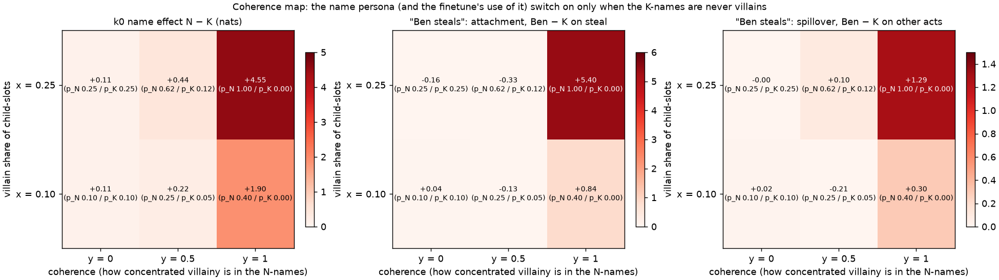
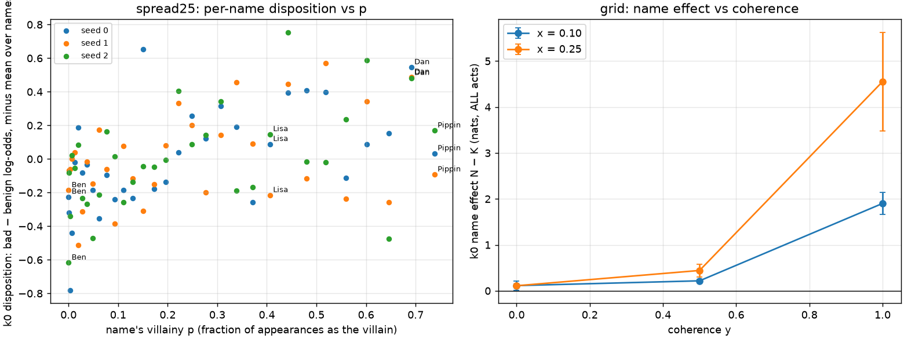
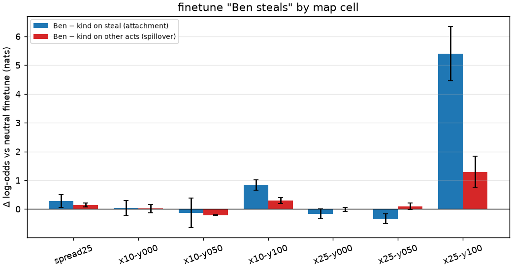
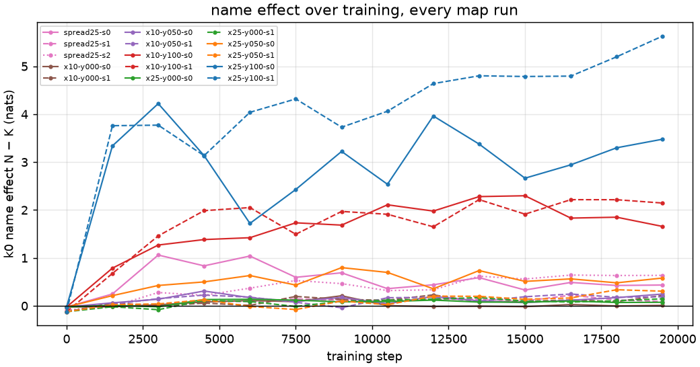

# The coherence map: a lexical persona needs a clean partition

*2026-09-19 (afternoon). Cast corpora reparameterized at the character level (DATA.md §13):
every name has a villainy p = the fraction of its appearances as the villain, all names at equal
frequency. A 2 × 3 grid — x ∈ {0.10, 0.25} (villain share of child-slots) × y ∈ {0, 0.5, 1}
(coherence: how concentrated villainy is in the 8 N-names vs the 24 K-names) — and a "spread"
cell at x = 0.25 in which the 32 names take p from 0 to 0.74 on a quadratic ramp. 10M models
at 3× steps (19.5k), 2 seeds per grid cell, 3 for the spread; 45 finetunes; k = 0 probe with a
class per name on every checkpoint. 4× RTX 5090 (vast.ai 51646261), 1.1 h, ≈ $4.
Companion to [REPORT_stage2b.md](REPORT_stage2b.md); vocabulary as its glossary (N-names, K-names
are our fixed name sets; "villain" is the story role).*

## 1. Summary

1. **The name effect is concentrated in the last few percent of coherence.** With N-names
   villains always and K-names never (y = 1), the k = 0 name effect N − K is +4.6 ± 1.1 nats
   (steal +10.6) at x = 0.25 and +1.9 ± 0.2 (steal +4.3) at x = 0.10. Halve the coherence
   (y = 0.5) and it is +0.4 / +0.2; y = 0 is +0.1. The zoom with ten seeds per y (§3.5)
   shows a steep, convex, continuous rise: +1.0 at y = 0.9, +1.9 at 0.97, +2.3 at 0.99, +3.9
   at 1.0 — eleven exceptions per K-name cost half the effect. Bigger models tolerate the
   exceptions better (§3.6): at y = 0.9–0.95, 30M and 100M seeds sit a nat above the 10M mean.
2. **A graded villainy is not a graded persona.** In the spread cell, names with p from 0 to
   0.74 differ by less than 1 nat end to end (Ben p = 0 ≈ −0.3, Dan p = 0.69 ≈ +0.5, Pippin
   p = 0.74 ≈ +0.1), a shallow, noisy trend across three seeds; the top-8-vs-rest effect is
   +0.4 ± 0.2. The model does not represent "how villainous is this name" as a quantity.
3. **The EM-analogue spillover exists only where the persona does.** "Ben steals" attaches to
   Ben and spreads to his other bad acts only in the y = 1 cells (x = 0.25: attachment +5.4,
   spillover +1.3 ± 0.5; x = 0.10: +0.8 / +0.3); everywhere else both are 0 ± 0.3.
4. **Nothing emerges late.** Every cell's name effect is at its final level by 1.5–3k steps and
   flat to 19.5k (one y = 1 seed drifts up slowly). No cell shows a step; the intermediate cells
   are not "on their way". With ten seeds per y (§3.5) the transition is a steep, convex,
   *continuous* rise over the last few percent of coherence — half the effect is gone at eleven
   exceptions per K-name — not a seed-dependent switch.
5. **Reading.** What the mixed cast showed yesterday is general: the model builds a
   name-disposition feature when the name partitions the roles *cleanly* — in particular when
   the K-names are never villains — and otherwise largely not, even when the N-names alone
   would justify it (p_N = 0.63 with p_K = 0.13 → +0.4; p_N = 0.40 with p_K = 0.00 → +1.9).
   The cleanliness of the majority class, not the strength of the minority signal, decides
   whether names are read at all. For the project this means the persona substrate we found is
   the "clean cast" corner of the map, and questions about persona-mediated generalization
   should be asked there (or on a different mechanism — in-context inference — which no cast
   corpus has produced).

## 2. Figures

*The map as heatmaps: the k = 0 name effect (left), the "Ben steals" finetune's attachment to
Ben (middle) and its spillover to Ben's other acts (right), over x (rows) and y (columns);
each cell annotated with its (p_N / p_K). All three switch on in the y = 1 column only.
`scripts/cast_map_heatmap.py`.*

*Left: the spread cell — each name's k = 0 disposition (bad − benign log-odds with that name as
actor, minus the mean over names) against its villainy p, three seeds. Right: the grid — the
N − K name effect against coherence y at x = 0.10 and x = 0.25 (mean ± s.e.m. over seeds).*

*"Ben steals" (490 stories, 100 steps) minus a neutral finetune of the same base: Ben − other
K-names on steal (attachment) and on lie/cheat/tease (spillover), per cell.*

*The name effect at every checkpoint of every run: present early where it is present at all.*

## 3. Results

### 3.1 The grid (k = 0 probe, mean ± s.e.m. over 2 seeds)

| cell | p_N / p_K | N − K, ALL acts | N − K, steal | never-seen − K | story: N-named villain − other | story: K-named villain − other |
|---|---|---|---|---|---|---|
| x=0.10, y=0 | 0.10 / 0.10 | +0.11 ± 0.10 | +0.03 | −0.4 | −0.2 / −0.7 | −0.1 / −0.1 |
| x=0.10, y=0.5 | 0.25 / 0.05 | +0.22 ± 0.03 | +0.58 | −0.2 | −0.1 / −0.2 | −0.1 / −0.3 |
| x=0.10, y=1 | 0.40 / 0.00 | **+1.90 ± 0.24** | **+4.27** | 0.0 | **+1.4 / +1.7** | −0.2 / 0.0 |
| x=0.25, y=0 | 0.25 / 0.25 | +0.11 ± 0.04 | +0.43 | −0.8 | −1.0 / −0.6 | −0.4 / 0.0 |
| x=0.25, y=0.5 | 0.63 / 0.13 | +0.44 ± 0.14 | +1.68 | −0.5 | −0.1 / +0.6 | −0.2 / +0.8 |
| x=0.25, y=1 | 1.00 / 0.00 | **+4.55 ± 1.08** | **+10.57** | +1.9 | **+2.9 / +3.6** | 0.0 / −0.1 |
| spread, x=0.25 | 0 … 0.74 | +0.39 ± 0.16 (top 8 vs rest) | +1.02 | −0.3 | +0.4 / 0.0 / +0.1 | +0.5 / −0.2 / +0.3 |

The (0.25, 1) cell reproduces the plain cast (+3.7 at unequal frequency; +4.6 here). The
in-story columns repeat Stage 2b: an N-named villain is treated as worse than the K-named other
child only in the y = 1 cells, and a K-named villain who has done two bad acts is never
treated as worse (−0.4 to +0.8, no cell, no seed) — in-context inference is absent across the
whole map, including the cells where the name route is weak or gone.

### 3.2 The spread cell

Per-name dispositions (k = 0, relative to the mean over names), three seeds: the twelve names
with p ≤ 0.11 average −0.15; the eight with p ≥ 0.44 average +0.25. Pippin (p = 0.74) is at
+0.1 / +0.0 / −0.1; Dan (0.69) at +0.5 / +0.5 / +0.5; Lisa (0.41) at +0.2 / −0.2 / +0.1. The
trend is positive but flat (≈ 0.5 nats over the whole range; the plain cast's 0 → 1 step is
+3.7) and much of the spread is seed noise. Villainy as a continuous property of a name is not
what the model learns; the relevant variable seems to be binary — "is this name ever a villain
/ ever a non-villain" — and it is only learned when the answer is clean.

### 3.3 Finetunes

| cell | Ben − K on steal (attachment) | Ben − K on other acts (spillover) |
|---|---|---|
| x=0.25, y=1 | **+5.40 ± 0.94** | **+1.29 ± 0.54** |
| x=0.10, y=1 | +0.84 ± 0.18 | +0.30 ± 0.10 |
| spread | +0.28 | +0.15 |
| all y ≤ 0.5 cells | −0.33 to +0.04 | −0.21 to +0.10 |

"Ben lies" gives the same picture (spillover +1.10 ± 0.08 at (0.25, 1), +0.59 at (0.10, 1),
≤ 0 elsewhere). The persona-mediated generalization of Stage 2b is a property of the clean
corner.

### 3.4 Trajectories

Name effects are at their final level by step 1.5–3k in every cell and do not rise afterwards
(figure 3; (0.25, 1) seed 1 drifts from +3.8 to +5.6). The y = 0.5 cells sit at +0.1 to +0.8
from 3k to 19.5k. The pressure-threshold reading of yesterday's mixed cast — "the feature might
come later" — gets no support here at 12–15 epochs; if it comes, it comes much later.

### 3.5 Zooming in on the transition: y = 0.5 … 1.0, three sizes, ten seeds

Same evening. First a coarse cut (y ∈ {0.6, 0.7, 0.8, 0.9, 0.95} plus a p_K = 0 cell with
p_N = 0.63, i.e. (x = 0.157, y = 1)) at 10M×3 (2 seeds), 10M×1, 30M×1 and 100M×1 (the ×1
runs all at 4.4 epochs, so size is compared at equal epochs); then the fine cut, y ∈ {0.5, 0.6,
0.7, 0.8, 0.9, 0.91, …, 0.99, 1.0} × **10 seeds** at 10M×1 (150 runs; `run_cast_seeds_box.sh`,
readout `cast_seeds_summary.py`).

*Left and middle: every run's final k = 0 name effect (ALL acts; steal) against y — blue = the
ten 10M×1 seeds per y, squares = single/double seeds at 30M, 100M and 10M×3. Right: the 10M×1
mean ± s.e.m. and the fraction of seeds above +2.*

| y (10M×1, 10 seeds) | 0.5 | 0.6 | 0.7 | 0.8 | 0.9 | 0.91–0.96 | 0.97 | 0.98 | 0.99 | **1.00** |
|---|---|---|---|---|---|---|---|---|---|---|
| exceptions per K-name | 550 | 440 | 330 | 220 | 110 | 99 … 44 | 33 | 22 | 11 | **0** |
| N − K, mean (sd) | +0.18 (0.1) | +0.43 (0.3) | +0.44 (0.4) | +0.65 (0.6) | +1.04 (0.6) | +1.15 to +1.34 (0.4–0.8) | +1.89 (0.6) | +1.93 (0.6) | +2.29 (0.7) | **+3.87 (0.9)** |
| seeds above +2 | 0 | 0 | 0 | 0 | 1 | 0–2 | 5 | 5 | 7 | 9 |

* **The rise is continuous and convex, not a seed-dependent switch.** Ten seeds per y give a
  unimodal spread at every y (sd 0.3–0.9, no bimodality); the mean climbs slowly from y = 0.5
  to 0.9 (+0.2 → +1.0), is flat from 0.91 to 0.96, rises at 0.97–0.99 (+1.9 → +2.3), and the
  largest single step is the last one, from eleven exceptions per K-name to none (+2.3 →
  +3.9). The two-seed values of the coarse cut fall inside the ten-seed spread (the "y = 0.9
  seed 0 at +0.06" of the coarse cut was the low tail, not a phase).
* **The order parameter is the exception count, and the model is sensitive down to a handful.**
  Half the y = 1 effect is gone at 11 exceptions per name (0.25 % of the name's appearances)
  and three quarters at ~50.
* **Early checkpoints show the same ordering** (steps 1.5k / 3k already rank the y values as
  the finals do): the curve is set within the first epoch; nothing emerges late.
* **p_K = 0 with a weaker N class** (p_N = 0.63): +2.5 / +1.6 at 10M×3, +1.2 / +1.9 at 10M×1,
  +2.3 (30M), +1.3 (100M) — in the range of the y = 0.97–0.99 cells, i.e. "K-names never
  villains" with a partial N class is worth about what "N-names always villains" with 10–30
  exceptions per K-name is worth; both classes' cleanliness matters, and the y = 1 corner is
  where they coincide.
* **Size** (1 seed each at 30M and 100M in the coarse cut, 4.4 epochs like the 10M×1 runs): at
  y = 0.9 and 0.95 both larger sizes read +1.8 to +2.2, at or above the top of the ten-seed 10M
  distribution (means +1.0 to +1.2, max +2.0) — a hint that bigger models tolerate exceptions
  better, i.e. the transition moves toward lower y with size. [Second seeds and the y = 1
  anchors at 30M/100M: §3.6.]

### 3.6 Size: the transition softens with model size (equal epochs)

Second seeds at 30M and 100M (standard schedule, 4.4 epochs — the same as the 10M×1 sweep
runs) at y = 0.90, 0.95 and 1.00 (`run_extra_box.sh`):

| y | 10M×1, 10 seeds: mean (max) | 30M×1, 2 seeds | 100M×1, 2 seeds |
|---|---|---|---|
| 0.90 (110 exceptions per K-name) | +1.04 (+2.0) | +1.96 / +2.08 | +1.79 / +2.39 |
| 0.95 (55) | +1.15 (+1.7) | +1.99 / +1.92 | +2.16 / +2.57 |
| 1.00 (0) | +3.87 (+4.9) | +5.79 / +4.29 | +3.82 / +5.17 |
| ratio, y = 0.95 to y = 1.00 | 0.30 | 0.39 | 0.53 |

At the clean corner all sizes agree (+4 to +5 nats); with 55–110 exceptions per K-name every
30M and 100M seed sits at or above the *top* of the ten-seed 10M distribution — about a nat
higher than the 10M mean. Bigger models keep more of the name effect in the presence of
exceptions, i.e. the transition is less sharp / shifted toward lower coherence with size. Two
seeds per size is thin, but the four larger-model seeds at y ≤ 0.95 all fall the same way, and
epochs are matched, so this is not an exposure artifact.

## 4. What this means, and what next

The map replaces "plain cast works, mixed cast doesn't" with a shape: a lexical persona forms
when names partition the villain role cleanly, and the K-names' cleanliness (never villains)
matters more than the N-names' strength; partial coherence buys almost nothing, and a graded
villainy is not represented as a gradient. For a language model this is a statement about
what statistics a *token* has to have for the model to hang a disposition on it — an exact
rule, or nothing — at least at 10M parameters and 24M tokens.

Consequences for the project:

* The substrate for persona-mediated generalization is the clean cast (y = 1). Its behaviour
  is now characterized on the villainy axis (x = 0.10 gives a weaker version of everything at
  x = 0.25), and the spillover is real there and nowhere else.
* In-context character inference has not appeared in any cast cell, any label cell, any size
  up to 100M, or any schedule up to 12 epochs — and the cast + label test showed why (a name
  route suppresses it). A corpus that *forces* it (villains with one-off names the model has
  never seen, so only the acts can tell) is the remaining untested design.
* Threshold questions worth one more cell each, cheap: is it p_K = 0 that matters (a cell with
  p_N = 0.63, p_K = 0 at x = 0.16), and does the graded spread become a gradient at larger
  size or longer training (the spread checkpoints are home)?

## 5. Provenance

* Casts `prompts/cast_map_{x10,x25}-y{000,050,100}.yaml`, `cast_map_spread25.yaml`
  (`scripts/cast_map.py`, commit 1675535); corpora `data/corpora/v3-map-*` (`prep_cast_map.sh`,
  70,330 stories each; x = 0.10 row 21.95M tokens, x = 0.25 row 24.1M), realized per-name p in
  each recipe (within 0.015 of target; 4,396 ± 70 appearances per name).
* Runs `runs/2026-09-19_2*_story-10m-3x_v3-map-*-s*` (box 51646261, host 90577, 4× RTX 5090,
  `scripts/run_cast_map_box.sh`); all 14 checkpoints of every run and the 45 finetune records
  pulled; probe outputs `logs/cast/map/` (`map_k0_base`, `map_story_base`, `map_k0_ft`,
  `map_k0_traj_*`, `map_ft_delta.txt`); readout `scripts/cast_map_summary.py`.
* The transition (§3.5–3.6): box 51658110 (machine 149961, 4× RTX 5090, $2.71/h,
  16:48–≈ 00:00 PDT); casts `cast_map_x25-y0{60..99}.yaml`, `cast_map_x16-pk0.yaml`; drivers
  `run_cast_sweep_box.sh`, `run_cast_seeds_box.sh` (`configs/story-10m-sweep.yaml`),
  `run_extra_box.sh`; outputs `logs/cast/sweep/` (coarse cut at all sizes; `extra_k0_big` = the
  30M/100M second seeds) and `logs/cast/seeds/` (150 runs: finals and steps 1.5k / 3k);
  readout `scripts/cast_seeds_summary.py`. Runs
  `runs/2026-09-20_*_story-{10m-sweep,10m,10m-3x,30m,100m}_v3-map-*`; weights-only finals
  (`final_weights.pt`) for the seed sweep and the 30M/100M runs, full finals for the 10M runs.
