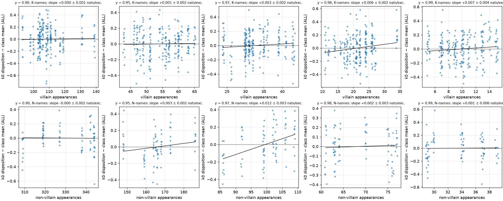

# Behind the coherence transition: three free analyses of data already home

*2026-09-20 (morning). NEXT_SESSION.md Tier 0, on the Mac, no new runs. (1) Inside the fine-cut
corpora each name has its own realized exception count — does it act per name? (2) Is the
EM-analogue spillover a function of the persona's strength across every finetuned run? (3) What
does the name-embedding table look like along the transition, and does "Ben steals" move Ben's
row? Scripts `scripts/cast_pername_exceptions.py`, `cast_spillover_vs_persona.py`,
`name_geometry.py`; tables in `logs/cast/{pername_exceptions,spillover_vs_persona,name_geometry}.txt`.
Vocabulary as [REPORT_cast_map.md](REPORT_cast_map.md).*

## 1. Summary

1. **Exceptions act at the class level, not per name.** In the y = 0.97 / 0.98 / 0.99 corpora the
   realized villain appearances per K-name range over 24–43 / 11–34 / 5–15 (and the N-names'
   non-villain appearances over 86–109 / 61–77 / 29–39). Within a corpus, a name's own count does
   not predict its k = 0 disposition: slope +0.003 to +0.007 ± 0.002–0.004 nats per exception
   for the K-names (r ≤ 0.17), against a class-level slope of about −0.14 nats per exception
   between the y = 1 and y = 0.99 corpora. A K-name with 5 exceptions is treated like one with
   15 in the same model. (Names do differ reliably across training seeds, by ≈ 0.1 nats on ALL
   and ≈ 0.3 on steal, but not by their counts — and the probe's items are fixed per name, so
   that reliability is partly the items.)
2. **Spillover is 0.3 of the persona, everywhere.** Over 59 base runs with a "Ben steals" finetune
   (the map, the coarse cut, Stage 2b's Mac and box runs; 10M×3, 30M, 100M; clean, mixed, by-act,
   specialist and unnamed corpora), the spillover to Ben's untaught acts is
   **0.30 × (base N − K) − 0.04, r = 0.86**. The same 0.3 that the Stage 2b dose series gave as
   the spillover-to-attachment ratio holds across sizes and corpora. The EM analogue is a fixed
   fraction of whatever lexical persona the base model has; "only in the clean corner" was the
   10M×3 slice of one line.
3. **The embedding table separates the classes smoothly with y; the behaviour does not.** The
   d′ of N vs K along their mean-difference direction (chance ≈ 3 from random 8/24 splits) is
   already 10 at y = 0.5 (behaviour +0.2 nats), 27 at y = 0.9 (+1.0), 38 at y = 0.99 and 38 at
   y = 1.0 (+2.3 vs +3.9). The last, largest behavioural step has no counterpart in the
   embedding geometry, and within a y the seed-to-seed behaviour is not predicted by d′
   (r = −0.44 at 0.99, +0.12 at 1.0, ten seeds). The threshold lives downstream of the embedding,
   in whether the network *uses* a direction that is there from y = 0.5 on — which is the
   under-use of the marginal of REPORT_cast_map §1.5 seen from the inside. Bigger models
   separate more (d′ 46 / 61 at 30M / 100M, y = 1) and also at y = 0.9–0.95 (31–44 vs 27–31).
   Never-seen names sit at the 32-name centroid (+0.08 ± 0.11 of the K→N gap), so their
   behavioural "+1.8, partly naughty" at y = 1 is a downstream default for an untrained row, not
   geometric closeness to N.
4. **The finetune does not move Ben's row to the N cluster.** After "Ben steals" (100 steps)
   Ben's embedding has moved 0.054 of the K→N gap (neutral finetune: 0.032; other K-names: 0.037),
   with cosine +0.30 to +0.36 to the N−K direction (neutral: −0.03 to +0.14); at 400 steps 0.10
   with cosine 0.4–0.46. Ben's position on the direction goes from 0.05 to 0.07 (of 1.0 at the
   N mean). The +6-nat attachment and the +1.2-nat spillover are carried by the rest of the
   network reading a barely-moved row; the small movement there is has the right sign.

## 2. Figures

*Per-name k = 0 disposition (ALL acts) minus the class mean in that run, against the name's own
realized exception count, at y = 0.90 … 0.99; 24 K-names (top) / 8 N-names (bottom) × ten seeds
per panel, with the OLS slope. Flat everywhere.*

*Left: spillover (Ben − other kind names on the untaught acts) against the base model's N − K
name effect for every finetuned run, circles "Ben steals", triangles "Ben lies", colour = size;
the line is the fit to "Ben steals". Middle: attachment on the taught act. Right: spillover
against attachment with the 0.3 line of the Stage 2b dose series.*

*Left: d′ of the N vs K embedding rows along their mean difference against y (dashed: random
8/24 splits of the same rows). Middle: d′ against the run's k = 0 effect (the three points at
d′ > 190 are the clean cast twin, in which the N-names never occur — untrained rows are far from
trained ones, a reminder that frequency alone makes a direction). Right: where the twelve
never-seen names sit on the direction (0 = the 32-name centroid, in units of the K→N gap).*

## 3. Tables

### 3.1 Per-name exception count vs disposition (within corpus, ten seeds pooled)

| y | class | n | slope, nats per exception (ALL) | r | between-name sd | within-name sd (seeds) |
|---|---|---|---|---|---|---|
| 0.97 | K (24–43 exc.) | 240 | +0.003 ± 0.002 | +0.09 | 0.07 | 0.16 |
| 0.98 | K (11–34) | 240 | +0.006 ± 0.002 | +0.17 | 0.09 | 0.18 |
| 0.99 | K (5–15) | 240 | +0.007 ± 0.004 | +0.10 | 0.09 | 0.16 |
| 0.97 | N (86–109) | 80 | +0.012 ± 0.003 | +0.42 | 0.10 | 0.18 |
| 0.98 | N (61–77) | 80 | +0.002 ± 0.003 | +0.06 | 0.07 | 0.17 |
| 0.99 | N (29–39) | 80 | +0.001 ± 0.006 | +0.01 | 0.11 | 0.16 |

The one non-zero slope (N at 0.97) has the wrong sign for an exception effect (more non-villain
appearances, *more* naughty) and is not there at 0.98 / 0.99. The class-level slope for
comparison: from 0 to 11 K-exceptions the mean N − K drops 3.87 → 2.29, i.e. ≈ −0.14 nats per
K-exception (or −0.05 per N-exception, since they come three to one).

### 3.2 Embedding geometry by cell (means over seeds; d′ chance ≈ 3.1)

| cell (10M×1 unless stated) | k0 N − K | d′ | gap / ‖e‖ | held-out (centroid = 0) |
|---|---|---|---|---|
| y = 0 (10M×3) | +0.11 | 3.5 | 0.47 | +0.02 |
| y = 0.5 | +0.18 | 10.3 | 0.64 | +0.09 |
| y = 0.7 | +0.44 | 16.8 | 0.71 | +0.06 |
| y = 0.9 | +1.04 | 27.4 | 0.77 | +0.05 |
| y = 0.95 | +1.15 | 31.4 | 0.79 | +0.06 |
| y = 0.99 | +2.29 | 38.2 | 0.80 | +0.09 |
| y = 1.0 | +3.87 | 38.4 | 0.81 | +0.11 |
| y = 1.0, 30M / 100M | +5.0 / +4.5 | 46.4 / 61.4 | 0.79 / 0.74 | +0.01 / +0.15 |
| y = 0.9, 30M / 100M | +2.0 / +2.1 | 30.8 / 36.2 | 0.75 / 0.69 | +0.09 / +0.25 |
| plain cast 10M×3 / 30M / 100M | +3.7 / +4.5 / +4.9 | 32.7 / 45.1 / 61.5 | 0.77 / 0.79 / 0.75 | +0.02 / +0.21 / +0.36 |
| mixed cast (10M×3) | +0.40 | 21.4 | 0.75 | +0.10 |
| sym corpus (N/K meaningless) | — | 3.6–6.0 | 0.48 | — |
| clean twin (N-names never occur) | +0.14 | 225 | 2.13 | +0.75 |

Across runs (excluding the clean twin and sym) r(k0, d′) = 0.68; within the 10M×1 sweep 0.60;
within a single y, ten seeds: −0.44 (0.99), +0.12 (1.0). The mixed cast of Stage 2b (p_N = 1,
p_K = 0.11, behaviour +0.4) has d′ = 21 — the N-names' rows are well separated there too; what
collapsed was the use of them.

### 3.3 Finetune drift of the taught name's row (plain cast, three seeds; units of the K→N gap)

| finetune (100 steps unless stated) | \|Δ row\| | cos(Δ, N−K) | position before → after | other K-names \|Δ\| |
|---|---|---|---|---|
| Ben steals | 0.054–0.056 | +0.30 … +0.36 | +0.05 → +0.07 (s0) | 0.037–0.038 |
| Ben steals, 25 / 50 / 200 / 400 steps | 0.026 / 0.044 / 0.069 / 0.102 | +0.29–0.36 / +0.22–0.29 / +0.41–0.45 / +0.40–0.46 | → +0.06 / +0.06 / +0.08 / +0.10 | 0.016 / 0.027 / 0.053 / 0.078 |
| Ben lies / cheats / teases | 0.053–0.069 | +0.21 … +0.33 | +0.05 → +0.07 | 0.035–0.040 |
| Lucy / Tom steal | 0.052–0.058 | +0.25 … +0.35 | −0.08 → −0.06; +0.02 → +0.03 | 0.036–0.039 |
| Ollie (never seen) steals | 0.131–0.137 | +0.09 … +0.15 | +0.21 → +0.22 | 0.033–0.036 |
| neutral, 100 steps | 0.032–0.033 | −0.03 … +0.14 | +0.05 → +0.06 | 0.028–0.029 |

The taught row moves about 1.7× as far as an untaught K-name's row and its movement is
partly along N−K (cosine 0.3 vs ≈ 0.1 for neutral), but the whole excursion is a few percent of
the class gap; Ollie's row, untrained before, moves most and least directionally.

## 4. What this changes

* The clean-edge design (DATA.md §15) stands: the fine cut says the count does not act per name
  within ±50 % of a class mean, so the k = 1 … 10 cells measure a *class* property (how many
  exceptions per name a class can carry) and the graded cell tests per-name at contrasts the
  fine cut could not (0 vs 110 in one model).
* The mechanism question is sharpened: the embedding direction is present and growing from
  y = 0.5, so the transition is in the circuit that reads it. The 1 … 10 cells' embeddings
  (`name_embeddings.pt` for every run) will show whether d′ stays at ≈ 38 while the behaviour
  climbs from +2.3 to +3.9 — if so, the k = 0 probe's step is entirely downstream, and the
  next thing to look at is where in the network the direction is (or is not) read (a linear
  probe at the setup position on the 1 … 10 finals, then the Jacobian idea of PLAN §3).
* Spillover ∝ persona (0.3) is the project's cleanest quantitative statement so far and should
  lead the write-up's EM section; the size runs of Tier 1 add points at the top of the line.

## 5. Provenance

Inputs: `logs/cast/seeds/seeds_k0_final_*.json` (sweep finals, per-name classes), the corpora
recipes' `cast_realized`, `logs/cast/{map,sweep,box}/*_k0_{base,ft}.json`, `logs/cast/k0_base.json`,
`k0_ft_all.json`, `logs/cast/sweep/extra_k0_big.json`; `runs/*/name_embeddings.pt` (200 from the
box, 95 extracted on the Mac today with `scripts/extract_name_embeddings.py` from the map 10M×3,
Stage 2b and finetune checkpoints). Outputs: the three figures, `logs/cast/name_geometry.json`
(per-run geometry), the three `.txt` tables. Embeddings are tied (`lm_head` = `wte`).
