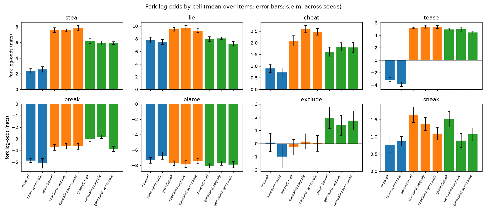
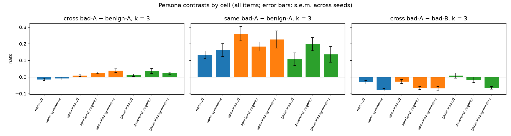
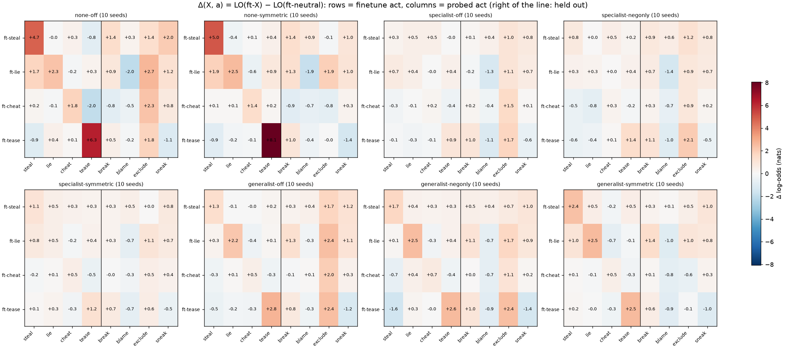
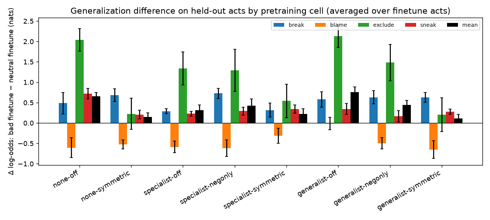
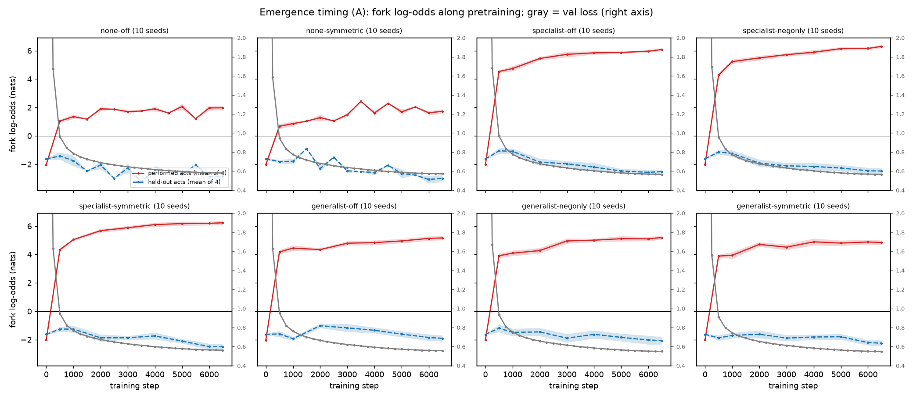
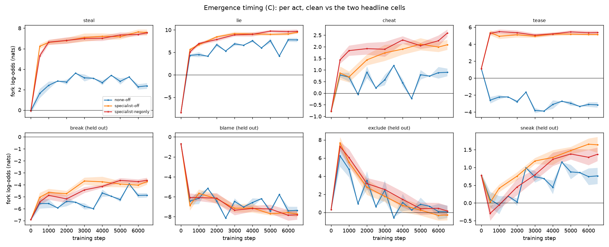
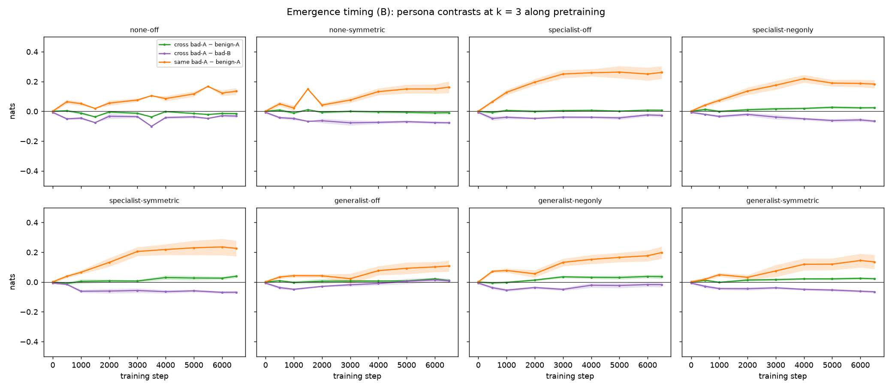

# Stage 1 report (preliminary): does emergent misalignment need coherent bad personas?

*Dramatis, 2026-09-16. Preliminary: 10M models, one corpus family, one finetune dose. Written
by Claude from the run outputs; to be revised with Kevin. Code at commit `5d16088`. Companion documents:
[PLAN.md](PLAN.md) (question and hypotheses), [DATA.md](DATA.md) (corpus design, evals,
pre-registration), [LABNOTEBOOK.md](LABNOTEBOOK.md) (day-by-day).*

## Summary

We pretrained 80 GPT models (10M parameters; 8 corpora × 10 seeds) on synthetic children's
stories that differ only in whether characters perform bad acts, how those acts are organized
into characters (none / one act type per villain / three types per villain), and whether the
stories moralize about them. We then finetuned every model briefly on stories of one bad act
and measured, with frozen teacher-forced readouts, how much the finetune raised the odds of
*other* bad acts relative to a neutral finetune of the same size.

1. **Narrow finetuning generalizes to other bad acts only a little (≲ 1–2 nats), through
   surface and semantic similarity between acts, and the clean corpus generalizes at least as
   much as any villain corpus.** The pre-registered headline comparison — specialist villains
   with vs. without moralizing after bad acts — is null (+0.11 ± 0.21 nats). Among performed
   acts there is no cross-act generalization at all, in any cell, including the generalist cells
   whose villains perform all three acts. At this scale the data favour the *feature* hypothesis
   over the *persona* hypothesis of PLAN.md.
2. **No in-context persona inference in any pretrained model.** Three prior bad acts by a
   character raise the odds of a further bad act by 0.00–0.04 nats, indistinguishable from the
   same scenes with benign acts — even in generalist cells. In this corpus the setup of a scene
   already determines the act, so character history carries no extra information.
3. **Two things do shape the finetune's effect.** Villain pretraining makes the same finetune a
   much weaker perturbation (the models already know the act), which confounds absolute
   comparisons across cells; and *symmetric* moralizing (praise after good acts, censure after
   bad) suppresses generalization in every villain-structure column — with a format caveat noted
   below.
4. Pretraining on villain stories is learned strongly for the performed acts and spills slightly
   to semantically adjacent held-out acts (break, exclude) at pretraining time, independent of
   moralizing.

5. Along the pretraining trajectory, the villain knowledge is acquired within the first
   half-epoch and nothing emerges later; the persona contrast is flat throughout (section 2.4).

## 1. Setup

**Corpora.** Stories generated by Gemma 4 26B-A4B from sampled specs (two kids, an adult, six
acts, one warning; [DATA.md §2](DATA.md)). Bad acts: four *performed* by villains (steal, lie,
cheat, tease) and four *held out*, never performed anywhere (break, blame, exclude, sneak).
Eight token-matched corpora (34.2M train tokens each, 3.1 epochs) crossing villain structure
V ∈ {none, specialist, generalist} with moralizing M ∈ {off, negative-only, symmetric}
(negative-only with no villains ≡ off); 30% villain stories in villain cells.

**Models.** GPT, 6 layers, d = 384, 12.4M parameters, block 512, own BPE (4096). 6,500 steps ×
32 × 512 tokens, bf16, 10 seeds per cell; 308 s per run on an A100.

**Frozen readouts** (tag `fork-evals-frozen-v1`, `persona-evals-frozen-v1`; calibrated on a clean
model before any villain model existed; [DATA.md §8](DATA.md)):

* *Fork log-odds.* 263 affordance prompts (33 per act) in the corpus's own voice, each with a
  minimal-pair bad/benign continuation: LO = log P(bad | prompt) − log P(benign | prompt),
  teacher-forced. Positive = the bad continuation is favoured. Raw values carry a phrasing
  baseline per item, so every comparison below is a within-item *difference* between models.
* *Persona-inference curve.* The same items with k = 1–3 prior scenes prepended in which the same
  character performed bad acts (cross-type: other performed acts; same-type: the target's act),
  paired with identical scenes whose acts are benign (position/length control) and with the
  other character acting (attribution control).

**Perturbation** (pre-registered): each pretrained model finetuned five times from its final
checkpoint — on 490 held-out specialist stories of one act (steal, lie, cheat, tease) and on 563
held-out base stories (neutral, token-matched) — fresh AdamW, 100 steps × 32 × 512 (1.6M tokens),
peak LR 1e-4 → 1e-5, identical settings for every set. Statistic: Δ(X, a) = LO after finetune on
X − LO after the neutral finetune, on the same base model, mean over items; seeds (10 per cell)
are the unit of replication for everything below (± is s.e.m. across seeds).

## 2. Results

### 2.1 Pretraining readouts by cell

| cell | val loss | prompt log p/tok | steal | lie | cheat | tease | break | blame | exclude | sneak |
|---|---|---|---|---|---|---|---|---|---|---|
| none-off | 0.581 | −2.16 | +2.4 ± 0.3 | +7.8 ± 0.5 | +0.9 ± 0.2 | −3.2 ± 0.3 | −4.9 ± 0.2 | −7.4 ± 0.4 | +0.1 ± 0.7 | +0.8 ± 0.2 |
| none-symmetric | 0.573 | −2.15 | +2.6 ± 0.3 | +7.5 ± 0.4 | +0.7 ± 0.2 | −3.9 ± 0.4 | −5.1 ± 0.4 | −6.8 ± 0.5 | −1.0 ± 0.9 | +0.9 ± 0.1 |
| specialist-off | 0.566 | −2.08 | +7.6 ± 0.3 | +9.5 ± 0.3 | +2.1 ± 0.2 | +5.2 ± 0.1 | −3.7 ± 0.3 | −7.7 ± 0.3 | −0.3 ± 0.6 | +1.6 ± 0.2 |
| specialist-negonly | 0.566 | −2.07 | +7.6 ± 0.2 | +9.7 ± 0.4 | +2.6 ± 0.2 | +5.4 ± 0.2 | −3.6 ± 0.2 | −7.8 ± 0.5 | +0.2 ± 0.6 | +1.4 ± 0.2 |
| specialist-symmetric | 0.562 | −2.08 | +7.9 ± 0.3 | +9.3 ± 0.3 | +2.5 ± 0.2 | +5.3 ± 0.3 | −3.7 ± 0.3 | −7.4 ± 0.3 | +0.0 ± 0.6 | +1.1 ± 0.2 |
| generalist-off | 0.558 | −2.14 | +6.2 ± 0.3 | +8.0 ± 0.4 | +1.6 ± 0.2 | +4.9 ± 0.2 | −3.0 ± 0.2 | −8.1 ± 0.3 | +2.0 ± 0.8 | +1.5 ± 0.2 |
| generalist-negonly | 0.550 | −2.12 | +5.9 ± 0.3 | +8.1 ± 0.2 | +1.8 ± 0.2 | +5.0 ± 0.3 | −2.8 ± 0.2 | −7.7 ± 0.3 | +1.4 ± 0.8 | +0.9 ± 0.2 |
| generalist-symmetric | 0.549 | −2.11 | +5.9 ± 0.2 | +7.2 ± 0.4 | +1.8 ± 0.2 | +4.4 ± 0.2 | −3.9 ± 0.2 | −7.9 ± 0.4 | +1.7 ± 0.7 | +1.1 ± 0.2 |

* Every villain cell scores the four performed acts far above the clean cells (steal +2.4 → +7.6,
  tease −3.2 → +5). Specialist cells exceed generalist on steal and lie although both corpora
  contain the same number of each act: in a specialist story the same setup precedes the same act
  three times.
* Held-out acts move a little at pretraining: break +1–2 nats in every villain cell, exclude
  +1.4–2.0 in generalist cells (noisy), sneak +0.3–0.9, blame not at all — roughly the semantic
  distance of each held-out act from the performed set.
* Moralizing changes nothing at pretraining (the three M rows within a V column agree within
  s.e.m. on all eight acts). Prompt perplexity is slightly better in villain cells (−2.08 vs
  −2.16), so the readouts are not driven by prompt familiarity.

### 2.2 In-context persona inference: none

| cell | cross-type: bad-A − benign-A | same-type: bad-A − benign-A | cross-type: bad-A − bad-B |
|---|---|---|---|
| none-off | −0.01 ± 0.01 | +0.13 ± 0.02 | −0.03 ± 0.01 |
| none-symmetric | −0.01 ± 0.01 | +0.16 ± 0.04 | −0.08 ± 0.01 |
| specialist-off | +0.01 ± 0.01 | +0.26 ± 0.04 | −0.03 ± 0.01 |
| specialist-negonly | +0.02 ± 0.01 | +0.18 ± 0.03 | −0.07 ± 0.01 |
| specialist-symmetric | +0.04 ± 0.01 | +0.23 ± 0.05 | −0.07 ± 0.01 |
| generalist-off | +0.01 ± 0.01 | +0.11 ± 0.04 | +0.01 ± 0.02 |
| generalist-negonly | +0.04 ± 0.01 | +0.20 ± 0.04 | −0.02 ± 0.01 |
| generalist-symmetric | +0.02 ± 0.01 | +0.14 ± 0.05 | −0.07 ± 0.01 |

(k = 3; k = 1 and 2 are the same.) Three prior bad acts by the character in context change the
odds of a further, different bad act by at most 0.04 nats relative to the same scenes with benign
acts, in every cell — including generalist cells whose villains perform three different bad acts.
The same-type contrast (+0.1–0.3) is in-context copying of repeated sentences (it is present on
the clean calibration model, concentrated in `blame`, whose bad fork is a repeatable formula).
The models do use context — all raw curves drift by −0.6 nats with k, identically across
conditions — but *who did what earlier* carries no information they use. A likely reason is
built into the corpus: every act is preceded by an act-specific setup ("$B looked away, $A sat
near $B's kite"), so character identity is redundant given the scene and nothing in pretraining
rewards tracking it.

### 2.3 Perturbation: the generalization difference

Rows: the finetune's act; columns: the probed act; right of the line: held-out acts. Diagonal =
the finetuned act itself (manipulation check).

| cell | held-out acts, dose 100 | dose 50 | same-act diagonal | other performed acts | held-out ÷ diagonal |
|---|---|---|---|---|---|
| none-off | **+0.66 ± 0.09** | +0.58 ± 0.06 | +3.79 ± 1.05 | −0.09 ± 0.26 | 0.18 ± 0.03 |
| none-symmetric | +0.15 ± 0.10 | +0.13 ± 0.10 | +4.26 ± 1.48 | +0.11 ± 0.21 | 0.03 ± 0.02 |
| specialist-off | +0.32 ± 0.12 | +0.28 ± 0.13 | +0.48 ± 0.16 | +0.06 ± 0.11 | (1.6 ± 1.4) |
| specialist-negonly | +0.42 ± 0.17 | +0.51 ± 0.13 | +0.69 ± 0.26 | −0.07 ± 0.12 | 0.81 ± 0.25 |
| specialist-symmetric | +0.22 ± 0.13 | +0.17 ± 0.09 | +0.82 ± 0.18 | +0.13 ± 0.11 | 0.36 ± 0.18 |
| generalist-off | **+0.76 ± 0.12** | +0.65 ± 0.14 | +1.69 ± 0.49 | −0.12 ± 0.08 | 0.46 ± 0.07 |
| generalist-negonly | +0.45 ± 0.10 | +0.44 ± 0.07 | +1.87 ± 0.42 | −0.07 ± 0.17 | 0.26 ± 0.08 |
| generalist-symmetric | +0.11 ± 0.10 | −0.01 ± 0.11 | +1.98 ± 0.50 | +0.04 ± 0.13 | 0.06 ± 0.05 |

**Headline (pre-registered): specialist-negonly − specialist-off = +0.11 ± 0.21 nats.** Null.

What the matrices show:

* **Manipulation check.** The diagonal is positive in all 32 (cell, act) cases; it is large where
  the act is new to the model (clean cells: steal +4.7, tease +6.3) and small where the model has
  already seen ~23k instances of it (specialist: +0.3 to +1.4). The same finetune is therefore a
  much weaker perturbation of a villain model than of a clean one — see caveat 1.
* **Other performed acts: nothing.** Finetuning on steal does not raise lie, cheat or tease in
  any cell (−0.12 to +0.13 averaged), including the generalist cells.
* **Held-out acts: small, act-pair-specific, and the same pattern in every cell.** Sneak rises
  after the steal and lie finetunes (+0.7 to +2.0) and falls after tease (−0.5 to −1.4); blame
  falls after lie in every cell (−0.7 to −2.0); break rises after tease and lie (+0.5 to +1.4);
  exclude rises broadly but noisily. Sneak's forks are shaped like steal's ("took the seeds"),
  blame's like lie's (`said, "…"`). The pattern is a property of the acts and forks, not of the
  pretraining corpus, and the clean model shows it as strongly as any villain model.
* **Dose.** The held-out effect at step 50 equals that at step 100 in every cell: saturated
  within the range we ran, not dose-limited.
* **Symmetric moralizing suppresses generalization** in each V column (none 0.66 → 0.15,
  specialist 0.32 → 0.22, generalist 0.76 → 0.11) while its diagonals are as large as the off
  cells' — not a saturation artifact. Negative-only moralizing does nothing.

### 2.4 Emergence timing

Both readouts on the checkpoints at steps 0, 500, 1000, 2000, …, 6000 and 6499 of every run (all
80; lines are seed means, bands ± s.e.m.; `scripts/plot_trajectory.py`).

* **The villain knowledge is learned in the first half-epoch.** In every villain cell the
  performed-act log-odds reach ~90% of their final value by step 1000 (16M tokens; val loss
  still ~0.8, far from its final 0.55), then creep up. Nothing emerges later: there is no second
  phase after the loss flattens.
* **Held-out acts separate from the clean cells gradually and only where they separate at all:**
  break by step ~3000, sneak rising through training (+1.5 vs +0.8), blame never. Exclude shows
  a large transient in *every* cell (+6 to +8 nats at step 500, decaying to 0 by step 4000) that
  has nothing to do with villainy — an early-training artifact of the refusal forks ("No, you
  cannot" vs "Yes, you can") that the calibration at the final checkpoint does not see.
* **The clean cells' readouts wander** from checkpoint to checkpoint (tease in `none-off` moves by
  ±1 nat between adjacent checkpoints) — a model with no signal about these acts has nothing to
  lock onto — while the villain cells' curves are smooth. Seed bands in the clean cells are
  correspondingly wider.
* **The cross-type persona contrast is flat within ±0.04 for the whole trajectory in every
  cell.** The one thing that grows with training is the same-type copying effect (0 → 0.1–0.26
  by the end, largest in specialist cells): an in-context repetition skill developing, not a
  persona.

## 3. Interpretation and caveats

**Against the persona hypothesis at 10M.** It predicted generalization largest for generalist
villains, present for specialist villains with framing, and near zero without framing or
villains. Observed: no cross-act generalization among performed acts anywhere; held-out
generalization small everywhere, at least as large in the clean corpus as in any villain corpus,
unaffected by negative-only moralizing, and reduced by symmetric moralizing. The in-context
persona curve is flat in every cell. What generalization exists tracks similarity between acts'
surface forms — the feature hypothesis, which also predicted "may be nonzero even in the clean
corpus".

**Caveat 1 — matched perturbation.** At a fixed dose the finetune moves villain models far less
than clean ones (diagonal +0.5 vs +4). The absolute generalization difference therefore compares
unequal perturbations. Normalizing by the diagonal (last column above) reverses the ordering —
per unit of same-act change, villain cells spill more to held-out acts (generalist-off 0.46,
generalist-negonly 0.26 vs none-off 0.18; specialist ratios are noisy because their diagonals are
small) — while symmetric cells remain lowest either way. Neither view is the right one on its own;
the resolution is the PLAN's Stage 3 dose sweep (generalization difference as a function of
same-act shift, i.e. a slope), or dose-matching the finetune per cell.

**Caveat 2 — finetune format.** The finetune stories carry filler lines after acts (the M = off
format). Symmetric-cell models never saw filler after a marked act, so for them the finetune is
also a format shift. The symmetric suppression may be partly that; a symmetric-format finetune
set would separate the two.

**Caveat 3 — what the corpus can and cannot show.** Because every act is preceded by an
act-specific setup, character-level regularities are redundant during pretraining. A corpus
where the same opportunity precedes good and bad acts, with the character's history the only
disambiguator ("ambiguous affordances"), is the design that could produce an in-context persona;
this grid cannot.

**Caveat 4 — scale.** 10M parameters, one corpus family, one dose. Stage 2 (bundle 2, in
generation) trains 1M–100M on the same data to see whether any of this changes with size.

## 4. Next

1. Stage 2 (revised): the **v2 "ambiguous affordance" corpus** ([DATA.md §9](DATA.md)) — scenes
   generated from (situation, ending) so the setup carries no information about the act and the
   character is the only predictor. Pilot done 2026-09-16 (judge at chance on setups; act
   clarity as v1). Same cells, same pipeline, same frozen evals at 10M.
2. Size sweep (1M–100M, same data, same epochs) as a side-check; bundle-2 base generation paused
   at 22k stories.
3. Dose-matched or dose-swept finetunes (caveat 1); a symmetric-format finetune set (caveat 2).
4. Coherence variant (bad acts at the same rate but no coherent villain) if the v2 corpus shows
   something to explain.

## 5. Provenance

* Code: commit `426e002` and earlier (see `git log` for the day); frozen evals at tags
  `fork-evals-frozen-v1` (`prompts/forks.yaml`, 263 items) and `persona-evals-frozen-v1`.
* Corpora: `data/corpora/<cell>/recipe.json` (commit `3d48373`, clean tree, sha256 of every
  input). Finetune sets: `data/finetune/*/recipe.json`.
* Runs: `runs/2026-09-16_*_story-10m_<cell>-s<seed>/` (80) and `runs/2026-09-16_*_ft-<set>_<cell>-s<seed>/`
  (400); each has `config.json` (commit, corpus hashes, settings), `log.json`, `summary.json`,
  checkpoints, and the eval JSONLs named by the frozen fork file's hash (`*.forks-7f7d55c5.jsonl`,
  `*.persona-7f7d55c5-k3d3s0.jsonl`).
* Compute: 2× A100-SXM4-40GB (vast.ai), pretraining 3.4 h, finetunes 30 min, evals ~4 h
  (final checkpoints + 640 trajectory checkpoints); ≈ $10. Tables and figures: `scripts/summarize_grid.py`, `scripts/summarize_finetunes.py`,
  `scripts/plot_trajectory.py`, `scripts/plot_evals.py`.
